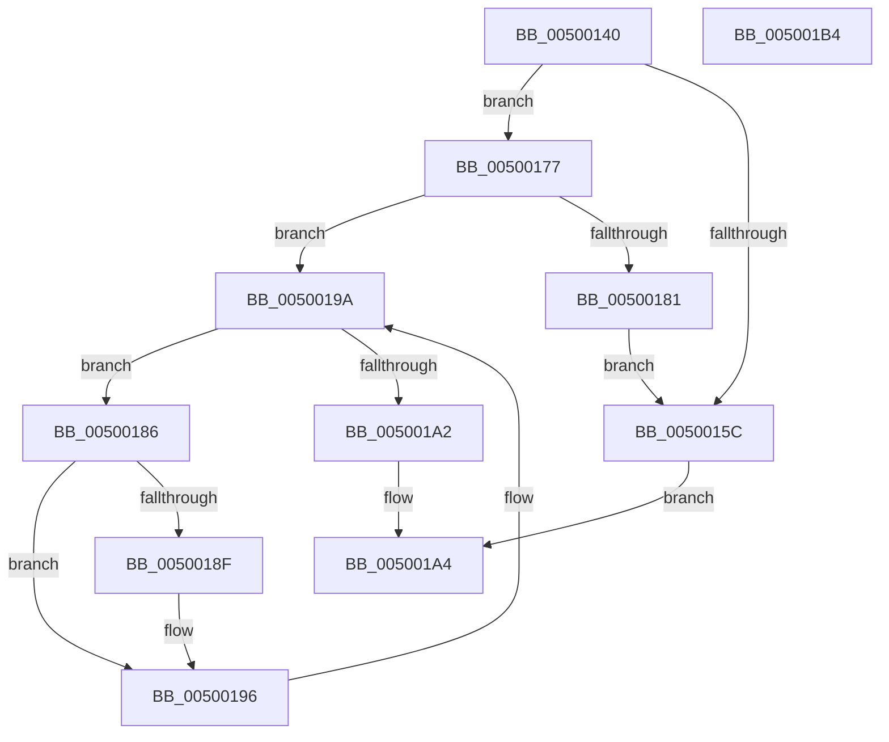

# wcslwr_s

- RVA: `0x00500140`–`0x005001B5` (길이 `117` bytes)
- VA: `0x0000000140500140`
- 실행 섹션: `.text`
- PDB 이름 있음: `예`; PDB Function 태그: `아니요`
- unwind 정보 RVA: `0x000794E0`
- 디코드: `38`개 명령, `117/117` bytes 표시
- 미해석 바이트: `0` (있으면 어셈블리에 `.byte`로 보존)

> 이 문서는 커널 이미지의 기계어와 PDB 기호를 분석해 생성했습니다. 4번과 5번은 함수 원형과 자료형을 바이너리 사용 방식에서 추정한 C 해석이며 원본 소스 복구 결과는 아닙니다.

## 1. Dependencies

- 직접 호출 지점: **2**; 고유 호출 대상: **2**
- 직접 호출자로 확인된 함수: **0**
- RIP 상대 이미지 참조: **0**

### Outgoing calls
- `0x0050016B` → [EmpCheckErrataList](../49/EmpCheckErrataList_function_0049E550.md) (function, `0x0049E550`)
- `0x00500177` → [wcsnlen](wcsnlen_function_00501D60.md) (function, `0x00501D60`)

### Direct callers
- 이 함수 시작 RVA로 연결되는 직접 call은 확인되지 않았습니다. 간접 호출은 완전히 역산할 수 없습니다.

### Static image references
- 디코드된 RIP-relative 메모리 참조가 없습니다.

## 2. Other-region calls and transfers

- 다른 실행 섹션으로 향하는 call: **0**
- 별도 외부 분기/꼬리 이동을 확인하지 못했습니다.

## 3. Assembly (complete function range)

```asm
00500140  48 89 5C 24 08                  mov qword ptr [rsp + 8], rbx
00500145  48 89 74 24 10                  mov qword ptr [rsp + 0x10], rsi
0050014A  57                              push rdi
0050014B  48 83 EC 30                     sub rsp, 0x30
0050014F  33 F6                           xor esi, esi
00500151  48 8B FA                        mov rdi, rdx
00500154  48 8B D9                        mov rbx, rcx
00500157  48 85 C9                        test rcx, rcx
0050015A  75 1B                           jne 0x140500177
0050015C  45 33 C9                        xor r9d, r9d
0050015F  48 89 74 24 20                  mov qword ptr [rsp + 0x20], rsi
00500164  45 33 C0                        xor r8d, r8d
00500167  33 D2                           xor edx, edx
00500169  33 C9                           xor ecx, ecx
0050016B  E8 E0 E3 F9 FF                  call 0x14049e550
00500170  B8 16 00 00 00                  mov eax, 0x16
00500175  EB 2D                           jmp 0x1405001a4
00500177  E8 E4 1B 00 00                  call 0x140501d60
0050017C  48 3B C7                        cmp rax, rdi
0050017F  72 19                           jb 0x14050019a
00500181  66 89 33                        mov word ptr [rbx], si
00500184  EB D6                           jmp 0x14050015c
00500186  8D 41 BF                        lea eax, [rcx - 0x41]
00500189  66 83 F8 19                     cmp ax, 0x19
0050018D  77 07                           ja 0x140500196
0050018F  66 83 C1 20                     add cx, 0x20
00500193  66 89 0B                        mov word ptr [rbx], cx
00500196  48 83 C3 02                     add rbx, 2
0050019A  0F B7 0B                        movzx ecx, word ptr [rbx]
0050019D  66 85 C9                        test cx, cx
005001A0  75 E4                           jne 0x140500186
005001A2  33 C0                           xor eax, eax
005001A4  48 8B 5C 24 40                  mov rbx, qword ptr [rsp + 0x40]
005001A9  48 8B 74 24 48                  mov rsi, qword ptr [rsp + 0x48]
005001AE  48 83 C4 30                     add rsp, 0x30
005001B2  5F                              pop rdi
005001B3  C3                              ret
005001B4  CC                              int3
```

## 4. C-style interpretation (structured pseudocode)

```c
__int64 __fastcall wcslwr_s(__int64 a1, __int64 a2, int a3, int a4)
{
    __int64 result;
    __int64 v_rbx;
    __int64 v_rsi;
    __int64 v_rsp;
    unsigned __int64 v_stack_m18;
    unsigned __int64 v_stack_p10;
    unsigned __int64 v_stack_p8;

    v_stack_p8 = v_rbx;
    v_stack_p10 = v_rsi;
    v_rsp = (v_rsp) - (48);
    v_rsi = 0;
    if (a1 != 0) goto loc_00500177;
loc_0050015C:
    a4 = 0;
    v_stack_m18 = 0;
    a3 = 0;
    a2 = 0;
    a1 = 0;
    result = EmpCheckErrataList(a1, a2, a3, a4);
    goto loc_005001A4;
loc_00500177:
    result = wcsnlen(a1, a2, a3, a4);
    if (result < 0) goto loc_0050019A;
    *(unsigned __int16 *)(a1) = 0;
    goto loc_0050015C;
loc_00500186:
    if (((unsigned __int16)(a1 - 65)) <= 25) {
        a1 = (unsigned __int16)((a1) + (32));
        *(unsigned __int16 *)(a1) = (unsigned __int16)(a1);
    }
    v_rbx = (a1) + (2);
loc_0050019A:
    if ((unsigned __int16)(*(unsigned __int16 *)(v_rbx)) != 0) goto loc_00500186;
    result = 0;
loc_005001A4:
    v_rsp = (v_rsp) + (48);
    return result;
}
```

## 5. (Beta) C Style

```c
int64_t wcslwr_s(void *Arg1, int64_t Arg2, int32_t Arg3, int32_t Arg4)
{
    uint8_t *arg1 = (uint8_t *)Arg1;

    int64_t result;
    int64_t local_rbx;
    int64_t local_rsi;
    int64_t local_rsp;
    uint64_t v_stack_m18;
    uint64_t v_stack_p10;
    uint64_t v_stack_p8;

    v_stack_p8 = local_rbx;
    v_stack_p10 = local_rsi;
    local_rsp = (local_rsp) - (48);
    local_rsi = 0;
    if (Arg1 != NULL) goto loc_00500177;
loc_0050015C:
    Arg4 = 0;
    v_stack_m18 = 0;
    Arg3 = 0;
    Arg2 = 0;
    Arg1 = 0;
    result = EmpCheckErrataList(Arg1, Arg2, Arg3, Arg4);
    goto loc_005001A4;
loc_00500177:
    result = wcsnlen(Arg1, Arg2, Arg3, Arg4);
    if (result < 0) goto loc_0050019A;
    *(uint16_t *)(arg1) = 0;
    goto loc_0050015C;
loc_00500186:
    if (((uint16_t)(Arg1 - 65)) <= 25) {
        Arg1 = (uint16_t)((Arg1) + (32));
        *(uint16_t *)(arg1) = (uint16_t)(Arg1);
    }
    local_rbx = (Arg1) + (2);
loc_0050019A:
    if ((uint16_t)(*(uint16_t *)(local_rbx)) != 0) goto loc_00500186;
    result = 0;
loc_005001A4:
    local_rsp = (local_rsp) + (48);
    return result;
}
```

### 관측된 메모리 오프셋

구조체 형식이 확인되지 않은 접근은 인자 기준의 오프셋으로만 기록했습니다.

| 기준 인자 | 오프셋 표현 | 폭 (bit) | 접근 |
|---|---:|---:|---|
| `Arg1` | `+ 0x0` | `16` | `R` |
| `Arg1` | `+ 0x0` | `16` | `W` |

## 6. Execution-region graph

[열기: 2D/3D 그래프와 함수 탐색 컨트롤 패널](../../../control-panel.html?section=text&rva=0x00500140&view=graph)

- 2D 그래프는 위에서 아래로 흐르고, 3D 그래프는 빈 공간을 드래그해 회전합니다. Shift+드래그는 이동, 휠은 확대·축소, 함수 노드 선택은 대상 보고서 이동입니다.

### Static fallback


