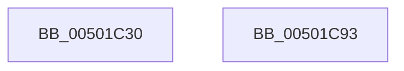

# wcsncat

- RVA: `0x00501C30`–`0x00501C94` (길이 `100` bytes)
- VA: `0x0000000140501C30`
- 실행 섹션: `.text`
- PDB 이름 있음: `예`; PDB Function 태그: `아니요`
- unwind 정보 RVA: `0x0006F978`
- 디코드: `28`개 명령, `100/100` bytes 표시
- 미해석 바이트: `0` (있으면 어셈블리에 `.byte`로 보존)

> 이 문서는 커널 이미지의 기계어와 PDB 기호를 분석해 생성했습니다. 4번과 5번은 함수 원형과 자료형을 바이너리 사용 방식에서 추정한 C 해석이며 원본 소스 복구 결과는 아닙니다.

## 1. Dependencies

- 직접 호출 지점: **3**; 고유 호출 대상: **3**
- 직접 호출자로 확인된 함수: **0**
- RIP 상대 이미지 참조: **0**

### Outgoing calls
- `0x00501C4E` → [wcslen](wcslen_function_00501BA0.md) (function, `0x00501BA0`)
- `0x00501C5D` → [wcsnlen](wcsnlen_function_00501D60.md) (function, `0x00501D60`)
- `0x00501C6F` → [memcpy](../6C/memcpy_function_006C6840.md) (function, `0x006C6840`)

### Direct callers
- 이 함수 시작 RVA로 연결되는 직접 call은 확인되지 않았습니다. 간접 호출은 완전히 역산할 수 없습니다.

### Static image references
- 디코드된 RIP-relative 메모리 참조가 없습니다.

## 2. Other-region calls and transfers

- 다른 실행 섹션으로 향하는 call: **0**
- 별도 외부 분기/꼬리 이동을 확인하지 못했습니다.

## 3. Assembly (complete function range)

```asm
00501C30  48 89 5C 24 08                  mov qword ptr [rsp + 8], rbx
00501C35  48 89 74 24 10                  mov qword ptr [rsp + 0x10], rsi
00501C3A  48 89 7C 24 18                  mov qword ptr [rsp + 0x18], rdi
00501C3F  41 56                           push r14
00501C41  48 83 EC 20                     sub rsp, 0x20
00501C45  49 8B D8                        mov rbx, r8
00501C48  48 8B F2                        mov rsi, rdx
00501C4B  4C 8B F1                        mov r14, rcx
00501C4E  E8 4D FF FF FF                  call 0x140501ba0
00501C53  48 8B D3                        mov rdx, rbx
00501C56  48 8B CE                        mov rcx, rsi
00501C59  49 8D 3C 46                     lea rdi, [r14 + rax*2]
00501C5D  E8 FE 00 00 00                  call 0x140501d60
00501C62  48 8B D6                        mov rdx, rsi
00501C65  48 8B CF                        mov rcx, rdi
00501C68  48 8D 1C 00                     lea rbx, [rax + rax]
00501C6C  4C 8B C3                        mov r8, rbx
00501C6F  E8 CC 4B 1C 00                  call 0x1406c6840
00501C74  48 8B 74 24 38                  mov rsi, qword ptr [rsp + 0x38]
00501C79  33 C0                           xor eax, eax
00501C7B  66 89 04 3B                     mov word ptr [rbx + rdi], ax
00501C7F  49 8B C6                        mov rax, r14
00501C82  48 8B 5C 24 30                  mov rbx, qword ptr [rsp + 0x30]
00501C87  48 8B 7C 24 40                  mov rdi, qword ptr [rsp + 0x40]
00501C8C  48 83 C4 20                     add rsp, 0x20
00501C90  41 5E                           pop r14
00501C92  C3                              ret
00501C93  CC                              int3
```

## 4. C-style interpretation (structured pseudocode)

```c
__int64 __fastcall wcsncat(__int64 a1, __int64 a2, __int64 a3)
{
    __int64 result;
    __int64 v_rsp;
    unsigned __int64 v_stack_p10;
    unsigned __int64 v_stack_p18;
    unsigned __int64 v_stack_p8;

    v_stack_p8 = v_rbx;
    v_stack_p10 = v_rsi;
    v_stack_p18 = v_rdi;
    v_rsp = (v_rsp) - (32);
    result = wcslen(a1, a2, a3, a4);
    result = wcsnlen(a2, a3, a3, a4);
    result = memcpy(a1 + result * 2, a2, result + result * 1, a4);
    result = 0;
    *(unsigned __int16 *)(result + result * 1 + a1 + result * 2 * 1) = 0;
    v_rsp = (v_rsp) + (32);
    return a1;
}
```

## 5. (Beta) C Style

```c
void *wcsncat(void *Arg1, int64_t Arg2, int64_t Arg3)
{
    uint8_t *arg1 = (uint8_t *)Arg1;

    int64_t result;
    int64_t local_rsp;
    uint64_t v_stack_p10;
    uint64_t v_stack_p18;
    uint64_t v_stack_p8;

    v_stack_p8 = local_rbx;
    v_stack_p10 = local_rsi;
    v_stack_p18 = local_rdi;
    local_rsp = (local_rsp) - (32);
    result = wcslen(Arg1, Arg2, Arg3, a4);
    result = wcsnlen(Arg2, Arg3, Arg3, a4);
    result = memcpy(Arg1 + result * 2, Arg2, result + result * 1, a4);
    result = 0;
    *(uint16_t *)(result + result * 1 + arg1 + result * 2 * 1) = 0;
    local_rsp = (local_rsp) + (32);
    return Arg1;
}
```

### 관측된 메모리 오프셋

구조체 형식이 확인되지 않은 접근은 인자 기준의 오프셋으로만 기록했습니다.

| 기준 인자 | 오프셋 표현 | 폭 (bit) | 접근 |
|---|---:|---:|---|
| `Arg1` | `+ 0x0 + rax*2` | `64` | `R` |

## 6. Execution-region graph

[열기: 2D/3D 그래프와 함수 탐색 컨트롤 패널](../../../control-panel.html?section=text&rva=0x00501C30&view=graph)

- 2D 그래프는 위에서 아래로 흐르고, 3D 그래프는 빈 공간을 드래그해 회전합니다. Shift+드래그는 이동, 휠은 확대·축소, 함수 노드 선택은 대상 보고서 이동입니다.

### Static fallback


