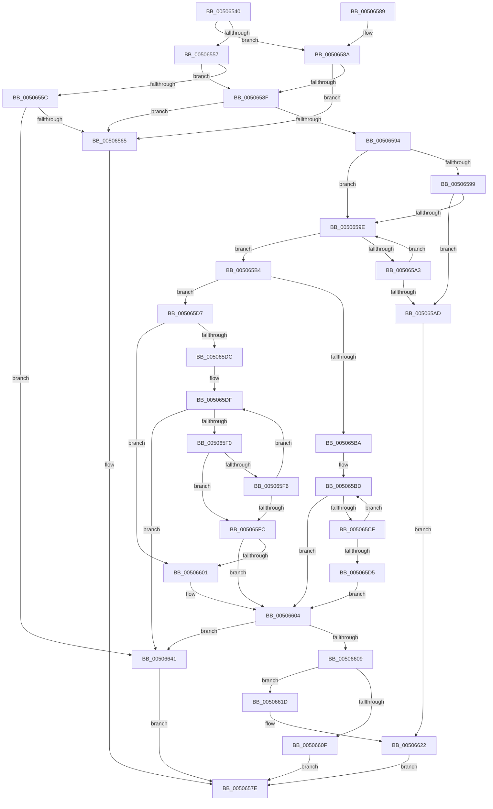

# wcsncat_s

- RVA: `0x00506540`–`0x00506648` (길이 `264` bytes)
- VA: `0x0000000140506540`
- 실행 섹션: `.text`
- PDB 이름 있음: `예`; PDB Function 태그: `아니요`
- unwind 정보 RVA: `0x000C293C`
- 디코드: `84`개 명령, `264/264` bytes 표시
- 미해석 바이트: `0` (있으면 어셈블리에 `.byte`로 보존)

> 이 문서는 커널 이미지의 기계어와 PDB 기호를 분석해 생성했습니다. 4번과 5번은 함수 원형과 자료형을 바이너리 사용 방식에서 추정한 C 해석이며 원본 소스 복구 결과는 아닙니다.

## 1. Dependencies

- 직접 호출 지점: **2**; 고유 호출 대상: **1**
- 직접 호출자로 확인된 함수: **7**
- RIP 상대 이미지 참조: **0**

### Outgoing calls
- `0x00506574` → [EmpCheckErrataList](../49/EmpCheckErrataList_function_0049E550.md) (function, `0x0049E550`)
- `0x00506635` → [EmpCheckErrataList](../49/EmpCheckErrataList_function_0049E550.md) (function, `0x0049E550`)

### Direct callers
- [PnprGetPluginDriverImagePath](../../page/73/PnprGetPluginDriverImagePath_function_007398E8.md) at `0x00739AB3`
- [SddlpUuidFromString](../../page/7A/SddlpUuidFromString_function_007A5300.md) at `0x007A5385`
- [SddlpUuidFromString](../../page/7A/SddlpUuidFromString_function_007A5300.md) at `0x007A539C`
- [ExpConvertArcName](../../page/7C/ExpConvertArcName_function_007CAF04.md) at `0x007CAF82`
- [ExpFindArcName](../../page/7C/ExpFindArcName_function_007CB5CC.md) at `0x007CB7C8`
- [VhdiMountVhdFile](../../page/83/VhdiMountVhdFile_function_0083BED0.md) at `0x0083C182`
- [NtLockProductActivationKeys](../../page/A4/NtLockProductActivationKeys_function_00A492E0.md) at `0x00A495C4`
- [ExpTranslateEfiPath](../../page/A7/ExpTranslateEfiPath_function_00A7AF84.md) at `0x00A7B09B`

### Static image references
- 디코드된 RIP-relative 메모리 참조가 없습니다.

## 2. Other-region calls and transfers

- 다른 실행 섹션으로 향하는 call: **0**
- 별도 외부 분기/꼬리 이동을 확인하지 못했습니다.

## 3. Assembly (complete function range)

```asm
00506540  48 89 5C 24 08                  mov qword ptr [rsp + 8], rbx
00506545  57                              push rdi
00506546  48 83 EC 30                     sub rsp, 0x30
0050654A  33 FF                           xor edi, edi
0050654C  4C 8B DA                        mov r11, rdx
0050654F  4C 8B D1                        mov r10, rcx
00506552  4D 85 C9                        test r9, r9
00506555  75 33                           jne 0x14050658a
00506557  48 85 C9                        test rcx, rcx
0050655A  75 33                           jne 0x14050658f
0050655C  48 85 D2                        test rdx, rdx
0050655F  0F 84 DC 00 00 00               je 0x140506641
00506565  45 33 C9                        xor r9d, r9d
00506568  48 89 7C 24 20                  mov qword ptr [rsp + 0x20], rdi
0050656D  45 33 C0                        xor r8d, r8d
00506570  33 D2                           xor edx, edx
00506572  33 C9                           xor ecx, ecx
00506574  E8 D7 7F F9 FF                  call 0x14049e550
00506579  B8 16 00 00 00                  mov eax, 0x16
0050657E  48 8B 5C 24 40                  mov rbx, qword ptr [rsp + 0x40]
00506583  48 83 C4 30                     add rsp, 0x30
00506587  5F                              pop rdi
00506588  C3                              ret
00506589  CC                              int3
0050658A  4D 85 D2                        test r10, r10
0050658D  74 D6                           je 0x140506565
0050658F  4D 85 DB                        test r11, r11
00506592  74 D1                           je 0x140506565
00506594  4D 85 C9                        test r9, r9
00506597  74 05                           je 0x14050659e
00506599  4D 85 C0                        test r8, r8
0050659C  74 0F                           je 0x1405065ad
0050659E  66 39 39                        cmp word ptr [rcx], di
005065A1  74 11                           je 0x1405065b4
005065A3  48 83 C1 02                     add rcx, 2
005065A7  48 83 EA 01                     sub rdx, 1
005065AB  75 F1                           jne 0x14050659e
005065AD  BB 16 00 00 00                  mov ebx, 0x16
005065B2  EB 6E                           jmp 0x140506622
005065B4  49 83 F9 FF                     cmp r9, -1
005065B8  75 1D                           jne 0x1405065d7
005065BA  49 2B C8                        sub rcx, r8
005065BD  41 0F B7 00                     movzx eax, word ptr [r8]
005065C1  66 42 89 04 01                  mov word ptr [rcx + r8], ax
005065C6  4D 8D 40 02                     lea r8, [r8 + 2]
005065CA  66 85 C0                        test ax, ax
005065CD  74 35                           je 0x140506604
005065CF  48 83 EA 01                     sub rdx, 1
005065D3  75 E8                           jne 0x1405065bd
005065D5  EB 2D                           jmp 0x140506604
005065D7  4D 85 C9                        test r9, r9
005065DA  74 25                           je 0x140506601
005065DC  4C 2B C1                        sub r8, rcx
005065DF  41 0F B7 04 08                  movzx eax, word ptr [r8 + rcx]
005065E4  66 89 01                        mov word ptr [rcx], ax
005065E7  48 83 C1 02                     add rcx, 2
005065EB  66 85 C0                        test ax, ax
005065EE  74 51                           je 0x140506641
005065F0  48 83 EA 01                     sub rdx, 1
005065F4  74 06                           je 0x1405065fc
005065F6  49 83 E9 01                     sub r9, 1
005065FA  75 E3                           jne 0x1405065df
005065FC  4D 85 C9                        test r9, r9
005065FF  75 03                           jne 0x140506604
00506601  66 89 39                        mov word ptr [rcx], di
00506604  48 85 D2                        test rdx, rdx
00506607  75 38                           jne 0x140506641
00506609  49 83 F9 FF                     cmp r9, -1
0050660D  75 0E                           jne 0x14050661d
0050660F  66 43 89 7C 5A FE               mov word ptr [r10 + r11*2 - 2], di
00506615  8D 42 50                        lea eax, [rdx + 0x50]
00506618  E9 61 FF FF FF                  jmp 0x14050657e
0050661D  BB 22 00 00 00                  mov ebx, 0x22
00506622  45 33 C9                        xor r9d, r9d
00506625  66 41 89 3A                     mov word ptr [r10], di
00506629  45 33 C0                        xor r8d, r8d
0050662C  48 89 7C 24 20                  mov qword ptr [rsp + 0x20], rdi
00506631  33 D2                           xor edx, edx
00506633  33 C9                           xor ecx, ecx
00506635  E8 16 7F F9 FF                  call 0x14049e550
0050663A  8B C3                           mov eax, ebx
0050663C  E9 3D FF FF FF                  jmp 0x14050657e
00506641  33 C0                           xor eax, eax
00506643  E9 36 FF FF FF                  jmp 0x14050657e
```

## 4. C-style interpretation (structured pseudocode)

```c
__int64 __fastcall wcsncat_s(__int64 a1, __int64 a2, int a3, __int64 a4)
{
    __int64 result;
    __int64 v_rdi;
    __int64 v_rsp;
    unsigned __int64 v_stack_m18;
    unsigned __int64 v_stack_p20;
    unsigned __int64 v_stack_p8;

    v_stack_p8 = v_rbx;
    v_rsp = (v_rsp) - (48);
    v_rdi = 0;
    if (a4 != 0) goto loc_0050658A;
    if (a1 != 0) goto loc_0050658F;
    if (a2 == 0) goto loc_00506641;
loc_00506565:
    a4 = 0;
    v_stack_m18 = 0;
    a3 = 0;
    a2 = 0;
    a1 = 0;
    result = EmpCheckErrataList(a1, a2, a3, a4);
loc_0050657E:
    v_rsp = (v_rsp) + (48);
    return 22;
loc_0050658A:
    if (0 == 0) goto loc_00506565;
loc_0050658F:
    if (0 == 0) goto loc_00506565;
    if (0 == 0) goto loc_0050659E;
    if (0 == 0) goto loc_005065AD;
loc_0050659E:
    if ((*(unsigned __int16 *)(a1)) == 0) goto loc_005065B4;
    a1 = (a1) + (2);
    a2 = (a2) - (1);
    if (condition_is_not_equal) goto loc_0050659E;
loc_005065AD:
    goto loc_00506622;
loc_005065B4:
    if (0 != -1) goto loc_005065D7;
    a1 = (a1) - (0);
loc_005065BD:
    *(unsigned __int16 *)(a1 + a3 * 1) = (unsigned __int16)(*(unsigned __int16 *)(a3));
    if ((unsigned __int16)(*(unsigned __int16 *)(a3)) == 0) goto loc_00506604;
    a2 = (a2) - (1);
    if (condition_is_not_equal) goto loc_005065BD;
    goto loc_00506604;
loc_005065D7:
    if (0 == 0) goto loc_00506601;
    a3 = (a3 + 2) - (a1);
loc_005065DF:
    *(unsigned __int16 *)(a1) = (unsigned __int16)(*(unsigned __int16 *)(a3 + a1 * 1));
    a1 = (a1) + (2);
    if ((unsigned __int16)(*(unsigned __int16 *)(a3 + a1 * 1)) == 0) goto loc_00506641;
    a2 = (a2) - (1);
    if (condition_is_equal) goto loc_005065FC;
    a4 = (a4) - (1);
    if (condition_is_not_equal) goto loc_005065DF;
loc_005065FC:
    if (a4 == 0) {
        *(unsigned __int16 *)(a1) = 0;
    }
    if (a2 != 0) goto loc_00506641;
    if (a4 != -1) goto loc_0050661D;
    *(unsigned __int16 *)(a1 + a2 * 2 - 2) = 0;
    goto loc_0050657E;
loc_0050661D:
loc_00506622:
    a4 = 0;
    *(unsigned __int16 *)(a1) = 0;
    a3 = 0;
    v_stack_p20 = 0;
    a2 = 0;
    a1 = 0;
    result = EmpCheckErrataList(a1, a2, a3, a4);
    goto loc_0050657E;
loc_00506641:
    result = 0;
    goto loc_0050657E;
}
```

## 5. (Beta) C Style

```c
int64_t wcsncat_s(int64_t Arg1, int64_t Arg2, int32_t Arg3, int64_t Arg4)
{
    int64_t result;
    int64_t local_rdi;
    int64_t local_rsp;
    uint64_t v_stack_m18;
    uint64_t v_stack_p20;
    uint64_t v_stack_p8;

    v_stack_p8 = local_rbx;
    local_rsp = (local_rsp) - (48);
    local_rdi = 0;
    if (Arg4 != 0) goto loc_0050658A;
    if (Arg1 != 0) goto loc_0050658F;
    if (Arg2 == 0) goto loc_00506641;
loc_00506565:
    Arg4 = 0;
    v_stack_m18 = 0;
    Arg3 = 0;
    Arg2 = 0;
    Arg1 = 0;
    result = EmpCheckErrataList(Arg1, Arg2, Arg3, Arg4);
loc_0050657E:
    local_rsp = (local_rsp) + (48);
    return 22;
loc_0050658A:
    if (0 == 0) goto loc_00506565;
loc_0050658F:
    if (0 == 0) goto loc_00506565;
    if (0 == 0) goto loc_0050659E;
    if (0 == 0) goto loc_005065AD;
loc_0050659E:
    if ((*(uint16_t *)(Arg1)) == 0) goto loc_005065B4;
    Arg1 = (Arg1) + (2);
    Arg2 = (Arg2) - (1);
    if (condition_is_not_equal) goto loc_0050659E;
loc_005065AD:
    goto loc_00506622;
loc_005065B4:
    if (0 != -1) goto loc_005065D7;
    Arg1 = (Arg1) - (0);
loc_005065BD:
    *(uint16_t *)(Arg1 + Arg3 * 1) = (uint16_t)(*(uint16_t *)(Arg3));
    if ((uint16_t)(*(uint16_t *)(Arg3)) == 0) goto loc_00506604;
    Arg2 = (Arg2) - (1);
    if (condition_is_not_equal) goto loc_005065BD;
    goto loc_00506604;
loc_005065D7:
    if (0 == 0) goto loc_00506601;
    Arg3 = (Arg3 + 2) - (Arg1);
loc_005065DF:
    *(uint16_t *)(Arg1) = (uint16_t)(*(uint16_t *)(Arg3 + Arg1 * 1));
    Arg1 = (Arg1) + (2);
    if ((uint16_t)(*(uint16_t *)(Arg3 + Arg1 * 1)) == 0) goto loc_00506641;
    Arg2 = (Arg2) - (1);
    if (condition_is_equal) goto loc_005065FC;
    Arg4 = (Arg4) - (1);
    if (condition_is_not_equal) goto loc_005065DF;
loc_005065FC:
    if (Arg4 == 0) {
        *(uint16_t *)(Arg1) = 0;
    }
    if (Arg2 != 0) goto loc_00506641;
    if (Arg4 != -1) goto loc_0050661D;
    *(uint16_t *)(Arg1 + Arg2 * 2 - 0x2) = 0;
    goto loc_0050657E;
loc_0050661D:
loc_00506622:
    Arg4 = 0;
    *(uint16_t *)(Arg1) = 0;
    Arg3 = 0;
    v_stack_p20 = 0;
    Arg2 = 0;
    Arg1 = 0;
    result = EmpCheckErrataList(Arg1, Arg2, Arg3, Arg4);
    goto loc_0050657E;
loc_00506641:
    result = 0;
    goto loc_0050657E;
}
```

## 6. Execution-region graph

[열기: 2D/3D 그래프와 함수 탐색 컨트롤 패널](../../../control-panel.html?section=text&rva=0x00506540&view=graph)

- 2D 그래프는 위에서 아래로 흐르고, 3D 그래프는 빈 공간을 드래그해 회전합니다. Shift+드래그는 이동, 휠은 확대·축소, 함수 노드 선택은 대상 보고서 이동입니다.

### Static fallback


