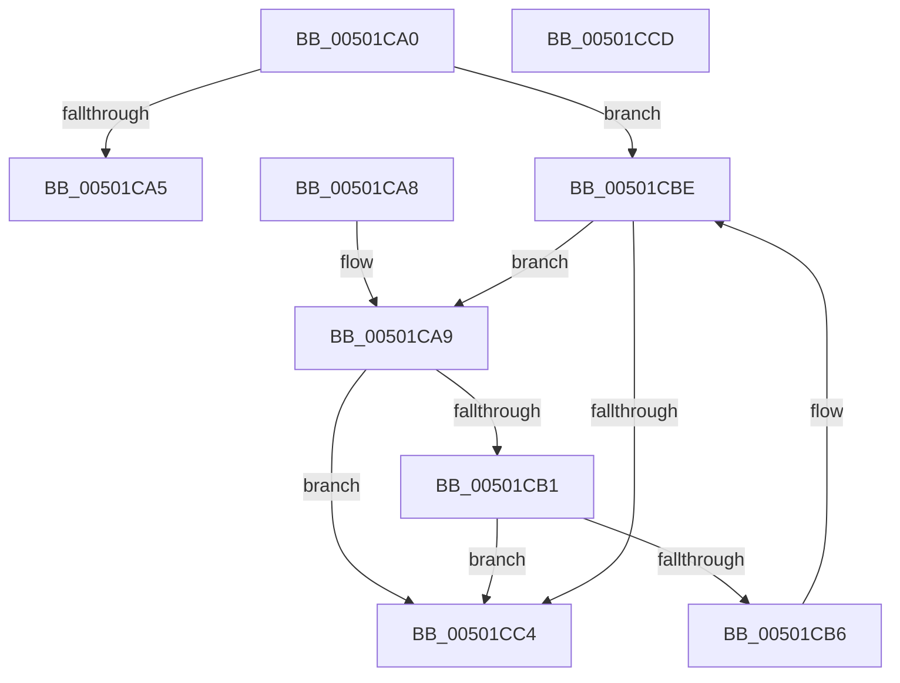

# wcsncmp

- RVA: `0x00501CA0`–`0x00501CCE` (길이 `46` bytes)
- VA: `0x0000000140501CA0`
- 실행 섹션: `.text`
- PDB 이름 있음: `예`; PDB Function 태그: `아니요`
- unwind 정보 RVA: `0x000DB714`
- 디코드: `19`개 명령, `46/46` bytes 표시
- 미해석 바이트: `0` (있으면 어셈블리에 `.byte`로 보존)

> 이 문서는 커널 이미지의 기계어와 PDB 기호를 분석해 생성했습니다. 4번과 5번은 함수 원형과 자료형을 바이너리 사용 방식에서 추정한 C 해석이며 원본 소스 복구 결과는 아닙니다.

## 1. Dependencies

- 직접 호출 지점: **0**; 고유 호출 대상: **0**
- 직접 호출자로 확인된 함수: **24**
- RIP 상대 이미지 참조: **0**

### Outgoing calls
- 직접 디코드된 call 명령이 없습니다.

### Direct callers
- [LdrpCompareResourceNamesWithValidation](../47/LdrpCompareResourceNamesWithValidation_function_0047E3D4.md) at `0x0047E42F`
- [HalpInsertProfileSource](../54/HalpInsertProfileSource_function_00547468.md) at `0x005474C1`
- [CarGetDriverInfoFromDriverName](../61/CarGetDriverInfoFromDriverName_function_00617E50.md) at `0x00617E97`
- [sub_006EAEDE](../6E/Unknown_function_006EAEDE.md) at `0x006EB1C3`
- [PopFxInitializeSocSubsystemStaticInfo](../../page/75/PopFxInitializeSocSubsystemStaticInfo_function_00758EC8.md) at `0x00759141`
- [PopFxInitializeSocSubsystemStaticInfo](../../page/75/PopFxInitializeSocSubsystemStaticInfo_function_00758EC8.md) at `0x00759161`
- [PopFxInitializeSocSubsystemStaticInfo](../../page/75/PopFxInitializeSocSubsystemStaticInfo_function_00758EC8.md) at `0x007591B4`
- [PopPluginInitializeSocSubsystemStaticInfo](../../page/75/PopPluginInitializeSocSubsystemStaticInfo_function_0075A98C.md) at `0x0075AA5C`
- [PopWakeSourceIsChild](../../page/75/PopWakeSourceIsChild_function_0075CAD0.md) at `0x0075CB12`
- [PopWakeSourceIsParent](../../page/75/PopWakeSourceIsParent_function_0075CB40.md) at `0x0075CB8D`
- [EtwpRemoveMicroarchitecturalPmcFromPmcGroup](../../page/7B/EtwpRemoveMicroarchitecturalPmcFromPmcGroup_function_007B7844.md) at `0x007B79A7`
- [AslPathClean](../../page/81/AslPathClean_function_0081AB9C.md) at `0x0081AC0D`
- [AslPathClean](../../page/81/AslPathClean_function_0081AB9C.md) at `0x0081AC24`
- [AslPathCleanUstr](../../page/81/AslPathCleanUstr_function_0081AE0C.md) at `0x0081AE99`
- [AslPathCleanUstr](../../page/81/AslPathCleanUstr_function_0081AE0C.md) at `0x0081AEB7`
- [AslPathCleanUstr](../../page/81/AslPathCleanUstr_function_0081AE0C.md) at `0x0081AECD`
- [AslPathCleanUstr](../../page/81/AslPathCleanUstr_function_0081AE0C.md) at `0x0081AEEF`
- [AslPathWildcardFindFirst](../../page/81/AslPathWildcardFindFirst_function_0081B534.md) at `0x0081B744`
- [AslpPathWildcardMakeLeaves](../../page/81/AslpPathWildcardMakeLeaves_function_0081C960.md) at `0x0081C9FB`
- [AslpPathWildcardMakeLeaves](../../page/81/AslpPathWildcardMakeLeaves_function_0081C960.md) at `0x0081CA16`
- [AslpPathWildcardMakeLeaves](../../page/81/AslpPathWildcardMakeLeaves_function_0081C960.md) at `0x0081CA2C`
- [AslpPathWildcardMakeLeaves](../../page/81/AslpPathWildcardMakeLeaves_function_0081C960.md) at `0x0081CA4F`
- [sub_008A8E86](../../page/8A/Unknown_function_008A8E86.md) at `0x008A9018`
- [PfSnPrefetchMetadata](../../page/93/PfSnPrefetchMetadata_function_0093B9B4.md) at `0x0093BA9D`
- [PfSnAltProfileTreeCompareByScenarioId](../../page/95/PfSnAltProfileTreeCompareByScenarioId_function_0095FCD0.md) at `0x0095FD08`
- [pIoQueryBusDescription](../../page/99/pIoQueryBusDescription_function_00996F58.md) at `0x009971DA`
- [pIoQueryBusDescription](../../page/99/pIoQueryBusDescription_function_00996F58.md) at `0x009971F4`
- [pIoQueryBusDescription](../../page/99/pIoQueryBusDescription_function_00996F58.md) at `0x0099720E`
- [WmipFindISinGEbyName](../../page/9E/WmipFindISinGEbyName_function_009E2BF0.md) at `0x009E2D02`
- [LdrpResSearchResourceInsideDirectory](../../page/9F/LdrpResSearchResourceInsideDirectory_function_009F22F0.md) at `0x009F2D26`
- [LdrpResCompareResourceNames](../../page/9F/LdrpResCompareResourceNames_function_009F2ECC.md) at `0x009F2F7A`
- [DrvDbSetDeviceIdDriverInfMatches](../../page/A6/DrvDbSetDeviceIdDriverInfMatches_function_00A6251C.md) at `0x00A6266E`
- [HalpDeviceEquals](../../pagekd/B8/HalpDeviceEquals_function_00B85580.md) at `0x00B856E3`
- [HalpFindDevice](../../pagekd/B8/HalpFindDevice_function_00B85770.md) at `0x00B85804`
- [ExpWatchProductTypeInitialization](../../init/C5/ExpWatchProductTypeInitialization_function_00C52170.md) at `0x00C5262A`

### Static image references
- 디코드된 RIP-relative 메모리 참조가 없습니다.

## 2. Other-region calls and transfers

- 다른 실행 섹션으로 향하는 call: **0**
- 별도 외부 분기/꼬리 이동을 확인하지 못했습니다.

## 3. Assembly (complete function range)

```asm
00501CA0  4D 85 C0                        test r8, r8
00501CA3  75 19                           jne 0x140501cbe
00501CA5  33 C0                           xor eax, eax
00501CA7  C3                              ret
00501CA8  CC                              int3
00501CA9  0F B7 01                        movzx eax, word ptr [rcx]
00501CAC  66 85 C0                        test ax, ax
00501CAF  74 13                           je 0x140501cc4
00501CB1  66 3B 02                        cmp ax, word ptr [rdx]
00501CB4  75 0E                           jne 0x140501cc4
00501CB6  48 83 C1 02                     add rcx, 2
00501CBA  48 83 C2 02                     add rdx, 2
00501CBE  49 83 E8 01                     sub r8, 1
00501CC2  75 E5                           jne 0x140501ca9
00501CC4  0F B7 01                        movzx eax, word ptr [rcx]
00501CC7  0F B7 0A                        movzx ecx, word ptr [rdx]
00501CCA  2B C1                           sub eax, ecx
00501CCC  C3                              ret
00501CCD  CC                              int3
```

## 4. C-style interpretation (structured pseudocode)

```c
__int64 __fastcall wcsncmp(__int64 a1, __int64 a2, __int64 a3)
{
    __int64 result;

    if (a3 != 0) goto loc_00501CBE;
    result = 0;
    return result;
loc_00501CA9:
    if ((unsigned __int16)(*(unsigned __int16 *)(a1)) == 0) goto loc_00501CC4;
    if (((unsigned __int16)(*(unsigned __int16 *)(a1))) != (*(unsigned __int16 *)(a2))) goto loc_00501CC4;
    a1 = (a1) + (2);
    a2 = (a2) + (2);
loc_00501CBE:
    a3 = (a3) - (1);
    if (condition_is_not_equal) goto loc_00501CA9;
loc_00501CC4:
    result = (unsigned int)((*(unsigned __int16 *)(a1)) - ((unsigned int)(*(unsigned __int16 *)(a2))));
    return result;
}
```

## 5. (Beta) C Style

```c
int64_t wcsncmp(void *Arg1, void *Arg2, int64_t Arg3)
{
    uint8_t *arg1 = (uint8_t *)Arg1;
    uint8_t *arg2 = (uint8_t *)Arg2;

    int64_t result;

    if (Arg3 != 0) goto loc_00501CBE;
    result = 0;
    return result;
loc_00501CA9:
    if ((uint16_t)(*(uint16_t *)(arg1)) == 0) goto loc_00501CC4;
    if (((uint16_t)(*(uint16_t *)(arg1))) != (*(uint16_t *)(arg2))) goto loc_00501CC4;
    Arg1 = (Arg1) + (2);
    Arg2 = (Arg2) + (2);
loc_00501CBE:
    Arg3 = (Arg3) - (1);
    if (condition_is_not_equal) goto loc_00501CA9;
loc_00501CC4:
    result = (uint32_t)((*(uint16_t *)(arg1)) - ((uint32_t)(*(uint16_t *)(arg2))));
    return result;
}
```

### 관측된 메모리 오프셋

구조체 형식이 확인되지 않은 접근은 인자 기준의 오프셋으로만 기록했습니다.

| 기준 인자 | 오프셋 표현 | 폭 (bit) | 접근 |
|---|---:|---:|---|
| `Arg1` | `+ 0x0` | `16` | `R` |
| `Arg2` | `+ 0x0` | `16` | `R` |

## 6. Execution-region graph

[열기: 2D/3D 그래프와 함수 탐색 컨트롤 패널](../../../control-panel.html?section=text&rva=0x00501CA0&view=graph)

- 2D 그래프는 위에서 아래로 흐르고, 3D 그래프는 빈 공간을 드래그해 회전합니다. Shift+드래그는 이동, 휠은 확대·축소, 함수 노드 선택은 대상 보고서 이동입니다.

### Static fallback


