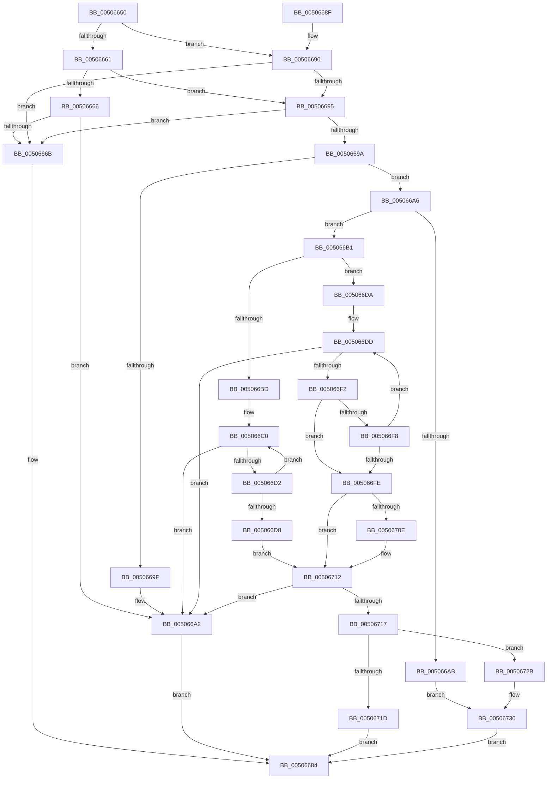

# wcsncpy_s

- RVA: `0x00506650`–`0x0050674E` (길이 `254` bytes)
- VA: `0x0000000140506650`
- 실행 섹션: `.text`
- PDB 이름 있음: `예`; PDB Function 태그: `아니요`
- unwind 정보 RVA: `0x000C293C`
- 디코드: `82`개 명령, `254/254` bytes 표시
- 미해석 바이트: `0` (있으면 어셈블리에 `.byte`로 보존)

> 이 문서는 커널 이미지의 기계어와 PDB 기호를 분석해 생성했습니다. 4번과 5번은 함수 원형과 자료형을 바이너리 사용 방식에서 추정한 C 해석이며 원본 소스 복구 결과는 아닙니다.

## 1. Dependencies

- 직접 호출 지점: **2**; 고유 호출 대상: **1**
- 직접 호출자로 확인된 함수: **12**
- RIP 상대 이미지 참조: **0**

### Outgoing calls
- `0x0050667A` → [EmpCheckErrataList](../49/EmpCheckErrataList_function_0049E550.md) (function, `0x0049E550`)
- `0x00506742` → [EmpCheckErrataList](../49/EmpCheckErrataList_function_0049E550.md) (function, `0x0049E550`)

### Direct callers
- [wsplitpath_s](wsplitpath_s_function_00505A80.md) at `0x00505B67`
- [wsplitpath_s](wsplitpath_s_function_00505A80.md) at `0x00505BE9`
- [wsplitpath_s](wsplitpath_s_function_00505A80.md) at `0x00505C2F`
- [wsplitpath_s](wsplitpath_s_function_00505A80.md) at `0x00505C5C`
- [wsplitpath_s](wsplitpath_s_function_00505A80.md) at `0x00505C89`
- [EmonAddProfileSource](../55/EmonAddProfileSource_function_0055BEA0.md) at `0x0055BF0B`
- [Amd64AddProfileSource](../56/Amd64AddProfileSource_function_0056B720.md) at `0x0056B7BB`
- [CarInitializeTelemetryData](../61/CarInitializeTelemetryData_function_00618BB0.md) at `0x00618D32`
- [EtwpLoadMicroarchitecturalProfileSource](../../page/7B/EtwpLoadMicroarchitecturalProfileSource_function_007B7288.md) at `0x007B7584`
- [ExpFindArcName](../../page/7C/ExpFindArcName_function_007CB5CC.md) at `0x007CB83E`
- [ExpParseSignatureName](../../page/7C/ExpParseSignatureName_function_007CBA30.md) at `0x007CBB22`
- [ExpParseSignatureName](../../page/7C/ExpParseSignatureName_function_007CBA30.md) at `0x007CBBD3`
- [ExpParseSignatureName](../../page/7C/ExpParseSignatureName_function_007CBA30.md) at `0x007CBC31`
- [ExpParseSignatureName](../../page/7C/ExpParseSignatureName_function_007CBA30.md) at `0x007CBC8E`
- [GetOperatorIndexByName](../../page/A0/GetOperatorIndexByName_function_00A029E0.md) at `0x00A02AC0`
- [LocalGetStringForControl](../../page/A5/LocalGetStringForControl_function_00A55674.md) at `0x00A5571C`
- [sub_00B22C34](../../page/B2/Unknown_function_00B22C34.md) at `0x00B22C45`
- [sub_00B3C988](../../page/B3/Unknown_function_00B3C988.md) at `0x00B3D065`
- [sub_00B3C988](../../page/B3/Unknown_function_00B3C988.md) at `0x00B3D120`
- [HalpKdEnumerateDebuggingDevices](../../pagekd/B8/HalpKdEnumerateDebuggingDevices_function_00B85850.md) at `0x00B859F1`

### Static image references
- 디코드된 RIP-relative 메모리 참조가 없습니다.

## 2. Other-region calls and transfers

- 다른 실행 섹션으로 향하는 call: **0**
- 별도 외부 분기/꼬리 이동을 확인하지 못했습니다.

## 3. Assembly (complete function range)

```asm
00506650  48 89 5C 24 08                  mov qword ptr [rsp + 8], rbx
00506655  57                              push rdi
00506656  48 83 EC 30                     sub rsp, 0x30
0050665A  33 FF                           xor edi, edi
0050665C  4D 85 C9                        test r9, r9
0050665F  75 2F                           jne 0x140506690
00506661  48 85 C9                        test rcx, rcx
00506664  75 2F                           jne 0x140506695
00506666  48 85 D2                        test rdx, rdx
00506669  74 37                           je 0x1405066a2
0050666B  45 33 C9                        xor r9d, r9d
0050666E  48 89 7C 24 20                  mov qword ptr [rsp + 0x20], rdi
00506673  45 33 C0                        xor r8d, r8d
00506676  33 D2                           xor edx, edx
00506678  33 C9                           xor ecx, ecx
0050667A  E8 D1 7E F9 FF                  call 0x14049e550
0050667F  B8 16 00 00 00                  mov eax, 0x16
00506684  48 8B 5C 24 40                  mov rbx, qword ptr [rsp + 0x40]
00506689  48 83 C4 30                     add rsp, 0x30
0050668D  5F                              pop rdi
0050668E  C3                              ret
0050668F  CC                              int3
00506690  48 85 C9                        test rcx, rcx
00506693  74 D6                           je 0x14050666b
00506695  48 85 D2                        test rdx, rdx
00506698  74 D1                           je 0x14050666b
0050669A  4D 85 C9                        test r9, r9
0050669D  75 07                           jne 0x1405066a6
0050669F  66 89 39                        mov word ptr [rcx], di
005066A2  33 C0                           xor eax, eax
005066A4  EB DE                           jmp 0x140506684
005066A6  4D 85 C0                        test r8, r8
005066A9  75 06                           jne 0x1405066b1
005066AB  41 8D 58 16                     lea ebx, [r8 + 0x16]
005066AF  EB 7F                           jmp 0x140506730
005066B1  4C 8B D9                        mov r11, rcx
005066B4  4C 8B D2                        mov r10, rdx
005066B7  49 83 F9 FF                     cmp r9, -1
005066BB  75 1D                           jne 0x1405066da
005066BD  4D 2B D8                        sub r11, r8
005066C0  41 0F B7 00                     movzx eax, word ptr [r8]
005066C4  66 43 89 04 03                  mov word ptr [r11 + r8], ax
005066C9  4D 8D 40 02                     lea r8, [r8 + 2]
005066CD  66 85 C0                        test ax, ax
005066D0  74 D0                           je 0x1405066a2
005066D2  49 83 EA 01                     sub r10, 1
005066D6  75 E8                           jne 0x1405066c0
005066D8  EB 38                           jmp 0x140506712
005066DA  4C 2B C1                        sub r8, rcx
005066DD  43 0F B7 04 18                  movzx eax, word ptr [r8 + r11]
005066E2  49 8B D9                        mov rbx, r9
005066E5  66 41 89 03                     mov word ptr [r11], ax
005066E9  4D 8D 5B 02                     lea r11, [r11 + 2]
005066ED  66 85 C0                        test ax, ax
005066F0  74 B0                           je 0x1405066a2
005066F2  49 83 EA 01                     sub r10, 1
005066F6  74 06                           je 0x1405066fe
005066F8  49 83 E9 01                     sub r9, 1
005066FC  75 DF                           jne 0x1405066dd
005066FE  4D 85 D2                        test r10, r10
00506701  4C 8D 4B FF                     lea r9, [rbx - 1]
00506705  4C 0F 44 CB                     cmove r9, rbx
00506709  4D 85 C9                        test r9, r9
0050670C  75 04                           jne 0x140506712
0050670E  66 41 89 3B                     mov word ptr [r11], di
00506712  4D 85 D2                        test r10, r10
00506715  75 8B                           jne 0x1405066a2
00506717  49 83 F9 FF                     cmp r9, -1
0050671B  75 0E                           jne 0x14050672b
0050671D  66 89 7C 51 FE                  mov word ptr [rcx + rdx*2 - 2], di
00506722  41 8D 42 50                     lea eax, [r10 + 0x50]
00506726  E9 59 FF FF FF                  jmp 0x140506684
0050672B  BB 22 00 00 00                  mov ebx, 0x22
00506730  66 89 39                        mov word ptr [rcx], di
00506733  45 33 C9                        xor r9d, r9d
00506736  33 C9                           xor ecx, ecx
00506738  48 89 7C 24 20                  mov qword ptr [rsp + 0x20], rdi
0050673D  45 33 C0                        xor r8d, r8d
00506740  33 D2                           xor edx, edx
00506742  E8 09 7E F9 FF                  call 0x14049e550
00506747  8B C3                           mov eax, ebx
00506749  E9 36 FF FF FF                  jmp 0x140506684
```

## 4. C-style interpretation (structured pseudocode)

```c
__int64 __fastcall wcsncpy_s(__int64 a1, __int64 a2, int a3, __int64 a4)
{
    __int64 result;
    __int64 v_r10;
    __int64 v_r11;
    __int64 v_rdi;
    __int64 v_rsp;
    unsigned __int64 v_stack_m18;
    unsigned __int64 v_stack_p20;
    unsigned __int64 v_stack_p8;

    v_stack_p8 = v_rbx;
    v_rsp = (v_rsp) - (48);
    v_rdi = 0;
    if (a4 != 0) goto loc_00506690;
    if (a1 != 0) goto loc_00506695;
    if (a2 == 0) goto loc_005066A2;
loc_0050666B:
    a4 = 0;
    v_stack_m18 = 0;
    a3 = 0;
    a2 = 0;
    a1 = 0;
    result = EmpCheckErrataList(a1, a2, a3, a4);
loc_00506684:
    v_rsp = (v_rsp) + (48);
    return 22;
loc_00506690:
    if (0 == 0) goto loc_0050666B;
loc_00506695:
    if (0 == 0) goto loc_0050666B;
    if (0 != 0) goto loc_005066A6;
    *(unsigned __int16 *)(a1) = 0;
loc_005066A2:
    result = 0;
    goto loc_00506684;
loc_005066A6:
    if (0 != 0) goto loc_005066B1;
    goto loc_00506730;
loc_005066B1:
    if (0 != -1) goto loc_005066DA;
    v_r11 = (0) - (0);
loc_005066C0:
    *(unsigned __int16 *)(v_r11 + a3 * 1) = (unsigned __int16)(*(unsigned __int16 *)(a3));
    if ((unsigned __int16)(*(unsigned __int16 *)(a3)) == 0) goto loc_005066A2;
    v_r10 = (0) - (1);
    if (condition_is_not_equal) goto loc_005066C0;
    goto loc_00506712;
loc_005066DA:
    a3 = (a3 + 2) - (0);
loc_005066DD:
    *(unsigned __int16 *)(v_r11) = (unsigned __int16)(*(unsigned __int16 *)(a3 + v_r11 * 1));
    if ((unsigned __int16)(*(unsigned __int16 *)(a3 + v_r11 * 1)) == 0) goto loc_005066A2;
    v_r10 = (v_r10) - (1);
    if (condition_is_equal) goto loc_005066FE;
    a4 = (a4) - (1);
    if (condition_is_not_equal) goto loc_005066DD;
loc_005066FE:
    a4 = 0 - 1;
    if (v_r10 == 0) { a4 = 0; }
    if (a4 == 0) {
        *(unsigned __int16 *)(v_r11 + 2) = 0;
    }
    if (v_r10 != 0) goto loc_005066A2;
    if (a4 != -1) goto loc_0050672B;
    *(unsigned __int16 *)(a1 + a2 * 2 - 2) = 0;
    goto loc_00506684;
loc_0050672B:
loc_00506730:
    *(unsigned __int16 *)(a1) = 0;
    a4 = 0;
    a1 = 0;
    v_stack_p20 = 0;
    a3 = 0;
    a2 = 0;
    result = EmpCheckErrataList(a1, a2, a3, a4);
    goto loc_00506684;
}
```

## 5. (Beta) C Style

```c
int64_t wcsncpy_s(int64_t Arg1, int64_t Arg2, int32_t Arg3, int64_t Arg4)
{
    int64_t result;
    int64_t local_r10;
    int64_t local_r11;
    int64_t local_rdi;
    int64_t local_rsp;
    uint64_t v_stack_m18;
    uint64_t v_stack_p20;
    uint64_t v_stack_p8;

    v_stack_p8 = local_rbx;
    local_rsp = (local_rsp) - (48);
    local_rdi = 0;
    if (Arg4 != 0) goto loc_00506690;
    if (Arg1 != 0) goto loc_00506695;
    if (Arg2 == 0) goto loc_005066A2;
loc_0050666B:
    Arg4 = 0;
    v_stack_m18 = 0;
    Arg3 = 0;
    Arg2 = 0;
    Arg1 = 0;
    result = EmpCheckErrataList(Arg1, Arg2, Arg3, Arg4);
loc_00506684:
    local_rsp = (local_rsp) + (48);
    return 22;
loc_00506690:
    if (0 == 0) goto loc_0050666B;
loc_00506695:
    if (0 == 0) goto loc_0050666B;
    if (0 != 0) goto loc_005066A6;
    *(uint16_t *)(Arg1) = 0;
loc_005066A2:
    result = 0;
    goto loc_00506684;
loc_005066A6:
    if (0 != 0) goto loc_005066B1;
    goto loc_00506730;
loc_005066B1:
    if (0 != -1) goto loc_005066DA;
    local_r11 = (0) - (0);
loc_005066C0:
    *(uint16_t *)(local_r11 + Arg3 * 1) = (uint16_t)(*(uint16_t *)(Arg3));
    if ((uint16_t)(*(uint16_t *)(Arg3)) == 0) goto loc_005066A2;
    local_r10 = (0) - (1);
    if (condition_is_not_equal) goto loc_005066C0;
    goto loc_00506712;
loc_005066DA:
    Arg3 = (Arg3 + 2) - (0);
loc_005066DD:
    *(uint16_t *)(local_r11) = (uint16_t)(*(uint16_t *)(Arg3 + local_r11 * 1));
    if ((uint16_t)(*(uint16_t *)(Arg3 + local_r11 * 1)) == 0) goto loc_005066A2;
    local_r10 = (local_r10) - (1);
    if (condition_is_equal) goto loc_005066FE;
    Arg4 = (Arg4) - (1);
    if (condition_is_not_equal) goto loc_005066DD;
loc_005066FE:
    Arg4 = 0 - 1;
    if (local_r10 == 0) { Arg4 = 0; }
    if (Arg4 == 0) {
        *(uint16_t *)(local_r11 + 0x2) = 0;
    }
    if (local_r10 != 0) goto loc_005066A2;
    if (Arg4 != -1) goto loc_0050672B;
    *(uint16_t *)(Arg1 + Arg2 * 2 - 0x2) = 0;
    goto loc_00506684;
loc_0050672B:
loc_00506730:
    *(uint16_t *)(Arg1) = 0;
    Arg4 = 0;
    Arg1 = 0;
    v_stack_p20 = 0;
    Arg3 = 0;
    Arg2 = 0;
    result = EmpCheckErrataList(Arg1, Arg2, Arg3, Arg4);
    goto loc_00506684;
}
```

## 6. Execution-region graph

[열기: 2D/3D 그래프와 함수 탐색 컨트롤 패널](../../../control-panel.html?section=text&rva=0x00506650&view=graph)

- 2D 그래프는 위에서 아래로 흐르고, 3D 그래프는 빈 공간을 드래그해 회전합니다. Shift+드래그는 이동, 휠은 확대·축소, 함수 노드 선택은 대상 보고서 이동입니다.

### Static fallback


