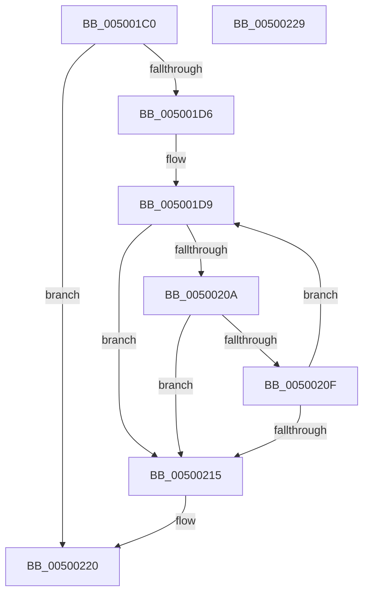

# wcsnicmp

- RVA: `0x005001C0`–`0x0050022A` (길이 `106` bytes)
- VA: `0x00000001405001C0`
- 실행 섹션: `.text`
- PDB 이름 있음: `예`; PDB Function 태그: `아니요`
- unwind 정보 RVA: `0x00071750`
- 디코드: `32`개 명령, `106/106` bytes 표시
- 미해석 바이트: `0` (있으면 어셈블리에 `.byte`로 보존)

> 이 문서는 커널 이미지의 기계어와 PDB 기호를 분석해 생성했습니다. 4번과 5번은 함수 원형과 자료형을 바이너리 사용 방식에서 추정한 C 해석이며 원본 소스 복구 결과는 아닙니다.

## 1. Dependencies

- 직접 호출 지점: **0**; 고유 호출 대상: **0**
- 직접 호출자로 확인된 함수: **49**
- RIP 상대 이미지 참조: **0**

### Outgoing calls
- 직접 디코드된 call 명령이 없습니다.

### Direct callers
- [PiDevCfgMatchDriverConfigurationId](../5A/PiDevCfgMatchDriverConfigurationId_function_005A7DD8.md) at `0x005A7E0D`
- [PiDevCfgMatchDriverConfigurationId](../5A/PiDevCfgMatchDriverConfigurationId_function_005A7DD8.md) at `0x005A7E33`
- [PopIdleWakeAreIdenticalWakeSources](../5D/PopIdleWakeAreIdenticalWakeSources_function_005DBF08.md) at `0x005DBF76`
- [BiIsValidDiskDevice](../../page/70/BiIsValidDiskDevice_function_00703190.md) at `0x007031E5`
- [IopCheckIfNotNativeDriver](../../page/71/IopCheckIfNotNativeDriver_function_0071AFB4.md) at `0x0071AFE2`
- [PiSwIrpCleanup](../../page/73/PiSwIrpCleanup_function_0073AC10.md) at `0x0073AC7A`
- [PiDrvDbOverlayCopyKeys](../../page/74/PiDrvDbOverlayCopyKeys_function_007413FC.md) at `0x0074169B`
- [punycode_decode](../../page/79/punycode_decode_function_007920EC.md) at `0x00792209`
- [punycode_encode](../../page/79/punycode_encode_function_007926F4.md) at `0x00792926`
- [GetValueType](../../page/7A/GetValueType_function_007A57E4.md) at `0x007A5828`
- [GetValueType](../../page/7A/GetValueType_function_007A57E4.md) at `0x007A5848`
- [GetValueType](../../page/7A/GetValueType_function_007A57E4.md) at `0x007A5863`
- [GetValueType](../../page/7A/GetValueType_function_007A57E4.md) at `0x007A5880`
- [GetValueType](../../page/7A/GetValueType_function_007A57E4.md) at `0x007A589D`
- [GetValueType](../../page/7A/GetValueType_function_007A57E4.md) at `0x007A58BA`
- [NtSetSystemEnvironmentValueEx](../../page/7C/NtSetSystemEnvironmentValueEx_function_007CE990.md) at `0x007CEB8F`
- [CmpPreserveSystemHiveData](../../page/7F/CmpPreserveSystemHiveData_function_007F2518.md) at `0x007F2B2D`
- [SdbpGetManifestedMergeStubAlloc](../../page/81/SdbpGetManifestedMergeStubAlloc_function_0081275C.md) at `0x008129F0`
- [SdbpGetMergeRedirectPathInternal](../../page/81/SdbpGetMergeRedirectPathInternal_function_00812B00.md) at `0x00812BF7`
- [SdbpResolveMatchingFile](../../page/81/SdbpResolveMatchingFile_function_00816A20.md) at `0x00816D08`
- [AslPathCleanUstr](../../page/81/AslPathCleanUstr_function_0081AE0C.md) at `0x0081AE6F`
- [AslpPathWildcardMakeLeaves](../../page/81/AslpPathWildcardMakeLeaves_function_0081C960.md) at `0x0081C9DE`
- [AslEnvVarQuery](../../page/81/AslEnvVarQuery_function_0081D410.md) at `0x0081D44F`
- [AslpEnvResolveVars](../../page/81/AslpEnvResolveVars_function_0081D608.md) at `0x0081D677`
- [BiCreateFileDeviceElement](../../page/82/BiCreateFileDeviceElement_function_00824B64.md) at `0x00824B96`
- [BiCreatePartitionDevice](../../page/82/BiCreatePartitionDevice_function_00824D10.md) at `0x00824E4F`
- [BiCreatePartitionDevice](../../page/82/BiCreatePartitionDevice_function_00824D10.md) at `0x00824EB1`
- [SiIsValidDiskDevice](../../page/82/SiIsValidDiskDevice_function_00828470.md) at `0x008284BD`
- [LocalConvertStringSDToSD_Rev1](../../page/92/LocalConvertStringSDToSD_Rev1_function_0092656C.md) at `0x00926670`
- [LocalConvertStringSDToSD_Rev1](../../page/92/LocalConvertStringSDToSD_Rev1_function_0092656C.md) at `0x0092672B`
- [LocalGetAclForString](../../page/92/LocalGetAclForString_function_00927F30.md) at `0x00927FD0`
- [LocalGetAclForString](../../page/92/LocalGetAclForString_function_00927F30.md) at `0x0092829A`
- [LocalGetAclForString](../../page/92/LocalGetAclForString_function_00927F30.md) at `0x00928666`
- [LocalGetAclForString](../../page/92/LocalGetAclForString_function_00927F30.md) at `0x0092874B`
- [FContainCallBackAce](../../page/92/FContainCallBackAce_function_00928FB0.md) at `0x00928FEE`
- [FContainCallBackAce](../../page/92/FContainCallBackAce_function_00928FB0.md) at `0x0092900B`
- [FContainCallBackAce](../../page/92/FContainCallBackAce_function_00928FB0.md) at `0x00929028`
- [FContainCallBackAce](../../page/92/FContainCallBackAce_function_00928FB0.md) at `0x00929045`
- [FContainCallBackAce](../../page/92/FContainCallBackAce_function_00928FB0.md) at `0x0092905E`
- [FContainCallBackAce](../../page/92/FContainCallBackAce_function_00928FB0.md) at `0x00929077`
- [FContainCallBackAce](../../page/92/FContainCallBackAce_function_00928FB0.md) at `0x00929090`
- [sub_009293FF](../../page/92/Unknown_function_009293FF.md) at `0x00929432`
- [sub_009293FF](../../page/92/Unknown_function_009293FF.md) at `0x0092944F`
- [sub_009293FF](../../page/92/Unknown_function_009293FF.md) at `0x0092946C`
- [sub_009293FF](../../page/92/Unknown_function_009293FF.md) at `0x00929489`
- [sub_0092949C](../../page/92/Unknown_function_0092949C.md) at `0x009294CC`
- [sub_0092949C](../../page/92/Unknown_function_0092949C.md) at `0x00929513`
- [RegRtlCreateTreeTransacted](../../page/93/RegRtlCreateTreeTransacted_function_00931D1C.md) at `0x00932039`
- [sub_009330DC](../../page/93/Unknown_function_009330DC.md) at `0x009332E5`
- [sub_009347B3](../../page/93/Unknown_function_009347B3.md) at `0x009348E4`
- [IoVolumeDeviceNameToGuidPath](../../page/95/IoVolumeDeviceNameToGuidPath_function_00952CC0.md) at `0x00952F0B`
- [EtwpExpandFileName](../../page/9C/EtwpExpandFileName_function_009C147C.md) at `0x009C14E2`
- [EtwpExpandFileName](../../page/9C/EtwpExpandFileName_function_009C147C.md) at `0x009C150A`
- [IopReplaceSymlinkPath](../../page/9D/IopReplaceSymlinkPath_function_009DBE80.md) at `0x009DBEF6`
- [WmipPrepareWnodeSI](../../page/9E/WmipPrepareWnodeSI_function_009E1740.md) at `0x009E1945`
- [GetOperandValue](../../page/A0/GetOperandValue_function_00A024C0.md) at `0x00A0259A`
- [GetAttributeName](../../page/A0/GetAttributeName_function_00A02768.md) at `0x00A027A5`
- [GetAttributeName](../../page/A0/GetAttributeName_function_00A02768.md) at `0x00A0280D`
- [GetAttributeName](../../page/A0/GetAttributeName_function_00A02768.md) at `0x00A02833`
- [GetAttributeName](../../page/A0/GetAttributeName_function_00A02768.md) at `0x00A02850`
- [GetAttributeName](../../page/A0/GetAttributeName_function_00A02768.md) at `0x00A02876`
- [GetAttributeName](../../page/A0/GetAttributeName_function_00A02768.md) at `0x00A02893`
- [GetOperatorIndexByName](../../page/A0/GetOperatorIndexByName_function_00A029E0.md) at `0x00A02B36`
- [EtwpAppStateChangeSummaryShouldLogCommandLine](../../page/A2/EtwpAppStateChangeSummaryShouldLogCommandLine_function_00A2FBD4.md) at `0x00A2FC31`
- [EtwpAppStateChangeSummaryShouldLogCommandLine](../../page/A2/EtwpAppStateChangeSummaryShouldLogCommandLine_function_00A2FBD4.md) at `0x00A2FC47`
- [BiOpenSystemStore](../../page/A4/BiOpenSystemStore_function_00A40844.md) at `0x00A4093D`
- [PiHotSwapGetDefaultBusRemovalPolicy](../../page/A8/PiHotSwapGetDefaultBusRemovalPolicy_function_00A85F8C.md) at `0x00A85FC2`
- [PiHotSwapGetDefaultBusRemovalPolicy](../../page/A8/PiHotSwapGetDefaultBusRemovalPolicy_function_00A85F8C.md) at `0x00A86033`
- [PiHotSwapGetDefaultBusRemovalPolicy](../../page/A8/PiHotSwapGetDefaultBusRemovalPolicy_function_00A85F8C.md) at `0x00A86050`
- [PiHotSwapGetDefaultBusRemovalPolicy](../../page/A8/PiHotSwapGetDefaultBusRemovalPolicy_function_00A85F8C.md) at `0x00A8606F`
- [PiHotSwapGetDefaultBusRemovalPolicy](../../page/A8/PiHotSwapGetDefaultBusRemovalPolicy_function_00A85F8C.md) at `0x00A86092`
- [WmipGetGuidObjectInstanceInfo](../../page/A8/WmipGetGuidObjectInstanceInfo_function_00A87470.md) at `0x00A87582`
- [PiSwFindSwDevice](../../page/A9/PiSwFindSwDevice_function_00A9CA84.md) at `0x00A9CAD2`
- [MiCacheImageSymbols](../../page/AD/MiCacheImageSymbols_function_00AD9410.md) at `0x00AD94D4`
- [sub_00B32900](../../page/B3/Unknown_function_00B32900.md) at `0x00B329D8`
- [sub_00B32900](../../page/B3/Unknown_function_00B32900.md) at `0x00B329F1`
- [sub_00B32900](../../page/B3/Unknown_function_00B32900.md) at `0x00B32A0A`
- [sub_00B32FE4](../../page/B3/Unknown_function_00B32FE4.md) at `0x00B331D8`
- [sub_00B3A892](../../page/B3/Unknown_function_00B3A892.md) at `0x00B3A8A2`
- [sub_00B3A892](../../page/B3/Unknown_function_00B3A892.md) at `0x00B3A932`
- [sub_00B476B8](../../page/B4/Unknown_function_00B476B8.md) at `0x00B476E4`
- [sub_00B4781A](../../page/B4/Unknown_function_00B4781A.md) at `0x00B4785F`
- [sub_00B47918](../../page/B4/Unknown_function_00B47918.md) at `0x00B479C0`
- [sub_00B47918](../../page/B4/Unknown_function_00B47918.md) at `0x00B47A0E`
- [CmpGetSystemRelativeRegistryHiveFilePath](../../init/C5/CmpGetSystemRelativeRegistryHiveFilePath_function_00C57C6C.md) at `0x00C57CB3`

### Static image references
- 디코드된 RIP-relative 메모리 참조가 없습니다.

## 2. Other-region calls and transfers

- 다른 실행 섹션으로 향하는 call: **0**
- 별도 외부 분기/꼬리 이동을 확인하지 못했습니다.

## 3. Assembly (complete function range)

```asm
005001C0  48 89 5C 24 08                  mov qword ptr [rsp + 8], rbx
005001C5  45 33 C9                        xor r9d, r9d
005001C8  49 8B D8                        mov rbx, r8
005001CB  4C 8B DA                        mov r11, rdx
005001CE  4C 8B D1                        mov r10, rcx
005001D1  4D 85 C0                        test r8, r8
005001D4  74 4A                           je 0x140500220
005001D6  4C 2B D2                        sub r10, rdx
005001D9  43 0F B7 0C 1A                  movzx ecx, word ptr [r10 + r11]
005001DE  8D 41 BF                        lea eax, [rcx - 0x41]
005001E1  66 83 F8 19                     cmp ax, 0x19
005001E5  8D 51 20                        lea edx, [rcx + 0x20]
005001E8  66 0F 47 D1                     cmova dx, cx
005001EC  41 0F B7 0B                     movzx ecx, word ptr [r11]
005001F0  4D 8D 5B 02                     lea r11, [r11 + 2]
005001F4  8D 41 BF                        lea eax, [rcx - 0x41]
005001F7  66 83 F8 19                     cmp ax, 0x19
005001FB  44 8D 41 20                     lea r8d, [rcx + 0x20]
005001FF  66 44 0F 47 C1                  cmova r8w, cx
00500204  48 83 EB 01                     sub rbx, 1
00500208  74 0B                           je 0x140500215
0050020A  66 85 D2                        test dx, dx
0050020D  74 06                           je 0x140500215
0050020F  66 41 3B D0                     cmp dx, r8w
00500213  74 C4                           je 0x1405001d9
00500215  41 0F B7 C0                     movzx eax, r8w
00500219  44 0F B7 CA                     movzx r9d, dx
0050021D  44 2B C8                        sub r9d, eax
00500220  48 8B 5C 24 08                  mov rbx, qword ptr [rsp + 8]
00500225  41 8B C1                        mov eax, r9d
00500228  C3                              ret
00500229  CC                              int3
```

## 4. C-style interpretation (structured pseudocode)

```c
__int64 __fastcall wcsnicmp(__int64 a1, __int64 a2, __int64 a3, int a4)
{
    __int64 v_r10;
    __int64 v_rbx;
    unsigned __int64 v_stack_p8;

    v_stack_p8 = v_rbx;
    a4 = 0;
    if (a3 == 0) goto loc_00500220;
    v_r10 = (a1) - (a2);
loc_005001D9:
    a2 = *(unsigned __int16 *)(v_r10 + a2 * 1) + 32;
    if (((unsigned __int16)(*(unsigned __int16 *)(v_r10 + a2 * 1) - 65)) > 25) { a2 = (unsigned __int16)(*(unsigned __int16 *)(v_r10 + a2 * 1)); }
    a3 = *(unsigned __int16 *)(a2) + 32;
    if (((unsigned __int16)(*(unsigned __int16 *)(a2) - 65)) > 25) { a3 = (unsigned __int16)(*(unsigned __int16 *)(a2)); }
    v_rbx = (a3) - (1);
    if (condition_is_equal) goto loc_00500215;
    if ((unsigned __int16)(a2) == 0) goto loc_00500215;
    if (((unsigned __int16)(a2)) == ((unsigned __int16)(a3))) goto loc_005001D9;
loc_00500215:
    a4 = (unsigned int)(((unsigned __int16)(a2)) - ((unsigned int)((unsigned __int16)(a3))));
loc_00500220:
    return (unsigned int)(a4);
}
```

## 5. (Beta) C Style

```c
int64_t wcsnicmp(void *Arg1, void *Arg2, int64_t Arg3, int32_t Arg4)
{
    uint8_t *arg1 = (uint8_t *)Arg1;
    uint8_t *arg2 = (uint8_t *)Arg2;

    int64_t local_r10;
    int64_t local_rbx;
    uint64_t v_stack_p8;

    v_stack_p8 = local_rbx;
    Arg4 = 0;
    if (Arg3 == 0) goto loc_00500220;
    local_r10 = (Arg1) - (Arg2);
loc_005001D9:
    Arg2 = *(uint16_t *)(local_r10 + arg2 * 1) + 32;
    if (((uint16_t)(*(uint16_t *)(local_r10 + arg2 * 1) - 65)) > 25) { Arg2 = (uint16_t)(*(uint16_t *)(local_r10 + arg2 * 1)); }
    Arg3 = *(uint16_t *)(arg2) + 32;
    if (((uint16_t)(*(uint16_t *)(arg2) - 65)) > 25) { Arg3 = (uint16_t)(*(uint16_t *)(arg2)); }
    local_rbx = (Arg3) - (1);
    if (condition_is_equal) goto loc_00500215;
    if ((uint16_t)(Arg2) == 0) goto loc_00500215;
    if (((uint16_t)(Arg2)) == ((uint16_t)(Arg3))) goto loc_005001D9;
loc_00500215:
    Arg4 = (uint32_t)(((uint16_t)(Arg2)) - ((uint32_t)((uint16_t)(Arg3))));
loc_00500220:
    return (uint32_t)(Arg4);
}
```

### 관측된 메모리 오프셋

구조체 형식이 확인되지 않은 접근은 인자 기준의 오프셋으로만 기록했습니다.

| 기준 인자 | 오프셋 표현 | 폭 (bit) | 접근 |
|---|---:|---:|---|
| `Arg1` | `+ 0x0 + r11*1` | `16` | `R` |
| `Arg2` | `+ 0x0` | `16` | `R` |
| `Arg2` | `+ 0x2` | `64` | `R` |

## 6. Execution-region graph

[열기: 2D/3D 그래프와 함수 탐색 컨트롤 패널](../../../control-panel.html?section=text&rva=0x005001C0&view=graph)

- 2D 그래프는 위에서 아래로 흐르고, 3D 그래프는 빈 공간을 드래그해 회전합니다. Shift+드래그는 이동, 휠은 확대·축소, 함수 노드 선택은 대상 보고서 이동입니다.

### Static fallback


