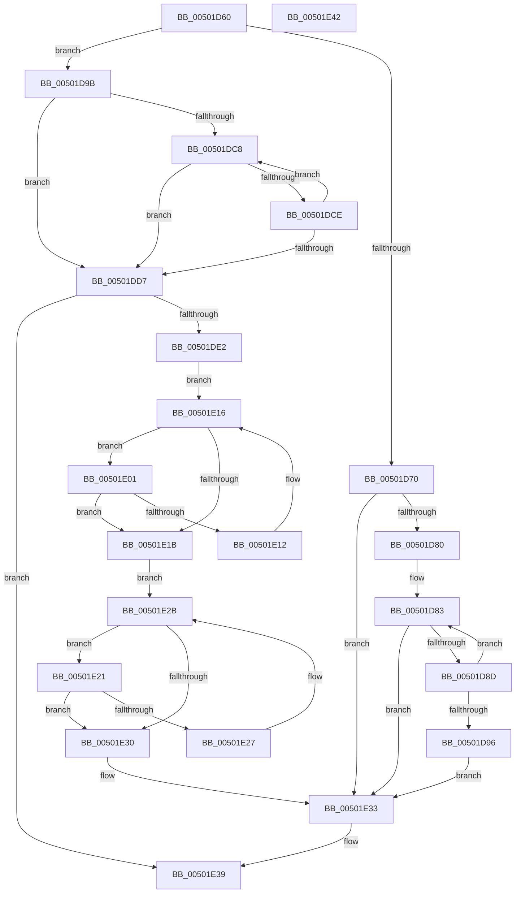

# wcsnlen

- RVA: `0x00501D60`–`0x00501E43` (길이 `227` bytes)
- VA: `0x0000000140501D60`
- 실행 섹션: `.text`
- PDB 이름 있음: `예`; PDB Function 태그: `아니요`
- unwind 정보 RVA: `0x00071750`
- 디코드: `71`개 명령, `227/227` bytes 표시
- 미해석 바이트: `0` (있으면 어셈블리에 `.byte`로 보존)

> 이 문서는 커널 이미지의 기계어와 PDB 기호를 분석해 생성했습니다. 4번과 5번은 함수 원형과 자료형을 바이너리 사용 방식에서 추정한 C 해석이며 원본 소스 복구 결과는 아닙니다.

## 1. Dependencies

- 직접 호출 지점: **0**; 고유 호출 대상: **0**
- 직접 호출자로 확인된 함수: **12**
- RIP 상대 이미지 참조: **0**

### Outgoing calls
- 직접 디코드된 call 명령이 없습니다.

### Direct callers
- [wcslwr_s](wcslwr_s_function_00500140.md) at `0x00500177`
- [wcsncat](wcsncat_function_00501C30.md) at `0x00501C5D`
- [wcsncpy](wcsncpy_function_00501CE0.md) at `0x00501D08`
- [EmonAddProfileSource](../55/EmonAddProfileSource_function_0055BEA0.md) at `0x0055BED7`
- [Amd64AddProfileSource](../56/Amd64AddProfileSource_function_0056B720.md) at `0x0056B78D`
- [RtlpQueryTimeZoneKeyNameRoutine](../../page/78/RtlpQueryTimeZoneKeyNameRoutine_function_0078FE40.md) at `0x0078FE60`
- [RtlpSetTimeZoneInformationWorker](../../page/78/RtlpSetTimeZoneInformationWorker_function_0078FEC8.md) at `0x0078FEF7`
- [RtlpSetTimeZoneInformationWorker](../../page/78/RtlpSetTimeZoneInformationWorker_function_0078FEC8.md) at `0x0078FF0D`
- [RtlpSetTimeZoneInformationWorker](../../page/78/RtlpSetTimeZoneInformationWorker_function_0078FEC8.md) at `0x0078FF2C`
- [EtwpLoadMicroarchitecturalProfileSource](../../page/7B/EtwpLoadMicroarchitecturalProfileSource_function_007B7288.md) at `0x007B72CD`
- [SiIsValidWindowsBootEntry](../../page/82/SiIsValidWindowsBootEntry_function_0082851C.md) at `0x0082854A`
- [NtSetInformationJobObject](../../page/9F/NtSetInformationJobObject_function_009F84C0.md) at `0x009FAEBF`
- [BiIsWindowsEfiEntry](../../page/A3/BiIsWindowsEfiEntry_function_00A3FBEC.md) at `0x00A3FC44`
- [sub_00B3C988](../../page/B3/Unknown_function_00B3C988.md) at `0x00B3D027`

### Static image references
- 디코드된 RIP-relative 메모리 참조가 없습니다.

## 2. Other-region calls and transfers

- 다른 실행 섹션으로 향하는 call: **0**
- 별도 외부 분기/꼬리 이동을 확인하지 못했습니다.

## 3. Assembly (complete function range)

```asm
00501D60  48 89 5C 24 08                  mov qword ptr [rsp + 8], rbx
00501D65  4C 8B DA                        mov r11, rdx
00501D68  4C 8B C1                        mov r8, rcx
00501D6B  F6 C1 01                        test cl, 1
00501D6E  74 2B                           je 0x140501d9b
00501D70  48 8D 04 51                     lea rax, [rcx + rdx*2]
00501D74  48 8B D1                        mov rdx, rcx
00501D77  48 3B C8                        cmp rcx, rax
00501D7A  0F 84 B3 00 00 00               je 0x140501e33
00501D80  45 33 D2                        xor r10d, r10d
00501D83  66 44 39 12                     cmp word ptr [rdx], r10w
00501D87  0F 84 A6 00 00 00               je 0x140501e33
00501D8D  48 83 C2 02                     add rdx, 2
00501D91  48 3B D0                        cmp rdx, rax
00501D94  75 ED                           jne 0x140501d83
00501D96  E9 98 00 00 00                  jmp 0x140501e33
00501D9B  83 E1 0F                        and ecx, 0xf
00501D9E  B8 10 00 00 00                  mov eax, 0x10
00501DA3  48 2B C1                        sub rax, rcx
00501DA6  49 8B D0                        mov rdx, r8
00501DA9  48 F7 D9                        neg rcx
00501DAC  48 1B DB                        sbb rbx, rbx
00501DAF  48 23 D8                        and rbx, rax
00501DB2  48 D1 EB                        shr rbx, 1
00501DB5  4C 3B DB                        cmp r11, rbx
00501DB8  49 0F 42 DB                     cmovb rbx, r11
00501DBC  45 33 D2                        xor r10d, r10d
00501DBF  49 8D 04 58                     lea rax, [r8 + rbx*2]
00501DC3  4C 3B C0                        cmp r8, rax
00501DC6  74 0F                           je 0x140501dd7
00501DC8  66 44 39 12                     cmp word ptr [rdx], r10w
00501DCC  74 09                           je 0x140501dd7
00501DCE  48 83 C2 02                     add rdx, 2
00501DD2  48 3B D0                        cmp rdx, rax
00501DD5  75 F1                           jne 0x140501dc8
00501DD7  49 2B D0                        sub rdx, r8
00501DDA  48 D1 FA                        sar rdx, 1
00501DDD  48 3B D3                        cmp rdx, rbx
00501DE0  75 57                           jne 0x140501e39
00501DE2  49 8B CB                        mov rcx, r11
00501DE5  4D 8D 0C 50                     lea r9, [r8 + rdx*2]
00501DE9  48 2B CB                        sub rcx, rbx
00501DEC  0F 57 C9                        xorps xmm1, xmm1
00501DEF  48 8B C1                        mov rax, rcx
00501DF2  83 E0 0F                        and eax, 0xf
00501DF5  48 2B C8                        sub rcx, rax
00501DF8  48 03 CA                        add rcx, rdx
00501DFB  49 8D 14 48                     lea rdx, [r8 + rcx*2]
00501DFF  EB 15                           jmp 0x140501e16
00501E01  66 0F 6F C1                     movdqa xmm0, xmm1
00501E05  66 41 0F 75 01                  pcmpeqw xmm0, xmmword ptr [r9]
00501E0A  66 0F D7 C0                     pmovmskb eax, xmm0
00501E0E  85 C0                           test eax, eax
00501E10  75 09                           jne 0x140501e1b
00501E12  49 83 C1 10                     add r9, 0x10
00501E16  4C 3B CA                        cmp r9, rdx
00501E19  75 E6                           jne 0x140501e01
00501E1B  4B 8D 04 58                     lea rax, [r8 + r11*2]
00501E1F  EB 0A                           jmp 0x140501e2b
00501E21  66 45 39 11                     cmp word ptr [r9], r10w
00501E25  74 09                           je 0x140501e30
00501E27  49 83 C1 02                     add r9, 2
00501E2B  4C 3B C8                        cmp r9, rax
00501E2E  75 F1                           jne 0x140501e21
00501E30  49 8B D1                        mov rdx, r9
00501E33  49 2B D0                        sub rdx, r8
00501E36  48 D1 FA                        sar rdx, 1
00501E39  48 8B 5C 24 08                  mov rbx, qword ptr [rsp + 8]
00501E3E  48 8B C2                        mov rax, rdx
00501E41  C3                              ret
00501E42  CC                              int3
```

## 4. C-style interpretation (structured pseudocode)

```c
__int64 __fastcall wcsnlen(__int64 a1, __int64 a2)
{
    __int64 result;
    __int64 v_r10;
    __int64 v_rbx;
    unsigned __int64 v_stack_p8;

    v_stack_p8 = v_rbx;
    if ((((unsigned __int8)(a1)) & (1)) == 0) goto loc_00501D9B;
    if (a1 == (a1 + a2 * 2)) goto loc_00501E33;
    v_r10 = 0;
loc_00501D83:
    if ((*(unsigned __int16 *)(a1)) == 0) goto loc_00501E33;
    a2 = (a1) + (2);
    if (a2 != (a1 + a2 * 2)) goto loc_00501D83;
    goto loc_00501E33;
loc_00501D9B:
    a1 = (unsigned int)((a1) & (15));
    result = (16) - (a1);
    a1 = -(a1);
    v_rbx = (v_rbx) & (result);
    v_rbx = (v_rbx) >> (1);
    if (a2 < v_rbx) { v_rbx = a2; }
    v_r10 = 0;
    if (a1 == (a1 + v_rbx * 2)) goto loc_00501DD7;
loc_00501DC8:
    if ((*(unsigned __int16 *)(a1)) == 0) goto loc_00501DD7;
    a2 = (a1) + (2);
    if (a2 != (a1 + v_rbx * 2)) goto loc_00501DC8;
loc_00501DD7:
    a2 = (a2) - (a1);
    a2 = (a2) >> (1);
    if (a2 != v_rbx) goto loc_00501E39;
    a1 = (a2) - (v_rbx);
    result = (unsigned int)((a1) & (15));
    a1 = (a1) - (result);
    a1 = (a1) + (a2);
    goto loc_00501E16;
loc_00501E01:
    if ((unsigned int)(result) != 0) goto loc_00501E1B;
    a4 = (a1 + a2 * 2) + (16);
loc_00501E16:
    if (a4 != (a1 + a1 * 2)) goto loc_00501E01;
loc_00501E1B:
    goto loc_00501E2B;
loc_00501E21:
    if ((*(unsigned __int16 *)(a4)) == 0) goto loc_00501E30;
    a4 = (a4) + (2);
loc_00501E2B:
    if (a4 != (a1 + a2 * 2)) goto loc_00501E21;
loc_00501E30:
loc_00501E33:
    a2 = (a4) - (a1);
    a2 = (a2) >> (1);
loc_00501E39:
    return a2;
}
```

## 5. (Beta) C Style

```c
int64_t wcsnlen(void *Arg1, int64_t Arg2)
{
    uint8_t *arg1 = (uint8_t *)Arg1;

    int64_t result;
    int64_t local_r10;
    int64_t local_rbx;
    uint64_t v_stack_p8;

    v_stack_p8 = local_rbx;
    if ((((uint8_t)(Arg1)) & (1)) == 0) goto loc_00501D9B;
    if (Arg1 == (Arg1 + Arg2 * 2)) goto loc_00501E33;
    local_r10 = 0;
loc_00501D83:
    if ((*(uint16_t *)(arg1)) == 0) goto loc_00501E33;
    Arg2 = (Arg1) + (2);
    if (Arg2 != (Arg1 + Arg2 * 2)) goto loc_00501D83;
    goto loc_00501E33;
loc_00501D9B:
    Arg1 = (uint32_t)((Arg1) & (15));
    result = (16) - (Arg1);
    Arg1 = -(Arg1);
    local_rbx = (local_rbx) & (result);
    local_rbx = (local_rbx) >> (1);
    if (Arg2 < local_rbx) { local_rbx = Arg2; }
    local_r10 = 0;
    if (Arg1 == (Arg1 + local_rbx * 2)) goto loc_00501DD7;
loc_00501DC8:
    if ((*(uint16_t *)(arg1)) == 0) goto loc_00501DD7;
    Arg2 = (Arg1) + (2);
    if (Arg2 != (Arg1 + local_rbx * 2)) goto loc_00501DC8;
loc_00501DD7:
    Arg2 = (Arg2) - (Arg1);
    Arg2 = (Arg2) >> (1);
    if (Arg2 != local_rbx) goto loc_00501E39;
    Arg1 = (Arg2) - (local_rbx);
    result = (uint32_t)((Arg1) & (15));
    Arg1 = (Arg1) - (result);
    Arg1 = (Arg1) + (Arg2);
    goto loc_00501E16;
loc_00501E01:
    if ((uint32_t)(result) != 0) goto loc_00501E1B;
    a4 = (Arg1 + Arg2 * 2) + (16);
loc_00501E16:
    if (a4 != (Arg1 + Arg1 * 2)) goto loc_00501E01;
loc_00501E1B:
    goto loc_00501E2B;
loc_00501E21:
    if ((*(uint16_t *)(a4)) == 0) goto loc_00501E30;
    a4 = (a4) + (2);
loc_00501E2B:
    if (a4 != (Arg1 + Arg2 * 2)) goto loc_00501E21;
loc_00501E30:
loc_00501E33:
    Arg2 = (a4) - (Arg1);
    Arg2 = (Arg2) >> (1);
loc_00501E39:
    return Arg2;
}
```

### 관측된 메모리 오프셋

구조체 형식이 확인되지 않은 접근은 인자 기준의 오프셋으로만 기록했습니다.

| 기준 인자 | 오프셋 표현 | 폭 (bit) | 접근 |
|---|---:|---:|---|
| `Arg1` | `+ 0x0 + rbx*2` | `64` | `R` |

## 6. Execution-region graph

[열기: 2D/3D 그래프와 함수 탐색 컨트롤 패널](../../../control-panel.html?section=text&rva=0x00501D60&view=graph)

- 2D 그래프는 위에서 아래로 흐르고, 3D 그래프는 빈 공간을 드래그해 회전합니다. Shift+드래그는 이동, 휠은 확대·축소, 함수 노드 선택은 대상 보고서 이동입니다.

### Static fallback


