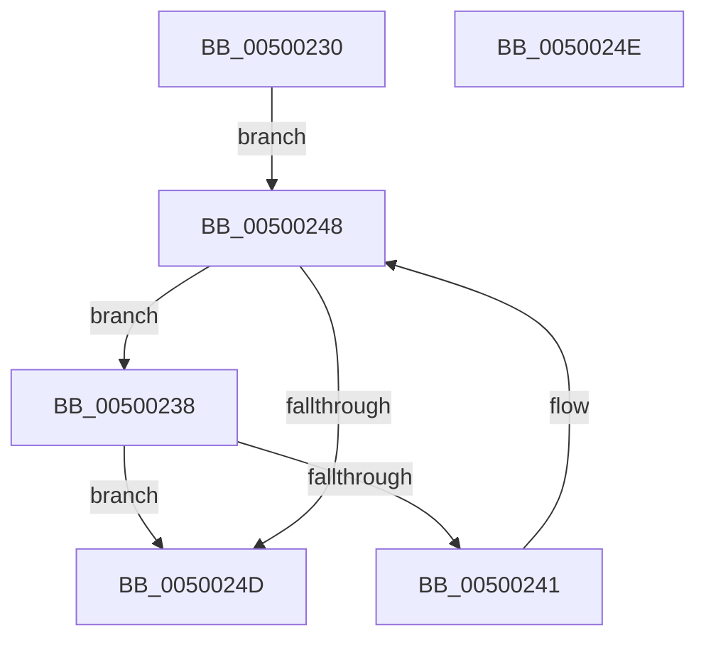

# wcsnset

- RVA: `0x00500230`–`0x0050024F` (길이 `31` bytes)
- VA: `0x0000000140500230`
- 실행 섹션: `.text`
- PDB 이름 있음: `예`; PDB Function 태그: `아니요`
- unwind 정보 RVA: `0x000DB714`
- 디코드: `12`개 명령, `31/31` bytes 표시
- 미해석 바이트: `0` (있으면 어셈블리에 `.byte`로 보존)

> 이 문서는 커널 이미지의 기계어와 PDB 기호를 분석해 생성했습니다. 4번과 5번은 함수 원형과 자료형을 바이너리 사용 방식에서 추정한 C 해석이며 원본 소스 복구 결과는 아닙니다.

## 1. Dependencies

- 직접 호출 지점: **0**; 고유 호출 대상: **0**
- 직접 호출자로 확인된 함수: **0**
- RIP 상대 이미지 참조: **0**

### Outgoing calls
- 직접 디코드된 call 명령이 없습니다.

### Direct callers
- 이 함수 시작 RVA로 연결되는 직접 call은 확인되지 않았습니다. 간접 호출은 완전히 역산할 수 없습니다.

### Static image references
- 디코드된 RIP-relative 메모리 참조가 없습니다.

## 2. Other-region calls and transfers

- 다른 실행 섹션으로 향하는 call: **0**
- 별도 외부 분기/꼬리 이동을 확인하지 못했습니다.

## 3. Assembly (complete function range)

```asm
00500230  48 8B C1                        mov rax, rcx
00500233  45 33 C9                        xor r9d, r9d
00500236  EB 10                           jmp 0x140500248
00500238  49 FF C8                        dec r8
0050023B  66 44 39 09                     cmp word ptr [rcx], r9w
0050023F  74 0C                           je 0x14050024d
00500241  66 89 11                        mov word ptr [rcx], dx
00500244  48 83 C1 02                     add rcx, 2
00500248  4D 85 C0                        test r8, r8
0050024B  75 EB                           jne 0x140500238
0050024D  C3                              ret
0050024E  CC                              int3
```

## 4. C-style interpretation (structured pseudocode)

```c
__int64 __fastcall wcsnset(__int64 a1, unsigned __int16 a2, __int64 a3, int a4)
{
    a4 = 0;
    goto loc_00500248;
loc_00500238:
    a3 = (a3) - 1;
    if ((*(unsigned __int16 *)(a1)) == 0) goto loc_0050024D;
    *(unsigned __int16 *)(a1) = a2;
    a1 = (a1) + (2);
loc_00500248:
    if (a3 != 0) goto loc_00500238;
loc_0050024D:
    return a1;
}
```

## 5. (Beta) C Style

```c
void *wcsnset(void *Arg1, uint16_t Arg2, int64_t Arg3, int32_t Arg4)
{
    uint8_t *arg1 = (uint8_t *)Arg1;

    Arg4 = 0;
    goto loc_00500248;
loc_00500238:
    Arg3 = (Arg3) - 1;
    if ((*(uint16_t *)(arg1)) == 0) goto loc_0050024D;
    *(uint16_t *)(arg1) = Arg2;
    Arg1 = (Arg1) + (2);
loc_00500248:
    if (Arg3 != 0) goto loc_00500238;
loc_0050024D:
    return Arg1;
}
```

### 관측된 메모리 오프셋

구조체 형식이 확인되지 않은 접근은 인자 기준의 오프셋으로만 기록했습니다.

| 기준 인자 | 오프셋 표현 | 폭 (bit) | 접근 |
|---|---:|---:|---|
| `Arg1` | `+ 0x0` | `16` | `R` |
| `Arg1` | `+ 0x0` | `16` | `W` |

## 6. Execution-region graph

[열기: 2D/3D 그래프와 함수 탐색 컨트롤 패널](../../../control-panel.html?section=text&rva=0x00500230&view=graph)

- 2D 그래프는 위에서 아래로 흐르고, 3D 그래프는 빈 공간을 드래그해 회전합니다. Shift+드래그는 이동, 휠은 확대·축소, 함수 노드 선택은 대상 보고서 이동입니다.

### Static fallback


