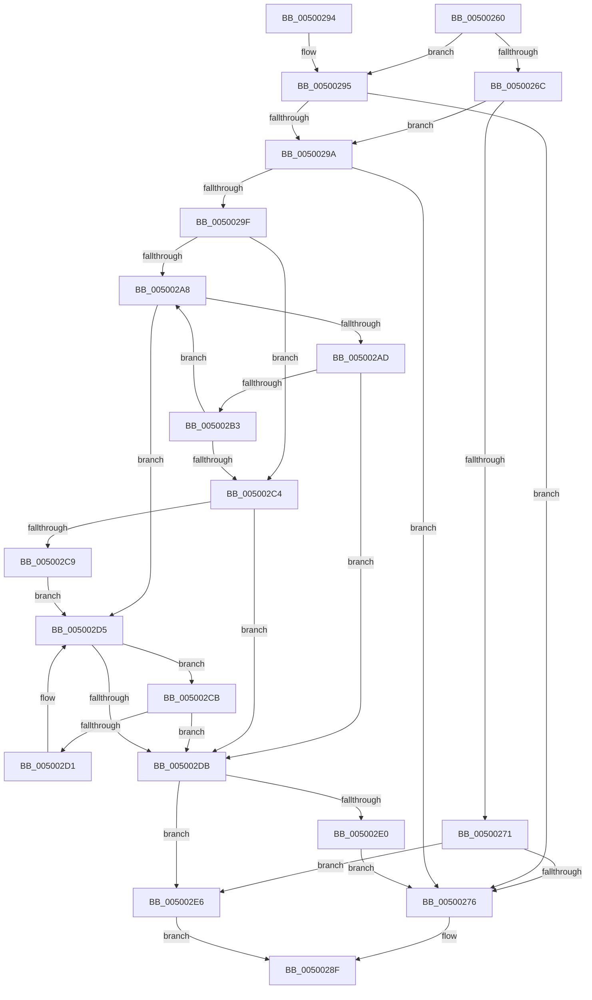

# wcsnset_s

- RVA: `0x00500260`–`0x005002EA` (길이 `138` bytes)
- VA: `0x0000000140500260`
- 실행 섹션: `.text`
- PDB 이름 있음: `예`; PDB Function 태그: `아니요`
- unwind 정보 RVA: `0x000C2664`
- 디코드: `48`개 명령, `138/138` bytes 표시
- 미해석 바이트: `0` (있으면 어셈블리에 `.byte`로 보존)

> 이 문서는 커널 이미지의 기계어와 PDB 기호를 분석해 생성했습니다. 4번과 5번은 함수 원형과 자료형을 바이너리 사용 방식에서 추정한 C 해석이며 원본 소스 복구 결과는 아닙니다.

## 1. Dependencies

- 직접 호출 지점: **1**; 고유 호출 대상: **1**
- 직접 호출자로 확인된 함수: **0**
- RIP 상대 이미지 참조: **0**

### Outgoing calls
- `0x00500285` → [EmpCheckErrataList](../49/EmpCheckErrataList_function_0049E550.md) (function, `0x0049E550`)

### Direct callers
- 이 함수 시작 RVA로 연결되는 직접 call은 확인되지 않았습니다. 간접 호출은 완전히 역산할 수 없습니다.

### Static image references
- 디코드된 RIP-relative 메모리 참조가 없습니다.

## 2. Other-region calls and transfers

- 다른 실행 섹션으로 향하는 call: **0**
- 별도 외부 분기/꼬리 이동을 확인하지 못했습니다.

## 3. Assembly (complete function range)

```asm
00500260  48 83 EC 38                     sub rsp, 0x38
00500264  45 33 D2                        xor r10d, r10d
00500267  4D 85 C9                        test r9, r9
0050026A  75 29                           jne 0x140500295
0050026C  48 85 C9                        test rcx, rcx
0050026F  75 29                           jne 0x14050029a
00500271  48 85 D2                        test rdx, rdx
00500274  74 70                           je 0x1405002e6
00500276  45 33 C9                        xor r9d, r9d
00500279  4C 89 54 24 20                  mov qword ptr [rsp + 0x20], r10
0050027E  45 33 C0                        xor r8d, r8d
00500281  33 D2                           xor edx, edx
00500283  33 C9                           xor ecx, ecx
00500285  E8 C6 E2 F9 FF                  call 0x14049e550
0050028A  B8 16 00 00 00                  mov eax, 0x16
0050028F  48 83 C4 38                     add rsp, 0x38
00500293  C3                              ret
00500294  CC                              int3
00500295  48 85 C9                        test rcx, rcx
00500298  74 DC                           je 0x140500276
0050029A  48 85 D2                        test rdx, rdx
0050029D  74 D7                           je 0x140500276
0050029F  48 8B C1                        mov rax, rcx
005002A2  66 44 39 11                     cmp word ptr [rcx], r10w
005002A6  74 1C                           je 0x1405002c4
005002A8  4D 85 C9                        test r9, r9
005002AB  74 28                           je 0x1405002d5
005002AD  48 83 EA 01                     sub rdx, 1
005002B1  74 28                           je 0x1405002db
005002B3  66 44 89 00                     mov word ptr [rax], r8w
005002B7  49 FF C9                        dec r9
005002BA  48 83 C0 02                     add rax, 2
005002BE  66 44 39 10                     cmp word ptr [rax], r10w
005002C2  75 E4                           jne 0x1405002a8
005002C4  4D 85 C9                        test r9, r9
005002C7  75 12                           jne 0x1405002db
005002C9  EB 0A                           jmp 0x1405002d5
005002CB  48 83 EA 01                     sub rdx, 1
005002CF  74 0A                           je 0x1405002db
005002D1  48 83 C0 02                     add rax, 2
005002D5  66 44 39 10                     cmp word ptr [rax], r10w
005002D9  75 F0                           jne 0x1405002cb
005002DB  48 85 D2                        test rdx, rdx
005002DE  75 06                           jne 0x1405002e6
005002E0  66 44 89 11                     mov word ptr [rcx], r10w
005002E4  EB 90                           jmp 0x140500276
005002E6  33 C0                           xor eax, eax
005002E8  EB A5                           jmp 0x14050028f
```

## 4. C-style interpretation (structured pseudocode)

```c
__int64 __fastcall wcsnset_s(__int64 a1, __int64 a2, int a3, __int64 a4)
{
    __int64 result;
    __int64 v_r10;
    __int64 v_rsp;
    unsigned __int64 v_stack_m18;

    v_rsp = (v_rsp) - (56);
    v_r10 = 0;
    if (a4 != 0) goto loc_00500295;
    if (a1 != 0) goto loc_0050029A;
    if (a2 == 0) goto loc_005002E6;
loc_00500276:
    a4 = 0;
    v_stack_m18 = 0;
    a3 = 0;
    a2 = 0;
    a1 = 0;
    result = EmpCheckErrataList(a1, a2, a3, a4);
loc_0050028F:
    v_rsp = (v_rsp) + (56);
    return 22;
loc_00500295:
    if (0 == 0) goto loc_00500276;
loc_0050029A:
    if (0 == 0) goto loc_00500276;
    if ((*(unsigned __int16 *)(a1)) == 0) goto loc_005002C4;
loc_005002A8:
    if (0 == 0) goto loc_005002D5;
    a2 = (a2) - (1);
    if (condition_is_equal) goto loc_005002DB;
    *(unsigned __int16 *)(0) = 0;
    a4 = (a4) - 1;
    result = (0) + (2);
    if ((*(unsigned __int16 *)(result)) != 0) goto loc_005002A8;
loc_005002C4:
    if (a4 != 0) goto loc_005002DB;
    goto loc_005002D5;
loc_005002CB:
    a2 = (a2) - (1);
    if (condition_is_equal) goto loc_005002DB;
    result = (result) + (2);
loc_005002D5:
    if ((*(unsigned __int16 *)(result)) != 0) goto loc_005002CB;
loc_005002DB:
    if (a2 != 0) goto loc_005002E6;
    *(unsigned __int16 *)(a1) = 0;
    goto loc_00500276;
loc_005002E6:
    result = 0;
    goto loc_0050028F;
}
```

## 5. (Beta) C Style

```c
int64_t wcsnset_s(int64_t Arg1, int64_t Arg2, int32_t Arg3, int64_t Arg4)
{
    int64_t result;
    int64_t local_r10;
    int64_t local_rsp;
    uint64_t v_stack_m18;

    local_rsp = (local_rsp) - (56);
    local_r10 = 0;
    if (Arg4 != 0) goto loc_00500295;
    if (Arg1 != 0) goto loc_0050029A;
    if (Arg2 == 0) goto loc_005002E6;
loc_00500276:
    Arg4 = 0;
    v_stack_m18 = 0;
    Arg3 = 0;
    Arg2 = 0;
    Arg1 = 0;
    result = EmpCheckErrataList(Arg1, Arg2, Arg3, Arg4);
loc_0050028F:
    local_rsp = (local_rsp) + (56);
    return 22;
loc_00500295:
    if (0 == 0) goto loc_00500276;
loc_0050029A:
    if (0 == 0) goto loc_00500276;
    if ((*(uint16_t *)(Arg1)) == 0) goto loc_005002C4;
loc_005002A8:
    if (0 == 0) goto loc_005002D5;
    Arg2 = (Arg2) - (1);
    if (condition_is_equal) goto loc_005002DB;
    *(uint16_t *)(0) = 0;
    Arg4 = (Arg4) - 1;
    result = (0) + (2);
    if ((*(uint16_t *)(result)) != 0) goto loc_005002A8;
loc_005002C4:
    if (Arg4 != 0) goto loc_005002DB;
    goto loc_005002D5;
loc_005002CB:
    Arg2 = (Arg2) - (1);
    if (condition_is_equal) goto loc_005002DB;
    result = (result) + (2);
loc_005002D5:
    if ((*(uint16_t *)(result)) != 0) goto loc_005002CB;
loc_005002DB:
    if (Arg2 != 0) goto loc_005002E6;
    *(uint16_t *)(Arg1) = 0;
    goto loc_00500276;
loc_005002E6:
    result = 0;
    goto loc_0050028F;
}
```

## 6. Execution-region graph

[열기: 2D/3D 그래프와 함수 탐색 컨트롤 패널](../../../control-panel.html?section=text&rva=0x00500260&view=graph)

- 2D 그래프는 위에서 아래로 흐르고, 3D 그래프는 빈 공간을 드래그해 회전합니다. Shift+드래그는 이동, 휠은 확대·축소, 함수 노드 선택은 대상 보고서 이동입니다.

### Static fallback


