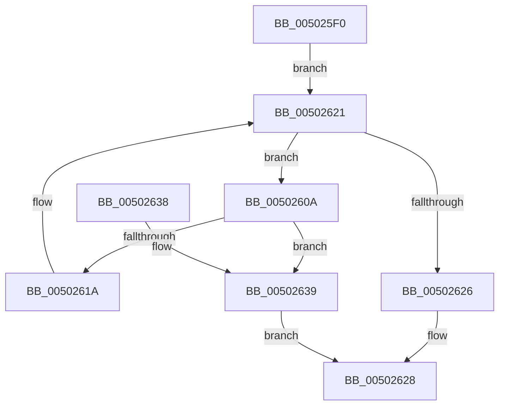

# wcspbrk

- RVA: `0x005025F0`–`0x0050263E` (길이 `78` bytes)
- VA: `0x00000001405025F0`
- 실행 섹션: `.text`
- PDB 이름 있음: `예`; PDB Function 태그: `아니요`
- unwind 정보 RVA: `0x00095A44`
- 디코드: `26`개 명령, `78/78` bytes 표시
- 미해석 바이트: `0` (있으면 어셈블리에 `.byte`로 보존)

> 이 문서는 커널 이미지의 기계어와 PDB 기호를 분석해 생성했습니다. 4번과 5번은 함수 원형과 자료형을 바이너리 사용 방식에서 추정한 C 해석이며 원본 소스 복구 결과는 아닙니다.

## 1. Dependencies

- 직접 호출 지점: **1**; 고유 호출 대상: **1**
- 직접 호출자로 확인된 함수: **3**
- RIP 상대 이미지 참조: **0**

### Outgoing calls
- `0x00502610` → [wcschr](wcschr_function_00501A60.md) (function, `0x00501A60`)

### Direct callers
- [RtlpMuiRegLoadLicInformation](../4C/RtlpMuiRegLoadLicInformation_function_004CB26C.md) at `0x004CB39D`
- [RtlpMuiRegLoadLicInformation](../4C/RtlpMuiRegLoadLicInformation_function_004CB26C.md) at `0x004CB3E9`
- [RtlpMuiRegLoadLicInformation](../4C/RtlpMuiRegLoadLicInformation_function_004CB26C.md) at `0x004CB4C5`
- [RtlpMuiRegLoadLicInformation](../4C/RtlpMuiRegLoadLicInformation_function_004CB26C.md) at `0x004CB510`
- [RtlpMuiRegLoadLicInformation](../4C/RtlpMuiRegLoadLicInformation_function_004CB26C.md) at `0x004CB5FA`
- [RtlpMuiRegLoadLicInformation](../4C/RtlpMuiRegLoadLicInformation_function_004CB26C.md) at `0x004CB671`
- [IoRegisterDeviceInterface](../../page/94/IoRegisterDeviceInterface_function_0094F9A0.md) at `0x0094FB5E`
- [PoThermalCounterSetCallback](../../page/A0/PoThermalCounterSetCallback_function_00A0E350.md) at `0x00A0E3F7`

### Static image references
- 디코드된 RIP-relative 메모리 참조가 없습니다.

## 2. Other-region calls and transfers

- 다른 실행 섹션으로 향하는 call: **0**
- 별도 외부 분기/꼬리 이동을 확인하지 못했습니다.

## 3. Assembly (complete function range)

```asm
005025F0  48 89 5C 24 08                  mov qword ptr [rsp + 8], rbx
005025F5  48 89 74 24 10                  mov qword ptr [rsp + 0x10], rsi
005025FA  57                              push rdi
005025FB  48 83 EC 20                     sub rsp, 0x20
005025FF  0F B7 01                        movzx eax, word ptr [rcx]
00502602  48 8B FA                        mov rdi, rdx
00502605  48 8B D9                        mov rbx, rcx
00502608  EB 17                           jmp 0x140502621
0050260A  0F B7 D0                        movzx edx, ax
0050260D  48 8B CF                        mov rcx, rdi
00502610  E8 4B F4 FF FF                  call 0x140501a60
00502615  48 85 C0                        test rax, rax
00502618  75 1F                           jne 0x140502639
0050261A  48 83 C3 02                     add rbx, 2
0050261E  0F B7 03                        movzx eax, word ptr [rbx]
00502621  66 85 C0                        test ax, ax
00502624  75 E4                           jne 0x14050260a
00502626  33 C0                           xor eax, eax
00502628  48 8B 5C 24 30                  mov rbx, qword ptr [rsp + 0x30]
0050262D  48 8B 74 24 38                  mov rsi, qword ptr [rsp + 0x38]
00502632  48 83 C4 20                     add rsp, 0x20
00502636  5F                              pop rdi
00502637  C3                              ret
00502638  CC                              int3
00502639  48 8B C3                        mov rax, rbx
0050263C  EB EA                           jmp 0x140502628
```

## 4. C-style interpretation (structured pseudocode)

```c
__int64 __fastcall wcspbrk(__int64 a1, __int64 a2)
{
    __int64 result;
    __int64 v_rbx;
    __int64 v_rsp;
    unsigned __int64 v_stack_p10;
    unsigned __int64 v_stack_p8;

    v_stack_p8 = v_rbx;
    v_stack_p10 = v_rsi;
    v_rsp = (v_rsp) - (32);
    goto loc_00502621;
loc_0050260A:
    result = wcschr(a2, (unsigned __int16)(*(unsigned __int16 *)(a1)), a3, a4);
    if (result != 0) goto loc_00502639;
    v_rbx = (a1) + (2);
loc_00502621:
    if ((unsigned __int16)(*(unsigned __int16 *)(v_rbx)) != 0) goto loc_0050260A;
    result = 0;
loc_00502628:
    v_rsp = (v_rsp) + (32);
    return result;
loc_00502639:
    goto loc_00502628;
}
```

## 5. (Beta) C Style

```c
int64_t wcspbrk(void *Arg1, int64_t Arg2)
{
    uint8_t *arg1 = (uint8_t *)Arg1;

    int64_t result;
    int64_t local_rbx;
    int64_t local_rsp;
    uint64_t v_stack_p10;
    uint64_t v_stack_p8;

    v_stack_p8 = local_rbx;
    v_stack_p10 = local_rsi;
    local_rsp = (local_rsp) - (32);
    goto loc_00502621;
loc_0050260A:
    result = wcschr(Arg2, (uint16_t)(*(uint16_t *)(arg1)), a3, a4);
    if (result != 0) goto loc_00502639;
    local_rbx = (Arg1) + (2);
loc_00502621:
    if ((uint16_t)(*(uint16_t *)(local_rbx)) != 0) goto loc_0050260A;
    result = 0;
loc_00502628:
    local_rsp = (local_rsp) + (32);
    return result;
loc_00502639:
    goto loc_00502628;
}
```

### 관측된 메모리 오프셋

구조체 형식이 확인되지 않은 접근은 인자 기준의 오프셋으로만 기록했습니다.

| 기준 인자 | 오프셋 표현 | 폭 (bit) | 접근 |
|---|---:|---:|---|
| `Arg1` | `+ 0x0` | `16` | `R` |

## 6. Execution-region graph

[열기: 2D/3D 그래프와 함수 탐색 컨트롤 패널](../../../control-panel.html?section=text&rva=0x005025F0&view=graph)

- 2D 그래프는 위에서 아래로 흐르고, 3D 그래프는 빈 공간을 드래그해 회전합니다. Shift+드래그는 이동, 휠은 확대·축소, 함수 노드 선택은 대상 보고서 이동입니다.

### Static fallback


