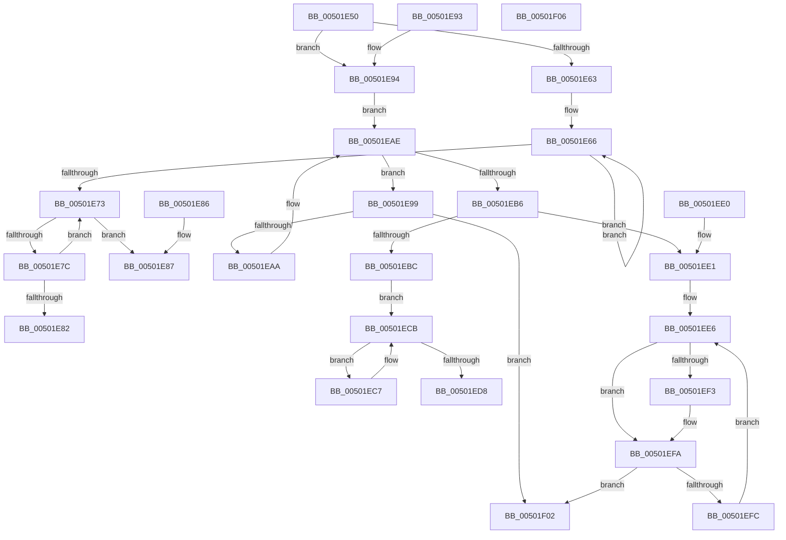

# wcsrchr

- RVA: `0x00501E50`–`0x00501F07` (길이 `183` bytes)
- VA: `0x0000000140501E50`
- 실행 섹션: `.text`
- PDB 이름 있음: `예`; PDB Function 태그: `아니요`
- unwind 정보 RVA: `0x000DB714`
- 디코드: `60`개 명령, `183/183` bytes 표시
- 미해석 바이트: `0` (있으면 어셈블리에 `.byte`로 보존)

> 이 문서는 커널 이미지의 기계어와 PDB 기호를 분석해 생성했습니다. 4번과 5번은 함수 원형과 자료형을 바이너리 사용 방식에서 추정한 C 해석이며 원본 소스 복구 결과는 아닙니다.

## 1. Dependencies

- 직접 호출 지점: **0**; 고유 호출 대상: **0**
- 직접 호출자로 확인된 함수: **18**
- RIP 상대 이미지 참조: **1**

### Outgoing calls
- 직접 디코드된 call 명령이 없습니다.

### Direct callers
- [AslPathGetFileNamePart](../../page/81/AslPathGetFileNamePart_function_0081B274.md) at `0x0081B282`
- [BiTranslateSymbolicLinkFile](../../page/82/BiTranslateSymbolicLinkFile_function_00825C2C.md) at `0x00825C79`
- [CmDeleteDevicePanelRegKeyWorker](../../page/82/CmDeleteDevicePanelRegKeyWorker_function_0082E554.md) at `0x0082E734`
- [CmDeleteDevicePanelRegKeyWorker](../../page/82/CmDeleteDevicePanelRegKeyWorker_function_0082E554.md) at `0x0082E768`
- [DrvDbDeleteObjectSubKey](../../page/83/DrvDbDeleteObjectSubKey_function_00832EEC.md) at `0x0083316A`
- [SdbGetDatabaseMatchEx](../../page/95/SdbGetDatabaseMatchEx_function_0095BD7C.md) at `0x0095BEF1`
- [PiDqDeleteUserObject](../../page/96/PiDqDeleteUserObject_function_00965B24.md) at `0x00965BB6`
- [_RegRtlDeletePathInternal](../../page/96/_RegRtlDeletePathInternal_function_00965F04.md) at `0x00966052`
- [PiDevCfgQueryIncludedDriverConfigurations](../../page/97/PiDevCfgQueryIncludedDriverConfigurations_function_009754BC.md) at `0x009755AD`
- [IopLoadDriver](../../page/99/IopLoadDriver_function_00997B54.md) at `0x00997CEB`
- [PiLookupInDDBCache](../../page/99/PiLookupInDDBCache_function_0099AB78.md) at `0x0099ABEB`
- [PiIsDriverBlocked](../../page/99/PiIsDriverBlocked_function_0099C254.md) at `0x0099C41B`
- [PopBcdSetDefaultResumeObjectElements](../../page/A3/PopBcdSetDefaultResumeObjectElements_function_00A3C7F8.md) at `0x00A3C8F3`
- [PiUpdateDriverDBCache](../../page/A8/PiUpdateDriverDBCache_function_00A895CC.md) at `0x00A8963A`
- [PiUpdateDriverDBCache](../../page/A8/PiUpdateDriverDBCache_function_00A895CC.md) at `0x00A897B0`
- [EtwpGenerateFileName](../../page/A9/EtwpGenerateFileName_function_00A962C8.md) at `0x00A96311`
- [AslPathSplit](../../page/AB/AslPathSplit_function_00ABE87C.md) at `0x00ABE8CD`
- [AslPathSplit](../../page/AB/AslPathSplit_function_00ABE87C.md) at `0x00ABE95E`
- [sub_00B23888](../../page/B2/Unknown_function_00B23888.md) at `0x00B239E1`
- [sub_00B47098](../../page/B4/Unknown_function_00B47098.md) at `0x00B471FA`
- [sub_00B47098](../../page/B4/Unknown_function_00B47098.md) at `0x00B47211`
- [CmpGetSystemRelativeRegistryHiveFilePath](../../init/C5/CmpGetSystemRelativeRegistryHiveFilePath_function_00C57C6C.md) at `0x00C57C7E`

### Static image references
- `0x00501E50` → RVA `0x00E0A6C0` (`.data`; read)

## 2. Other-region calls and transfers

- 다른 실행 섹션으로 향하는 call: **0**
- 별도 외부 분기/꼬리 이동을 확인하지 못했습니다.

## 3. Assembly (complete function range)

```asm
00501E50  8A 05 6A 88 90 00               mov al, byte ptr [rip + 0x90886a]
00501E56  4C 8B C1                        mov r8, rcx
00501E59  33 C9                           xor ecx, ecx
00501E5B  44 0F B7 CA                     movzx r9d, dx
00501E5F  A8 08                           test al, 8
00501E61  75 31                           jne 0x140501e94
00501E63  49 8B D0                        mov rdx, r8
00501E66  41 0F B7 00                     movzx eax, word ptr [r8]
00501E6A  49 83 C0 02                     add r8, 2
00501E6E  66 85 C0                        test ax, ax
00501E71  75 F3                           jne 0x140501e66
00501E73  49 83 E8 02                     sub r8, 2
00501E77  4C 3B C2                        cmp r8, rdx
00501E7A  74 0B                           je 0x140501e87
00501E7C  66 45 39 08                     cmp word ptr [r8], r9w
00501E80  75 F1                           jne 0x140501e73
00501E82  49 8B C0                        mov rax, r8
00501E85  C3                              ret
00501E86  CC                              int3
00501E87  66 45 39 08                     cmp word ptr [r8], r9w
00501E8B  49 0F 44 C8                     cmove rcx, r8
00501E8F  48 8B C1                        mov rax, rcx
00501E92  C3                              ret
00501E93  CC                              int3
00501E94  48 8B D1                        mov rdx, rcx
00501E97  EB 15                           jmp 0x140501eae
00501E99  41 0F B7 00                     movzx eax, word ptr [r8]
00501E9D  66 41 3B C1                     cmp ax, r9w
00501EA1  49 0F 44 D0                     cmove rdx, r8
00501EA5  66 85 C0                        test ax, ax
00501EA8  74 58                           je 0x140501f02
00501EAA  49 83 C0 02                     add r8, 2
00501EAE  41 8D 40 01                     lea eax, [r8 + 1]
00501EB2  A8 0E                           test al, 0xe
00501EB4  75 E3                           jne 0x140501e99
00501EB6  66 41 3B C9                     cmp cx, r9w
00501EBA  75 25                           jne 0x140501ee1
00501EBC  B8 01 00 FF FF                  mov eax, 0xffff0001
00501EC1  66 0F 6E C8                     movd xmm1, eax
00501EC5  EB 04                           jmp 0x140501ecb
00501EC7  49 83 C0 10                     add r8, 0x10
00501ECB  F3 41 0F 6F 00                  movdqu xmm0, xmmword ptr [r8]
00501ED0  66 0F 3A 63 C8 15               pcmpistri xmm1, xmm0, 0x15
00501ED6  75 EF                           jne 0x140501ec7
00501ED8  48 63 C1                        movsxd rax, ecx
00501EDB  49 8D 04 40                     lea rax, [r8 + rax*2]
00501EDF  C3                              ret
00501EE0  CC                              int3
00501EE1  66 41 0F 6E C9                  movd xmm1, r9d
00501EE6  F3 41 0F 6F 00                  movdqu xmm0, xmmword ptr [r8]
00501EEB  66 0F 3A 63 C8 41               pcmpistri xmm1, xmm0, 0x41
00501EF1  73 07                           jae 0x140501efa
00501EF3  48 63 C1                        movsxd rax, ecx
00501EF6  49 8D 14 40                     lea rdx, [r8 + rax*2]
00501EFA  74 06                           je 0x140501f02
00501EFC  49 83 C0 10                     add r8, 0x10
00501F00  EB E4                           jmp 0x140501ee6
00501F02  48 8B C2                        mov rax, rdx
00501F05  C3                              ret
00501F06  CC                              int3
```

## 4. C-style interpretation (structured pseudocode)

```c
__int64 __fastcall wcsrchr(__int64 a1, unsigned __int16 a2)
{
    __int64 result;

    a1 = 0;
    if ((((unsigned __int8)(*(unsigned __int8 *)(v_rip + 9472106))) & (8)) != 0) goto loc_00501E94;
loc_00501E66:
    a3 = (a1) + (2);
    if ((unsigned __int16)(*(unsigned __int16 *)(a1)) != 0) goto loc_00501E66;
loc_00501E73:
    a3 = (a3) - (2);
    if (a3 == 0) goto loc_00501E87;
    if ((*(unsigned __int16 *)(a3)) != a2) goto loc_00501E73;
    return a3;
loc_00501E87:
    if ((*(unsigned __int16 *)(a3)) == a2) { a1 = a3; }
    return a1;
loc_00501E94:
    goto loc_00501EAE;
loc_00501E99:
    if (((unsigned __int16)(*(unsigned __int16 *)(a3))) == a2) { a1 = a3; }
    if ((unsigned __int16)(*(unsigned __int16 *)(a3)) == 0) goto loc_00501F02;
    a3 = (a3) + (2);
loc_00501EAE:
    if ((((unsigned __int8)(a3 + 1)) & (14)) != 0) goto loc_00501E99;
    if (((unsigned __int16)(a1)) != a2) goto loc_00501EE1;
    goto loc_00501ECB;
loc_00501EC7:
    a3 = (a3) + (16);
loc_00501ECB:
    if (condition_is_not_equal) goto loc_00501EC7;
    return a3 + (int)((unsigned int)(a1)) * 2;
loc_00501EE1:
loc_00501EE6:
    result = a3 + (int)((unsigned int)(a1)) * 2;
    if (!(condition_is_above_or_equal)) {
        result = (int)((unsigned int)(a1));
        a2 = a3 + result * 2;
    }
    if (condition_is_equal) goto loc_00501F02;
    a3 = (a3) + (16);
    goto loc_00501EE6;
loc_00501F02:
    return a2;
}
```

## 5. (Beta) C Style

```c
int64_t wcsrchr(void *Arg1, uint16_t Arg2)
{
    uint8_t *arg1 = (uint8_t *)Arg1;

    int64_t result;

    Arg1 = 0;
    if ((((uint8_t)(*(uint8_t *)(v_rip + 0x90886A))) & (8)) != 0) goto loc_00501E94;
loc_00501E66:
    a3 = (Arg1) + (2);
    if ((uint16_t)(*(uint16_t *)(arg1)) != 0) goto loc_00501E66;
loc_00501E73:
    a3 = (a3) - (2);
    if (a3 == 0) goto loc_00501E87;
    if ((*(uint16_t *)(a3)) != Arg2) goto loc_00501E73;
    return a3;
loc_00501E87:
    if ((*(uint16_t *)(a3)) == Arg2) { Arg1 = a3; }
    return Arg1;
loc_00501E94:
    goto loc_00501EAE;
loc_00501E99:
    if (((uint16_t)(*(uint16_t *)(a3))) == Arg2) { Arg1 = a3; }
    if ((uint16_t)(*(uint16_t *)(a3)) == 0) goto loc_00501F02;
    a3 = (a3) + (2);
loc_00501EAE:
    if ((((uint8_t)(a3 + 1)) & (14)) != 0) goto loc_00501E99;
    if (((uint16_t)(Arg1)) != Arg2) goto loc_00501EE1;
    goto loc_00501ECB;
loc_00501EC7:
    a3 = (a3) + (16);
loc_00501ECB:
    if (condition_is_not_equal) goto loc_00501EC7;
    return a3 + (int32_t)((uint32_t)(Arg1)) * 2;
loc_00501EE1:
loc_00501EE6:
    result = a3 + (int32_t)((uint32_t)(Arg1)) * 2;
    if (!(condition_is_above_or_equal)) {
        result = (int32_t)((uint32_t)(Arg1));
        Arg2 = a3 + result * 2;
    }
    if (condition_is_equal) goto loc_00501F02;
    a3 = (a3) + (16);
    goto loc_00501EE6;
loc_00501F02:
    return Arg2;
}
```

### 관측된 메모리 오프셋

구조체 형식이 확인되지 않은 접근은 인자 기준의 오프셋으로만 기록했습니다.

| 기준 인자 | 오프셋 표현 | 폭 (bit) | 접근 |
|---|---:|---:|---|
| `Arg1` | `+ 0x0` | `16` | `R` |
| `Arg1` | `+ 0x0` | `128` | `R` |
| `Arg1` | `+ 0x0 + rax*2` | `64` | `R` |
| `Arg1` | `+ 0x1` | `32` | `R` |

## 6. Execution-region graph

[열기: 2D/3D 그래프와 함수 탐색 컨트롤 패널](../../../control-panel.html?section=text&rva=0x00501E50&view=graph)

- 2D 그래프는 위에서 아래로 흐르고, 3D 그래프는 빈 공간을 드래그해 회전합니다. Shift+드래그는 이동, 휠은 확대·축소, 함수 노드 선택은 대상 보고서 이동입니다.

### Static fallback


