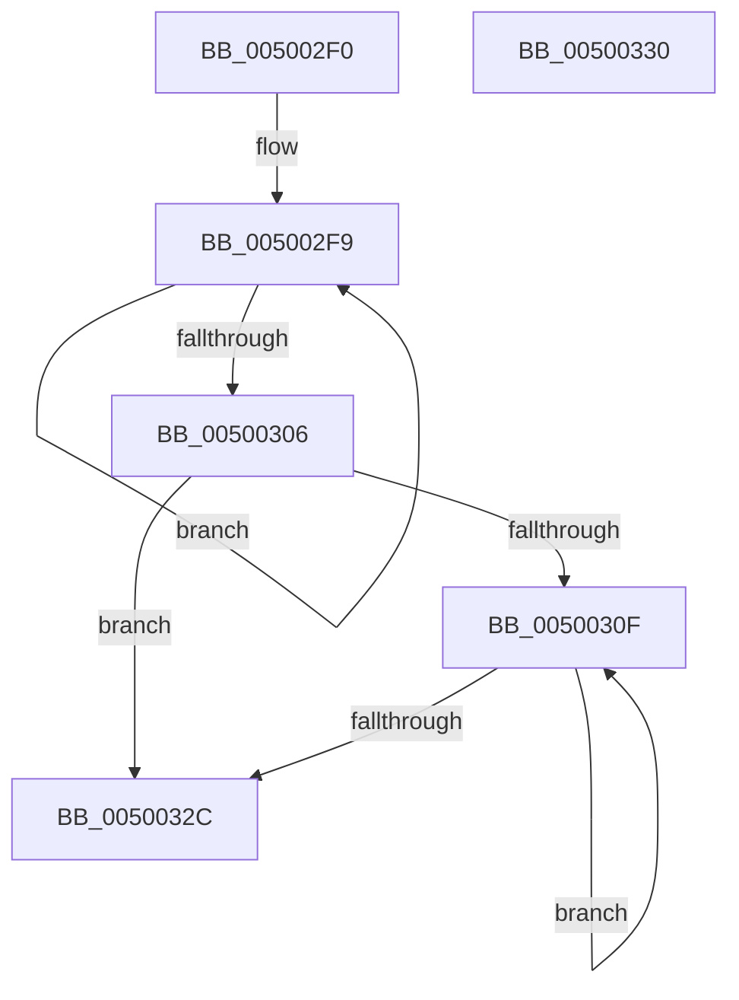

# wcsrev

- RVA: `0x005002F0`–`0x00500331` (길이 `65` bytes)
- VA: `0x00000001405002F0`
- 실행 섹션: `.text`
- PDB 이름 있음: `예`; PDB Function 태그: `아니요`
- unwind 정보 RVA: `0x000DB714`
- 디코드: `21`개 명령, `65/65` bytes 표시
- 미해석 바이트: `0` (있으면 어셈블리에 `.byte`로 보존)

> 이 문서는 커널 이미지의 기계어와 PDB 기호를 분석해 생성했습니다. 4번과 5번은 함수 원형과 자료형을 바이너리 사용 방식에서 추정한 C 해석이며 원본 소스 복구 결과는 아닙니다.

## 1. Dependencies

- 직접 호출 지점: **0**; 고유 호출 대상: **0**
- 직접 호출자로 확인된 함수: **0**
- RIP 상대 이미지 참조: **0**

### Outgoing calls
- 직접 디코드된 call 명령이 없습니다.

### Direct callers
- 이 함수 시작 RVA로 연결되는 직접 call은 확인되지 않았습니다. 간접 호출은 완전히 역산할 수 없습니다.

### Static image references
- 디코드된 RIP-relative 메모리 참조가 없습니다.

## 2. Other-region calls and transfers

- 다른 실행 섹션으로 향하는 call: **0**
- 별도 외부 분기/꼬리 이동을 확인하지 못했습니다.

## 3. Assembly (complete function range)

```asm
005002F0  4C 8B C1                        mov r8, rcx
005002F3  4C 8B D1                        mov r10, rcx
005002F6  4C 8B C9                        mov r9, rcx
005002F9  41 0F B7 00                     movzx eax, word ptr [r8]
005002FD  49 83 C0 02                     add r8, 2
00500301  66 85 C0                        test ax, ax
00500304  75 F3                           jne 0x1405002f9
00500306  49 83 E8 04                     sub r8, 4
0050030A  49 3B C8                        cmp rcx, r8
0050030D  73 1D                           jae 0x14050032c
0050030F  41 0F B7 08                     movzx ecx, word ptr [r8]
00500313  41 0F B7 11                     movzx edx, word ptr [r9]
00500317  66 41 89 09                     mov word ptr [r9], cx
0050031B  49 83 C1 02                     add r9, 2
0050031F  66 41 89 10                     mov word ptr [r8], dx
00500323  49 83 E8 02                     sub r8, 2
00500327  4D 3B C8                        cmp r9, r8
0050032A  72 E3                           jb 0x14050030f
0050032C  49 8B C2                        mov rax, r10
0050032F  C3                              ret
00500330  CC                              int3
```

## 4. C-style interpretation (structured pseudocode)

```c
__int64 __fastcall wcsrev(__int64 a1)
{
loc_005002F9:
    a3 = (a1) + (2);
    if ((unsigned __int16)(*(unsigned __int16 *)(a1)) != 0) goto loc_005002F9;
    a3 = (a3) - (4);
    if (a1 >= a3) goto loc_0050032C;
loc_0050030F:
    *(unsigned __int16 *)(a1) = (unsigned __int16)(*(unsigned __int16 *)(a3));
    a4 = (a1) + (2);
    *(unsigned __int16 *)(a3) = (unsigned __int16)(*(unsigned __int16 *)(a1));
    a3 = (a3) - (2);
    if (a4 < a3) goto loc_0050030F;
loc_0050032C:
    return a1;
}
```

## 5. (Beta) C Style

```c
void *wcsrev(void *Arg1)
{
    uint8_t *arg1 = (uint8_t *)Arg1;

loc_005002F9:
    a3 = (Arg1) + (2);
    if ((uint16_t)(*(uint16_t *)(arg1)) != 0) goto loc_005002F9;
    a3 = (a3) - (4);
    if (Arg1 >= a3) goto loc_0050032C;
loc_0050030F:
    *(uint16_t *)(arg1) = (uint16_t)(*(uint16_t *)(a3));
    a4 = (Arg1) + (2);
    *(uint16_t *)(a3) = (uint16_t)(*(uint16_t *)(arg1));
    a3 = (a3) - (2);
    if (a4 < a3) goto loc_0050030F;
loc_0050032C:
    return Arg1;
}
```

### 관측된 메모리 오프셋

구조체 형식이 확인되지 않은 접근은 인자 기준의 오프셋으로만 기록했습니다.

| 기준 인자 | 오프셋 표현 | 폭 (bit) | 접근 |
|---|---:|---:|---|
| `Arg1` | `+ 0x0` | `16` | `R` |
| `Arg1` | `+ 0x0` | `16` | `W` |

## 6. Execution-region graph

[열기: 2D/3D 그래프와 함수 탐색 컨트롤 패널](../../../control-panel.html?section=text&rva=0x005002F0&view=graph)

- 2D 그래프는 위에서 아래로 흐르고, 3D 그래프는 빈 공간을 드래그해 회전합니다. Shift+드래그는 이동, 휠은 확대·축소, 함수 노드 선택은 대상 보고서 이동입니다.

### Static fallback


