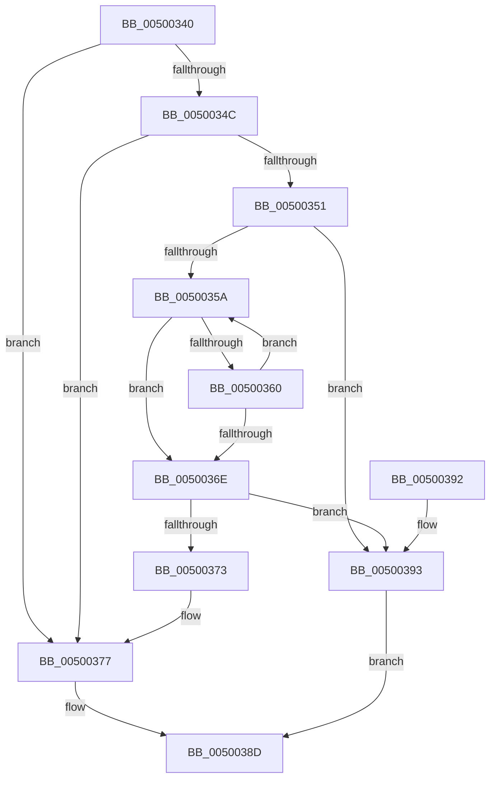

# wcsset_s

- RVA: `0x00500340`–`0x00500397` (길이 `87` bytes)
- VA: `0x0000000140500340`
- 실행 섹션: `.text`
- PDB 이름 있음: `예`; PDB Function 태그: `아니요`
- unwind 정보 RVA: `0x0008EE54`
- 디코드: `29`개 명령, `87/87` bytes 표시
- 미해석 바이트: `0` (있으면 어셈블리에 `.byte`로 보존)

> 이 문서는 커널 이미지의 기계어와 PDB 기호를 분석해 생성했습니다. 4번과 5번은 함수 원형과 자료형을 바이너리 사용 방식에서 추정한 C 해석이며 원본 소스 복구 결과는 아닙니다.

## 1. Dependencies

- 직접 호출 지점: **1**; 고유 호출 대상: **1**
- 직접 호출자로 확인된 함수: **0**
- RIP 상대 이미지 참조: **0**

### Outgoing calls
- `0x00500383` → [EmpCheckErrataList](../49/EmpCheckErrataList_function_0049E550.md) (function, `0x0049E550`)

### Direct callers
- 이 함수 시작 RVA로 연결되는 직접 call은 확인되지 않았습니다. 간접 호출은 완전히 역산할 수 없습니다.

### Static image references
- 디코드된 RIP-relative 메모리 참조가 없습니다.

## 2. Other-region calls and transfers

- 다른 실행 섹션으로 향하는 call: **0**
- 별도 외부 분기/꼬리 이동을 확인하지 못했습니다.

## 3. Assembly (complete function range)

```asm
00500340  48 83 EC 38                     sub rsp, 0x38
00500344  45 33 C9                        xor r9d, r9d
00500347  48 85 C9                        test rcx, rcx
0050034A  74 2B                           je 0x140500377
0050034C  48 85 D2                        test rdx, rdx
0050034F  74 26                           je 0x140500377
00500351  48 8B C1                        mov rax, rcx
00500354  66 44 39 09                     cmp word ptr [rcx], r9w
00500358  74 39                           je 0x140500393
0050035A  48 83 EA 01                     sub rdx, 1
0050035E  74 0E                           je 0x14050036e
00500360  66 44 89 00                     mov word ptr [rax], r8w
00500364  48 83 C0 02                     add rax, 2
00500368  66 44 39 08                     cmp word ptr [rax], r9w
0050036C  75 EC                           jne 0x14050035a
0050036E  48 85 D2                        test rdx, rdx
00500371  75 20                           jne 0x140500393
00500373  66 44 89 09                     mov word ptr [rcx], r9w
00500377  45 33 C0                        xor r8d, r8d
0050037A  4C 89 4C 24 20                  mov qword ptr [rsp + 0x20], r9
0050037F  33 D2                           xor edx, edx
00500381  33 C9                           xor ecx, ecx
00500383  E8 C8 E1 F9 FF                  call 0x14049e550
00500388  B8 16 00 00 00                  mov eax, 0x16
0050038D  48 83 C4 38                     add rsp, 0x38
00500391  C3                              ret
00500392  CC                              int3
00500393  33 C0                           xor eax, eax
00500395  EB F6                           jmp 0x14050038d
```

## 4. C-style interpretation (structured pseudocode)

```c
__int64 __fastcall wcsset_s(__int64 a1, __int64 a2, int a3, int a4)
{
    __int64 result;
    __int64 v_rsp;
    unsigned __int64 v_stack_m18;

    v_rsp = (v_rsp) - (56);
    a4 = 0;
    if (a1 == 0) goto loc_00500377;
    if (a2 == 0) goto loc_00500377;
    if ((*(unsigned __int16 *)(a1)) == 0) goto loc_00500393;
loc_0050035A:
    a2 = (a2) - (1);
    if (condition_is_equal) goto loc_0050036E;
    *(unsigned __int16 *)(a1) = (unsigned __int16)(a3);
    result = (a1) + (2);
    if ((*(unsigned __int16 *)(result)) != 0) goto loc_0050035A;
loc_0050036E:
    if (a2 != 0) goto loc_00500393;
    *(unsigned __int16 *)(a1) = 0;
loc_00500377:
    a3 = 0;
    v_stack_m18 = 0;
    a2 = 0;
    a1 = 0;
    result = EmpCheckErrataList(a1, a2, a3, a4);
loc_0050038D:
    v_rsp = (v_rsp) + (56);
    return 22;
loc_00500393:
    result = 0;
    goto loc_0050038D;
}
```

## 5. (Beta) C Style

```c
int64_t wcsset_s(int64_t Arg1, int64_t Arg2, int32_t Arg3, int32_t Arg4)
{
    int64_t result;
    int64_t local_rsp;
    uint64_t v_stack_m18;

    local_rsp = (local_rsp) - (56);
    Arg4 = 0;
    if (Arg1 == 0) goto loc_00500377;
    if (Arg2 == 0) goto loc_00500377;
    if ((*(uint16_t *)(Arg1)) == 0) goto loc_00500393;
loc_0050035A:
    Arg2 = (Arg2) - (1);
    if (condition_is_equal) goto loc_0050036E;
    *(uint16_t *)(Arg1) = (uint16_t)(Arg3);
    result = (Arg1) + (2);
    if ((*(uint16_t *)(result)) != 0) goto loc_0050035A;
loc_0050036E:
    if (Arg2 != 0) goto loc_00500393;
    *(uint16_t *)(Arg1) = 0;
loc_00500377:
    Arg3 = 0;
    v_stack_m18 = 0;
    Arg2 = 0;
    Arg1 = 0;
    result = EmpCheckErrataList(Arg1, Arg2, Arg3, Arg4);
loc_0050038D:
    local_rsp = (local_rsp) + (56);
    return 22;
loc_00500393:
    result = 0;
    goto loc_0050038D;
}
```

## 6. Execution-region graph

[열기: 2D/3D 그래프와 함수 탐색 컨트롤 패널](../../../control-panel.html?section=text&rva=0x00500340&view=graph)

- 2D 그래프는 위에서 아래로 흐르고, 3D 그래프는 빈 공간을 드래그해 회전합니다. Shift+드래그는 이동, 휠은 확대·축소, 함수 노드 선택은 대상 보고서 이동입니다.

### Static fallback


