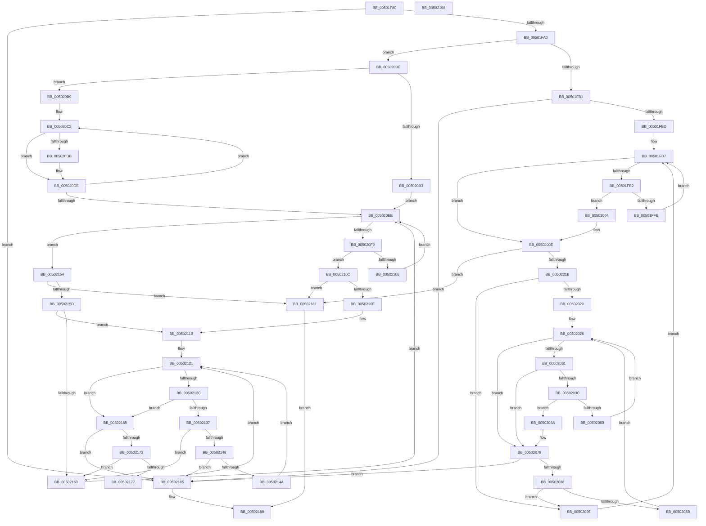

# wcsstr

- RVA: `0x00501F80`–`0x00502199` (길이 `537` bytes)
- VA: `0x0000000140501F80`
- 실행 섹션: `.text`
- PDB 이름 있음: `예`; PDB Function 태그: `아니요`
- unwind 정보 RVA: `0x000AF220`
- 디코드: `159`개 명령, `537/537` bytes 표시
- 미해석 바이트: `0` (있으면 어셈블리에 `.byte`로 보존)

> 이 문서는 커널 이미지의 기계어와 PDB 기호를 분석해 생성했습니다. 4번과 5번은 함수 원형과 자료형을 바이너리 사용 방식에서 추정한 C 해석이며 원본 소스 복구 결과는 아닙니다.

## 1. Dependencies

- 직접 호출 지점: **0**; 고유 호출 대상: **0**
- 직접 호출자로 확인된 함수: **15**
- RIP 상대 이미지 참조: **1**

### Outgoing calls
- 직접 디코드된 call 명령이 없습니다.

### Direct callers
- [SmUniqueIdParseProductName](../60/SmUniqueIdParseProductName_function_0060ECC0.md) at `0x0060ECF0`
- [SmUniqueIdParseProductName](../60/SmUniqueIdParseProductName_function_0060ECC0.md) at `0x0060EDC0`
- [BcpGetProgressMessages](../6A/BcpGetProgressMessages_function_006A0B48.md) at `0x006A0B7D`
- [IopCheckIfNotNativeDriver](../../page/71/IopCheckIfNotNativeDriver_function_0071AFB4.md) at `0x0071AFF6`
- [PiGetDeviceRegistryProperty](../../page/72/PiGetDeviceRegistryProperty_function_007280A8.md) at `0x0072821C`
- [BiUpdateObjectReferenceInEfiEntry](../../page/82/BiUpdateObjectReferenceInEfiEntry_function_0082745C.md) at `0x0082752E`
- [SiGetBiosSystemPartition](../../page/82/SiGetBiosSystemPartition_function_008286C0.md) at `0x0082872A`
- [PiGetDeviceRegProperty](../../page/8F/PiGetDeviceRegProperty_function_008FAC6C.md) at `0x008FAE9C`
- [PfSnIsHostingApplication](../../page/95/PfSnIsHostingApplication_function_0095FF34.md) at `0x0095FF89`
- [SubstringMatch](../../page/A3/SubstringMatch_function_00A3408C.md) at `0x00A340D5`
- [SiIsWinPEBoot](../../page/A3/SiIsWinPEBoot_function_00A37880.md) at `0x00A378C9`
- [SiGetBootDeviceName](../../page/A3/SiGetBootDeviceName_function_00A378FC.md) at `0x00A37A3B`
- [BiIsWinPEBoot](../../page/A4/BiIsWinPEBoot_function_00A40F54.md) at `0x00A40FA3`
- [EtwpGenerateFileName](../../page/A9/EtwpGenerateFileName_function_00A962C8.md) at `0x00A96326`
- [sub_00B3A7EA](../../page/B3/Unknown_function_00B3A7EA.md) at `0x00B3A80B`
- [PopGetBitlockerKeyLocation](../../pagelk/B6/PopGetBitlockerKeyLocation_function_00B6BBFC.md) at `0x00B6BD6A`

### Static image references
- `0x00501FA0` → RVA `0x00E0A6C0` (`.data`; read)

## 2. Other-region calls and transfers

- 다른 실행 섹션으로 향하는 call: **0**
- 별도 외부 분기/꼬리 이동을 확인하지 못했습니다.

## 3. Assembly (complete function range)

```asm
00501F80  48 89 5C 24 08                  mov qword ptr [rsp + 8], rbx
00501F85  48 89 74 24 18                  mov qword ptr [rsp + 0x18], rsi
00501F8A  48 89 7C 24 20                  mov qword ptr [rsp + 0x20], rdi
00501F8F  33 F6                           xor esi, esi
00501F91  4C 8B D2                        mov r10, rdx
00501F94  4C 8B C1                        mov r8, rcx
00501F97  66 3B 32                        cmp si, word ptr [rdx]
00501F9A  0F 84 E5 01 00 00               je 0x140502185
00501FA0  8A 05 1A 87 90 00               mov al, byte ptr [rip + 0x90871a]
00501FA6  8D 4E 08                        lea ecx, [rsi + 8]
00501FA9  84 C1                           test cl, al
00501FAB  0F 85 ED 00 00 00               jne 0x14050209e
00501FB1  0F B7 3A                        movzx edi, word ptr [rdx]
00501FB4  66 3B F7                        cmp si, di
00501FB7  0F 84 C8 01 00 00               je 0x140502185
00501FBD  BB F0 0F 00 00                  mov ebx, 0xff0
00501FC2  66 0F 6E C7                     movd xmm0, edi
00501FC6  F2 0F 70 C8 00                  pshuflw xmm1, xmm0, 0
00501FCB  0F 57 DB                        xorps xmm3, xmm3
00501FCE  66 0F 70 E1 00                  pshufd xmm4, xmm1, 0
00501FD3  44 8D 5B 0F                     lea r11d, [rbx + 0xf]
00501FD7  49 8B C0                        mov rax, r8
00501FDA  49 23 C3                        and rax, r11
00501FDD  48 3B C3                        cmp rax, rbx
00501FE0  77 2C                           ja 0x14050200e
00501FE2  F3 41 0F 6F 00                  movdqu xmm0, xmmword ptr [r8]
00501FE7  66 0F 6F C8                     movdqa xmm1, xmm0
00501FEB  66 0F 75 C3                     pcmpeqw xmm0, xmm3
00501FEF  66 0F 75 CC                     pcmpeqw xmm1, xmm4
00501FF3  0F 56 C8                        orps xmm1, xmm0
00501FF6  66 0F D7 C1                     pmovmskb eax, xmm1
00501FFA  85 C0                           test eax, eax
00501FFC  75 06                           jne 0x140502004
00501FFE  49 83 C0 10                     add r8, 0x10
00502002  EB D3                           jmp 0x140501fd7
00502004  0F BC C8                        bsf ecx, eax
00502007  48 D1 E9                        shr rcx, 1
0050200A  4D 8D 04 48                     lea r8, [r8 + rcx*2]
0050200E  41 0F B7 00                     movzx eax, word ptr [r8]
00502012  66 3B F0                        cmp si, ax
00502015  0F 84 66 01 00 00               je 0x140502181
0050201B  66 3B F8                        cmp di, ax
0050201E  75 75                           jne 0x140502095
00502020  49 8B D0                        mov rdx, r8
00502023  4D 8B CA                        mov r9, r10
00502026  49 8B C1                        mov rax, r9
00502029  49 23 C3                        and rax, r11
0050202C  48 3B C3                        cmp rax, rbx
0050202F  77 48                           ja 0x140502079
00502031  48 8B C2                        mov rax, rdx
00502034  49 23 C3                        and rax, r11
00502037  48 3B C3                        cmp rax, rbx
0050203A  77 3D                           ja 0x140502079
0050203C  F3 41 0F 6F 09                  movdqu xmm1, xmmword ptr [r9]
00502041  F3 0F 6F 02                     movdqu xmm0, xmmword ptr [rdx]
00502045  66 0F 6F D1                     movdqa xmm2, xmm1
00502049  66 0F 75 CB                     pcmpeqw xmm1, xmm3
0050204D  66 0F 75 D0                     pcmpeqw xmm2, xmm0
00502051  66 0F 75 D3                     pcmpeqw xmm2, xmm3
00502055  0F 56 D1                        orps xmm2, xmm1
00502058  66 0F D7 C2                     pmovmskb eax, xmm2
0050205C  85 C0                           test eax, eax
0050205E  75 0A                           jne 0x14050206a
00502060  48 83 C2 10                     add rdx, 0x10
00502064  49 83 C1 10                     add r9, 0x10
00502068  EB BC                           jmp 0x140502026
0050206A  0F BC C8                        bsf ecx, eax
0050206D  48 D1 E9                        shr rcx, 1
00502070  48 03 C9                        add rcx, rcx
00502073  48 03 D1                        add rdx, rcx
00502076  4C 03 C9                        add r9, rcx
00502079  41 0F B7 01                     movzx eax, word ptr [r9]
0050207D  66 3B F0                        cmp si, ax
00502080  0F 84 FF 00 00 00               je 0x140502185
00502086  66 39 02                        cmp word ptr [rdx], ax
00502089  75 0A                           jne 0x140502095
0050208B  48 83 C2 02                     add rdx, 2
0050208F  49 83 C1 02                     add r9, 2
00502093  EB 91                           jmp 0x140502026
00502095  49 83 C0 02                     add r8, 2
00502099  E9 39 FF FF FF                  jmp 0x140501fd7
0050209E  41 BB FF 0F 00 00               mov r11d, 0xfff
005020A4  49 8B C2                        mov rax, r10
005020A7  49 23 C3                        and rax, r11
005020AA  41 8D 5B F1                     lea ebx, [r11 - 0xf]
005020AE  48 3B C3                        cmp rax, rbx
005020B1  77 06                           ja 0x1405020b9
005020B3  F3 0F 6F 02                     movdqu xmm0, xmmword ptr [rdx]
005020B7  EB 35                           jmp 0x1405020ee
005020B9  0F B7 12                        movzx edx, word ptr [rdx]
005020BC  0F 57 C0                        xorps xmm0, xmm0
005020BF  4D 8B CA                        mov r9, r10
005020C2  0F B7 C2                        movzx eax, dx
005020C5  0F B7 FA                        movzx edi, dx
005020C8  66 0F 73 D8 02                  psrldq xmm0, 2
005020CD  66 0F C4 C0 07                  pinsrw xmm0, eax, 7
005020D2  49 8D 41 02                     lea rax, [r9 + 2]
005020D6  66 3B F2                        cmp si, dx
005020D9  74 03                           je 0x1405020de
005020DB  0F B7 10                        movzx edx, word ptr [rax]
005020DE  66 3B F7                        cmp si, di
005020E1  49 0F 44 C1                     cmove rax, r9
005020E5  4C 8B C8                        mov r9, rax
005020E8  48 83 E9 01                     sub rcx, 1
005020EC  75 D4                           jne 0x1405020c2
005020EE  49 8B C0                        mov rax, r8
005020F1  49 23 C3                        and rax, r11
005020F4  48 3B C3                        cmp rax, rbx
005020F7  77 5B                           ja 0x140502154
005020F9  F3 41 0F 6F 08                  movdqu xmm1, xmmword ptr [r8]
005020FE  66 0F 3A 63 C1 0D               pcmpistri xmm0, xmm1, 0xd
00502104  76 06                           jbe 0x14050210c
00502106  49 83 C0 10                     add r8, 0x10
0050210A  EB E2                           jmp 0x1405020ee
0050210C  73 73                           jae 0x140502181
0050210E  66 0F 3A 63 C1 0D               pcmpistri xmm0, xmm1, 0xd
00502114  48 63 C1                        movsxd rax, ecx
00502117  4D 8D 04 40                     lea r8, [r8 + rax*2]
0050211B  49 8B D0                        mov rdx, r8
0050211E  4D 8B CA                        mov r9, r10
00502121  48 8B C2                        mov rax, rdx
00502124  49 23 C3                        and rax, r11
00502127  48 3B C3                        cmp rax, rbx
0050212A  77 3D                           ja 0x140502169
0050212C  49 8B C1                        mov rax, r9
0050212F  49 23 C3                        and rax, r11
00502132  48 3B C3                        cmp rax, rbx
00502135  77 32                           ja 0x140502169
00502137  F3 0F 6F 0A                     movdqu xmm1, xmmword ptr [rdx]
0050213B  F3 41 0F 6F 11                  movdqu xmm2, xmmword ptr [r9]
00502140  66 0F 3A 63 D1 0D               pcmpistri xmm2, xmm1, 0xd
00502146  71 1B                           jno 0x140502163
00502148  78 3B                           js 0x140502185
0050214A  48 83 C2 10                     add rdx, 0x10
0050214E  49 83 C1 10                     add r9, 0x10
00502152  EB CD                           jmp 0x140502121
00502154  41 0F B7 00                     movzx eax, word ptr [r8]
00502158  66 3B F0                        cmp si, ax
0050215B  74 24                           je 0x140502181
0050215D  66 41 3B 02                     cmp ax, word ptr [r10]
00502161  74 B8                           je 0x14050211b
00502163  49 83 C0 02                     add r8, 2
00502167  EB 85                           jmp 0x1405020ee
00502169  41 0F B7 01                     movzx eax, word ptr [r9]
0050216D  66 3B F0                        cmp si, ax
00502170  74 13                           je 0x140502185
00502172  66 39 02                        cmp word ptr [rdx], ax
00502175  75 EC                           jne 0x140502163
00502177  48 83 C2 02                     add rdx, 2
0050217B  49 83 C1 02                     add r9, 2
0050217F  EB A0                           jmp 0x140502121
00502181  33 C0                           xor eax, eax
00502183  EB 03                           jmp 0x140502188
00502185  49 8B C0                        mov rax, r8
00502188  48 8B 5C 24 08                  mov rbx, qword ptr [rsp + 8]
0050218D  48 8B 74 24 18                  mov rsi, qword ptr [rsp + 0x18]
00502192  48 8B 7C 24 20                  mov rdi, qword ptr [rsp + 0x20]
00502197  C3                              ret
00502198  CC                              int3
```

## 4. C-style interpretation (structured pseudocode)

```c
__int64 __fastcall wcsstr(__int64 a1, __int64 a2)
{
    __int64 result;
    __int64 v_rsi;
    unsigned __int64 v_stack_p18;
    unsigned __int64 v_stack_p20;
    unsigned __int64 v_stack_p8;

    v_stack_p8 = v_rbx;
    v_stack_p18 = v_rsi;
    v_stack_p20 = v_rdi;
    v_rsi = 0;
    if (0 == (*(unsigned __int16 *)(a2))) goto loc_00502185;
    if ((((unsigned __int8)(v_rsi + 8)) & ((unsigned __int8)(*(unsigned __int8 *)(v_rip + 9471770)))) != 0) goto loc_0050209E;
    if (0 == ((unsigned __int16)(*(unsigned __int16 *)(a2)))) goto loc_00502185;
loc_00501FD7:
    result = (a1) & ((unsigned int)(0xFF0ULL) + 15);
    if (result > ((unsigned int)(0xFF0ULL))) goto loc_0050200E;
    if ((unsigned int)(result) != 0) goto loc_00502004;
    a3 = (a1) + (16);
    goto loc_00501FD7;
loc_00502004:
    a1 = (v_rsi + 8) >> (1);
loc_0050200E:
    if (0 == ((unsigned __int16)(*(unsigned __int16 *)(a3 + a1 * 2)))) goto loc_00502181;
    if (((unsigned __int16)(*(unsigned __int16 *)(a2))) != ((unsigned __int16)(*(unsigned __int16 *)(a3 + a1 * 2)))) goto loc_00502095;
loc_00502026:
    result = (a2) & ((unsigned int)(0xFF0ULL) + 15);
    if (result > ((unsigned int)(0xFF0ULL))) goto loc_00502079;
    result = (a3 + a1 * 2) & ((unsigned int)(0xFF0ULL) + 15);
    if (result > ((unsigned int)(0xFF0ULL))) goto loc_00502079;
    if ((unsigned int)(result) != 0) goto loc_0050206A;
    a2 = (a3 + a1 * 2) + (16);
    a4 = (a2) + (16);
    goto loc_00502026;
loc_0050206A:
    a1 = (a1) >> (1);
    a1 = (a1) + (a1);
    a2 = (a2) + (a1);
    a4 = (a4) + (a1);
loc_00502079:
    if (0 == ((unsigned __int16)(*(unsigned __int16 *)(a4)))) goto loc_00502185;
    if ((*(unsigned __int16 *)(a2)) != ((unsigned __int16)(*(unsigned __int16 *)(a4)))) goto loc_00502095;
    a2 = (a2) + (2);
    a4 = (a4) + (2);
    goto loc_00502026;
loc_00502095:
    a3 = (a3 + a1 * 2) + (2);
    goto loc_00501FD7;
loc_0050209E:
    result = (a2) & ((unsigned int)(0xFFFULL));
    if (result > ((unsigned int)(0xFFFULL) - 15)) goto loc_005020B9;
    goto loc_005020EE;
loc_005020B9:
loc_005020C2:
    if (0 != ((unsigned __int16)(*(unsigned __int16 *)(a2)))) {
        a2 = *(unsigned __int16 *)(a2 + 2);
    }
    result = a2 + 2;
    if (0 == ((unsigned __int16)((unsigned __int16)(*(unsigned __int16 *)(a2))))) { result = a2; }
    a1 = (a1) - (1);
    if (condition_is_not_equal) goto loc_005020C2;
loc_005020EE:
    result = (a3) & ((unsigned int)(0xFFFULL));
    if (result > ((unsigned int)(0xFFFULL) - 15)) goto loc_00502154;
    if (result <= ((unsigned int)(0xFFFULL) - 15)) goto loc_0050210C;
    a3 = (a3) + (16);
    goto loc_005020EE;
loc_0050210C:
    if (condition_is_above_or_equal) goto loc_00502181;
loc_0050211B:
loc_00502121:
    result = (a3 + (int)((unsigned int)(a1)) * 2) & ((unsigned int)(0xFFFULL));
    if (result > ((unsigned int)(0xFFFULL) - 15)) goto loc_00502169;
    result = (a2) & ((unsigned int)(0xFFFULL));
    if (result > ((unsigned int)(0xFFFULL) - 15)) goto loc_00502169;
    if (!overflow_flag) goto loc_00502163;
    if (sign_flag) goto loc_00502185;
    a2 = (a3 + (int)((unsigned int)(a1)) * 2) + (16);
    a4 = (a2) + (16);
    goto loc_00502121;
loc_00502154:
    if (0 == ((unsigned __int16)(*(unsigned __int16 *)(a3 + (int)((unsigned int)(a1)) * 2)))) goto loc_00502181;
    if (((unsigned __int16)(*(unsigned __int16 *)(a3 + (int)((unsigned int)(a1)) * 2))) == (*(unsigned __int16 *)(a2))) goto loc_0050211B;
loc_00502163:
    a3 = (a3 + (int)((unsigned int)(a1)) * 2) + (2);
    goto loc_005020EE;
loc_00502169:
    if (0 == ((unsigned __int16)(*(unsigned __int16 *)(a4)))) goto loc_00502185;
    if ((*(unsigned __int16 *)(a2)) != ((unsigned __int16)(*(unsigned __int16 *)(a4)))) goto loc_00502163;
    a2 = (a2) + (2);
    a4 = (a4) + (2);
    goto loc_00502121;
loc_00502181:
    result = 0;
    goto loc_00502188;
loc_00502185:
loc_00502188:
    return a3;
}
```

## 5. (Beta) C Style

```c
int64_t wcsstr(void *Arg1, void *Arg2)
{
    uint8_t *arg1 = (uint8_t *)Arg1;
    uint8_t *arg2 = (uint8_t *)Arg2;

    int64_t result;
    int64_t local_rsi;
    uint64_t v_stack_p18;
    uint64_t v_stack_p20;
    uint64_t v_stack_p8;

    v_stack_p8 = local_rbx;
    v_stack_p18 = local_rsi;
    v_stack_p20 = local_rdi;
    local_rsi = 0;
    if (0 == (*(uint16_t *)(arg2))) goto loc_00502185;
    if ((((uint8_t)(local_rsi + 8)) & ((uint8_t)(*(uint8_t *)(v_rip + 0x90871A)))) != 0) goto loc_0050209E;
    if (0 == ((uint16_t)(*(uint16_t *)(arg2)))) goto loc_00502185;
loc_00501FD7:
    result = (Arg1) & ((uint32_t)(0xFF0ULL) + 15);
    if (result > ((uint32_t)(0xFF0ULL))) goto loc_0050200E;
    if ((uint32_t)(result) != 0) goto loc_00502004;
    a3 = (Arg1) + (16);
    goto loc_00501FD7;
loc_00502004:
    Arg1 = (local_rsi + 8) >> (1);
loc_0050200E:
    if (0 == ((uint16_t)(*(uint16_t *)(a3 + arg1 * 2)))) goto loc_00502181;
    if (((uint16_t)(*(uint16_t *)(arg2))) != ((uint16_t)(*(uint16_t *)(a3 + arg1 * 2)))) goto loc_00502095;
loc_00502026:
    result = (Arg2) & ((uint32_t)(0xFF0ULL) + 15);
    if (result > ((uint32_t)(0xFF0ULL))) goto loc_00502079;
    result = (a3 + Arg1 * 2) & ((uint32_t)(0xFF0ULL) + 15);
    if (result > ((uint32_t)(0xFF0ULL))) goto loc_00502079;
    if ((uint32_t)(result) != 0) goto loc_0050206A;
    Arg2 = (a3 + Arg1 * 2) + (16);
    a4 = (Arg2) + (16);
    goto loc_00502026;
loc_0050206A:
    Arg1 = (Arg1) >> (1);
    Arg1 = (Arg1) + (Arg1);
    Arg2 = (Arg2) + (Arg1);
    a4 = (a4) + (Arg1);
loc_00502079:
    if (0 == ((uint16_t)(*(uint16_t *)(a4)))) goto loc_00502185;
    if ((*(uint16_t *)(arg2)) != ((uint16_t)(*(uint16_t *)(a4)))) goto loc_00502095;
    Arg2 = (Arg2) + (2);
    a4 = (a4) + (2);
    goto loc_00502026;
loc_00502095:
    a3 = (a3 + Arg1 * 2) + (2);
    goto loc_00501FD7;
loc_0050209E:
    result = (Arg2) & ((uint32_t)(0xFFFULL));
    if (result > ((uint32_t)(0xFFFULL) - 15)) goto loc_005020B9;
    goto loc_005020EE;
loc_005020B9:
loc_005020C2:
    if (0 != ((uint16_t)(*(uint16_t *)(arg2)))) {
        Arg2 = *(uint16_t *)(arg2 + 0x2);
    }
    result = Arg2 + 2;
    if (0 == ((uint16_t)((uint16_t)(*(uint16_t *)(arg2))))) { result = Arg2; }
    Arg1 = (Arg1) - (1);
    if (condition_is_not_equal) goto loc_005020C2;
loc_005020EE:
    result = (a3) & ((uint32_t)(0xFFFULL));
    if (result > ((uint32_t)(0xFFFULL) - 15)) goto loc_00502154;
    if (result <= ((uint32_t)(0xFFFULL) - 15)) goto loc_0050210C;
    a3 = (a3) + (16);
    goto loc_005020EE;
loc_0050210C:
    if (condition_is_above_or_equal) goto loc_00502181;
loc_0050211B:
loc_00502121:
    result = (a3 + (int32_t)((uint32_t)(Arg1)) * 2) & ((uint32_t)(0xFFFULL));
    if (result > ((uint32_t)(0xFFFULL) - 15)) goto loc_00502169;
    result = (Arg2) & ((uint32_t)(0xFFFULL));
    if (result > ((uint32_t)(0xFFFULL) - 15)) goto loc_00502169;
    if (!overflow_flag) goto loc_00502163;
    if (sign_flag) goto loc_00502185;
    Arg2 = (a3 + (int32_t)((uint32_t)(Arg1)) * 2) + (16);
    a4 = (Arg2) + (16);
    goto loc_00502121;
loc_00502154:
    if (0 == ((uint16_t)(*(uint16_t *)(a3 + (int32_t)((uint32_t)(arg1)) * 2)))) goto loc_00502181;
    if (((uint16_t)(*(uint16_t *)(a3 + (int32_t)((uint32_t)(arg1)) * 2))) == (*(uint16_t *)(arg2))) goto loc_0050211B;
loc_00502163:
    a3 = (a3 + (int32_t)((uint32_t)(Arg1)) * 2) + (2);
    goto loc_005020EE;
loc_00502169:
    if (0 == ((uint16_t)(*(uint16_t *)(a4)))) goto loc_00502185;
    if ((*(uint16_t *)(arg2)) != ((uint16_t)(*(uint16_t *)(a4)))) goto loc_00502163;
    Arg2 = (Arg2) + (2);
    a4 = (a4) + (2);
    goto loc_00502121;
loc_00502181:
    result = 0;
    goto loc_00502188;
loc_00502185:
loc_00502188:
    return a3;
}
```

### 관측된 메모리 오프셋

구조체 형식이 확인되지 않은 접근은 인자 기준의 오프셋으로만 기록했습니다.

| 기준 인자 | 오프셋 표현 | 폭 (bit) | 접근 |
|---|---:|---:|---|
| `Arg1` | `+ 0x0` | `16` | `R` |
| `Arg1` | `+ 0x0` | `128` | `R` |
| `Arg1` | `+ 0x0 + rax*2` | `64` | `R` |
| `Arg1` | `+ 0x0 + rcx*2` | `64` | `R` |
| `Arg2` | `+ 0x0` | `16` | `R` |
| `Arg2` | `+ 0x0` | `128` | `R` |

## 6. Execution-region graph

[열기: 2D/3D 그래프와 함수 탐색 컨트롤 패널](../../../control-panel.html?section=text&rva=0x00501F80&view=graph)

- 2D 그래프는 위에서 아래로 흐르고, 3D 그래프는 빈 공간을 드래그해 회전합니다. Shift+드래그는 이동, 휠은 확대·축소, 함수 노드 선택은 대상 보고서 이동입니다.

### Static fallback


