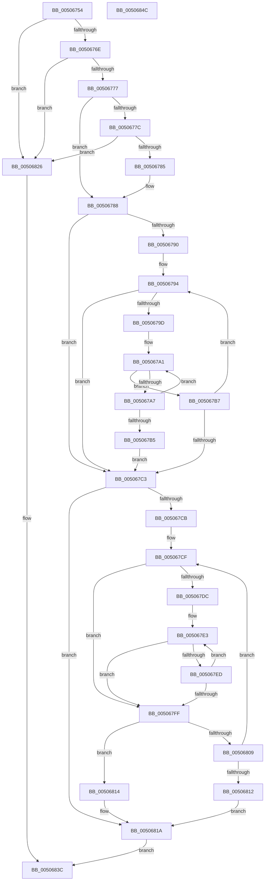

# wcstok_s

- RVA: `0x00506754`–`0x0050684D` (길이 `249` bytes)
- VA: `0x0000000140506754`
- 실행 섹션: `.text`
- PDB 이름 있음: `예`; PDB Function 태그: `아니요`
- unwind 정보 RVA: `0x000794E0`
- 디코드: `77`개 명령, `249/249` bytes 표시
- 미해석 바이트: `0` (있으면 어셈블리에 `.byte`로 보존)

> 이 문서는 커널 이미지의 기계어와 PDB 기호를 분석해 생성했습니다. 4번과 5번은 함수 원형과 자료형을 바이너리 사용 방식에서 추정한 C 해석이며 원본 소스 복구 결과는 아닙니다.

## 1. Dependencies

- 직접 호출 지점: **1**; 고유 호출 대상: **1**
- 직접 호출자로 확인된 함수: **1**
- RIP 상대 이미지 참조: **0**

### Outgoing calls
- `0x00506835` → [EmpCheckErrataList](../49/EmpCheckErrataList_function_0049E550.md) (function, `0x0049E550`)

### Direct callers
- [GetOperatorIndexByName](../../page/A0/GetOperatorIndexByName_function_00A029E0.md) at `0x00A02AD2`

### Static image references
- 디코드된 RIP-relative 메모리 참조가 없습니다.

## 2. Other-region calls and transfers

- 다른 실행 섹션으로 향하는 call: **0**
- 별도 외부 분기/꼬리 이동을 확인하지 못했습니다.

## 3. Assembly (complete function range)

```asm
00506754  48 89 5C 24 08                  mov qword ptr [rsp + 8], rbx
00506759  48 89 74 24 10                  mov qword ptr [rsp + 0x10], rsi
0050675E  57                              push rdi
0050675F  48 83 EC 30                     sub rsp, 0x30
00506763  33 F6                           xor esi, esi
00506765  4D 85 C0                        test r8, r8
00506768  0F 84 B8 00 00 00               je 0x140506826
0050676E  48 85 D2                        test rdx, rdx
00506771  0F 84 AF 00 00 00               je 0x140506826
00506777  48 85 C9                        test rcx, rcx
0050677A  75 0C                           jne 0x140506788
0050677C  49 39 30                        cmp qword ptr [r8], rsi
0050677F  0F 84 A1 00 00 00               je 0x140506826
00506785  49 8B 08                        mov rcx, qword ptr [r8]
00506788  0F B7 01                        movzx eax, word ptr [rcx]
0050678B  66 85 C0                        test ax, ax
0050678E  74 33                           je 0x1405067c3
00506790  44 0F B7 1A                     movzx r11d, word ptr [rdx]
00506794  4C 8B D2                        mov r10, rdx
00506797  66 45 85 DB                     test r11w, r11w
0050679B  74 26                           je 0x1405067c3
0050679D  45 0F B7 CB                     movzx r9d, r11w
005067A1  66 44 3B C8                     cmp r9w, ax
005067A5  74 10                           je 0x1405067b7
005067A7  49 83 C2 02                     add r10, 2
005067AB  45 0F B7 0A                     movzx r9d, word ptr [r10]
005067AF  66 45 85 C9                     test r9w, r9w
005067B3  75 EC                           jne 0x1405067a1
005067B5  EB 0C                           jmp 0x1405067c3
005067B7  48 83 C1 02                     add rcx, 2
005067BB  0F B7 01                        movzx eax, word ptr [rcx]
005067BE  66 85 C0                        test ax, ax
005067C1  75 D1                           jne 0x140506794
005067C3  48 8B C1                        mov rax, rcx
005067C6  66 39 31                        cmp word ptr [rcx], si
005067C9  74 4F                           je 0x14050681a
005067CB  44 0F B7 1A                     movzx r11d, word ptr [rdx]
005067CF  48 8B DA                        mov rbx, rdx
005067D2  45 0F B7 CB                     movzx r9d, r11w
005067D6  66 45 85 DB                     test r11w, r11w
005067DA  74 23                           je 0x1405067ff
005067DC  0F B7 39                        movzx edi, word ptr [rcx]
005067DF  45 0F B7 D3                     movzx r10d, r11w
005067E3  45 0F B7 CA                     movzx r9d, r10w
005067E7  66 44 3B D7                     cmp r10w, di
005067EB  74 12                           je 0x1405067ff
005067ED  48 83 C3 02                     add rbx, 2
005067F1  44 0F B7 0B                     movzx r9d, word ptr [rbx]
005067F5  45 0F B7 D1                     movzx r10d, r9w
005067F9  66 45 85 C9                     test r9w, r9w
005067FD  75 E4                           jne 0x1405067e3
005067FF  4C 8D 51 02                     lea r10, [rcx + 2]
00506803  66 45 85 C9                     test r9w, r9w
00506807  75 0B                           jne 0x140506814
00506809  49 8B CA                        mov rcx, r10
0050680C  66 41 39 32                     cmp word ptr [r10], si
00506810  75 BD                           jne 0x1405067cf
00506812  EB 06                           jmp 0x14050681a
00506814  66 89 31                        mov word ptr [rcx], si
00506817  49 8B CA                        mov rcx, r10
0050681A  48 3B C1                        cmp rax, rcx
0050681D  49 89 08                        mov qword ptr [r8], rcx
00506820  48 0F 44 C6                     cmove rax, rsi
00506824  EB 16                           jmp 0x14050683c
00506826  45 33 C9                        xor r9d, r9d
00506829  48 89 74 24 20                  mov qword ptr [rsp + 0x20], rsi
0050682E  45 33 C0                        xor r8d, r8d
00506831  33 D2                           xor edx, edx
00506833  33 C9                           xor ecx, ecx
00506835  E8 16 7D F9 FF                  call 0x14049e550
0050683A  33 C0                           xor eax, eax
0050683C  48 8B 5C 24 40                  mov rbx, qword ptr [rsp + 0x40]
00506841  48 8B 74 24 48                  mov rsi, qword ptr [rsp + 0x48]
00506846  48 83 C4 30                     add rsp, 0x30
0050684A  5F                              pop rdi
0050684B  C3                              ret
0050684C  CC                              int3
```

## 4. C-style interpretation (structured pseudocode)

```c
__int64 __fastcall wcstok_s(__int64 a1, __int64 a2, __int64 a3)
{
    __int64 result;
    __int64 v_r10;
    __int64 v_rbx;
    __int64 v_rsi;
    __int64 v_rsp;
    unsigned __int64 v_stack_m18;
    unsigned __int64 v_stack_p10;
    unsigned __int64 v_stack_p8;

    v_stack_p8 = v_rbx;
    v_stack_p10 = v_rsi;
    v_rsp = (v_rsp) - (48);
    v_rsi = 0;
    if (a3 == 0) goto loc_00506826;
    if (a2 == 0) goto loc_00506826;
    if (a1 != 0) goto loc_00506788;
    if ((*(unsigned __int64 *)(a3)) == 0) goto loc_00506826;
loc_00506788:
    if ((unsigned __int16)(*(unsigned __int16 *)(*(unsigned __int64 *)(a3))) == 0) goto loc_005067C3;
loc_00506794:
    if ((unsigned __int16)(*(unsigned __int16 *)(a2)) == 0) goto loc_005067C3;
loc_005067A1:
    if (((unsigned __int16)((unsigned __int16)(*(unsigned __int16 *)(a2)))) == ((unsigned __int16)(*(unsigned __int16 *)(*(unsigned __int64 *)(a3))))) goto loc_005067B7;
    v_r10 = (a2) + (2);
    if ((unsigned __int16)(*(unsigned __int16 *)(v_r10)) != 0) goto loc_005067A1;
    goto loc_005067C3;
loc_005067B7:
    a1 = (*(unsigned __int64 *)(a3)) + (2);
    if ((unsigned __int16)(*(unsigned __int16 *)(a1)) != 0) goto loc_00506794;
loc_005067C3:
    if ((*(unsigned __int16 *)(a1)) == 0) goto loc_0050681A;
loc_005067CF:
    if ((unsigned __int16)(*(unsigned __int16 *)(a2)) == 0) goto loc_005067FF;
loc_005067E3:
    if (((unsigned __int16)((unsigned __int16)(*(unsigned __int16 *)(a2)))) == ((unsigned __int16)(*(unsigned __int16 *)(a1)))) goto loc_005067FF;
    v_rbx = (a2) + (2);
    if ((unsigned __int16)(*(unsigned __int16 *)(v_rbx)) != 0) goto loc_005067E3;
loc_005067FF:
    if ((unsigned __int16)(*(unsigned __int16 *)(v_rbx)) != 0) goto loc_00506814;
    if ((*(unsigned __int16 *)(a1 + 2)) != 0) goto loc_005067CF;
    goto loc_0050681A;
loc_00506814:
    *(unsigned __int16 *)(a1 + 2) = 0;
loc_0050681A:
    *(unsigned __int64 *)(a3) = a1 + 2;
    if (a1 == (a1 + 2)) { a1 = 0; }
    goto loc_0050683C;
loc_00506826:
    a4 = 0;
    v_stack_m18 = 0;
    a3 = 0;
    a2 = 0;
    a1 = 0;
    result = EmpCheckErrataList(a1, a2, a3, a4);
    result = 0;
loc_0050683C:
    v_rsp = (v_rsp) + (48);
    return result;
}
```

## 5. (Beta) C Style

```c
int64_t wcstok_s(int64_t Arg1, int64_t Arg2, int64_t Arg3)
{
    int64_t result;
    int64_t local_r10;
    int64_t local_rbx;
    int64_t local_rsi;
    int64_t local_rsp;
    uint64_t v_stack_m18;
    uint64_t v_stack_p10;
    uint64_t v_stack_p8;

    v_stack_p8 = local_rbx;
    v_stack_p10 = local_rsi;
    local_rsp = (local_rsp) - (48);
    local_rsi = 0;
    if (Arg3 == 0) goto loc_00506826;
    if (Arg2 == 0) goto loc_00506826;
    if (Arg1 != 0) goto loc_00506788;
    if ((*(uint64_t *)(Arg3)) == 0) goto loc_00506826;
loc_00506788:
    if ((uint16_t)(*(uint16_t *)(*(uint64_t *)(Arg3))) == 0) goto loc_005067C3;
loc_00506794:
    if ((uint16_t)(*(uint16_t *)(Arg2)) == 0) goto loc_005067C3;
loc_005067A1:
    if (((uint16_t)((uint16_t)(*(uint16_t *)(Arg2)))) == ((uint16_t)(*(uint16_t *)(*(uint64_t *)(Arg3))))) goto loc_005067B7;
    local_r10 = (Arg2) + (2);
    if ((uint16_t)(*(uint16_t *)(local_r10)) != 0) goto loc_005067A1;
    goto loc_005067C3;
loc_005067B7:
    Arg1 = (*(uint64_t *)(Arg3)) + (2);
    if ((uint16_t)(*(uint16_t *)(Arg1)) != 0) goto loc_00506794;
loc_005067C3:
    if ((*(uint16_t *)(Arg1)) == 0) goto loc_0050681A;
loc_005067CF:
    if ((uint16_t)(*(uint16_t *)(Arg2)) == 0) goto loc_005067FF;
loc_005067E3:
    if (((uint16_t)((uint16_t)(*(uint16_t *)(Arg2)))) == ((uint16_t)(*(uint16_t *)(Arg1)))) goto loc_005067FF;
    local_rbx = (Arg2) + (2);
    if ((uint16_t)(*(uint16_t *)(local_rbx)) != 0) goto loc_005067E3;
loc_005067FF:
    if ((uint16_t)(*(uint16_t *)(local_rbx)) != 0) goto loc_00506814;
    if ((*(uint16_t *)(Arg1 + 0x2)) != 0) goto loc_005067CF;
    goto loc_0050681A;
loc_00506814:
    *(uint16_t *)(Arg1 + 0x2) = 0;
loc_0050681A:
    *(uint64_t *)(Arg3) = Arg1 + 2;
    if (Arg1 == (Arg1 + 2)) { Arg1 = 0; }
    goto loc_0050683C;
loc_00506826:
    a4 = 0;
    v_stack_m18 = 0;
    Arg3 = 0;
    Arg2 = 0;
    Arg1 = 0;
    result = EmpCheckErrataList(Arg1, Arg2, Arg3, a4);
    result = 0;
loc_0050683C:
    local_rsp = (local_rsp) + (48);
    return result;
}
```

## 6. Execution-region graph

[열기: 2D/3D 그래프와 함수 탐색 컨트롤 패널](../../../control-panel.html?section=text&rva=0x00506754&view=graph)

- 2D 그래프는 위에서 아래로 흐르고, 3D 그래프는 빈 공간을 드래그해 회전합니다. Shift+드래그는 이동, 휠은 확대·축소, 함수 노드 선택은 대상 보고서 이동입니다.

### Static fallback


