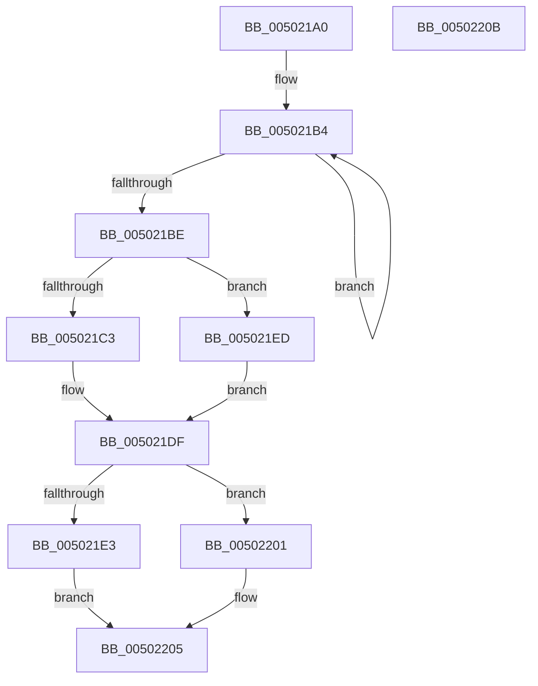

# wcstombs

- RVA: `0x005021A0`–`0x0050220C` (길이 `108` bytes)
- VA: `0x00000001405021A0`
- 실행 섹션: `.text`
- PDB 이름 있음: `예`; PDB Function 태그: `아니요`
- unwind 정보 RVA: `0x00064C80`
- 디코드: `31`개 명령, `108/108` bytes 표시
- 미해석 바이트: `0` (있으면 어셈블리에 `.byte`로 보존)

> 이 문서는 커널 이미지의 기계어와 PDB 기호를 분석해 생성했습니다. 4번과 5번은 함수 원형과 자료형을 바이너리 사용 방식에서 추정한 C 해석이며 원본 소스 복구 결과는 아닙니다.

## 1. Dependencies

- 직접 호출 지점: **2**; 고유 호출 대상: **2**
- 직접 호출자로 확인된 함수: **1**
- RIP 상대 이미지 참조: **0**

### Outgoing calls
- `0x005021DA` → [RtlUnicodeToMultiByteN](../../page/90/RtlUnicodeToMultiByteN_function_0090D820.md) (function, `0x0090D820`)
- `0x005021FA` → [RtlUnicodeToMultiByteSize](../../page/90/RtlUnicodeToMultiByteSize_function_0090D110.md) (function, `0x0090D110`)

### Direct callers
- [WheaRegChangeNotifyCallback](../../page/7D/WheaRegChangeNotifyCallback_function_007D8A50.md) at `0x007D8BC2`

### Static image references
- 디코드된 RIP-relative 메모리 참조가 없습니다.

## 2. Other-region calls and transfers

- 다른 실행 섹션으로 향하는 call: **2**
  - `0x005021DA` → [RtlUnicodeToMultiByteN](../../page/90/RtlUnicodeToMultiByteN_function_0090D820.md) (`.text` → `PAGE`)
  - `0x005021FA` → [RtlUnicodeToMultiByteSize](../../page/90/RtlUnicodeToMultiByteSize_function_0090D110.md) (`.text` → `PAGE`)
- 별도 외부 분기/꼬리 이동을 확인하지 못했습니다.

## 3. Assembly (complete function range)

```asm
005021A0  40 53                           push rbx
005021A2  48 83 EC 30                     sub rsp, 0x30
005021A6  33 DB                           xor ebx, ebx
005021A8  4D 8B D0                        mov r10, r8
005021AB  48 89 5C 24 40                  mov qword ptr [rsp + 0x40], rbx
005021B0  49 83 C8 FF                     or r8, 0xffffffffffffffff
005021B4  49 FF C0                        inc r8
005021B7  66 42 39 1C 42                  cmp word ptr [rdx + r8*2], bx
005021BC  75 F6                           jne 0x1405021b4
005021BE  48 85 C9                        test rcx, rcx
005021C1  74 2A                           je 0x1405021ed
005021C3  42 8D 04 45 02 00 00 00         lea eax, [r8*2 + 2]
005021CB  4C 8B CA                        mov r9, rdx
005021CE  4C 8D 44 24 40                  lea r8, [rsp + 0x40]
005021D3  89 44 24 20                     mov dword ptr [rsp + 0x20], eax
005021D7  41 8B D2                        mov edx, r10d
005021DA  E8 41 B6 40 00                  call 0x14090d820
005021DF  85 C0                           test eax, eax
005021E1  78 1E                           js 0x140502201
005021E3  48 8B 44 24 40                  mov rax, qword ptr [rsp + 0x40]
005021E8  48 FF C8                        dec rax
005021EB  EB 18                           jmp 0x140502205
005021ED  46 8D 04 45 02 00 00 00         lea r8d, [r8*2 + 2]
005021F5  48 8D 4C 24 40                  lea rcx, [rsp + 0x40]
005021FA  E8 11 AF 40 00                  call 0x14090d110
005021FF  EB DE                           jmp 0x1405021df
00502201  48 83 C8 FF                     or rax, 0xffffffffffffffff
00502205  48 83 C4 30                     add rsp, 0x30
00502209  5B                              pop rbx
0050220A  C3                              ret
0050220B  CC                              int3
```

## 4. C-style interpretation (structured pseudocode)

```c
__int64 __fastcall wcstombs(__int64 a1, __int64 a2, __int64 a3)
{
    __int64 result;
    __int64 v_rbx;
    __int64 v_rsp;
    unsigned int v_stack_m18;
    unsigned __int64 v_stack_p8;

    v_rsp = (v_rsp) - (48);
    v_rbx = 0;
    v_stack_p8 = 0;
    a3 = (a3) | (-1);
loc_005021B4:
    a3 = (a3) + 1;
    if ((*(unsigned __int16 *)(a2 + a3 * 2)) != 0) goto loc_005021B4;
    if (a1 == 0) goto loc_005021ED;
    v_stack_m18 = (unsigned int)(a3 * 2 + 2);
    result = RtlUnicodeToMultiByteN(a1, (unsigned int)((unsigned int)(a3)), v_stack_p8, a2);
loc_005021DF:
    if (sign_flag) goto loc_00502201;
    result = (v_stack_p8) - 1;
    goto loc_00502205;
loc_005021ED:
    result = RtlUnicodeToMultiByteSize(v_stack_p8, (unsigned int)((unsigned int)(a3)), v_stack_p8 * 2 + 2, a2);
    goto loc_005021DF;
loc_00502201:
    result = (result) | (-1);
loc_00502205:
    v_rsp = (v_rsp) + (48);
    return result;
}
```

## 5. (Beta) C Style

```c
int64_t wcstombs(int64_t Arg1, void *Arg2, int64_t Arg3)
{
    uint8_t *arg2 = (uint8_t *)Arg2;

    int64_t result;
    int64_t local_rbx;
    int64_t local_rsp;
    uint32_t v_stack_m18;
    uint64_t v_stack_p8;

    local_rsp = (local_rsp) - (48);
    local_rbx = 0;
    v_stack_p8 = 0;
    Arg3 = (Arg3) | (-1);
loc_005021B4:
    Arg3 = (Arg3) + 1;
    if ((*(uint16_t *)(arg2 + Arg3 * 2)) != 0) goto loc_005021B4;
    if (Arg1 == 0) goto loc_005021ED;
    v_stack_m18 = (uint32_t)(Arg3 * 2 + 2);
    result = RtlUnicodeToMultiByteN(Arg1, (uint32_t)((uint32_t)(Arg3)), v_stack_p8, Arg2);
loc_005021DF:
    if (sign_flag) goto loc_00502201;
    result = (v_stack_p8) - 1;
    goto loc_00502205;
loc_005021ED:
    result = RtlUnicodeToMultiByteSize(v_stack_p8, (uint32_t)((uint32_t)(Arg3)), v_stack_p8 * 2 + 2, Arg2);
    goto loc_005021DF;
loc_00502201:
    result = (result) | (-1);
loc_00502205:
    local_rsp = (local_rsp) + (48);
    return result;
}
```

### 관측된 메모리 오프셋

구조체 형식이 확인되지 않은 접근은 인자 기준의 오프셋으로만 기록했습니다.

| 기준 인자 | 오프셋 표현 | 폭 (bit) | 접근 |
|---|---:|---:|---|
| `Arg2` | `+ 0x0 + r8*2` | `16` | `R` |

## 6. Execution-region graph

[열기: 2D/3D 그래프와 함수 탐색 컨트롤 패널](../../../control-panel.html?section=text&rva=0x005021A0&view=graph)

- 2D 그래프는 위에서 아래로 흐르고, 3D 그래프는 빈 공간을 드래그해 회전합니다. Shift+드래그는 이동, 휠은 확대·축소, 함수 노드 선택은 대상 보고서 이동입니다.

### Static fallback


