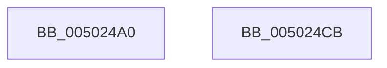

# wcstoul

- RVA: `0x005024A0`–`0x005024CC` (길이 `44` bytes)
- VA: `0x00000001405024A0`
- 실행 섹션: `.text`
- PDB 이름 있음: `예`; PDB Function 태그: `아니요`
- unwind 정보 RVA: `0x0005D2F4`
- 디코드: `11`개 명령, `44/44` bytes 표시
- 미해석 바이트: `0` (있으면 어셈블리에 `.byte`로 보존)

> 이 문서는 커널 이미지의 기계어와 PDB 기호를 분석해 생성했습니다. 4번과 5번은 함수 원형과 자료형을 바이너리 사용 방식에서 추정한 C 해석이며 원본 소스 복구 결과는 아닙니다.

## 1. Dependencies

- 직접 호출 지점: **1**; 고유 호출 대상: **1**
- 직접 호출자로 확인된 함수: **11**
- RIP 상대 이미지 참조: **1**

### Outgoing calls
- `0x005024C1` → [wcstoxlX](wcstoxlX_function_00502214.md) (function, `0x00502214`)

### Direct callers
- [PnpStringToDwordValue](../4E/PnpStringToDwordValue_function_004E1894.md) at `0x004E18D5`
- [HalpMcEnumerateAndSetPatchConfig](../55/HalpMcEnumerateAndSetPatchConfig_function_0055AB38.md) at `0x0055AD46`
- [HalpMcEnumerateAndSetPatchConfig](../55/HalpMcEnumerateAndSetPatchConfig_function_0055AB38.md) at `0x0055ADFF`
- [CmDevicePanelEnumSubkeyCallback](../../page/82/CmDevicePanelEnumSubkeyCallback_function_0082E9B0.md) at `0x0082EA1A`
- [CmDevicePanelEnumSubkeyCallback](../../page/82/CmDevicePanelEnumSubkeyCallback_function_0082E9B0.md) at `0x0082EA4D`
- [LocalGetAclForString](../../page/92/LocalGetAclForString_function_00927F30.md) at `0x009282B8`
- [LocalpConvertStringSidToSid](../../page/A1/LocalpConvertStringSidToSid_function_00A17490.md) at `0x00A1754A`
- [LocalpConvertStringSidToSid](../../page/A1/LocalpConvertStringSidToSid_function_00A17490.md) at `0x00A17828`
- [BiOpenSystemStore](../../page/A4/BiOpenSystemStore_function_00A40844.md) at `0x00A40954`
- [_CmCreateOrdinalInstanceKey](../../page/A7/_CmCreateOrdinalInstanceKey_function_00A77838.md) at `0x00A7787C`
- [_CmCreateOrdinalInstanceKey](../../page/A7/_CmCreateOrdinalInstanceKey_function_00A77838.md) at `0x00A77891`
- [CmSplitDevicePanelId](../../page/AC/CmSplitDevicePanelId_function_00ACEA18.md) at `0x00ACEB50`
- [CmSplitDevicePanelId](../../page/AC/CmSplitDevicePanelId_function_00ACEA18.md) at `0x00ACEB82`
- [sub_00B3A892](../../page/B3/Unknown_function_00B3A892.md) at `0x00B3A8B8`
- [sub_00B3A892](../../page/B3/Unknown_function_00B3A892.md) at `0x00B3A948`
- [HalpInitChipHacks](../../init/C2/HalpInitChipHacks_function_00C24274.md) at `0x00C2443E`
- [HalpInitChipHacks](../../init/C2/HalpInitChipHacks_function_00C24274.md) at `0x00C24462`
- [KsepMatchInitBiosInfo](../../init/C3/KsepMatchInitBiosInfo_function_00C3BCB0.md) at `0x00C3BE72`
- [KsepMatchInitBiosInfo](../../init/C3/KsepMatchInitBiosInfo_function_00C3BCB0.md) at `0x00C3BE82`
- [KsepMatchInitBiosInfo](../../init/C3/KsepMatchInitBiosInfo_function_00C3BCB0.md) at `0x00C3BE95`

### Static image references
- `0x005024BA` → RVA `0x00006698` (`.rdata`; read)

## 2. Other-region calls and transfers

- 다른 실행 섹션으로 향하는 call: **0**
- 별도 외부 분기/꼬리 이동을 확인하지 못했습니다.

## 3. Assembly (complete function range)

```asm
005024A0  48 83 EC 38                     sub rsp, 0x38
005024A4  83 64 24 28 00                  and dword ptr [rsp + 0x28], 0
005024A9  45 8B C8                        mov r9d, r8d
005024AC  4C 8B C2                        mov r8, rdx
005024AF  C7 44 24 20 01 00 00 00         mov dword ptr [rsp + 0x20], 1
005024B7  48 8B D1                        mov rdx, rcx
005024BA  48 8D 0D D7 41 B0 FF            lea rcx, [rip - 0x4fbe29]
005024C1  E8 4E FD FF FF                  call 0x140502214
005024C6  48 83 C4 38                     add rsp, 0x38
005024CA  C3                              ret
005024CB  CC                              int3
```

## 4. C-style interpretation (structured pseudocode)

```c
__int64 __fastcall wcstoul(__int64 a1, __int64 a2, int a3)
{
    __int64 result;
    __int64 v_rsp;
    unsigned int v_stack_m10;
    unsigned int v_stack_m18;

    v_rsp = (v_rsp) - (56);
    v_stack_m18 = 1;
    result = wcstoxlX(v_rip - 5226025, a1, a2, (unsigned int)(a3));
    v_rsp = (v_rsp) + (56);
    return result;
}
```

## 5. (Beta) C Style

```c
int64_t wcstoul(int64_t Arg1, int64_t Arg2, int32_t Arg3)
{
    int64_t result;
    int64_t local_rsp;
    uint32_t v_stack_m10;
    uint32_t v_stack_m18;

    local_rsp = (local_rsp) - (56);
    v_stack_m18 = 1;
    result = wcstoxlX(v_rip - 5226025, Arg1, Arg2, (uint32_t)(Arg3));
    local_rsp = (local_rsp) + (56);
    return result;
}
```

## 6. Execution-region graph

[열기: 2D/3D 그래프와 함수 탐색 컨트롤 패널](../../../control-panel.html?section=text&rva=0x005024A0&view=graph)

- 2D 그래프는 위에서 아래로 흐르고, 3D 그래프는 빈 공간을 드래그해 회전합니다. Shift+드래그는 이동, 휠은 확대·축소, 함수 노드 선택은 대상 보고서 이동입니다.

### Static fallback


