# wcstoxlX

- RVA: `0x00502214`–`0x0050242D` (길이 `537` bytes)
- VA: `0x0000000140502214`
- 실행 섹션: `.text`
- PDB 이름 있음: `예`; PDB Function 태그: `예`
- unwind 정보 RVA: `0x0008C20C`
- 디코드: `173`개 명령, `537/537` bytes 표시
- 미해석 바이트: `0` (있으면 어셈블리에 `.byte`로 보존)

> 이 문서는 커널 이미지의 기계어와 PDB 기호를 분석해 생성했습니다. 4번과 5번은 함수 원형과 자료형을 바이너리 사용 방식에서 추정한 C 해석이며 원본 소스 복구 결과는 아닙니다.

## 1. Dependencies

- 직접 호출 지점: **5**; 고유 호출 대상: **3**
- 직접 호출자로 확인된 함수: **3**
- RIP 상대 이미지 참조: **0**

### Outgoing calls
- `0x00502279` → [iswctype_l](iswctype_l_function_005028D0.md) (function, `0x005028D0`)
- `0x005022AF` → [wchartodigit](wchartodigit_function_005042EC.md) (function, `0x005042EC`)
- `0x005022E6` → [wchartodigit](wchartodigit_function_005042EC.md) (function, `0x005042EC`)
- `0x00502312` → [wchartodigit](wchartodigit_function_005042EC.md) (function, `0x005042EC`)
- `0x00502408` → [EmpCheckErrataList](../49/EmpCheckErrataList_function_0049E550.md) (function, `0x0049E550`)

### Direct callers
- [wcstol](wcstol_function_00502434.md) at `0x00502452`
- [wcstolX](wcstolX_function_00502464.md) at `0x00502482`
- [wcstoul](wcstoul_function_005024A0.md) at `0x005024C1`

### Static image references
- 디코드된 RIP-relative 메모리 참조가 없습니다.

## 2. Other-region calls and transfers

- 다른 실행 섹션으로 향하는 call: **0**
- 별도 외부 분기/꼬리 이동을 확인하지 못했습니다.

## 3. Assembly (complete function range)

```asm
00502214  48 89 5C 24 08                  mov qword ptr [rsp + 8], rbx
00502219  48 89 6C 24 10                  mov qword ptr [rsp + 0x10], rbp
0050221E  48 89 74 24 18                  mov qword ptr [rsp + 0x18], rsi
00502223  57                              push rdi
00502224  41 54                           push r12
00502226  41 55                           push r13
00502228  41 56                           push r14
0050222A  41 57                           push r15
0050222C  48 83 EC 30                     sub rsp, 0x30
00502230  45 8B F1                        mov r14d, r9d
00502233  4D 8B F8                        mov r15, r8
00502236  4C 8B E2                        mov r12, rdx
00502239  4D 85 C0                        test r8, r8
0050223C  74 03                           je 0x140502241
0050223E  49 89 10                        mov qword ptr [r8], rdx
00502241  4D 85 E4                        test r12, r12
00502244  0F 84 AE 01 00 00               je 0x1405023f8
0050224A  45 85 F6                        test r14d, r14d
0050224D  74 0D                           je 0x14050225c
0050224F  41 8D 41 FE                     lea eax, [r9 - 2]
00502253  83 F8 22                        cmp eax, 0x22
00502256  0F 87 9C 01 00 00               ja 0x1405023f8
0050225C  0F B7 2A                        movzx ebp, word ptr [rdx]
0050225F  48 8D 5A 02                     lea rbx, [rdx + 2]
00502263  33 FF                           xor edi, edi
00502265  8D 77 08                        lea esi, [rdi + 8]
00502268  EB 07                           jmp 0x140502271
0050226A  0F B7 2B                        movzx ebp, word ptr [rbx]
0050226D  48 83 C3 02                     add rbx, 2
00502271  45 33 C0                        xor r8d, r8d
00502274  8B D6                           mov edx, esi
00502276  0F B7 CD                        movzx ecx, bp
00502279  E8 52 06 00 00                  call 0x1405028d0
0050227E  85 C0                           test eax, eax
00502280  75 E8                           jne 0x14050226a
00502282  8B B4 24 80 00 00 00            mov esi, dword ptr [rsp + 0x80]
00502289  66 83 FD 2D                     cmp bp, 0x2d
0050228D  75 05                           jne 0x140502294
0050228F  83 CE 02                        or esi, 2
00502292  EB 06                           jmp 0x14050229a
00502294  66 83 FD 2B                     cmp bp, 0x2b
00502298  75 07                           jne 0x1405022a1
0050229A  0F B7 2B                        movzx ebp, word ptr [rbx]
0050229D  48 83 C3 02                     add rbx, 2
005022A1  41 BD DF FF 00 00               mov r13d, 0xffdf
005022A7  45 85 F6                        test r14d, r14d
005022AA  75 31                           jne 0x1405022dd
005022AC  0F B7 CD                        movzx ecx, bp
005022AF  E8 38 20 00 00                  call 0x1405042ec
005022B4  85 C0                           test eax, eax
005022B6  74 08                           je 0x1405022c0
005022B8  41 BE 0A 00 00 00               mov r14d, 0xa
005022BE  EB 44                           jmp 0x140502304
005022C0  0F B7 03                        movzx eax, word ptr [rbx]
005022C3  66 83 E8 58                     sub ax, 0x58
005022C7  66 41 85 C5                     test r13w, ax
005022CB  74 08                           je 0x1405022d5
005022CD  41 BE 08 00 00 00               mov r14d, 8
005022D3  EB 2F                           jmp 0x140502304
005022D5  41 BE 10 00 00 00               mov r14d, 0x10
005022DB  EB 06                           jmp 0x1405022e3
005022DD  41 83 FE 10                     cmp r14d, 0x10
005022E1  75 21                           jne 0x140502304
005022E3  0F B7 CD                        movzx ecx, bp
005022E6  E8 01 20 00 00                  call 0x1405042ec
005022EB  85 C0                           test eax, eax
005022ED  75 15                           jne 0x140502304
005022EF  0F B7 03                        movzx eax, word ptr [rbx]
005022F2  66 83 E8 58                     sub ax, 0x58
005022F6  66 41 85 C5                     test r13w, ax
005022FA  75 08                           jne 0x140502304
005022FC  0F B7 6B 02                     movzx ebp, word ptr [rbx + 2]
00502300  48 83 C3 04                     add rbx, 4
00502304  33 D2                           xor edx, edx
00502306  83 C8 FF                        or eax, 0xffffffff
00502309  41 F7 F6                        div r14d
0050230C  44 8B E8                        mov r13d, eax
0050230F  0F B7 CD                        movzx ecx, bp
00502312  E8 D5 1F 00 00                  call 0x1405042ec
00502317  41 83 C8 FF                     or r8d, 0xffffffff
0050231B  8B C8                           mov ecx, eax
0050231D  41 3B C0                        cmp eax, r8d
00502320  75 26                           jne 0x140502348
00502322  8D 45 BF                        lea eax, [rbp - 0x41]
00502325  66 83 F8 19                     cmp ax, 0x19
00502329  76 09                           jbe 0x140502334
0050232B  8D 45 9F                        lea eax, [rbp - 0x61]
0050232E  66 83 F8 19                     cmp ax, 0x19
00502332  77 41                           ja 0x140502375
00502334  0F B7 C5                        movzx eax, bp
00502337  66 83 ED 61                     sub bp, 0x61
0050233B  66 83 FD 19                     cmp bp, 0x19
0050233F  8D 48 E0                        lea ecx, [rax - 0x20]
00502342  0F 47 C8                        cmova ecx, eax
00502345  83 E9 37                        sub ecx, 0x37
00502348  41 3B CE                        cmp ecx, r14d
0050234B  73 28                           jae 0x140502375
0050234D  83 CE 08                        or esi, 8
00502350  83 BC 24 88 00 00 00 00         cmp dword ptr [rsp + 0x88], 0
00502358  75 30                           jne 0x14050238a
0050235A  41 3B FD                        cmp edi, r13d
0050235D  72 2B                           jb 0x14050238a
0050235F  75 0C                           jne 0x14050236d
00502361  33 D2                           xor edx, edx
00502363  41 8B C0                        mov eax, r8d
00502366  41 F7 F6                        div r14d
00502369  3B CA                           cmp ecx, edx
0050236B  76 1D                           jbe 0x14050238a
0050236D  83 CE 04                        or esi, 4
00502370  4D 85 FF                        test r15, r15
00502373  75 1B                           jne 0x140502390
00502375  48 83 EB 02                     sub rbx, 2
00502379  40 F6 C6 08                     test sil, 8
0050237D  75 1D                           jne 0x14050239c
0050237F  4D 85 FF                        test r15, r15
00502382  49 0F 45 DC                     cmovne rbx, r12
00502386  33 FF                           xor edi, edi
00502388  EB 59                           jmp 0x1405023e3
0050238A  41 0F AF FE                     imul edi, r14d
0050238E  03 F9                           add edi, ecx
00502390  0F B7 2B                        movzx ebp, word ptr [rbx]
00502393  48 83 C3 02                     add rbx, 2
00502397  E9 73 FF FF FF                  jmp 0x14050230f
0050239C  B9 FF FF FF 7F                  mov ecx, 0x7fffffff
005023A1  40 F6 C6 04                     test sil, 4
005023A5  75 1A                           jne 0x1405023c1
005023A7  40 F6 C6 01                     test sil, 1
005023AB  75 36                           jne 0x1405023e3
005023AD  40 F6 C6 02                     test sil, 2
005023B1  74 0A                           je 0x1405023bd
005023B3  81 FF 00 00 00 80               cmp edi, 0x80000000
005023B9  77 06                           ja 0x1405023c1
005023BB  EB 26                           jmp 0x1405023e3
005023BD  3B F9                           cmp edi, ecx
005023BF  76 22                           jbe 0x1405023e3
005023C1  83 BC 24 88 00 00 00 00         cmp dword ptr [rsp + 0x88], 0
005023C9  75 18                           jne 0x1405023e3
005023CB  40 F6 C6 01                     test sil, 1
005023CF  74 05                           je 0x1405023d6
005023D1  41 8B F8                        mov edi, r8d
005023D4  EB 0D                           jmp 0x1405023e3
005023D6  40 8A C6                        mov al, sil
005023D9  24 02                           and al, 2
005023DB  F6 D8                           neg al
005023DD  1B FF                           sbb edi, edi
005023DF  F7 DF                           neg edi
005023E1  03 F9                           add edi, ecx
005023E3  4D 85 FF                        test r15, r15
005023E6  74 03                           je 0x1405023eb
005023E8  49 89 1F                        mov qword ptr [r15], rbx
005023EB  8B C7                           mov eax, edi
005023ED  F7 D8                           neg eax
005023EF  40 F6 C6 02                     test sil, 2
005023F3  0F 44 C7                        cmove eax, edi
005023F6  EB 17                           jmp 0x14050240f
005023F8  48 83 64 24 20 00               and qword ptr [rsp + 0x20], 0
005023FE  45 33 C9                        xor r9d, r9d
00502401  45 33 C0                        xor r8d, r8d
00502404  33 D2                           xor edx, edx
00502406  33 C9                           xor ecx, ecx
00502408  E8 43 C1 F9 FF                  call 0x14049e550
0050240D  33 C0                           xor eax, eax
0050240F  48 8B 5C 24 60                  mov rbx, qword ptr [rsp + 0x60]
00502414  48 8B 6C 24 68                  mov rbp, qword ptr [rsp + 0x68]
00502419  48 8B 74 24 70                  mov rsi, qword ptr [rsp + 0x70]
0050241E  48 83 C4 30                     add rsp, 0x30
00502422  41 5F                           pop r15
00502424  41 5E                           pop r14
00502426  41 5D                           pop r13
00502428  41 5C                           pop r12
0050242A  5F                              pop rdi
0050242B  C3                              ret
0050242C  CC                              int3
```

## 4. C-style interpretation (structured pseudocode)

```c
__int64 __fastcall wcstoxlX(__int64 a1, __int64 a2, __int64 a3, __int64 a4, unsigned int a5, unsigned int a6)
{
    __int64 result;
    __int64 v_rbp;
    __int64 v_rbx;
    __int64 v_rdi;
    __int64 v_rsi;
    __int64 v_rsp;
    unsigned __int64 v_stack_m38;
    unsigned __int64 v_stack_p10;
    unsigned __int64 v_stack_p18;
    unsigned __int64 v_stack_p8;

    v_stack_p8 = v_rbx;
    v_stack_p10 = v_rbp;
    v_stack_p18 = v_rsi;
    v_rsp = (v_rsp) - (48);
    if (a3 != 0) {
        *(unsigned __int64 *)(a3) = a2;
    }
    if (a2 == 0) goto loc_005023F8;
    if ((unsigned int)((unsigned int)((unsigned int)(a4))) == 0) goto loc_0050225C;
    if (((unsigned int)(a4 - 2)) > 34) goto loc_005023F8;
loc_0050225C:
    v_rdi = 0;
    goto loc_00502271;
loc_0050226A:
    v_rbx = (a2 + 2) + (2);
loc_00502271:
    a3 = 0;
    result = iswctype_l((unsigned __int16)(*(unsigned __int16 *)(a2 + 2)), (unsigned int)((unsigned int)(v_rdi + 8)), a3, a4);
    if ((unsigned int)(result) != 0) goto loc_0050226A;
    if (((unsigned __int16)(*(unsigned __int16 *)(a2 + 2))) != 45) goto loc_00502294;
    v_rsi = (unsigned int)(((unsigned int)(a5)) | (2));
    goto loc_0050229A;
loc_00502294:
    v_rbp = *(unsigned __int16 *)(a2 + 2);
    if (((unsigned __int16)(*(unsigned __int16 *)(a2 + 2))) == 43) {
        v_rbp = *(unsigned __int16 *)(v_rbx);
        v_rbx = (v_rbx) + (2);
    }
    if ((unsigned int)((unsigned int)((unsigned int)(a4))) != 0) goto loc_005022DD;
    result = wchartodigit((unsigned __int16)(v_rbp), (unsigned int)((unsigned int)(v_rdi + 8)), a3, a4);
    if ((unsigned int)(result) == 0) goto loc_005022C0;
    goto loc_00502304;
loc_005022C0:
    result = (unsigned __int16)((*(unsigned __int16 *)(v_rbx)) - (88));
    if ((((unsigned __int16)((unsigned int)(0xFFDFULL))) & ((unsigned __int16)(result))) == 0) goto loc_005022D5;
    goto loc_00502304;
loc_005022D5:
    goto loc_005022E3;
loc_005022DD:
    if (16 != 16) goto loc_00502304;
loc_005022E3:
    result = wchartodigit((unsigned __int16)(v_rbp), (unsigned int)((unsigned int)(v_rdi + 8)), a3, a4);
    if ((unsigned int)(result) != 0) goto loc_00502304;
    result = (unsigned __int16)((*(unsigned __int16 *)(v_rbx)) - (88));
    if ((((unsigned __int16)((unsigned int)(0xFFDFULL))) & ((unsigned __int16)(result))) == 0) {
        v_rbp = *(unsigned __int16 *)(v_rbx + 2);
        v_rbx = (v_rbx) + (4);
    }
    a2 = 0;
    result = (unsigned int)((result) | (0xFFFFFFFFULL));
loc_0050230F:
    result = wchartodigit((unsigned __int16)(v_rbp), a2, a3, a4);
    a3 = (unsigned int)((a3) | (0xFFFFFFFFULL));
    if (((unsigned int)(result)) != ((unsigned int)(a3))) goto loc_00502348;
    if (((unsigned __int16)(v_rbp - 65)) <= 25) goto loc_00502334;
    if (((unsigned __int16)(v_rbp - 97)) > 25) goto loc_00502375;
loc_00502334:
    v_rbp = (unsigned __int16)((v_rbp) - (97));
    a1 = (unsigned __int16)(v_rbp) - 32;
    if (((unsigned __int16)(v_rbp)) > 25) { a1 = (unsigned int)((unsigned __int16)(v_rbp)); }
    a1 = (unsigned int)((a1) - (55));
loc_00502348:
    if (((unsigned int)(a1)) >= 16) goto loc_00502375;
    v_rsi = (unsigned int)((v_rsi) | (8));
    if (a6 != 0) goto loc_0050238A;
    if (0 < ((unsigned int)((unsigned int)((unsigned int)(result))))) goto loc_0050238A;
    if (0 != ((unsigned int)((unsigned int)((unsigned int)(result))))) goto loc_0050236D;
    a2 = 0;
    if (((unsigned int)(a1)) <= 0) goto loc_0050238A;
loc_0050236D:
    v_rsi = (unsigned int)((v_rsi) | (4));
    if (a3 != 0) goto loc_00502390;
loc_00502375:
    v_rbx = (v_rbx) - (2);
    if ((((unsigned __int8)(v_rsi)) & (8)) != 0) goto loc_0050239C;
    if (a3 != 0) { v_rbx = 0; }
    v_rdi = 0;
    goto loc_005023E3;
loc_0050238A:
    v_rdi = (unsigned int)((v_rdi) * (16));
    v_rdi = (unsigned int)((v_rdi) + ((unsigned int)(a1)));
loc_00502390:
    v_rbx = (v_rbx) + (2);
    goto loc_0050230F;
loc_0050239C:
    if ((((unsigned __int8)(v_rsi)) & (4)) != 0) goto loc_005023C1;
    if ((((unsigned __int8)(v_rsi)) & (1)) != 0) goto loc_005023E3;
    if ((((unsigned __int8)(v_rsi)) & (2)) == 0) goto loc_005023BD;
    if (((unsigned int)(v_rdi)) > 0x80000000ULL) goto loc_005023C1;
    goto loc_005023E3;
loc_005023BD:
    if (((unsigned int)(v_rdi)) <= ((unsigned int)((unsigned int)(0x7FFFFFFFULL)))) goto loc_005023E3;
loc_005023C1:
    if (a6 != 0) goto loc_005023E3;
    if ((((unsigned __int8)(v_rsi)) & (1)) == 0) goto loc_005023D6;
    goto loc_005023E3;
loc_005023D6:
    result = (unsigned __int8)(((unsigned __int8)(v_rsi)) & (2));
    result = (unsigned __int8)(-(result));
    v_rdi = (unsigned int)(-((unsigned int)((unsigned int)(a3))));
    v_rdi = (unsigned int)((v_rdi) + ((unsigned int)((unsigned int)(0x7FFFFFFFULL))));
loc_005023E3:
    if (a3 != 0) {
        *(unsigned __int64 *)(a3) = v_rbx;
    }
    result = (unsigned int)(-((unsigned int)((unsigned int)(v_rdi))));
    if ((((unsigned __int8)(v_rsi)) & (2)) == 0) { result = (unsigned int)(v_rdi); }
    goto loc_0050240F;
loc_005023F8:
    a4 = 0;
    a3 = 0;
    a2 = 0;
    a1 = 0;
    result = EmpCheckErrataList(a1, a2, a3, a4);
    result = 0;
loc_0050240F:
    v_rsp = (v_rsp) + (48);
    return result;
}
```

## 5. (Beta) C Style

```c
int64_t wcstoxlX(int64_t Arg1, void *Arg2, int64_t Arg3, void *Arg4, uint32_t Arg5, uint32_t Arg6)
{
    uint8_t *arg2 = (uint8_t *)Arg2;
    uint8_t *arg4 = (uint8_t *)Arg4;

    int64_t result;
    int64_t local_rbp;
    int64_t local_rbx;
    int64_t local_rdi;
    int64_t local_rsi;
    int64_t local_rsp;
    uint64_t v_stack_m38;
    uint64_t v_stack_p10;
    uint64_t v_stack_p18;
    uint64_t v_stack_p8;

    v_stack_p8 = local_rbx;
    v_stack_p10 = local_rbp;
    v_stack_p18 = local_rsi;
    local_rsp = (local_rsp) - (48);
    if (Arg3 != 0) {
        *(void **)(Arg3) = Arg2;
    }
    if (Arg2 == NULL) goto loc_005023F8;
    if ((uint32_t)((uint32_t)((uint32_t)(Arg4))) == 0) goto loc_0050225C;
    if (((uint32_t)(Arg4 - 2)) > 34) goto loc_005023F8;
loc_0050225C:
    local_rdi = 0;
    goto loc_00502271;
loc_0050226A:
    local_rbx = (Arg2 + 2) + (2);
loc_00502271:
    Arg3 = 0;
    result = iswctype_l((uint16_t)(*(uint16_t *)(arg2 + 0x2)), (uint32_t)((uint32_t)(local_rdi + 8)), Arg3, Arg4);
    if ((uint32_t)(result) != 0) goto loc_0050226A;
    if (((uint16_t)(*(uint16_t *)(arg2 + 0x2))) != 45) goto loc_00502294;
    local_rsi = (uint32_t)(((uint32_t)(Arg5)) | (2));
    goto loc_0050229A;
loc_00502294:
    local_rbp = *(uint16_t *)(arg2 + 0x2);
    if (((uint16_t)(*(uint16_t *)(arg2 + 0x2))) == 43) {
        local_rbp = *(uint16_t *)(local_rbx);
        local_rbx = (local_rbx) + (2);
    }
    if ((uint32_t)((uint32_t)((uint32_t)(Arg4))) != 0) goto loc_005022DD;
    result = wchartodigit((uint16_t)(local_rbp), (uint32_t)((uint32_t)(local_rdi + 8)), Arg3, Arg4);
    if ((uint32_t)(result) == 0) goto loc_005022C0;
    goto loc_00502304;
loc_005022C0:
    result = (uint16_t)((*(uint16_t *)(local_rbx)) - (88));
    if ((((uint16_t)((uint32_t)(0xFFDFULL))) & ((uint16_t)(result))) == 0) goto loc_005022D5;
    goto loc_00502304;
loc_005022D5:
    goto loc_005022E3;
loc_005022DD:
    if (16 != 16) goto loc_00502304;
loc_005022E3:
    result = wchartodigit((uint16_t)(local_rbp), (uint32_t)((uint32_t)(local_rdi + 8)), Arg3, Arg4);
    if ((uint32_t)(result) != 0) goto loc_00502304;
    result = (uint16_t)((*(uint16_t *)(local_rbx)) - (88));
    if ((((uint16_t)((uint32_t)(0xFFDFULL))) & ((uint16_t)(result))) == 0) {
        local_rbp = *(uint16_t *)(local_rbx + 0x2);
        local_rbx = (local_rbx) + (4);
    }
    Arg2 = 0;
    result = (uint32_t)((result) | (0xFFFFFFFFULL));
loc_0050230F:
    result = wchartodigit((uint16_t)(local_rbp), Arg2, Arg3, Arg4);
    Arg3 = (uint32_t)((Arg3) | (0xFFFFFFFFULL));
    if (((uint32_t)(result)) != ((uint32_t)(Arg3))) goto loc_00502348;
    if (((uint16_t)(local_rbp - 65)) <= 25) goto loc_00502334;
    if (((uint16_t)(local_rbp - 97)) > 25) goto loc_00502375;
loc_00502334:
    local_rbp = (uint16_t)((local_rbp) - (97));
    Arg1 = (uint16_t)(local_rbp) - 32;
    if (((uint16_t)(local_rbp)) > 25) { Arg1 = (uint32_t)((uint16_t)(local_rbp)); }
    Arg1 = (uint32_t)((Arg1) - (55));
loc_00502348:
    if (((uint32_t)(Arg1)) >= 16) goto loc_00502375;
    local_rsi = (uint32_t)((local_rsi) | (8));
    if (Arg6 != 0) goto loc_0050238A;
    if (0 < ((uint32_t)((uint32_t)((uint32_t)(result))))) goto loc_0050238A;
    if (0 != ((uint32_t)((uint32_t)((uint32_t)(result))))) goto loc_0050236D;
    Arg2 = 0;
    if (((uint32_t)(Arg1)) <= 0) goto loc_0050238A;
loc_0050236D:
    local_rsi = (uint32_t)((local_rsi) | (4));
    if (Arg3 != 0) goto loc_00502390;
loc_00502375:
    local_rbx = (local_rbx) - (2);
    if ((((uint8_t)(local_rsi)) & (8)) != 0) goto loc_0050239C;
    if (Arg3 != 0) { local_rbx = 0; }
    local_rdi = 0;
    goto loc_005023E3;
loc_0050238A:
    local_rdi = (uint32_t)((local_rdi) * (16));
    local_rdi = (uint32_t)((local_rdi) + ((uint32_t)(Arg1)));
loc_00502390:
    local_rbx = (local_rbx) + (2);
    goto loc_0050230F;
loc_0050239C:
    if ((((uint8_t)(local_rsi)) & (4)) != 0) goto loc_005023C1;
    if ((((uint8_t)(local_rsi)) & (1)) != 0) goto loc_005023E3;
    if ((((uint8_t)(local_rsi)) & (2)) == 0) goto loc_005023BD;
    if (((uint32_t)(local_rdi)) > 0x80000000ULL) goto loc_005023C1;
    goto loc_005023E3;
loc_005023BD:
    if (((uint32_t)(local_rdi)) <= ((uint32_t)((uint32_t)(0x7FFFFFFFULL)))) goto loc_005023E3;
loc_005023C1:
    if (Arg6 != 0) goto loc_005023E3;
    if ((((uint8_t)(local_rsi)) & (1)) == 0) goto loc_005023D6;
    goto loc_005023E3;
loc_005023D6:
    result = (uint8_t)(((uint8_t)(local_rsi)) & (2));
    result = (uint8_t)(-(result));
    local_rdi = (uint32_t)(-((uint32_t)((uint32_t)(Arg3))));
    local_rdi = (uint32_t)((local_rdi) + ((uint32_t)((uint32_t)(0x7FFFFFFFULL))));
loc_005023E3:
    if (Arg3 != 0) {
        *(uint64_t *)(Arg3) = local_rbx;
    }
    result = (uint32_t)(-((uint32_t)((uint32_t)(local_rdi))));
    if ((((uint8_t)(local_rsi)) & (2)) == 0) { result = (uint32_t)(local_rdi); }
    goto loc_0050240F;
loc_005023F8:
    Arg4 = 0;
    Arg3 = 0;
    Arg2 = 0;
    Arg1 = 0;
    result = EmpCheckErrataList(Arg1, Arg2, Arg3, Arg4);
    result = 0;
loc_0050240F:
    local_rsp = (local_rsp) + (48);
    return result;
}
```

### 관측된 메모리 오프셋

구조체 형식이 확인되지 않은 접근은 인자 기준의 오프셋으로만 기록했습니다.

| 기준 인자 | 오프셋 표현 | 폭 (bit) | 접근 |
|---|---:|---:|---|
| `Arg2` | `+ 0x0` | `16` | `R` |
| `Arg2` | `+ 0x2` | `16` | `R` |
| `Arg2` | `+ 0x2` | `64` | `R` |
| `Arg4` | `- 0x2` | `32` | `R` |

## 6. Execution-region graph

[열기: 2D/3D 그래프와 함수 탐색 컨트롤 패널](../../../control-panel.html?section=text&rva=0x00502214&view=graph)

- 2D 그래프는 위에서 아래로 흐르고, 3D 그래프는 빈 공간을 드래그해 회전합니다. Shift+드래그는 이동, 휠은 확대·축소, 함수 노드 선택은 대상 보고서 이동입니다.

### Static fallback

```mermaid
flowchart TD
  bb_00502214[BB_00502214]
  bb_0050223E[BB_0050223E]
  bb_00502241[BB_00502241]
  bb_0050224A[BB_0050224A]
  bb_0050224F[BB_0050224F]
  bb_0050225C[BB_0050225C]
  bb_0050226A[BB_0050226A]
  bb_00502271[BB_00502271]
  bb_00502282[BB_00502282]
  bb_0050228F[BB_0050228F]
  bb_00502294[BB_00502294]
  bb_0050229A[BB_0050229A]
  bb_005022A1[BB_005022A1]
  bb_005022AC[BB_005022AC]
  bb_005022B8[BB_005022B8]
  bb_005022C0[BB_005022C0]
  bb_005022CD[BB_005022CD]
  bb_005022D5[BB_005022D5]
  bb_005022DD[BB_005022DD]
  bb_005022E3[BB_005022E3]
  bb_005022EF[BB_005022EF]
  bb_005022FC[BB_005022FC]
  bb_00502304[BB_00502304]
  bb_0050230F[BB_0050230F]
  bb_00502322[BB_00502322]
  bb_0050232B[BB_0050232B]
  bb_00502334[BB_00502334]
  bb_00502348[BB_00502348]
  bb_0050234D[BB_0050234D]
  bb_0050235A[BB_0050235A]
  bb_0050235F[BB_0050235F]
  bb_00502361[BB_00502361]
  bb_0050236D[BB_0050236D]
  bb_00502375[BB_00502375]
  bb_0050237F[BB_0050237F]
  bb_0050238A[BB_0050238A]
  bb_00502390[BB_00502390]
  bb_0050239C[BB_0050239C]
  bb_005023A7[BB_005023A7]
  bb_005023AD[BB_005023AD]
  bb_005023B3[BB_005023B3]
  bb_005023BB[BB_005023BB]
  bb_005023BD[BB_005023BD]
  bb_005023C1[BB_005023C1]
  bb_005023CB[BB_005023CB]
  bb_005023D1[BB_005023D1]
  bb_005023D6[BB_005023D6]
  bb_005023E3[BB_005023E3]
  bb_005023E8[BB_005023E8]
  bb_005023EB[BB_005023EB]
  bb_005023F8[BB_005023F8]
  bb_0050240F[BB_0050240F]
  bb_0050242C[BB_0050242C]
  bb_00502214 -->|branch| bb_00502241
  bb_00502214 -->|fallthrough| bb_0050223E
  bb_0050223E -->|flow| bb_00502241
  bb_00502241 -->|branch| bb_005023F8
  bb_00502241 -->|fallthrough| bb_0050224A
  bb_0050224A -->|branch| bb_0050225C
  bb_0050224A -->|fallthrough| bb_0050224F
  bb_0050224F -->|branch| bb_005023F8
  bb_0050224F -->|fallthrough| bb_0050225C
  bb_0050225C -->|branch| bb_00502271
  bb_0050226A -->|flow| bb_00502271
  bb_00502271 -->|branch| bb_0050226A
  bb_00502271 -->|fallthrough| bb_00502282
  bb_00502282 -->|branch| bb_00502294
  bb_00502282 -->|fallthrough| bb_0050228F
  bb_0050228F -->|branch| bb_0050229A
  bb_00502294 -->|branch| bb_005022A1
  bb_00502294 -->|fallthrough| bb_0050229A
  bb_0050229A -->|flow| bb_005022A1
  bb_005022A1 -->|branch| bb_005022DD
  bb_005022A1 -->|fallthrough| bb_005022AC
  bb_005022AC -->|branch| bb_005022C0
  bb_005022AC -->|fallthrough| bb_005022B8
  bb_005022B8 -->|branch| bb_00502304
  bb_005022C0 -->|branch| bb_005022D5
  bb_005022C0 -->|fallthrough| bb_005022CD
  bb_005022CD -->|branch| bb_00502304
  bb_005022D5 -->|branch| bb_005022E3
  bb_005022DD -->|branch| bb_00502304
  bb_005022DD -->|fallthrough| bb_005022E3
  bb_005022E3 -->|branch| bb_00502304
  bb_005022E3 -->|fallthrough| bb_005022EF
  bb_005022EF -->|branch| bb_00502304
  bb_005022EF -->|fallthrough| bb_005022FC
  bb_005022FC -->|flow| bb_00502304
  bb_00502304 -->|flow| bb_0050230F
  bb_0050230F -->|branch| bb_00502348
  bb_0050230F -->|fallthrough| bb_00502322
  bb_00502322 -->|branch| bb_00502334
  bb_00502322 -->|fallthrough| bb_0050232B
  bb_0050232B -->|branch| bb_00502375
  bb_0050232B -->|fallthrough| bb_00502334
  bb_00502334 -->|flow| bb_00502348
  bb_00502348 -->|branch| bb_00502375
  bb_00502348 -->|fallthrough| bb_0050234D
  bb_0050234D -->|branch| bb_0050238A
  bb_0050234D -->|fallthrough| bb_0050235A
  bb_0050235A -->|branch| bb_0050238A
  bb_0050235A -->|fallthrough| bb_0050235F
  bb_0050235F -->|branch| bb_0050236D
  bb_0050235F -->|fallthrough| bb_00502361
  bb_00502361 -->|branch| bb_0050238A
  bb_00502361 -->|fallthrough| bb_0050236D
  bb_0050236D -->|branch| bb_00502390
  bb_0050236D -->|fallthrough| bb_00502375
  bb_00502375 -->|branch| bb_0050239C
  bb_00502375 -->|fallthrough| bb_0050237F
  bb_0050237F -->|branch| bb_005023E3
  bb_0050238A -->|flow| bb_00502390
  bb_00502390 -->|branch| bb_0050230F
  bb_0050239C -->|branch| bb_005023C1
  bb_0050239C -->|fallthrough| bb_005023A7
  bb_005023A7 -->|branch| bb_005023E3
  bb_005023A7 -->|fallthrough| bb_005023AD
  bb_005023AD -->|branch| bb_005023BD
  bb_005023AD -->|fallthrough| bb_005023B3
  bb_005023B3 -->|branch| bb_005023C1
  bb_005023B3 -->|fallthrough| bb_005023BB
  bb_005023BB -->|branch| bb_005023E3
  bb_005023BD -->|branch| bb_005023E3
  bb_005023BD -->|fallthrough| bb_005023C1
  bb_005023C1 -->|branch| bb_005023E3
  bb_005023C1 -->|fallthrough| bb_005023CB
  bb_005023CB -->|branch| bb_005023D6
  bb_005023CB -->|fallthrough| bb_005023D1
  bb_005023D1 -->|branch| bb_005023E3
  bb_005023D6 -->|flow| bb_005023E3
  bb_005023E3 -->|branch| bb_005023EB
  bb_005023E3 -->|fallthrough| bb_005023E8
  bb_005023E8 -->|flow| bb_005023EB
  bb_005023EB -->|branch| bb_0050240F
  bb_005023F8 -->|flow| bb_0050240F
```


