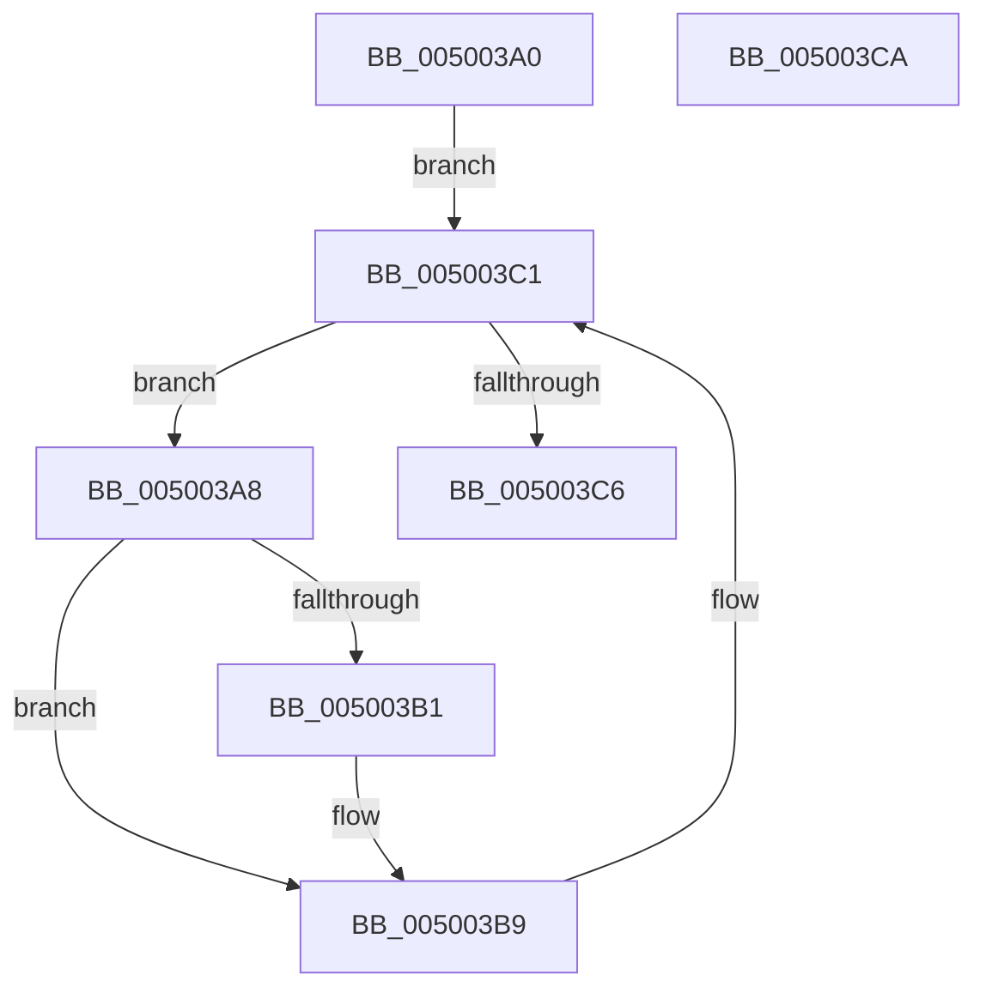

# wcsupr

- RVA: `0x005003A0`–`0x005003CB` (길이 `43` bytes)
- VA: `0x00000001405003A0`
- 실행 섹션: `.text`
- PDB 이름 있음: `예`; PDB Function 태그: `아니요`
- unwind 정보 RVA: `0x000DB714`
- 디코드: `15`개 명령, `43/43` bytes 표시
- 미해석 바이트: `0` (있으면 어셈블리에 `.byte`로 보존)

> 이 문서는 커널 이미지의 기계어와 PDB 기호를 분석해 생성했습니다. 4번과 5번은 함수 원형과 자료형을 바이너리 사용 방식에서 추정한 C 해석이며 원본 소스 복구 결과는 아닙니다.

## 1. Dependencies

- 직접 호출 지점: **0**; 고유 호출 대상: **0**
- 직접 호출자로 확인된 함수: **5**
- RIP 상대 이미지 참조: **0**

### Outgoing calls
- 직접 디코드된 call 명령이 없습니다.

### Direct callers
- [PfTFiNotifyVolumeCreateCallback](../45/PfTFiNotifyVolumeCreateCallback_function_0045ED30.md) at `0x0045EE6D`
- [PfTFiNotifyFileStreamCreateCallback](../45/PfTFiNotifyFileStreamCreateCallback_function_0045EEB0.md) at `0x0045EFDC`
- [PfSnParametersRead](../../page/75/PfSnParametersRead_function_00752970.md) at `0x00752C99`
- [BiUpdateObjectReferenceInEfiEntry](../../page/82/BiUpdateObjectReferenceInEfiEntry_function_0082745C.md) at `0x0082751F`
- [sub_00B3A7EA](../../page/B3/Unknown_function_00B3A7EA.md) at `0x00B3A7FC`

### Static image references
- 디코드된 RIP-relative 메모리 참조가 없습니다.

## 2. Other-region calls and transfers

- 다른 실행 섹션으로 향하는 call: **0**
- 별도 외부 분기/꼬리 이동을 확인하지 못했습니다.

## 3. Assembly (complete function range)

```asm
005003A0  0F B7 11                        movzx edx, word ptr [rcx]
005003A3  4C 8B C1                        mov r8, rcx
005003A6  EB 19                           jmp 0x1405003c1
005003A8  8D 42 9F                        lea eax, [rdx - 0x61]
005003AB  66 83 F8 19                     cmp ax, 0x19
005003AF  77 08                           ja 0x1405003b9
005003B1  66 83 EA 20                     sub dx, 0x20
005003B5  66 41 89 10                     mov word ptr [r8], dx
005003B9  49 83 C0 02                     add r8, 2
005003BD  41 0F B7 10                     movzx edx, word ptr [r8]
005003C1  66 85 D2                        test dx, dx
005003C4  75 E2                           jne 0x1405003a8
005003C6  48 8B C1                        mov rax, rcx
005003C9  C3                              ret
005003CA  CC                              int3
```

## 4. C-style interpretation (structured pseudocode)

```c
__int64 __fastcall wcsupr(__int64 a1)
{
    goto loc_005003C1;
loc_005003A8:
    if (((unsigned __int16)(*(unsigned __int16 *)(a1) - 97)) <= 25) {
        a2 = (unsigned __int16)((*(unsigned __int16 *)(a1)) - (32));
        *(unsigned __int16 *)(a1) = (unsigned __int16)(a2);
    }
    a3 = (a1) + (2);
loc_005003C1:
    if ((unsigned __int16)(*(unsigned __int16 *)(a3)) != 0) goto loc_005003A8;
    return a1;
}
```

## 5. (Beta) C Style

```c
void *wcsupr(void *Arg1)
{
    uint8_t *arg1 = (uint8_t *)Arg1;

    goto loc_005003C1;
loc_005003A8:
    if (((uint16_t)(*(uint16_t *)(arg1) - 97)) <= 25) {
        a2 = (uint16_t)((*(uint16_t *)(arg1)) - (32));
        *(uint16_t *)(arg1) = (uint16_t)(a2);
    }
    a3 = (Arg1) + (2);
loc_005003C1:
    if ((uint16_t)(*(uint16_t *)(a3)) != 0) goto loc_005003A8;
    return Arg1;
}
```

### 관측된 메모리 오프셋

구조체 형식이 확인되지 않은 접근은 인자 기준의 오프셋으로만 기록했습니다.

| 기준 인자 | 오프셋 표현 | 폭 (bit) | 접근 |
|---|---:|---:|---|
| `Arg1` | `+ 0x0` | `16` | `R` |
| `Arg1` | `+ 0x0` | `16` | `W` |

## 6. Execution-region graph

[열기: 2D/3D 그래프와 함수 탐색 컨트롤 패널](../../../control-panel.html?section=text&rva=0x005003A0&view=graph)

- 2D 그래프는 위에서 아래로 흐르고, 3D 그래프는 빈 공간을 드래그해 회전합니다. Shift+드래그는 이동, 휠은 확대·축소, 함수 노드 선택은 대상 보고서 이동입니다.

### Static fallback


