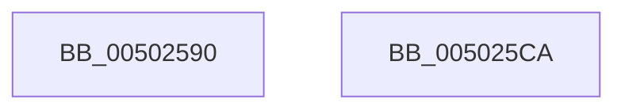

# wctomb

- RVA: `0x00502590`–`0x005025CB` (길이 `59` bytes)
- VA: `0x0000000140502590`
- 실행 섹션: `.text`
- PDB 이름 있음: `예`; PDB Function 태그: `아니요`
- unwind 정보 RVA: `0x00064C80`
- 디코드: `17`개 명령, `59/59` bytes 표시
- 미해석 바이트: `0` (있으면 어셈블리에 `.byte`로 보존)

> 이 문서는 커널 이미지의 기계어와 PDB 기호를 분석해 생성했습니다. 4번과 5번은 함수 원형과 자료형을 바이너리 사용 방식에서 추정한 C 해석이며 원본 소스 복구 결과는 아닙니다.

## 1. Dependencies

- 직접 호출 지점: **1**; 고유 호출 대상: **1**
- 직접 호출자로 확인된 함수: **0**
- RIP 상대 이미지 참조: **1**

### Outgoing calls
- `0x005025B6` → [wctomb_s_l](wctomb_s_l_function_005024D4.md) (function, `0x005024D4`)

### Direct callers
- 이 함수 시작 RVA로 연결되는 직접 call은 확인되지 않았습니다. 간접 호출은 완전히 역산할 수 없습니다.

### Static image references
- `0x00502596` → RVA `0x00E0A700` (`.data`; read)

## 2. Other-region calls and transfers

- 다른 실행 섹션으로 향하는 call: **0**
- 별도 외부 분기/꼬리 이동을 확인하지 못했습니다.

## 3. Assembly (complete function range)

```asm
00502590  40 53                           push rbx
00502592  48 83 EC 30                     sub rsp, 0x30
00502596  4C 63 05 63 81 90 00            movsxd r8, dword ptr [rip + 0x908163]
0050259D  44 0F B7 CA                     movzx r9d, dx
005025A1  48 83 64 24 20 00               and qword ptr [rsp + 0x20], 0
005025A7  48 8B D1                        mov rdx, rcx
005025AA  83 CB FF                        or ebx, 0xffffffff
005025AD  48 8D 4C 24 50                  lea rcx, [rsp + 0x50]
005025B2  89 5C 24 50                     mov dword ptr [rsp + 0x50], ebx
005025B6  E8 19 FF FF FF                  call 0x1405024d4
005025BB  85 C0                           test eax, eax
005025BD  0F 44 5C 24 50                  cmove ebx, dword ptr [rsp + 0x50]
005025C2  8B C3                           mov eax, ebx
005025C4  48 83 C4 30                     add rsp, 0x30
005025C8  5B                              pop rbx
005025C9  C3                              ret
005025CA  CC                              int3
```

## 4. C-style interpretation (structured pseudocode)

```c
__int64 __fastcall wctomb(__int64 a1, unsigned __int16 a2)
{
    __int64 result;
    __int64 v_rbx;
    __int64 v_rsp;
    unsigned __int64 v_stack_m18;
    unsigned __int64 v_stack_p18;

    v_rsp = (v_rsp) - (48);
    v_rbx = (unsigned int)((v_rbx) | (0xFFFFFFFFULL));
    v_stack_p18 = (unsigned int)(v_rbx);
    result = wctomb_s_l(v_stack_p18, a1, (int)(*(unsigned int *)(v_rip + 9470307)), a2);
    if ((unsigned int)(result) == 0) { v_rbx = v_stack_p18; }
    v_rsp = (v_rsp) + (48);
    return (unsigned int)((unsigned int)(v_rbx));
}
```

## 5. (Beta) C Style

```c
int64_t wctomb(int64_t Arg1, uint16_t Arg2)
{
    int64_t result;
    int64_t local_rbx;
    int64_t local_rsp;
    uint64_t v_stack_m18;
    uint64_t v_stack_p18;

    local_rsp = (local_rsp) - (48);
    local_rbx = (uint32_t)((local_rbx) | (0xFFFFFFFFULL));
    v_stack_p18 = (uint32_t)(local_rbx);
    result = wctomb_s_l(v_stack_p18, Arg1, (int32_t)(*(uint32_t *)(v_rip + 0x908163)), Arg2);
    if ((uint32_t)(result) == 0) { local_rbx = v_stack_p18; }
    local_rsp = (local_rsp) + (48);
    return (uint32_t)((uint32_t)(local_rbx));
}
```

## 6. Execution-region graph

[열기: 2D/3D 그래프와 함수 탐색 컨트롤 패널](../../../control-panel.html?section=text&rva=0x00502590&view=graph)

- 2D 그래프는 위에서 아래로 흐르고, 3D 그래프는 빈 공간을 드래그해 회전합니다. Shift+드래그는 이동, 휠은 확대·축소, 함수 노드 선택은 대상 보고서 이동입니다.

### Static fallback


