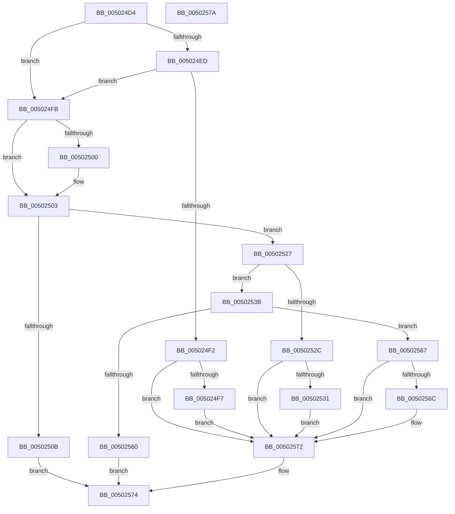

# wctomb_s_l

- RVA: `0x005024D4`–`0x0050257B` (길이 `167` bytes)
- VA: `0x00000001405024D4`
- 실행 섹션: `.text`
- PDB 이름 있음: `예`; PDB Function 태그: `아니요`
- unwind 정보 RVA: `0x000C27D4`
- 디코드: `54`개 명령, `167/167` bytes 표시
- 미해석 바이트: `0` (있으면 어셈블리에 `.byte`로 보존)

> 이 문서는 커널 이미지의 기계어와 PDB 기호를 분석해 생성했습니다. 4번과 5번은 함수 원형과 자료형을 바이너리 사용 방식에서 추정한 C 해석이며 원본 소스 복구 결과는 아닙니다.

## 1. Dependencies

- 직접 호출 지점: **2**; 고유 호출 대상: **2**
- 직접 호출자로 확인된 함수: **2**
- RIP 상대 이미지 참조: **1**

### Outgoing calls
- `0x0050251B` → [EmpCheckErrataList](../49/EmpCheckErrataList_function_0049E550.md) (function, `0x0049E550`)
- `0x00502557` → [RtlUnicodeToMultiByteN](../../page/90/RtlUnicodeToMultiByteN_function_0090D820.md) (function, `0x0090D820`)

### Direct callers
- [wctomb](wctomb_function_00502590.md) at `0x005025B6`
- [wctomb_s](wctomb_s_function_005025D4.md) at `0x005025DE`

### Static image references
- `0x00502531` → RVA `0x00E0A700` (`.data`; read)

## 2. Other-region calls and transfers

- 다른 실행 섹션으로 향하는 call: **1**
  - `0x00502557` → [RtlUnicodeToMultiByteN](../../page/90/RtlUnicodeToMultiByteN_function_0090D820.md) (`.text` → `PAGE`)
- 별도 외부 분기/꼬리 이동을 확인하지 못했습니다.

## 3. Assembly (complete function range)

```asm
005024D4  66 44 89 4C 24 20               mov word ptr [rsp + 0x20], r9w
005024DA  53                              push rbx
005024DB  48 83 EC 30                     sub rsp, 0x30
005024DF  49 8B C0                        mov rax, r8
005024E2  4C 8B D2                        mov r10, rdx
005024E5  48 8B D9                        mov rbx, rcx
005024E8  48 85 D2                        test rdx, rdx
005024EB  75 0E                           jne 0x1405024fb
005024ED  48 85 C0                        test rax, rax
005024F0  74 09                           je 0x1405024fb
005024F2  48 85 C9                        test rcx, rcx
005024F5  74 7B                           je 0x140502572
005024F7  21 11                           and dword ptr [rcx], edx
005024F9  EB 77                           jmp 0x140502572
005024FB  48 85 DB                        test rbx, rbx
005024FE  74 03                           je 0x140502503
00502500  83 09 FF                        or dword ptr [rcx], 0xffffffff
00502503  48 3D FF FF FF 7F               cmp rax, 0x7fffffff
00502509  76 1C                           jbe 0x140502527
0050250B  48 83 64 24 20 00               and qword ptr [rsp + 0x20], 0
00502511  45 33 C9                        xor r9d, r9d
00502514  45 33 C0                        xor r8d, r8d
00502517  33 D2                           xor edx, edx
00502519  33 C9                           xor ecx, ecx
0050251B  E8 30 C0 F9 FF                  call 0x14049e550
00502520  B8 16 00 00 00                  mov eax, 0x16
00502525  EB 4D                           jmp 0x140502574
00502527  4D 85 D2                        test r10, r10
0050252A  75 0F                           jne 0x14050253b
0050252C  48 85 DB                        test rbx, rbx
0050252F  74 41                           je 0x140502572
00502531  8B 05 C9 81 90 00               mov eax, dword ptr [rip + 0x9081c9]
00502537  89 01                           mov dword ptr [rcx], eax
00502539  EB 37                           jmp 0x140502572
0050253B  83 64 24 48 00                  and dword ptr [rsp + 0x48], 0
00502540  4C 8D 4C 24 58                  lea r9, [rsp + 0x58]
00502545  4C 8D 44 24 48                  lea r8, [rsp + 0x48]
0050254A  C7 44 24 20 02 00 00 00         mov dword ptr [rsp + 0x20], 2
00502552  8B D0                           mov edx, eax
00502554  49 8B CA                        mov rcx, r10
00502557  E8 C4 B2 40 00                  call 0x14090d820
0050255C  85 C0                           test eax, eax
0050255E  79 07                           jns 0x140502567
00502560  B8 2A 00 00 00                  mov eax, 0x2a
00502565  EB 0D                           jmp 0x140502574
00502567  48 85 DB                        test rbx, rbx
0050256A  74 06                           je 0x140502572
0050256C  8B 44 24 48                     mov eax, dword ptr [rsp + 0x48]
00502570  89 03                           mov dword ptr [rbx], eax
00502572  33 C0                           xor eax, eax
00502574  48 83 C4 30                     add rsp, 0x30
00502578  5B                              pop rbx
00502579  C3                              ret
0050257A  CC                              int3
```

## 4. C-style interpretation (structured pseudocode)

```c
__int64 __fastcall wctomb_s_l(__int64 a1, __int64 a2, __int64 a3, int a4)
{
    __int64 result;
    __int64 v_rsp;
    unsigned __int64 v_stack_m18;
    unsigned int v_stack_p10;
    unsigned __int16 v_stack_p20;

    v_stack_p20 = (unsigned __int16)(a4);
    v_rsp = (v_rsp) - (48);
    if (a2 != 0) goto loc_005024FB;
    if (a3 == 0) goto loc_005024FB;
    if (a1 == 0) goto loc_00502572;
    goto loc_00502572;
loc_005024FB:
    if (a1 != 0) {
    }
    if (a3 <= 0x7FFFFFFFULL) goto loc_00502527;
    a4 = 0;
    a3 = 0;
    a2 = 0;
    a1 = 0;
    result = EmpCheckErrataList(a1, a2, a3, a4);
    goto loc_00502574;
loc_00502527:
    if (0 != 0) goto loc_0050253B;
    if (0 == 0) goto loc_00502572;
    *(unsigned int *)(a1) = (unsigned int)((unsigned int)(*(unsigned int *)(v_rip + 9470409)));
    goto loc_00502572;
loc_0050253B:
    v_stack_m18 = 2;
    result = RtlUnicodeToMultiByteN(0, (unsigned int)((unsigned int)((unsigned int)(*(unsigned int *)(v_rip + 9470409)))), v_stack_p10, v_stack_p20);
    if (!sign_flag) goto loc_00502567;
    goto loc_00502574;
loc_00502567:
    result = 42;
    if (0 != 0) {
        result = v_stack_p10;
        *(unsigned int *)(a1) = (unsigned int)(result);
    }
    result = 0;
loc_00502574:
    v_rsp = (v_rsp) + (48);
    return result;
}
```

## 5. (Beta) C Style

```c
int64_t wctomb_s_l(void *Arg1, int64_t Arg2, int64_t Arg3, int32_t Arg4)
{
    uint8_t *arg1 = (uint8_t *)Arg1;

    int64_t result;
    int64_t local_rsp;
    uint64_t v_stack_m18;
    uint32_t v_stack_p10;
    uint16_t v_stack_p20;

    v_stack_p20 = (uint16_t)(Arg4);
    local_rsp = (local_rsp) - (48);
    if (Arg2 != 0) goto loc_005024FB;
    if (Arg3 == 0) goto loc_005024FB;
    if (Arg1 == NULL) goto loc_00502572;
    goto loc_00502572;
loc_005024FB:
    if (Arg1 != NULL) {
    }
    if (Arg3 <= 0x7FFFFFFFULL) goto loc_00502527;
    Arg4 = 0;
    Arg3 = 0;
    Arg2 = 0;
    Arg1 = 0;
    result = EmpCheckErrataList(Arg1, Arg2, Arg3, Arg4);
    goto loc_00502574;
loc_00502527:
    if (0 != 0) goto loc_0050253B;
    if (0 == 0) goto loc_00502572;
    *(uint32_t *)(arg1) = (uint32_t)((uint32_t)(*(uint32_t *)(v_rip + 0x9081C9)));
    goto loc_00502572;
loc_0050253B:
    v_stack_m18 = 2;
    result = RtlUnicodeToMultiByteN(0, (uint32_t)((uint32_t)((uint32_t)(*(uint32_t *)(v_rip + 0x9081C9)))), v_stack_p10, v_stack_p20);
    if (!sign_flag) goto loc_00502567;
    goto loc_00502574;
loc_00502567:
    result = 42;
    if (0 != 0) {
        result = v_stack_p10;
        *(uint32_t *)(arg1) = (uint32_t)(result);
    }
    result = 0;
loc_00502574:
    local_rsp = (local_rsp) + (48);
    return result;
}
```

### 관측된 메모리 오프셋

구조체 형식이 확인되지 않은 접근은 인자 기준의 오프셋으로만 기록했습니다.

| 기준 인자 | 오프셋 표현 | 폭 (bit) | 접근 |
|---|---:|---:|---|
| `Arg1` | `+ 0x0` | `32` | `R/W` |
| `Arg1` | `+ 0x0` | `32` | `W` |

## 6. Execution-region graph

[열기: 2D/3D 그래프와 함수 탐색 컨트롤 패널](../../../control-panel.html?section=text&rva=0x005024D4&view=graph)

- 2D 그래프는 위에서 아래로 흐르고, 3D 그래프는 빈 공간을 드래그해 회전합니다. Shift+드래그는 이동, 휠은 확대·축소, 함수 노드 선택은 대상 보고서 이동입니다.

### Static fallback


