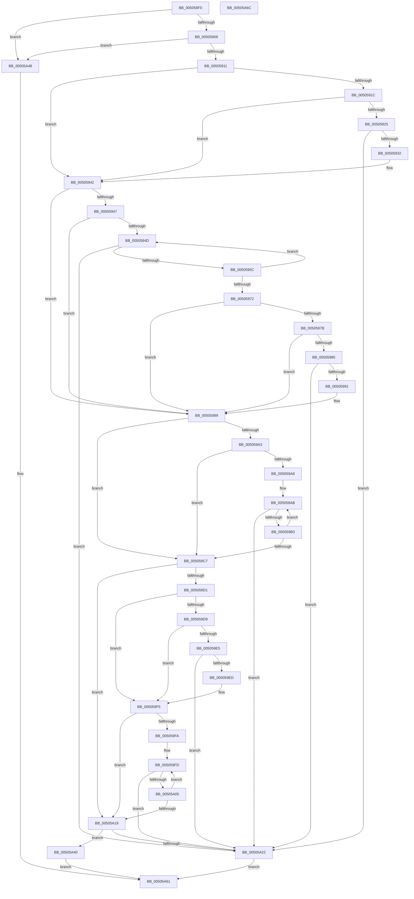

# wmakepath_s

- RVA: `0x005058F0`–`0x00505A6D` (길이 `381` bytes)
- VA: `0x00000001405058F0`
- 실행 섹션: `.text`
- PDB 이름 있음: `예`; PDB Function 태그: `아니요`
- unwind 정보 RVA: `0x0006E5F8`
- 디코드: `114`개 명령, `381/381` bytes 표시
- 미해석 바이트: `0` (있으면 어셈블리에 `.byte`로 보존)

> 이 문서는 커널 이미지의 기계어와 PDB 기호를 분석해 생성했습니다. 4번과 5번은 함수 원형과 자료형을 바이너리 사용 방식에서 추정한 C 해석이며 원본 소스 복구 결과는 아닙니다.

## 1. Dependencies

- 직접 호출 지점: **2**; 고유 호출 대상: **1**
- 직접 호출자로 확인된 함수: **0**
- RIP 상대 이미지 참조: **0**

### Outgoing calls
- `0x00505A34` → [EmpCheckErrataList](../49/EmpCheckErrataList_function_0049E550.md) (function, `0x0049E550`)
- `0x00505A57` → [EmpCheckErrataList](../49/EmpCheckErrataList_function_0049E550.md) (function, `0x0049E550`)

### Direct callers
- 이 함수 시작 RVA로 연결되는 직접 call은 확인되지 않았습니다. 간접 호출은 완전히 역산할 수 없습니다.

### Static image references
- 디코드된 RIP-relative 메모리 참조가 없습니다.

## 2. Other-region calls and transfers

- 다른 실행 섹션으로 향하는 call: **0**
- 별도 외부 분기/꼬리 이동을 확인하지 못했습니다.

## 3. Assembly (complete function range)

```asm
005058F0  48 89 5C 24 08                  mov qword ptr [rsp + 8], rbx
005058F5  57                              push rdi
005058F6  48 83 EC 30                     sub rsp, 0x30
005058FA  33 FF                           xor edi, edi
005058FC  48 8B D9                        mov rbx, rcx
005058FF  48 85 C9                        test rcx, rcx
00505902  0F 84 40 01 00 00               je 0x140505a48
00505908  48 85 D2                        test rdx, rdx
0050590B  0F 84 37 01 00 00               je 0x140505a48
00505911  44 8B DF                        mov r11d, edi
00505914  4C 8B D1                        mov r10, rcx
00505917  4D 85 C0                        test r8, r8
0050591A  74 26                           je 0x140505942
0050591C  41 0F B7 00                     movzx eax, word ptr [r8]
00505920  66 85 C0                        test ax, ax
00505923  74 1D                           je 0x140505942
00505925  44 8D 5F 02                     lea r11d, [rdi + 2]
00505929  49 3B D3                        cmp rdx, r11
0050592C  0F 86 F0 00 00 00               jbe 0x140505a22
00505932  4C 8D 51 02                     lea r10, [rcx + 2]
00505936  66 89 01                        mov word ptr [rcx], ax
00505939  66 41 C7 02 3A 00               mov word ptr [r10], 0x3a
0050593F  4D 03 D3                        add r10, r11
00505942  4D 85 C9                        test r9, r9
00505945  74 52                           je 0x140505999
00505947  66 41 39 39                     cmp word ptr [r9], di
0050594B  74 4C                           je 0x140505999
0050594D  49 FF C3                        inc r11
00505950  49 8B C9                        mov rcx, r9
00505953  4C 3B DA                        cmp r11, rdx
00505956  0F 83 C6 00 00 00               jae 0x140505a22
0050595C  41 0F B7 01                     movzx eax, word ptr [r9]
00505960  49 83 C1 02                     add r9, 2
00505964  66 41 89 02                     mov word ptr [r10], ax
00505968  49 83 C2 02                     add r10, 2
0050596C  66 41 39 39                     cmp word ptr [r9], di
00505970  75 DB                           jne 0x14050594d
00505972  0F B7 01                        movzx eax, word ptr [rcx]
00505975  66 83 F8 2F                     cmp ax, 0x2f
00505979  74 1E                           je 0x140505999
0050597B  B9 5C 00 00 00                  mov ecx, 0x5c
00505980  66 3B C1                        cmp ax, cx
00505983  74 14                           je 0x140505999
00505985  49 FF C3                        inc r11
00505988  4C 3B DA                        cmp r11, rdx
0050598B  0F 83 91 00 00 00               jae 0x140505a22
00505991  66 41 89 0A                     mov word ptr [r10], cx
00505995  49 83 C2 02                     add r10, 2
00505999  48 8B 4C 24 60                  mov rcx, qword ptr [rsp + 0x60]
0050599E  48 85 C9                        test rcx, rcx
005059A1  74 24                           je 0x1405059c7
005059A3  66 39 39                        cmp word ptr [rcx], di
005059A6  74 1F                           je 0x1405059c7
005059A8  49 2B CA                        sub rcx, r10
005059AB  49 FF C3                        inc r11
005059AE  4C 3B DA                        cmp r11, rdx
005059B1  73 6F                           jae 0x140505a22
005059B3  42 0F B7 04 11                  movzx eax, word ptr [rcx + r10]
005059B8  66 41 89 02                     mov word ptr [r10], ax
005059BC  49 83 C2 02                     add r10, 2
005059C0  66 42 39 3C 11                  cmp word ptr [rcx + r10], di
005059C5  75 E4                           jne 0x1405059ab
005059C7  48 8B 4C 24 68                  mov rcx, qword ptr [rsp + 0x68]
005059CC  48 85 C9                        test rcx, rcx
005059CF  74 48                           je 0x140505a19
005059D1  0F B7 01                        movzx eax, word ptr [rcx]
005059D4  66 85 C0                        test ax, ax
005059D7  74 1C                           je 0x1405059f5
005059D9  41 B8 2E 00 00 00               mov r8d, 0x2e
005059DF  66 41 3B C0                     cmp ax, r8w
005059E3  74 10                           je 0x1405059f5
005059E5  49 FF C3                        inc r11
005059E8  4C 3B DA                        cmp r11, rdx
005059EB  73 35                           jae 0x140505a22
005059ED  66 45 89 02                     mov word ptr [r10], r8w
005059F1  49 83 C2 02                     add r10, 2
005059F5  66 39 39                        cmp word ptr [rcx], di
005059F8  74 1F                           je 0x140505a19
005059FA  49 2B CA                        sub rcx, r10
005059FD  49 FF C3                        inc r11
00505A00  4C 3B DA                        cmp r11, rdx
00505A03  73 1D                           jae 0x140505a22
00505A05  42 0F B7 04 11                  movzx eax, word ptr [rcx + r10]
00505A0A  66 41 89 02                     mov word ptr [r10], ax
00505A0E  49 83 C2 02                     add r10, 2
00505A12  66 42 39 3C 11                  cmp word ptr [rcx + r10], di
00505A17  75 E4                           jne 0x1405059fd
00505A19  49 8D 43 01                     lea rax, [r11 + 1]
00505A1D  48 3B C2                        cmp rax, rdx
00505A20  76 1E                           jbe 0x140505a40
00505A22  45 33 C9                        xor r9d, r9d
00505A25  66 89 3B                        mov word ptr [rbx], di
00505A28  45 33 C0                        xor r8d, r8d
00505A2B  48 89 7C 24 20                  mov qword ptr [rsp + 0x20], rdi
00505A30  33 D2                           xor edx, edx
00505A32  33 C9                           xor ecx, ecx
00505A34  E8 17 8B F9 FF                  call 0x14049e550
00505A39  B8 22 00 00 00                  mov eax, 0x22
00505A3E  EB 21                           jmp 0x140505a61
00505A40  66 41 89 3A                     mov word ptr [r10], di
00505A44  33 C0                           xor eax, eax
00505A46  EB 19                           jmp 0x140505a61
00505A48  45 33 C9                        xor r9d, r9d
00505A4B  48 89 7C 24 20                  mov qword ptr [rsp + 0x20], rdi
00505A50  45 33 C0                        xor r8d, r8d
00505A53  33 D2                           xor edx, edx
00505A55  33 C9                           xor ecx, ecx
00505A57  E8 F4 8A F9 FF                  call 0x14049e550
00505A5C  B8 16 00 00 00                  mov eax, 0x16
00505A61  48 8B 5C 24 40                  mov rbx, qword ptr [rsp + 0x40]
00505A66  48 83 C4 30                     add rsp, 0x30
00505A6A  5F                              pop rdi
00505A6B  C3                              ret
00505A6C  CC                              int3
```

## 4. C-style interpretation (structured pseudocode)

```c
__int64 __fastcall wmakepath_s(__int64 a1, __int64 a2, __int64 a3, __int64 a4, __int64 a5, __int64 a6)
{
    __int64 result;
    __int64 v_r10;
    __int64 v_r11;
    __int64 v_rdi;
    __int64 v_rsp;
    unsigned __int64 v_stack_m18;
    unsigned __int64 v_stack_p8;

    v_stack_p8 = v_rbx;
    v_rsp = (v_rsp) - (48);
    v_rdi = 0;
    if (a1 == 0) goto loc_00505A48;
    if (a2 == 0) goto loc_00505A48;
    if (a3 == 0) goto loc_00505942;
    if ((unsigned __int16)(*(unsigned __int16 *)(a3)) == 0) goto loc_00505942;
    if (a2 <= (v_rdi + 2)) goto loc_00505A22;
    *(unsigned __int16 *)(a1) = (unsigned __int16)(*(unsigned __int16 *)(a3));
    *(unsigned __int16 *)(a1 + 2) = 58;
    v_r10 = (a1 + 2) + (v_rdi + 2);
loc_00505942:
    if (a4 == 0) goto loc_00505999;
    if ((*(unsigned __int16 *)(a4)) == 0) goto loc_00505999;
loc_0050594D:
    v_r11 = (v_rdi + 2) + 1;
    if (v_r11 >= a2) goto loc_00505A22;
    a4 = (a4) + (2);
    *(unsigned __int16 *)(v_r10) = (unsigned __int16)(*(unsigned __int16 *)(a4));
    v_r10 = (v_r10) + (2);
    if ((*(unsigned __int16 *)(a4)) != 0) goto loc_0050594D;
    if (((unsigned __int16)(*(unsigned __int16 *)(a4))) == 47) goto loc_00505999;
    if (((unsigned __int16)(*(unsigned __int16 *)(a4))) == 92) goto loc_00505999;
    v_r11 = (v_r11) + 1;
    if (v_r11 >= a2) goto loc_00505A22;
    *(unsigned __int16 *)(v_r10) = 92;
    v_r10 = (v_r10) + (2);
loc_00505999:
    if (a5 == 0) goto loc_005059C7;
    if ((*(unsigned __int16 *)(a5)) == 0) goto loc_005059C7;
    a1 = (a5) - (v_r10);
loc_005059AB:
    v_r11 = (v_r11) + 1;
    if (v_r11 >= a2) goto loc_00505A22;
    *(unsigned __int16 *)(v_r10) = (unsigned __int16)(*(unsigned __int16 *)(a1 + v_r10 * 1));
    v_r10 = (v_r10) + (2);
    if ((*(unsigned __int16 *)(a1 + v_r10 * 1)) != 0) goto loc_005059AB;
loc_005059C7:
    if (a6 == 0) goto loc_00505A19;
    if ((unsigned __int16)(*(unsigned __int16 *)(a6)) == 0) goto loc_005059F5;
    if (((unsigned __int16)(*(unsigned __int16 *)(a6))) == 46) goto loc_005059F5;
    v_r11 = (v_r11) + 1;
    if (v_r11 >= a2) goto loc_00505A22;
    *(unsigned __int16 *)(v_r10) = 46;
    v_r10 = (v_r10) + (2);
loc_005059F5:
    if ((*(unsigned __int16 *)(a6)) == 0) goto loc_00505A19;
    a1 = (a6) - (v_r10);
loc_005059FD:
    v_r11 = (v_r11) + 1;
    if (v_r11 >= a2) goto loc_00505A22;
    *(unsigned __int16 *)(v_r10) = (unsigned __int16)(*(unsigned __int16 *)(a1 + v_r10 * 1));
    v_r10 = (v_r10) + (2);
    if ((*(unsigned __int16 *)(a1 + v_r10 * 1)) != 0) goto loc_005059FD;
loc_00505A19:
    if ((v_r11 + 1) <= a2) goto loc_00505A40;
loc_00505A22:
    a4 = 0;
    *(unsigned __int16 *)(a1) = 0;
    a3 = 0;
    v_stack_m18 = 0;
    a2 = 0;
    a1 = 0;
    result = EmpCheckErrataList(a1, a2, a3, a4);
    goto loc_00505A61;
loc_00505A40:
    *(unsigned __int16 *)(v_r10) = 0;
    result = 0;
    goto loc_00505A61;
loc_00505A48:
    a4 = 0;
    v_stack_m18 = 0;
    a3 = 0;
    a2 = 0;
    a1 = 0;
    result = EmpCheckErrataList(a1, a2, a3, a4);
loc_00505A61:
    v_rsp = (v_rsp) + (48);
    return 22;
}
```

## 5. (Beta) C Style

```c
int64_t wmakepath_s(void *Arg1, int64_t Arg2, int64_t Arg3, int64_t Arg4, int64_t Arg5, int64_t Arg6)
{
    uint8_t *arg1 = (uint8_t *)Arg1;

    int64_t result;
    int64_t local_r10;
    int64_t local_r11;
    int64_t local_rdi;
    int64_t local_rsp;
    uint64_t v_stack_m18;
    uint64_t v_stack_p8;

    v_stack_p8 = local_rbx;
    local_rsp = (local_rsp) - (48);
    local_rdi = 0;
    if (Arg1 == NULL) goto loc_00505A48;
    if (Arg2 == 0) goto loc_00505A48;
    if (Arg3 == 0) goto loc_00505942;
    if ((uint16_t)(*(uint16_t *)(Arg3)) == 0) goto loc_00505942;
    if (Arg2 <= (local_rdi + 2)) goto loc_00505A22;
    *(uint16_t *)(arg1) = (uint16_t)(*(uint16_t *)(Arg3));
    *(uint16_t *)(arg1 + 0x2) = 58;
    local_r10 = (Arg1 + 2) + (local_rdi + 2);
loc_00505942:
    if (Arg4 == 0) goto loc_00505999;
    if ((*(uint16_t *)(Arg4)) == 0) goto loc_00505999;
loc_0050594D:
    local_r11 = (local_rdi + 2) + 1;
    if (local_r11 >= Arg2) goto loc_00505A22;
    Arg4 = (Arg4) + (2);
    *(uint16_t *)(local_r10) = (uint16_t)(*(uint16_t *)(Arg4));
    local_r10 = (local_r10) + (2);
    if ((*(uint16_t *)(Arg4)) != 0) goto loc_0050594D;
    if (((uint16_t)(*(uint16_t *)(Arg4))) == 47) goto loc_00505999;
    if (((uint16_t)(*(uint16_t *)(Arg4))) == 92) goto loc_00505999;
    local_r11 = (local_r11) + 1;
    if (local_r11 >= Arg2) goto loc_00505A22;
    *(uint16_t *)(local_r10) = 92;
    local_r10 = (local_r10) + (2);
loc_00505999:
    if (Arg5 == 0) goto loc_005059C7;
    if ((*(uint16_t *)(Arg5)) == 0) goto loc_005059C7;
    Arg1 = (Arg5) - (local_r10);
loc_005059AB:
    local_r11 = (local_r11) + 1;
    if (local_r11 >= Arg2) goto loc_00505A22;
    *(uint16_t *)(local_r10) = (uint16_t)(*(uint16_t *)(arg1 + local_r10 * 1));
    local_r10 = (local_r10) + (2);
    if ((*(uint16_t *)(arg1 + local_r10 * 1)) != 0) goto loc_005059AB;
loc_005059C7:
    if (Arg6 == 0) goto loc_00505A19;
    if ((uint16_t)(*(uint16_t *)(Arg6)) == 0) goto loc_005059F5;
    if (((uint16_t)(*(uint16_t *)(Arg6))) == 46) goto loc_005059F5;
    local_r11 = (local_r11) + 1;
    if (local_r11 >= Arg2) goto loc_00505A22;
    *(uint16_t *)(local_r10) = 46;
    local_r10 = (local_r10) + (2);
loc_005059F5:
    if ((*(uint16_t *)(Arg6)) == 0) goto loc_00505A19;
    Arg1 = (Arg6) - (local_r10);
loc_005059FD:
    local_r11 = (local_r11) + 1;
    if (local_r11 >= Arg2) goto loc_00505A22;
    *(uint16_t *)(local_r10) = (uint16_t)(*(uint16_t *)(arg1 + local_r10 * 1));
    local_r10 = (local_r10) + (2);
    if ((*(uint16_t *)(arg1 + local_r10 * 1)) != 0) goto loc_005059FD;
loc_00505A19:
    if ((local_r11 + 1) <= Arg2) goto loc_00505A40;
loc_00505A22:
    Arg4 = 0;
    *(uint16_t *)(arg1) = 0;
    Arg3 = 0;
    v_stack_m18 = 0;
    Arg2 = 0;
    Arg1 = 0;
    result = EmpCheckErrataList(Arg1, Arg2, Arg3, Arg4);
    goto loc_00505A61;
loc_00505A40:
    *(uint16_t *)(local_r10) = 0;
    result = 0;
    goto loc_00505A61;
loc_00505A48:
    Arg4 = 0;
    v_stack_m18 = 0;
    Arg3 = 0;
    Arg2 = 0;
    Arg1 = 0;
    result = EmpCheckErrataList(Arg1, Arg2, Arg3, Arg4);
loc_00505A61:
    local_rsp = (local_rsp) + (48);
    return 22;
}
```

### 관측된 메모리 오프셋

구조체 형식이 확인되지 않은 접근은 인자 기준의 오프셋으로만 기록했습니다.

| 기준 인자 | 오프셋 표현 | 폭 (bit) | 접근 |
|---|---:|---:|---|
| `Arg1` | `+ 0x0` | `16` | `W` |

## 6. Execution-region graph

[열기: 2D/3D 그래프와 함수 탐색 컨트롤 패널](../../../control-panel.html?section=text&rva=0x005058F0&view=graph)

- 2D 그래프는 위에서 아래로 흐르고, 3D 그래프는 빈 공간을 드래그해 회전합니다. Shift+드래그는 이동, 휠은 확대·축소, 함수 노드 선택은 대상 보고서 이동입니다.

### Static fallback


