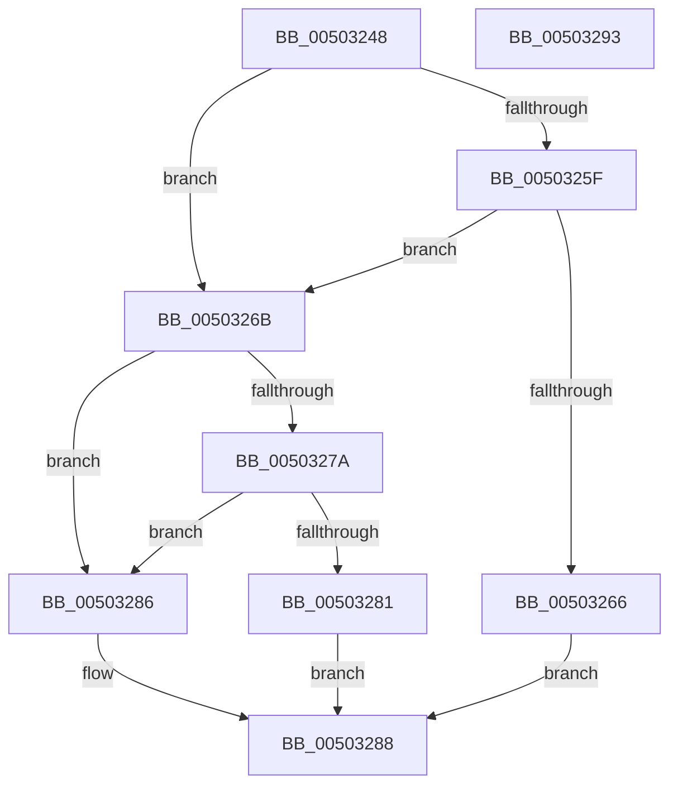

# write_char

- RVA: `0x00503248`–`0x00503294` (길이 `76` bytes)
- VA: `0x0000000140503248`
- 실행 섹션: `.text`
- PDB 이름 있음: `예`; PDB Function 태그: `예`
- unwind 정보 RVA: `0x0005CAAC`
- 디코드: `27`개 명령, `76/76` bytes 표시
- 미해석 바이트: `0` (있으면 어셈블리에 `.byte`로 보존)

> 이 문서는 커널 이미지의 기계어와 PDB 기호를 분석해 생성했습니다. 4번과 5번은 함수 원형과 자료형을 바이너리 사용 방식에서 추정한 C 해석이며 원본 소스 복구 결과는 아닙니다.

## 1. Dependencies

- 직접 호출 지점: **1**; 고유 호출 대상: **1**
- 직접 호출자로 확인된 함수: **3**
- RIP 상대 이미지 참조: **0**

### Outgoing calls
- `0x0050326B` → [fputwc_nolock](fputwc_nolock_function_005044B4.md) (function, `0x005044B4`)

### Direct callers
- [woutput_l](woutput_l_function_0050293C.md) at `0x00502F13`
- [woutput_l](woutput_l_function_0050293C.md) at `0x005030EA`
- [write_multi_char](write_multi_char_function_0050329C.md) at `0x005032CA`
- [write_string](write_string_function_005032F4.md) at `0x00503338`

### Static image references
- 디코드된 RIP-relative 메모리 참조가 없습니다.

## 2. Other-region calls and transfers

- 다른 실행 섹션으로 향하는 call: **0**
- 별도 외부 분기/꼬리 이동을 확인하지 못했습니다.

## 3. Assembly (complete function range)

```asm
00503248  48 89 5C 24 08                  mov qword ptr [rsp + 8], rbx
0050324D  57                              push rdi
0050324E  48 83 EC 20                     sub rsp, 0x20
00503252  8B 42 18                        mov eax, dword ptr [rdx + 0x18]
00503255  49 8B D8                        mov rbx, r8
00503258  48 8B FA                        mov rdi, rdx
0050325B  A8 40                           test al, 0x40
0050325D  74 0C                           je 0x14050326b
0050325F  48 83 7A 10 00                  cmp qword ptr [rdx + 0x10], 0
00503264  75 05                           jne 0x14050326b
00503266  41 FF 00                        inc dword ptr [r8]
00503269  EB 1D                           jmp 0x140503288
0050326B  E8 44 12 00 00                  call 0x1405044b4
00503270  B9 FF FF 00 00                  mov ecx, 0xffff
00503275  66 3B C1                        cmp ax, cx
00503278  75 0C                           jne 0x140503286
0050327A  8B 47 18                        mov eax, dword ptr [rdi + 0x18]
0050327D  A8 20                           test al, 0x20
0050327F  74 05                           je 0x140503286
00503281  83 0B FF                        or dword ptr [rbx], 0xffffffff
00503284  EB 02                           jmp 0x140503288
00503286  FF 03                           inc dword ptr [rbx]
00503288  48 8B 5C 24 30                  mov rbx, qword ptr [rsp + 0x30]
0050328D  48 83 C4 20                     add rsp, 0x20
00503291  5F                              pop rdi
00503292  C3                              ret
00503293  CC                              int3
```

## 4. C-style interpretation (structured pseudocode)

```c
__int64 __fastcall write_char(__int64 a1, __int64 a2, __int64 a3)
{
    __int64 result;
    __int64 v_rsp;
    unsigned __int64 v_stack_p8;

    v_stack_p8 = v_rbx;
    v_rsp = (v_rsp) - (32);
    if ((((unsigned __int8)((unsigned int)(*(unsigned int *)(a2 + 24)))) & (64)) == 0) goto loc_0050326B;
    if ((*(unsigned __int64 *)(a2 + 16)) != 0) goto loc_0050326B;
    goto loc_00503288;
loc_0050326B:
    result = fputwc_nolock(a1, a2, a3, a4);
    if (((unsigned __int16)(result)) != ((unsigned __int16)((unsigned int)(0xFFFFULL)))) goto loc_00503286;
    if ((((unsigned __int8)((unsigned int)(*(unsigned int *)(a2 + 24)))) & (32)) == 0) goto loc_00503286;
    goto loc_00503288;
loc_00503286:
loc_00503288:
    v_rsp = (v_rsp) + (32);
    return (unsigned int)(*(unsigned int *)(a2 + 24));
}
```

## 5. (Beta) C Style

```c
int64_t write_char(int64_t Arg1, void *Arg2, void *Arg3)
{
    uint8_t *arg2 = (uint8_t *)Arg2;
    uint8_t *arg3 = (uint8_t *)Arg3;

    int64_t result;
    int64_t local_rsp;
    uint64_t v_stack_p8;

    v_stack_p8 = local_rbx;
    local_rsp = (local_rsp) - (32);
    if ((((uint8_t)((uint32_t)(*(uint32_t *)(arg2 + 0x18)))) & (64)) == 0) goto loc_0050326B;
    if ((*(uint64_t *)(arg2 + 0x10)) != 0) goto loc_0050326B;
    goto loc_00503288;
loc_0050326B:
    result = fputwc_nolock(Arg1, Arg2, Arg3, a4);
    if (((uint16_t)(result)) != ((uint16_t)((uint32_t)(0xFFFFULL)))) goto loc_00503286;
    if ((((uint8_t)((uint32_t)(*(uint32_t *)(arg2 + 0x18)))) & (32)) == 0) goto loc_00503286;
    goto loc_00503288;
loc_00503286:
loc_00503288:
    local_rsp = (local_rsp) + (32);
    return (uint32_t)(*(uint32_t *)(arg2 + 0x18));
}
```

### 관측된 메모리 오프셋

구조체 형식이 확인되지 않은 접근은 인자 기준의 오프셋으로만 기록했습니다.

| 기준 인자 | 오프셋 표현 | 폭 (bit) | 접근 |
|---|---:|---:|---|
| `Arg2` | `+ 0x10` | `64` | `R` |
| `Arg2` | `+ 0x18` | `32` | `R` |
| `Arg3` | `+ 0x0` | `32` | `R/W` |

## 6. Execution-region graph

[열기: 2D/3D 그래프와 함수 탐색 컨트롤 패널](../../../control-panel.html?section=text&rva=0x00503248&view=graph)

- 2D 그래프는 위에서 아래로 흐르고, 3D 그래프는 빈 공간을 드래그해 회전합니다. Shift+드래그는 이동, 휠은 확대·축소, 함수 노드 선택은 대상 보고서 이동입니다.

### Static fallback


