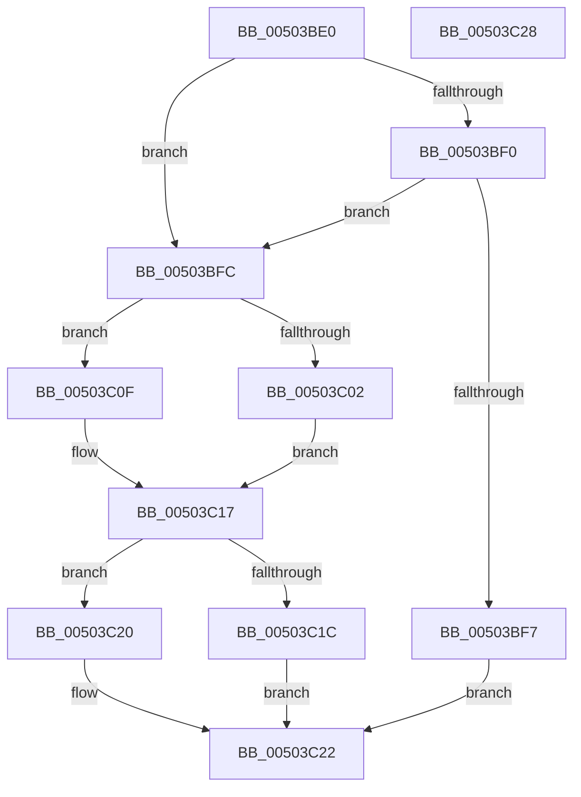

# write_char

- RVA: `0x00503BE0`–`0x00503C29` (길이 `73` bytes)
- VA: `0x0000000140503BE0`
- 실행 섹션: `.text`
- PDB 이름 있음: `예`; PDB Function 태그: `예`
- unwind 정보 RVA: `0x0005CF00`
- 디코드: `28`개 명령, `73/73` bytes 표시
- 미해석 바이트: `0` (있으면 어셈블리에 `.byte`로 보존)

> 이 문서는 커널 이미지의 기계어와 PDB 기호를 분석해 생성했습니다. 4번과 5번은 함수 원형과 자료형을 바이너리 사용 방식에서 추정한 C 해석이며 원본 소스 복구 결과는 아닙니다.

## 1. Dependencies

- 직접 호출 지점: **1**; 고유 호출 대상: **1**
- 직접 호출자로 확인된 함수: **4**
- RIP 상대 이미지 참조: **0**

### Outgoing calls
- `0x00503C12` → [flsbuf](flsbuf_function_0050292C.md) (function, `0x0050292C`)

### Direct callers
- [output_l](output_l_function_00503368.md) at `0x00503A74`
- [write_multi_char](write_multi_char_function_00503C30.md) at `0x00503C5E`
- [write_string](write_string_function_00503C88.md) at `0x00503CCB`
- [output_s](output_s_function_00506854.md) at `0x00506F47`

### Static image references
- 디코드된 RIP-relative 메모리 참조가 없습니다.

## 2. Other-region calls and transfers

- 다른 실행 섹션으로 향하는 call: **0**
- 별도 외부 분기/꼬리 이동을 확인하지 못했습니다.

## 3. Assembly (complete function range)

```asm
00503BE0  40 53                           push rbx
00503BE2  48 83 EC 20                     sub rsp, 0x20
00503BE6  8B 42 18                        mov eax, dword ptr [rdx + 0x18]
00503BE9  49 8B D8                        mov rbx, r8
00503BEC  A8 40                           test al, 0x40
00503BEE  74 0C                           je 0x140503bfc
00503BF0  48 83 7A 10 00                  cmp qword ptr [rdx + 0x10], 0
00503BF5  75 05                           jne 0x140503bfc
00503BF7  41 FF 00                        inc dword ptr [r8]
00503BFA  EB 26                           jmp 0x140503c22
00503BFC  83 6A 08 01                     sub dword ptr [rdx + 8], 1
00503C00  78 0D                           js 0x140503c0f
00503C02  48 8B 02                        mov rax, qword ptr [rdx]
00503C05  88 08                           mov byte ptr [rax], cl
00503C07  48 FF 02                        inc qword ptr [rdx]
00503C0A  0F B6 C1                        movzx eax, cl
00503C0D  EB 08                           jmp 0x140503c17
00503C0F  0F BE C9                        movsx ecx, cl
00503C12  E8 15 ED FF FF                  call 0x14050292c
00503C17  83 F8 FF                        cmp eax, -1
00503C1A  75 04                           jne 0x140503c20
00503C1C  09 03                           or dword ptr [rbx], eax
00503C1E  EB 02                           jmp 0x140503c22
00503C20  FF 03                           inc dword ptr [rbx]
00503C22  48 83 C4 20                     add rsp, 0x20
00503C26  5B                              pop rbx
00503C27  C3                              ret
00503C28  CC                              int3
```

## 4. C-style interpretation (structured pseudocode)

```c
__int64 __fastcall write_char(unsigned __int8 a1, __int64 a2, __int64 a3)
{
    __int64 result;
    __int64 v_rsp;

    v_rsp = (v_rsp) - (32);
    if ((((unsigned __int8)((unsigned int)(*(unsigned int *)(a2 + 24)))) & (64)) == 0) goto loc_00503BFC;
    if ((*(unsigned __int64 *)(a2 + 16)) != 0) goto loc_00503BFC;
    goto loc_00503C22;
loc_00503BFC:
    if (sign_flag) goto loc_00503C0F;
    *(unsigned __int8 *)(*(unsigned __int64 *)(a2)) = a1;
    goto loc_00503C17;
loc_00503C0F:
    result = flsbuf((__int8)(a1), a2, a3, a4);
loc_00503C17:
    if (((unsigned int)(result)) != -1) goto loc_00503C20;
    goto loc_00503C22;
loc_00503C20:
loc_00503C22:
    v_rsp = (v_rsp) + (32);
    return result;
}
```

## 5. (Beta) C Style

```c
int64_t write_char(uint8_t Arg1, void *Arg2, void *Arg3)
{
    uint8_t *arg2 = (uint8_t *)Arg2;
    uint8_t *arg3 = (uint8_t *)Arg3;

    int64_t result;
    int64_t local_rsp;

    local_rsp = (local_rsp) - (32);
    if ((((uint8_t)((uint32_t)(*(uint32_t *)(arg2 + 0x18)))) & (64)) == 0) goto loc_00503BFC;
    if ((*(uint64_t *)(arg2 + 0x10)) != 0) goto loc_00503BFC;
    goto loc_00503C22;
loc_00503BFC:
    if (sign_flag) goto loc_00503C0F;
    *(uint8_t *)(*(uint64_t *)(arg2)) = Arg1;
    goto loc_00503C17;
loc_00503C0F:
    result = flsbuf((int8_t)(Arg1), Arg2, Arg3, a4);
loc_00503C17:
    if (((uint32_t)(result)) != -1) goto loc_00503C20;
    goto loc_00503C22;
loc_00503C20:
loc_00503C22:
    local_rsp = (local_rsp) + (32);
    return result;
}
```

### 관측된 메모리 오프셋

구조체 형식이 확인되지 않은 접근은 인자 기준의 오프셋으로만 기록했습니다.

| 기준 인자 | 오프셋 표현 | 폭 (bit) | 접근 |
|---|---:|---:|---|
| `Arg2` | `+ 0x0` | `64` | `R` |
| `Arg2` | `+ 0x0` | `64` | `R/W` |
| `Arg2` | `+ 0x8` | `32` | `R/W` |
| `Arg2` | `+ 0x10` | `64` | `R` |
| `Arg2` | `+ 0x18` | `32` | `R` |
| `Arg3` | `+ 0x0` | `32` | `R/W` |

## 6. Execution-region graph

[열기: 2D/3D 그래프와 함수 탐색 컨트롤 패널](../../../control-panel.html?section=text&rva=0x00503BE0&view=graph)

- 2D 그래프는 위에서 아래로 흐르고, 3D 그래프는 빈 공간을 드래그해 회전합니다. Shift+드래그는 이동, 휠은 확대·축소, 함수 노드 선택은 대상 보고서 이동입니다.

### Static fallback


