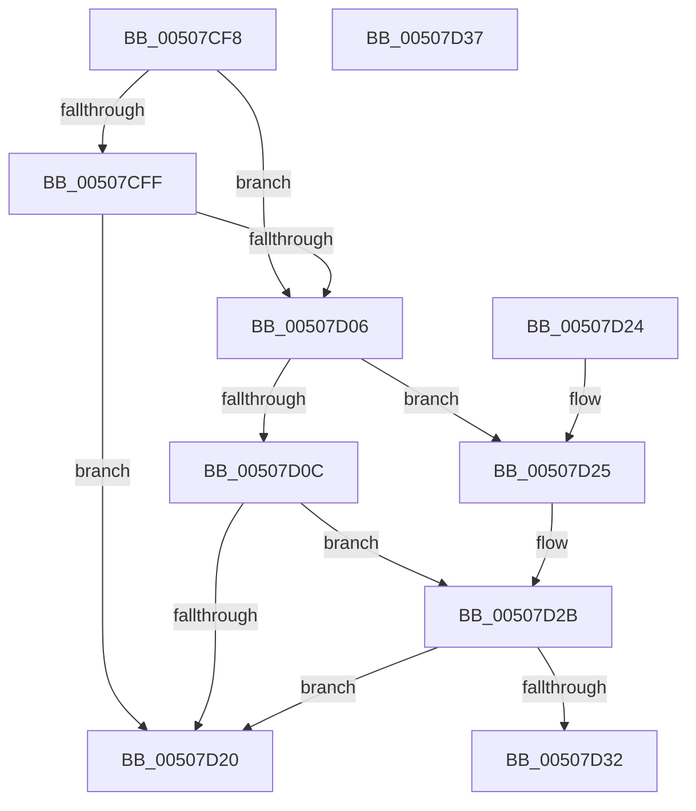

# write_char

- RVA: `0x00507CF8`–`0x00507D38` (길이 `64` bytes)
- VA: `0x0000000140507CF8`
- 실행 섹션: `.text`
- PDB 이름 있음: `예`; PDB Function 태그: `예`
- unwind 정보 RVA: `0x000DB714`
- 디코드: `24`개 명령, `64/64` bytes 표시
- 미해석 바이트: `0` (있으면 어셈블리에 `.byte`로 보존)

> 이 문서는 커널 이미지의 기계어와 PDB 기호를 분석해 생성했습니다. 4번과 5번은 함수 원형과 자료형을 바이너리 사용 방식에서 추정한 C 해석이며 원본 소스 복구 결과는 아닙니다.

## 1. Dependencies

- 직접 호출 지점: **0**; 고유 호출 대상: **0**
- 직접 호출자로 확인된 함수: **1**
- RIP 상대 이미지 참조: **0**

### Outgoing calls
- 직접 디코드된 call 명령이 없습니다.

### Direct callers
- [woutput_s](woutput_s_function_005073AC.md) at `0x00507905`
- [woutput_s](woutput_s_function_005073AC.md) at `0x0050794E`
- [woutput_s](woutput_s_function_005073AC.md) at `0x00507984`
- [woutput_s](woutput_s_function_005073AC.md) at `0x005079EE`
- [woutput_s](woutput_s_function_005073AC.md) at `0x00507A3A`
- [woutput_s](woutput_s_function_005073AC.md) at `0x00507A6C`
- [woutput_s](woutput_s_function_005073AC.md) at `0x00507B83`

### Static image references
- 디코드된 RIP-relative 메모리 참조가 없습니다.

## 2. Other-region calls and transfers

- 다른 실행 섹션으로 향하는 call: **0**
- 별도 외부 분기/꼬리 이동을 확인하지 못했습니다.

## 3. Assembly (complete function range)

```asm
00507CF8  8B 42 18                        mov eax, dword ptr [rdx + 0x18]
00507CFB  A8 40                           test al, 0x40
00507CFD  74 07                           je 0x140507d06
00507CFF  48 83 7A 10 00                  cmp qword ptr [rdx + 0x10], 0
00507D04  74 1A                           je 0x140507d20
00507D06  83 42 08 FE                     add dword ptr [rdx + 8], -2
00507D0A  78 19                           js 0x140507d25
00507D0C  48 8B 02                        mov rax, qword ptr [rdx]
00507D0F  66 89 08                        mov word ptr [rax], cx
00507D12  B8 FF FF 00 00                  mov eax, 0xffff
00507D17  48 83 02 02                     add qword ptr [rdx], 2
00507D1B  66 3B C8                        cmp cx, ax
00507D1E  74 0B                           je 0x140507d2b
00507D20  41 FF 00                        inc dword ptr [r8]
00507D23  C3                              ret
00507D24  CC                              int3
00507D25  83 C8 20                        or eax, 0x20
00507D28  89 42 18                        mov dword ptr [rdx + 0x18], eax
00507D2B  8B 42 18                        mov eax, dword ptr [rdx + 0x18]
00507D2E  A8 20                           test al, 0x20
00507D30  74 EE                           je 0x140507d20
00507D32  41 83 08 FF                     or dword ptr [r8], 0xffffffff
00507D36  C3                              ret
00507D37  CC                              int3
```

## 4. C-style interpretation (structured pseudocode)

```c
__int64 __fastcall write_char(unsigned __int16 a1, __int64 a2, __int64 a3)
{
    __int64 result;

    if ((((unsigned __int8)((unsigned int)(*(unsigned int *)(a2 + 24)))) & (64)) == 0) goto loc_00507D06;
    if ((*(unsigned __int64 *)(a2 + 16)) == 0) goto loc_00507D20;
loc_00507D06:
    if (sign_flag) goto loc_00507D25;
    *(unsigned __int16 *)(*(unsigned __int64 *)(a2)) = a1;
    if (a1 == ((unsigned __int16)((unsigned int)(0xFFFFULL)))) goto loc_00507D2B;
loc_00507D20:
    return (unsigned int)(0xFFFFULL);
loc_00507D25:
    result = (unsigned int)(((unsigned int)(0xFFFFULL)) | (32));
    *(unsigned int *)(a2 + 24) = (unsigned int)(result);
loc_00507D2B:
    if ((((unsigned __int8)((unsigned int)(*(unsigned int *)(a2 + 24)))) & (32)) == 0) goto loc_00507D20;
    return (unsigned int)(*(unsigned int *)(a2 + 24));
}
```

## 5. (Beta) C Style

```c
int64_t write_char(uint16_t Arg1, void *Arg2, void *Arg3)
{
    uint8_t *arg2 = (uint8_t *)Arg2;
    uint8_t *arg3 = (uint8_t *)Arg3;

    int64_t result;

    if ((((uint8_t)((uint32_t)(*(uint32_t *)(arg2 + 0x18)))) & (64)) == 0) goto loc_00507D06;
    if ((*(uint64_t *)(arg2 + 0x10)) == 0) goto loc_00507D20;
loc_00507D06:
    if (sign_flag) goto loc_00507D25;
    *(uint16_t *)(*(uint64_t *)(arg2)) = Arg1;
    if (Arg1 == ((uint16_t)((uint32_t)(0xFFFFULL)))) goto loc_00507D2B;
loc_00507D20:
    return (uint32_t)(0xFFFFULL);
loc_00507D25:
    result = (uint32_t)(((uint32_t)(0xFFFFULL)) | (32));
    *(uint32_t *)(arg2 + 0x18) = (uint32_t)(result);
loc_00507D2B:
    if ((((uint8_t)((uint32_t)(*(uint32_t *)(arg2 + 0x18)))) & (32)) == 0) goto loc_00507D20;
    return (uint32_t)(*(uint32_t *)(arg2 + 0x18));
}
```

### 관측된 메모리 오프셋

구조체 형식이 확인되지 않은 접근은 인자 기준의 오프셋으로만 기록했습니다.

| 기준 인자 | 오프셋 표현 | 폭 (bit) | 접근 |
|---|---:|---:|---|
| `Arg2` | `+ 0x0` | `64` | `R` |
| `Arg2` | `+ 0x0` | `64` | `R/W` |
| `Arg2` | `+ 0x8` | `32` | `R/W` |
| `Arg2` | `+ 0x10` | `64` | `R` |
| `Arg2` | `+ 0x18` | `32` | `R` |
| `Arg2` | `+ 0x18` | `32` | `W` |
| `Arg3` | `+ 0x0` | `32` | `R/W` |

## 6. Execution-region graph

[열기: 2D/3D 그래프와 함수 탐색 컨트롤 패널](../../../control-panel.html?section=text&rva=0x00507CF8&view=graph)

- 2D 그래프는 위에서 아래로 흐르고, 3D 그래프는 빈 공간을 드래그해 회전합니다. Shift+드래그는 이동, 휠은 확대·축소, 함수 노드 선택은 대상 보고서 이동입니다.

### Static fallback


