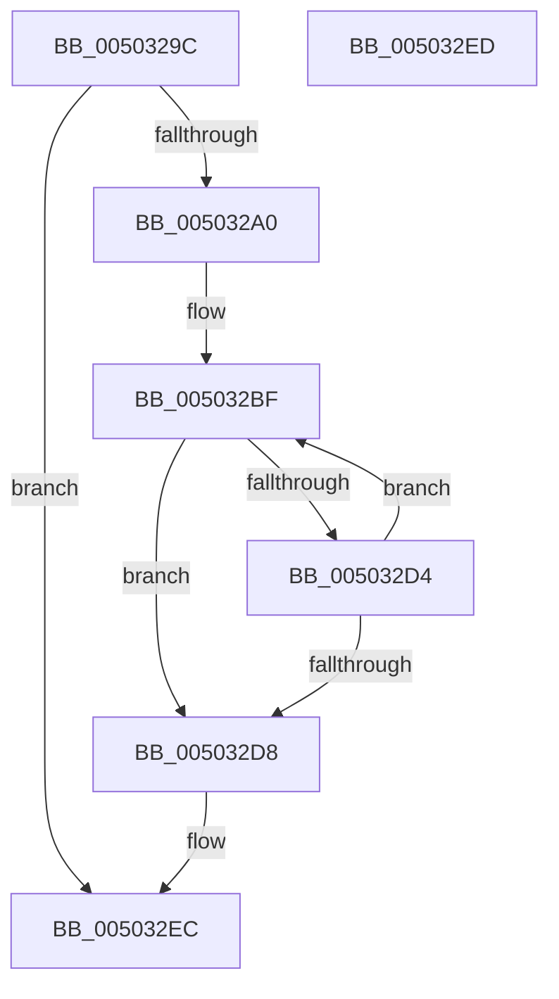

# write_multi_char

- RVA: `0x0050329C`–`0x005032EE` (길이 `82` bytes)
- VA: `0x000000014050329C`
- 실행 섹션: `.text`
- PDB 이름 있음: `예`; PDB Function 태그: `예`
- unwind 정보 RVA: `0x000C27E0`
- 디코드: `27`개 명령, `82/82` bytes 표시
- 미해석 바이트: `0` (있으면 어셈블리에 `.byte`로 보존)

> 이 문서는 커널 이미지의 기계어와 PDB 기호를 분석해 생성했습니다. 4번과 5번은 함수 원형과 자료형을 바이너리 사용 방식에서 추정한 C 해석이며 원본 소스 복구 결과는 아닙니다.

## 1. Dependencies

- 직접 호출 지점: **1**; 고유 호출 대상: **1**
- 직접 호출자로 확인된 함수: **1**
- RIP 상대 이미지 참조: **0**

### Outgoing calls
- `0x005032CA` → [write_char](write_char_function_00503248.md) (function, `0x00503248`)

### Direct callers
- [woutput_l](woutput_l_function_0050293C.md) at `0x00502E8A`
- [woutput_l](woutput_l_function_0050293C.md) at `0x00502EC0`
- [woutput_l](woutput_l_function_0050293C.md) at `0x00502F79`

### Static image references
- 디코드된 RIP-relative 메모리 참조가 없습니다.

## 2. Other-region calls and transfers

- 다른 실행 섹션으로 향하는 call: **0**
- 별도 외부 분기/꼬리 이동을 확인하지 못했습니다.

## 3. Assembly (complete function range)

```asm
0050329C  85 D2                           test edx, edx
0050329E  7E 4C                           jle 0x1405032ec
005032A0  48 89 5C 24 08                  mov qword ptr [rsp + 8], rbx
005032A5  48 89 6C 24 10                  mov qword ptr [rsp + 0x10], rbp
005032AA  48 89 74 24 18                  mov qword ptr [rsp + 0x18], rsi
005032AF  57                              push rdi
005032B0  48 83 EC 20                     sub rsp, 0x20
005032B4  49 8B F9                        mov rdi, r9
005032B7  49 8B F0                        mov rsi, r8
005032BA  8B DA                           mov ebx, edx
005032BC  0F B7 E9                        movzx ebp, cx
005032BF  4C 8B C7                        mov r8, rdi
005032C2  48 8B D6                        mov rdx, rsi
005032C5  0F B7 CD                        movzx ecx, bp
005032C8  FF CB                           dec ebx
005032CA  E8 79 FF FF FF                  call 0x140503248
005032CF  83 3F FF                        cmp dword ptr [rdi], -1
005032D2  74 04                           je 0x1405032d8
005032D4  85 DB                           test ebx, ebx
005032D6  7F E7                           jg 0x1405032bf
005032D8  48 8B 5C 24 30                  mov rbx, qword ptr [rsp + 0x30]
005032DD  48 8B 6C 24 38                  mov rbp, qword ptr [rsp + 0x38]
005032E2  48 8B 74 24 40                  mov rsi, qword ptr [rsp + 0x40]
005032E7  48 83 C4 20                     add rsp, 0x20
005032EB  5F                              pop rdi
005032EC  C3                              ret
005032ED  CC                              int3
```

## 4. C-style interpretation (structured pseudocode)

```c
__int64 __fastcall write_multi_char(unsigned __int16 a1, int a2, __int64 a3, __int64 a4)
{
    __int64 result;
    __int64 v_rbx;
    __int64 v_rsp;
    unsigned __int64 v_stack_p10;
    unsigned __int64 v_stack_p18;
    unsigned __int64 v_stack_p8;

    if (condition_is_less_or_equal) goto loc_005032EC;
    v_stack_p8 = v_rbx;
    v_stack_p10 = v_rbp;
    v_stack_p18 = v_rsi;
    v_rsp = (v_rsp) - (32);
loc_005032BF:
    v_rbx = (unsigned int)(((unsigned int)(a2)) - 1);
    result = write_char(a1, a3, a4, a4);
    if ((*(unsigned int *)(a4)) == -1) goto loc_005032D8;
    if (condition_is_greater) goto loc_005032BF;
loc_005032D8:
    v_rsp = (v_rsp) + (32);
loc_005032EC:
    return result;
}
```

## 5. (Beta) C Style

```c
int64_t write_multi_char(uint16_t Arg1, int32_t Arg2, int64_t Arg3, void *Arg4)
{
    uint8_t *arg4 = (uint8_t *)Arg4;

    int64_t result;
    int64_t local_rbx;
    int64_t local_rsp;
    uint64_t v_stack_p10;
    uint64_t v_stack_p18;
    uint64_t v_stack_p8;

    if (condition_is_less_or_equal) goto loc_005032EC;
    v_stack_p8 = local_rbx;
    v_stack_p10 = local_rbp;
    v_stack_p18 = local_rsi;
    local_rsp = (local_rsp) - (32);
loc_005032BF:
    local_rbx = (uint32_t)(((uint32_t)(Arg2)) - 1);
    result = write_char(Arg1, Arg3, Arg4, Arg4);
    if ((*(uint32_t *)(arg4)) == -1) goto loc_005032D8;
    if (condition_is_greater) goto loc_005032BF;
loc_005032D8:
    local_rsp = (local_rsp) + (32);
loc_005032EC:
    return result;
}
```

### 관측된 메모리 오프셋

구조체 형식이 확인되지 않은 접근은 인자 기준의 오프셋으로만 기록했습니다.

| 기준 인자 | 오프셋 표현 | 폭 (bit) | 접근 |
|---|---:|---:|---|
| `Arg4` | `+ 0x0` | `32` | `R` |

## 6. Execution-region graph

[열기: 2D/3D 그래프와 함수 탐색 컨트롤 패널](../../../control-panel.html?section=text&rva=0x0050329C&view=graph)

- 2D 그래프는 위에서 아래로 흐르고, 3D 그래프는 빈 공간을 드래그해 회전합니다. Shift+드래그는 이동, 휠은 확대·축소, 함수 노드 선택은 대상 보고서 이동입니다.

### Static fallback


