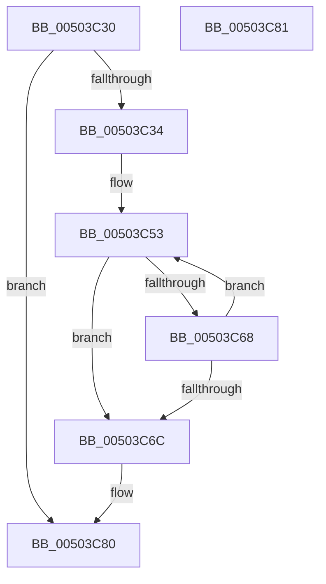

# write_multi_char

- RVA: `0x00503C30`–`0x00503C82` (길이 `82` bytes)
- VA: `0x0000000140503C30`
- 실행 섹션: `.text`
- PDB 이름 있음: `예`; PDB Function 태그: `예`
- unwind 정보 RVA: `0x000C27E0`
- 디코드: `27`개 명령, `82/82` bytes 표시
- 미해석 바이트: `0` (있으면 어셈블리에 `.byte`로 보존)

> 이 문서는 커널 이미지의 기계어와 PDB 기호를 분석해 생성했습니다. 4번과 5번은 함수 원형과 자료형을 바이너리 사용 방식에서 추정한 C 해석이며 원본 소스 복구 결과는 아닙니다.

## 1. Dependencies

- 직접 호출 지점: **1**; 고유 호출 대상: **1**
- 직접 호출자로 확인된 함수: **2**
- RIP 상대 이미지 참조: **0**

### Outgoing calls
- `0x00503C5E` → [write_char](write_char_function_00503BE0.md) (function, `0x00503BE0`)

### Direct callers
- [output_l](output_l_function_00503368.md) at `0x0050387A`
- [output_l](output_l_function_00503368.md) at `0x005038AC`
- [output_l](output_l_function_00503368.md) at `0x00503955`
- [output_s](output_s_function_00506854.md) at `0x00506D75`
- [output_s](output_s_function_00506854.md) at `0x00506DA8`
- [output_s](output_s_function_00506854.md) at `0x00506E57`

### Static image references
- 디코드된 RIP-relative 메모리 참조가 없습니다.

## 2. Other-region calls and transfers

- 다른 실행 섹션으로 향하는 call: **0**
- 별도 외부 분기/꼬리 이동을 확인하지 못했습니다.

## 3. Assembly (complete function range)

```asm
00503C30  85 D2                           test edx, edx
00503C32  7E 4C                           jle 0x140503c80
00503C34  48 89 5C 24 08                  mov qword ptr [rsp + 8], rbx
00503C39  48 89 6C 24 10                  mov qword ptr [rsp + 0x10], rbp
00503C3E  48 89 74 24 18                  mov qword ptr [rsp + 0x18], rsi
00503C43  57                              push rdi
00503C44  48 83 EC 20                     sub rsp, 0x20
00503C48  49 8B F9                        mov rdi, r9
00503C4B  49 8B F0                        mov rsi, r8
00503C4E  8B DA                           mov ebx, edx
00503C50  40 8A E9                        mov bpl, cl
00503C53  4C 8B C7                        mov r8, rdi
00503C56  48 8B D6                        mov rdx, rsi
00503C59  40 8A CD                        mov cl, bpl
00503C5C  FF CB                           dec ebx
00503C5E  E8 7D FF FF FF                  call 0x140503be0
00503C63  83 3F FF                        cmp dword ptr [rdi], -1
00503C66  74 04                           je 0x140503c6c
00503C68  85 DB                           test ebx, ebx
00503C6A  7F E7                           jg 0x140503c53
00503C6C  48 8B 5C 24 30                  mov rbx, qword ptr [rsp + 0x30]
00503C71  48 8B 6C 24 38                  mov rbp, qword ptr [rsp + 0x38]
00503C76  48 8B 74 24 40                  mov rsi, qword ptr [rsp + 0x40]
00503C7B  48 83 C4 20                     add rsp, 0x20
00503C7F  5F                              pop rdi
00503C80  C3                              ret
00503C81  CC                              int3
```

## 4. C-style interpretation (structured pseudocode)

```c
__int64 __fastcall write_multi_char(unsigned __int8 a1, int a2, __int64 a3, __int64 a4)
{
    __int64 result;
    __int64 v_rbx;
    __int64 v_rsp;
    unsigned __int64 v_stack_p10;
    unsigned __int64 v_stack_p18;
    unsigned __int64 v_stack_p8;

    if (condition_is_less_or_equal) goto loc_00503C80;
    v_stack_p8 = v_rbx;
    v_stack_p10 = v_rbp;
    v_stack_p18 = v_rsi;
    v_rsp = (v_rsp) - (32);
loc_00503C53:
    v_rbx = (unsigned int)(((unsigned int)(a2)) - 1);
    result = write_char(a1, a3, a4, a4);
    if ((*(unsigned int *)(a4)) == -1) goto loc_00503C6C;
    if (condition_is_greater) goto loc_00503C53;
loc_00503C6C:
    v_rsp = (v_rsp) + (32);
loc_00503C80:
    return result;
}
```

## 5. (Beta) C Style

```c
int64_t write_multi_char(uint8_t Arg1, int32_t Arg2, int64_t Arg3, void *Arg4)
{
    uint8_t *arg4 = (uint8_t *)Arg4;

    int64_t result;
    int64_t local_rbx;
    int64_t local_rsp;
    uint64_t v_stack_p10;
    uint64_t v_stack_p18;
    uint64_t v_stack_p8;

    if (condition_is_less_or_equal) goto loc_00503C80;
    v_stack_p8 = local_rbx;
    v_stack_p10 = local_rbp;
    v_stack_p18 = local_rsi;
    local_rsp = (local_rsp) - (32);
loc_00503C53:
    local_rbx = (uint32_t)(((uint32_t)(Arg2)) - 1);
    result = write_char(Arg1, Arg3, Arg4, Arg4);
    if ((*(uint32_t *)(arg4)) == -1) goto loc_00503C6C;
    if (condition_is_greater) goto loc_00503C53;
loc_00503C6C:
    local_rsp = (local_rsp) + (32);
loc_00503C80:
    return result;
}
```

### 관측된 메모리 오프셋

구조체 형식이 확인되지 않은 접근은 인자 기준의 오프셋으로만 기록했습니다.

| 기준 인자 | 오프셋 표현 | 폭 (bit) | 접근 |
|---|---:|---:|---|
| `Arg4` | `+ 0x0` | `32` | `R` |

## 6. Execution-region graph

[열기: 2D/3D 그래프와 함수 탐색 컨트롤 패널](../../../control-panel.html?section=text&rva=0x00503C30&view=graph)

- 2D 그래프는 위에서 아래로 흐르고, 3D 그래프는 빈 공간을 드래그해 회전합니다. Shift+드래그는 이동, 휠은 확대·축소, 함수 노드 선택은 대상 보고서 이동입니다.

### Static fallback


