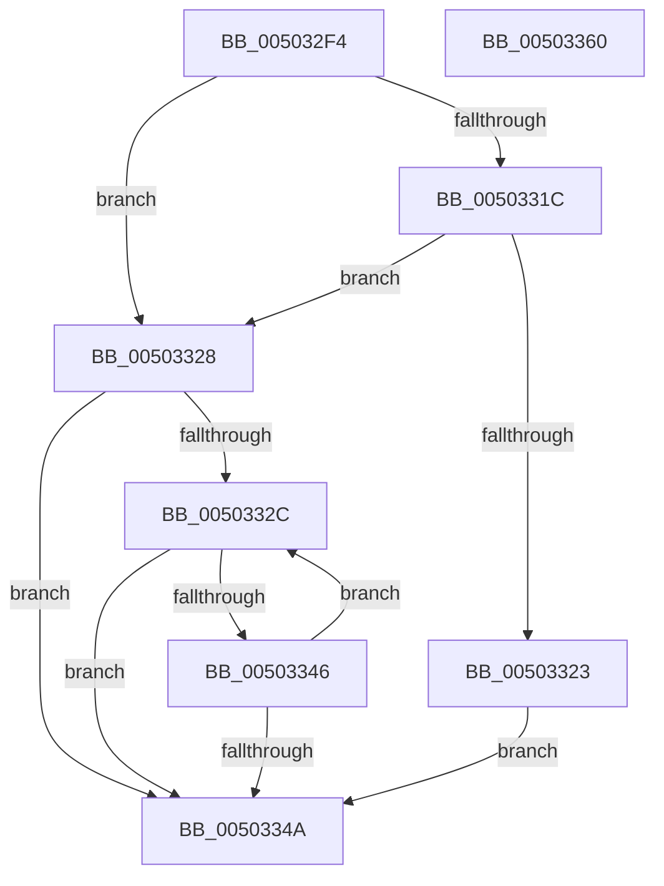

# write_string

- RVA: `0x005032F4`–`0x00503361` (길이 `109` bytes)
- VA: `0x00000001405032F4`
- 실행 섹션: `.text`
- PDB 이름 있음: `예`; PDB Function 태그: `예`
- unwind 정보 RVA: `0x0006F978`
- 디코드: `35`개 명령, `109/109` bytes 표시
- 미해석 바이트: `0` (있으면 어셈블리에 `.byte`로 보존)

> 이 문서는 커널 이미지의 기계어와 PDB 기호를 분석해 생성했습니다. 4번과 5번은 함수 원형과 자료형을 바이너리 사용 방식에서 추정한 C 해석이며 원본 소스 복구 결과는 아닙니다.

## 1. Dependencies

- 직접 호출 지점: **1**; 고유 호출 대상: **1**
- 직접 호출자로 확인된 함수: **1**
- RIP 상대 이미지 참조: **0**

### Outgoing calls
- `0x00503338` → [write_char](write_char_function_00503248.md) (function, `0x00503248`)

### Direct callers
- [woutput_l](woutput_l_function_0050293C.md) at `0x00502EA1`
- [woutput_l](woutput_l_function_0050293C.md) at `0x00502F51`

### Static image references
- 디코드된 RIP-relative 메모리 참조가 없습니다.

## 2. Other-region calls and transfers

- 다른 실행 섹션으로 향하는 call: **0**
- 별도 외부 분기/꼬리 이동을 확인하지 못했습니다.

## 3. Assembly (complete function range)

```asm
005032F4  48 89 5C 24 08                  mov qword ptr [rsp + 8], rbx
005032F9  48 89 74 24 10                  mov qword ptr [rsp + 0x10], rsi
005032FE  48 89 7C 24 18                  mov qword ptr [rsp + 0x18], rdi
00503303  41 56                           push r14
00503305  48 83 EC 20                     sub rsp, 0x20
00503309  41 8B 40 18                     mov eax, dword ptr [r8 + 0x18]
0050330D  49 8B F9                        mov rdi, r9
00503310  49 8B F0                        mov rsi, r8
00503313  8B DA                           mov ebx, edx
00503315  4C 8B F1                        mov r14, rcx
00503318  A8 40                           test al, 0x40
0050331A  74 0C                           je 0x140503328
0050331C  49 83 78 10 00                  cmp qword ptr [r8 + 0x10], 0
00503321  75 05                           jne 0x140503328
00503323  41 01 11                        add dword ptr [r9], edx
00503326  EB 22                           jmp 0x14050334a
00503328  85 D2                           test edx, edx
0050332A  7E 1E                           jle 0x14050334a
0050332C  41 0F B7 0E                     movzx ecx, word ptr [r14]
00503330  4C 8B C7                        mov r8, rdi
00503333  48 8B D6                        mov rdx, rsi
00503336  FF CB                           dec ebx
00503338  E8 0B FF FF FF                  call 0x140503248
0050333D  83 3F FF                        cmp dword ptr [rdi], -1
00503340  4D 8D 76 02                     lea r14, [r14 + 2]
00503344  74 04                           je 0x14050334a
00503346  85 DB                           test ebx, ebx
00503348  7F E2                           jg 0x14050332c
0050334A  48 8B 5C 24 30                  mov rbx, qword ptr [rsp + 0x30]
0050334F  48 8B 74 24 38                  mov rsi, qword ptr [rsp + 0x38]
00503354  48 8B 7C 24 40                  mov rdi, qword ptr [rsp + 0x40]
00503359  48 83 C4 20                     add rsp, 0x20
0050335D  41 5E                           pop r14
0050335F  C3                              ret
00503360  CC                              int3
```

## 4. C-style interpretation (structured pseudocode)

```c
__int64 __fastcall write_string(__int64 a1, int a2, __int64 a3, __int64 a4)
{
    __int64 result;
    __int64 v_rbx;
    __int64 v_rsp;
    unsigned __int64 v_stack_p10;
    unsigned __int64 v_stack_p18;
    unsigned __int64 v_stack_p8;

    v_stack_p8 = v_rbx;
    v_stack_p10 = v_rsi;
    v_stack_p18 = v_rdi;
    v_rsp = (v_rsp) - (32);
    if ((((unsigned __int8)((unsigned int)(*(unsigned int *)(a3 + 24)))) & (64)) == 0) goto loc_00503328;
    if ((*(unsigned __int64 *)(a3 + 16)) != 0) goto loc_00503328;
    goto loc_0050334A;
loc_00503328:
    if (condition_is_less_or_equal) goto loc_0050334A;
loc_0050332C:
    v_rbx = (unsigned int)(((unsigned int)(a2)) - 1);
    result = write_char(*(unsigned __int16 *)(a1), a3, a4, a4);
    if ((*(unsigned int *)(a4)) == -1) goto loc_0050334A;
    if (condition_is_greater) goto loc_0050332C;
loc_0050334A:
    v_rsp = (v_rsp) + (32);
    return result;
}
```

## 5. (Beta) C Style

```c
int64_t write_string(void *Arg1, int32_t Arg2, void *Arg3, void *Arg4)
{
    uint8_t *arg1 = (uint8_t *)Arg1;
    uint8_t *arg3 = (uint8_t *)Arg3;
    uint8_t *arg4 = (uint8_t *)Arg4;

    int64_t result;
    int64_t local_rbx;
    int64_t local_rsp;
    uint64_t v_stack_p10;
    uint64_t v_stack_p18;
    uint64_t v_stack_p8;

    v_stack_p8 = local_rbx;
    v_stack_p10 = local_rsi;
    v_stack_p18 = local_rdi;
    local_rsp = (local_rsp) - (32);
    if ((((uint8_t)((uint32_t)(*(uint32_t *)(arg3 + 0x18)))) & (64)) == 0) goto loc_00503328;
    if ((*(uint64_t *)(arg3 + 0x10)) != 0) goto loc_00503328;
    goto loc_0050334A;
loc_00503328:
    if (condition_is_less_or_equal) goto loc_0050334A;
loc_0050332C:
    local_rbx = (uint32_t)(((uint32_t)(Arg2)) - 1);
    result = write_char(*(uint16_t *)(arg1), Arg3, Arg4, Arg4);
    if ((*(uint32_t *)(arg4)) == -1) goto loc_0050334A;
    if (condition_is_greater) goto loc_0050332C;
loc_0050334A:
    local_rsp = (local_rsp) + (32);
    return result;
}
```

### 관측된 메모리 오프셋

구조체 형식이 확인되지 않은 접근은 인자 기준의 오프셋으로만 기록했습니다.

| 기준 인자 | 오프셋 표현 | 폭 (bit) | 접근 |
|---|---:|---:|---|
| `Arg1` | `+ 0x0` | `16` | `R` |
| `Arg1` | `+ 0x2` | `64` | `R` |
| `Arg3` | `+ 0x10` | `64` | `R` |
| `Arg3` | `+ 0x18` | `32` | `R` |
| `Arg4` | `+ 0x0` | `32` | `R` |
| `Arg4` | `+ 0x0` | `32` | `R/W` |

## 6. Execution-region graph

[열기: 2D/3D 그래프와 함수 탐색 컨트롤 패널](../../../control-panel.html?section=text&rva=0x005032F4&view=graph)

- 2D 그래프는 위에서 아래로 흐르고, 3D 그래프는 빈 공간을 드래그해 회전합니다. Shift+드래그는 이동, 휠은 확대·축소, 함수 노드 선택은 대상 보고서 이동입니다.

### Static fallback


