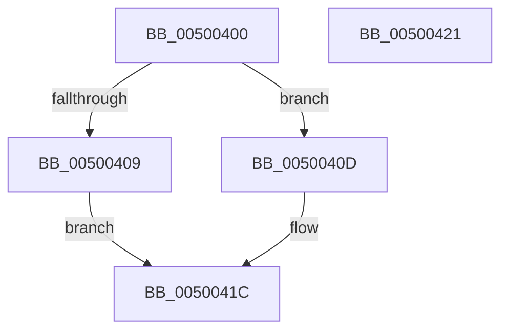

# wtol

- RVA: `0x00500400`–`0x00500422` (길이 `34` bytes)
- VA: `0x0000000140500400`
- 실행 섹션: `.text`
- PDB 이름 있음: `예`; PDB Function 태그: `아니요`
- unwind 정보 RVA: `0x0005C788`
- 디코드: `12`개 명령, `34/34` bytes 표시
- 미해석 바이트: `0` (있으면 어셈블리에 `.byte`로 보존)

> 이 문서는 커널 이미지의 기계어와 PDB 기호를 분석해 생성했습니다. 4번과 5번은 함수 원형과 자료형을 바이너리 사용 방식에서 추정한 C 해석이며 원본 소스 복구 결과는 아닙니다.

## 1. Dependencies

- 직접 호출 지점: **1**; 고유 호출 대상: **1**
- 직접 호출자로 확인된 함수: **2**
- RIP 상대 이미지 참조: **0**

### Outgoing calls
- `0x00500417` → [wcstolX](wcstolX_function_00502464.md) (function, `0x00502464`)

### Direct callers
- [wtoi](wtoi_function_005003E0.md) at `0x005003E4`
- [PfSnParsePrefetchParam](../../page/96/PfSnParsePrefetchParam_function_0096092C.md) at `0x00960A66`

### Static image references
- 디코드된 RIP-relative 메모리 참조가 없습니다.

## 2. Other-region calls and transfers

- 다른 실행 섹션으로 향하는 call: **0**
- 별도 외부 분기/꼬리 이동을 확인하지 못했습니다.

## 3. Assembly (complete function range)

```asm
00500400  48 83 EC 28                     sub rsp, 0x28
00500404  48 85 C9                        test rcx, rcx
00500407  75 04                           jne 0x14050040d
00500409  33 C0                           xor eax, eax
0050040B  EB 0F                           jmp 0x14050041c
0050040D  33 D2                           xor edx, edx
0050040F  44 8D 4A 01                     lea r9d, [rdx + 1]
00500413  44 8D 42 0A                     lea r8d, [rdx + 0xa]
00500417  E8 48 20 00 00                  call 0x140502464
0050041C  48 83 C4 28                     add rsp, 0x28
00500420  C3                              ret
00500421  CC                              int3
```

## 4. C-style interpretation (structured pseudocode)

```c
__int64 __fastcall wtol(__int64 a1, int a2)
{
    __int64 result;
    __int64 v_rsp;

    v_rsp = (v_rsp) - (40);
    if (a1 != 0) goto loc_0050040D;
    result = 0;
    goto loc_0050041C;
loc_0050040D:
    a2 = 0;
    result = wcstolX(a1, a2, a2 + 10, a2 + 1);
loc_0050041C:
    v_rsp = (v_rsp) + (40);
    return result;
}
```

## 5. (Beta) C Style

```c
int64_t wtol(int64_t Arg1, int32_t Arg2)
{
    int64_t result;
    int64_t local_rsp;

    local_rsp = (local_rsp) - (40);
    if (Arg1 != 0) goto loc_0050040D;
    result = 0;
    goto loc_0050041C;
loc_0050040D:
    Arg2 = 0;
    result = wcstolX(Arg1, Arg2, Arg2 + 10, Arg2 + 1);
loc_0050041C:
    local_rsp = (local_rsp) + (40);
    return result;
}
```

## 6. Execution-region graph

[열기: 2D/3D 그래프와 함수 탐색 컨트롤 패널](../../../control-panel.html?section=text&rva=0x00500400&view=graph)

- 2D 그래프는 위에서 아래로 흐르고, 3D 그래프는 빈 공간을 드래그해 회전합니다. Shift+드래그는 이동, 휠은 확대·축소, 함수 노드 선택은 대상 보고서 이동입니다.

### Static fallback


