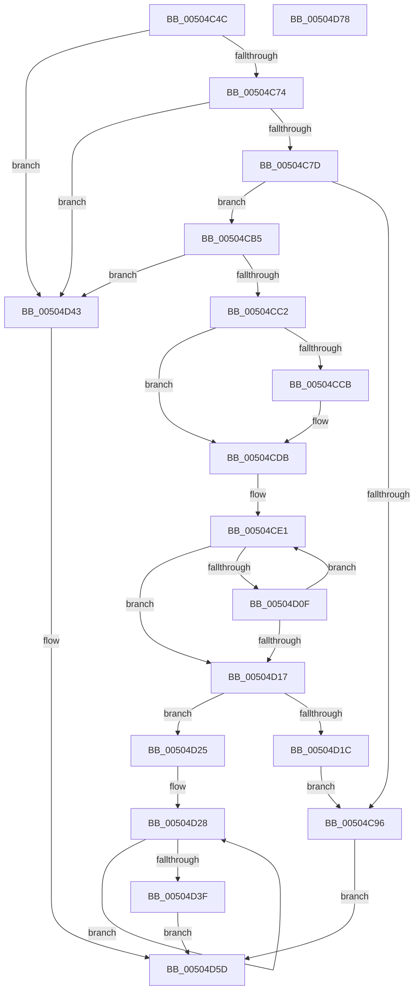

# x64toa_s

- RVA: `0x00504C4C`–`0x00504D79` (길이 `301` bytes)
- VA: `0x0000000140504C4C`
- 실행 섹션: `.text`
- PDB 이름 있음: `예`; PDB Function 태그: `예`
- unwind 정보 RVA: `0x0005D7BC`
- 디코드: `91`개 명령, `301/301` bytes 표시
- 미해석 바이트: `0` (있으면 어셈블리에 `.byte`로 보존)

> 이 문서는 커널 이미지의 기계어와 PDB 기호를 분석해 생성했습니다. 4번과 5번은 함수 원형과 자료형을 바이너리 사용 방식에서 추정한 C 해석이며 원본 소스 복구 결과는 아닙니다.

## 1. Dependencies

- 직접 호출 지점: **2**; 고유 호출 대상: **1**
- 직접 호출자로 확인된 함수: **2**
- RIP 상대 이미지 참조: **0**

### Outgoing calls
- `0x00504CA6` → [EmpCheckErrataList](../49/EmpCheckErrataList_function_0049E550.md) (function, `0x0049E550`)
- `0x00504D53` → [EmpCheckErrataList](../49/EmpCheckErrataList_function_0049E550.md) (function, `0x0049E550`)

### Direct callers
- [i64toa_s](i64toa_s_function_00504BB0.md) at `0x00504BC9`
- [ui64toa_s](ui64toa_s_function_00504C10.md) at `0x00504C19`

### Static image references
- 디코드된 RIP-relative 메모리 참조가 없습니다.

## 2. Other-region calls and transfers

- 다른 실행 섹션으로 향하는 call: **0**
- 별도 외부 분기/꼬리 이동을 확인하지 못했습니다.

## 3. Assembly (complete function range)

```asm
00504C4C  48 8B C4                        mov rax, rsp
00504C4F  48 89 58 08                     mov qword ptr [rax + 8], rbx
00504C53  48 89 68 10                     mov qword ptr [rax + 0x10], rbp
00504C57  48 89 70 18                     mov qword ptr [rax + 0x18], rsi
00504C5B  48 89 78 20                     mov qword ptr [rax + 0x20], rdi
00504C5F  41 56                           push r14
00504C61  48 83 EC 30                     sub rsp, 0x30
00504C65  4D 8B D8                        mov r11, r8
00504C68  4C 8B D2                        mov r10, rdx
00504C6B  48 85 D2                        test rdx, rdx
00504C6E  0F 84 CF 00 00 00               je 0x140504d43
00504C74  4D 85 C0                        test r8, r8
00504C77  0F 84 C6 00 00 00               je 0x140504d43
00504C7D  C6 02 00                        mov byte ptr [rdx], 0
00504C80  8B 54 24 60                     mov edx, dword ptr [rsp + 0x60]
00504C84  8B C2                           mov eax, edx
00504C86  F7 D8                           neg eax
00504C88  4D 1B C0                        sbb r8, r8
00504C8B  49 F7 D8                        neg r8
00504C8E  49 FF C0                        inc r8
00504C91  4D 3B D8                        cmp r11, r8
00504C94  77 1F                           ja 0x140504cb5
00504C96  48 83 64 24 20 00               and qword ptr [rsp + 0x20], 0
00504C9C  45 33 C9                        xor r9d, r9d
00504C9F  45 33 C0                        xor r8d, r8d
00504CA2  33 D2                           xor edx, edx
00504CA4  33 C9                           xor ecx, ecx
00504CA6  E8 A5 98 F9 FF                  call 0x14049e550
00504CAB  B8 22 00 00 00                  mov eax, 0x22
00504CB0  E9 A8 00 00 00                  jmp 0x140504d5d
00504CB5  41 8D 41 FE                     lea eax, [r9 - 2]
00504CB9  83 F8 22                        cmp eax, 0x22
00504CBC  0F 87 81 00 00 00               ja 0x140504d43
00504CC2  33 FF                           xor edi, edi
00504CC4  49 8B DA                        mov rbx, r10
00504CC7  85 D2                           test edx, edx
00504CC9  74 10                           je 0x140504cdb
00504CCB  41 C6 02 2D                     mov byte ptr [r10], 0x2d
00504CCF  49 8D 5A 01                     lea rbx, [r10 + 1]
00504CD3  BF 01 00 00 00                  mov edi, 1
00504CD8  48 F7 D9                        neg rcx
00504CDB  4C 8B C3                        mov r8, rbx
00504CDE  41 8B E9                        mov ebp, r9d
00504CE1  33 D2                           xor edx, edx
00504CE3  48 8D 73 01                     lea rsi, [rbx + 1]
00504CE7  48 8B C1                        mov rax, rcx
00504CEA  4C 8B CB                        mov r9, rbx
00504CED  48 F7 F5                        div rbp
00504CF0  48 8B C8                        mov rcx, rax
00504CF3  83 FA 09                        cmp edx, 9
00504CF6  B8 57 00 00 00                  mov eax, 0x57
00504CFB  44 8D 70 D9                     lea r14d, [rax - 0x27]
00504CFF  41 0F 46 C6                     cmovbe eax, r14d
00504D03  48 FF C7                        inc rdi
00504D06  02 C2                           add al, dl
00504D08  88 03                           mov byte ptr [rbx], al
00504D0A  48 85 C9                        test rcx, rcx
00504D0D  74 08                           je 0x140504d17
00504D0F  48 8B DE                        mov rbx, rsi
00504D12  49 3B FB                        cmp rdi, r11
00504D15  72 CA                           jb 0x140504ce1
00504D17  49 3B FB                        cmp rdi, r11
00504D1A  72 09                           jb 0x140504d25
00504D1C  41 C6 02 00                     mov byte ptr [r10], 0
00504D20  E9 71 FF FF FF                  jmp 0x140504c96
00504D25  C6 06 00                        mov byte ptr [rsi], 0
00504D28  41 8A 00                        mov al, byte ptr [r8]
00504D2B  41 8A 09                        mov cl, byte ptr [r9]
00504D2E  41 88 01                        mov byte ptr [r9], al
00504D31  49 FF C9                        dec r9
00504D34  41 88 08                        mov byte ptr [r8], cl
00504D37  49 FF C0                        inc r8
00504D3A  4D 3B C1                        cmp r8, r9
00504D3D  72 E9                           jb 0x140504d28
00504D3F  33 C0                           xor eax, eax
00504D41  EB 1A                           jmp 0x140504d5d
00504D43  48 83 64 24 20 00               and qword ptr [rsp + 0x20], 0
00504D49  45 33 C9                        xor r9d, r9d
00504D4C  45 33 C0                        xor r8d, r8d
00504D4F  33 D2                           xor edx, edx
00504D51  33 C9                           xor ecx, ecx
00504D53  E8 F8 97 F9 FF                  call 0x14049e550
00504D58  B8 16 00 00 00                  mov eax, 0x16
00504D5D  48 8B 5C 24 40                  mov rbx, qword ptr [rsp + 0x40]
00504D62  48 8B 6C 24 48                  mov rbp, qword ptr [rsp + 0x48]
00504D67  48 8B 74 24 50                  mov rsi, qword ptr [rsp + 0x50]
00504D6C  48 8B 7C 24 58                  mov rdi, qword ptr [rsp + 0x58]
00504D71  48 83 C4 30                     add rsp, 0x30
00504D75  41 5E                           pop r14
00504D77  C3                              ret
00504D78  CC                              int3
```

## 4. C-style interpretation (structured pseudocode)

```c
__int64 __fastcall x64toa_s(int a1, __int64 a2, __int64 a3, int a4, unsigned int a5)
{
    __int64 result;
    __int64 v_rbx;
    __int64 v_rdi;
    __int64 v_rsp;
    unsigned __int64 v_stack_m18;
    unsigned __int64 v_stack_p10;
    unsigned __int64 v_stack_p18;
    unsigned __int64 v_stack_p20;
    unsigned __int64 v_stack_p8;

    *(unsigned __int64 *)(v_rsp + 8) = v_rbx;
    *(unsigned __int64 *)(v_rsp + 16) = v_rbp;
    *(unsigned __int64 *)(v_rsp + 24) = v_rsi;
    *(unsigned __int64 *)(v_rsp + 32) = v_rdi;
    v_rsp = (v_rsp) - (48);
    if (a2 == 0) goto loc_00504D43;
    if (a3 == 0) goto loc_00504D43;
    *(unsigned __int8 *)(a2) = 0;
    result = (unsigned int)(-((unsigned int)((unsigned int)((unsigned int)(a5)))));
    a3 = -(a3);
    a3 = (a3) + 1;
    if (a3 > a3) goto loc_00504CB5;
loc_00504C96:
    a4 = 0;
    a3 = 0;
    a2 = 0;
    a1 = 0;
    result = EmpCheckErrataList(a1, a2, a3, a4);
    goto loc_00504D5D;
loc_00504CB5:
    if (((unsigned int)(a4 - 2)) > 34) goto loc_00504D43;
    v_rdi = 0;
    v_rbx = 0;
    if (0 != 0) {
        *(unsigned __int8 *)(a2) = 45;
        v_rbx = a2 + 1;
        v_rdi = 1;
        a1 = -(a1);
    }
loc_00504CE1:
    a2 = 0;
    result = 87;
    if (0 <= 9) { result = (unsigned int)(87 - 39); }
    v_rdi = (v_rdi) + 1;
    result = (unsigned __int8)((result) + (0));
    *(unsigned __int8 *)(v_rbx) = (unsigned __int8)(result);
    if (a1 == 0) goto loc_00504D17;
    if (v_rdi < 0) goto loc_00504CE1;
loc_00504D17:
    if (v_rdi < 0) goto loc_00504D25;
    *(unsigned __int8 *)(a2) = 0;
    goto loc_00504C96;
loc_00504D25:
    *(unsigned __int8 *)(v_rbx + 1) = 0;
loc_00504D28:
    *(unsigned __int8 *)(v_rbx) = (unsigned __int8)(*(unsigned __int8 *)(v_rbx));
    a4 = (v_rbx) - 1;
    *(unsigned __int8 *)(v_rbx) = (unsigned __int8)(*(unsigned __int8 *)(v_rbx));
    a3 = (v_rbx) + 1;
    if (a3 < a4) goto loc_00504D28;
    result = 0;
    goto loc_00504D5D;
loc_00504D43:
    a4 = 0;
    a3 = 0;
    a2 = 0;
    a1 = 0;
    result = EmpCheckErrataList(a1, a2, a3, a4);
loc_00504D5D:
    v_rsp = (v_rsp) + (48);
    return 22;
}
```

## 5. (Beta) C Style

```c
int64_t x64toa_s(int32_t Arg1, void *Arg2, int64_t Arg3, void *Arg4, uint32_t Arg5)
{
    uint8_t *arg2 = (uint8_t *)Arg2;
    uint8_t *arg4 = (uint8_t *)Arg4;

    int64_t result;
    int64_t local_rbx;
    int64_t local_rdi;
    int64_t local_rsp;
    uint64_t v_stack_m18;
    uint64_t v_stack_p10;
    uint64_t v_stack_p18;
    uint64_t v_stack_p20;
    uint64_t v_stack_p8;

    *(uint64_t *)(local_rsp + 0x8) = local_rbx;
    *(uint64_t *)(local_rsp + 0x10) = local_rbp;
    *(uint64_t *)(local_rsp + 0x18) = local_rsi;
    *(uint64_t *)(local_rsp + 0x20) = local_rdi;
    local_rsp = (local_rsp) - (48);
    if (Arg2 == NULL) goto loc_00504D43;
    if (Arg3 == 0) goto loc_00504D43;
    *(uint8_t *)(arg2) = 0;
    result = (uint32_t)(-((uint32_t)((uint32_t)((uint32_t)(Arg5)))));
    Arg3 = -(Arg3);
    Arg3 = (Arg3) + 1;
    if (Arg3 > Arg3) goto loc_00504CB5;
loc_00504C96:
    Arg4 = 0;
    Arg3 = 0;
    Arg2 = 0;
    Arg1 = 0;
    result = EmpCheckErrataList(Arg1, Arg2, Arg3, Arg4);
    goto loc_00504D5D;
loc_00504CB5:
    if (((uint32_t)(Arg4 - 2)) > 34) goto loc_00504D43;
    local_rdi = 0;
    local_rbx = 0;
    if (0 != 0) {
        *(uint8_t *)(arg2) = 45;
        local_rbx = Arg2 + 1;
        local_rdi = 1;
        Arg1 = -(Arg1);
    }
loc_00504CE1:
    Arg2 = 0;
    result = 87;
    if (0 <= 9) { result = (uint32_t)(87 - 39); }
    local_rdi = (local_rdi) + 1;
    result = (uint8_t)((result) + (0));
    *(uint8_t *)(local_rbx) = (uint8_t)(result);
    if (Arg1 == 0) goto loc_00504D17;
    if (local_rdi < 0) goto loc_00504CE1;
loc_00504D17:
    if (local_rdi < 0) goto loc_00504D25;
    *(uint8_t *)(arg2) = 0;
    goto loc_00504C96;
loc_00504D25:
    *(uint8_t *)(local_rbx + 0x1) = 0;
loc_00504D28:
    *(uint8_t *)(local_rbx) = (uint8_t)(*(uint8_t *)(local_rbx));
    Arg4 = (local_rbx) - 1;
    *(uint8_t *)(local_rbx) = (uint8_t)(*(uint8_t *)(local_rbx));
    Arg3 = (local_rbx) + 1;
    if (Arg3 < Arg4) goto loc_00504D28;
    result = 0;
    goto loc_00504D5D;
loc_00504D43:
    Arg4 = 0;
    Arg3 = 0;
    Arg2 = 0;
    Arg1 = 0;
    result = EmpCheckErrataList(Arg1, Arg2, Arg3, Arg4);
loc_00504D5D:
    local_rsp = (local_rsp) + (48);
    return 22;
}
```

### 관측된 메모리 오프셋

구조체 형식이 확인되지 않은 접근은 인자 기준의 오프셋으로만 기록했습니다.

| 기준 인자 | 오프셋 표현 | 폭 (bit) | 접근 |
|---|---:|---:|---|
| `Arg2` | `+ 0x0` | `8` | `W` |
| `Arg2` | `+ 0x1` | `64` | `R` |
| `Arg4` | `- 0x2` | `32` | `R` |

## 6. Execution-region graph

[열기: 2D/3D 그래프와 함수 탐색 컨트롤 패널](../../../control-panel.html?section=text&rva=0x00504C4C&view=graph)

- 2D 그래프는 위에서 아래로 흐르고, 3D 그래프는 빈 공간을 드래그해 회전합니다. Shift+드래그는 이동, 휠은 확대·축소, 함수 노드 선택은 대상 보고서 이동입니다.

### Static fallback


