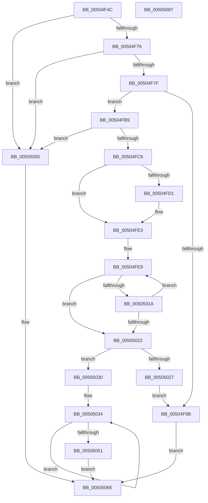

# x64tow_s

- RVA: `0x00504F4C`–`0x00505088` (길이 `316` bytes)
- VA: `0x0000000140504F4C`
- 실행 섹션: `.text`
- PDB 이름 있음: `예`; PDB Function 태그: `예`
- unwind 정보 RVA: `0x00084C9C`
- 디코드: `93`개 명령, `316/316` bytes 표시
- 미해석 바이트: `0` (있으면 어셈블리에 `.byte`로 보존)

> 이 문서는 커널 이미지의 기계어와 PDB 기호를 분석해 생성했습니다. 4번과 5번은 함수 원형과 자료형을 바이너리 사용 방식에서 추정한 C 해석이며 원본 소스 복구 결과는 아닙니다.

## 1. Dependencies

- 직접 호출 지점: **2**; 고유 호출 대상: **1**
- 직접 호출자로 확인된 함수: **2**
- RIP 상대 이미지 참조: **0**

### Outgoing calls
- `0x00504FAA` → [EmpCheckErrataList](../49/EmpCheckErrataList_function_0049E550.md) (function, `0x0049E550`)
- `0x00505064` → [EmpCheckErrataList](../49/EmpCheckErrataList_function_0049E550.md) (function, `0x0049E550`)

### Direct callers
- [i64tow_s](i64tow_s_function_00504EB0.md) at `0x00504EC9`
- [ui64tow_s](ui64tow_s_function_00504F10.md) at `0x00504F19`

### Static image references
- 디코드된 RIP-relative 메모리 참조가 없습니다.

## 2. Other-region calls and transfers

- 다른 실행 섹션으로 향하는 call: **0**
- 별도 외부 분기/꼬리 이동을 확인하지 못했습니다.

## 3. Assembly (complete function range)

```asm
00504F4C  48 89 5C 24 08                  mov qword ptr [rsp + 8], rbx
00504F51  48 89 6C 24 10                  mov qword ptr [rsp + 0x10], rbp
00504F56  48 89 74 24 18                  mov qword ptr [rsp + 0x18], rsi
00504F5B  57                              push rdi
00504F5C  41 56                           push r14
00504F5E  41 57                           push r15
00504F60  48 83 EC 30                     sub rsp, 0x30
00504F64  45 33 FF                        xor r15d, r15d
00504F67  4D 8B D8                        mov r11, r8
00504F6A  4C 8B D2                        mov r10, rdx
00504F6D  48 85 D2                        test rdx, rdx
00504F70  0F 84 DF 00 00 00               je 0x140505055
00504F76  4D 85 C0                        test r8, r8
00504F79  0F 84 D6 00 00 00               je 0x140505055
00504F7F  44 8B 44 24 70                  mov r8d, dword ptr [rsp + 0x70]
00504F84  41 8B C0                        mov eax, r8d
00504F87  66 44 89 3A                     mov word ptr [rdx], r15w
00504F8B  F7 D8                           neg eax
00504F8D  48 1B D2                        sbb rdx, rdx
00504F90  48 F7 DA                        neg rdx
00504F93  48 FF C2                        inc rdx
00504F96  4C 3B DA                        cmp r11, rdx
00504F99  77 1E                           ja 0x140504fb9
00504F9B  45 33 C9                        xor r9d, r9d
00504F9E  4C 89 7C 24 20                  mov qword ptr [rsp + 0x20], r15
00504FA3  45 33 C0                        xor r8d, r8d
00504FA6  33 D2                           xor edx, edx
00504FA8  33 C9                           xor ecx, ecx
00504FAA  E8 A1 95 F9 FF                  call 0x14049e550
00504FAF  B8 22 00 00 00                  mov eax, 0x22
00504FB4  E9 B5 00 00 00                  jmp 0x14050506e
00504FB9  41 8D 41 FE                     lea eax, [r9 - 2]
00504FBD  83 F8 22                        cmp eax, 0x22
00504FC0  0F 87 8F 00 00 00               ja 0x140505055
00504FC6  49 8B FF                        mov rdi, r15
00504FC9  49 8B DA                        mov rbx, r10
00504FCC  45 85 C0                        test r8d, r8d
00504FCF  74 12                           je 0x140504fe3
00504FD1  66 41 C7 02 2D 00               mov word ptr [r10], 0x2d
00504FD7  49 8D 5A 02                     lea rbx, [r10 + 2]
00504FDB  BF 01 00 00 00                  mov edi, 1
00504FE0  48 F7 D9                        neg rcx
00504FE3  4C 8B C3                        mov r8, rbx
00504FE6  41 8B E9                        mov ebp, r9d
00504FE9  33 D2                           xor edx, edx
00504FEB  48 8D 73 02                     lea rsi, [rbx + 2]
00504FEF  48 8B C1                        mov rax, rcx
00504FF2  4C 8B CB                        mov r9, rbx
00504FF5  48 F7 F5                        div rbp
00504FF8  48 8B C8                        mov rcx, rax
00504FFB  83 FA 09                        cmp edx, 9
00504FFE  B8 57 00 00 00                  mov eax, 0x57
00505003  44 8D 70 D9                     lea r14d, [rax - 0x27]
00505007  66 41 0F 46 C6                  cmovbe ax, r14w
0050500C  48 FF C7                        inc rdi
0050500F  66 03 C2                        add ax, dx
00505012  66 89 03                        mov word ptr [rbx], ax
00505015  48 85 C9                        test rcx, rcx
00505018  74 08                           je 0x140505022
0050501A  48 8B DE                        mov rbx, rsi
0050501D  49 3B FB                        cmp rdi, r11
00505020  72 C7                           jb 0x140504fe9
00505022  49 3B FB                        cmp rdi, r11
00505025  72 09                           jb 0x140505030
00505027  66 45 89 3A                     mov word ptr [r10], r15w
0050502B  E9 6B FF FF FF                  jmp 0x140504f9b
00505030  66 44 89 3E                     mov word ptr [rsi], r15w
00505034  41 0F B7 00                     movzx eax, word ptr [r8]
00505038  41 0F B7 09                     movzx ecx, word ptr [r9]
0050503C  66 41 89 01                     mov word ptr [r9], ax
00505040  49 83 E9 02                     sub r9, 2
00505044  66 41 89 08                     mov word ptr [r8], cx
00505048  49 83 C0 02                     add r8, 2
0050504C  4D 3B C1                        cmp r8, r9
0050504F  72 E3                           jb 0x140505034
00505051  33 C0                           xor eax, eax
00505053  EB 19                           jmp 0x14050506e
00505055  45 33 C9                        xor r9d, r9d
00505058  4C 89 7C 24 20                  mov qword ptr [rsp + 0x20], r15
0050505D  45 33 C0                        xor r8d, r8d
00505060  33 D2                           xor edx, edx
00505062  33 C9                           xor ecx, ecx
00505064  E8 E7 94 F9 FF                  call 0x14049e550
00505069  B8 16 00 00 00                  mov eax, 0x16
0050506E  48 8B 5C 24 50                  mov rbx, qword ptr [rsp + 0x50]
00505073  48 8B 6C 24 58                  mov rbp, qword ptr [rsp + 0x58]
00505078  48 8B 74 24 60                  mov rsi, qword ptr [rsp + 0x60]
0050507D  48 83 C4 30                     add rsp, 0x30
00505081  41 5F                           pop r15
00505083  41 5E                           pop r14
00505085  5F                              pop rdi
00505086  C3                              ret
00505087  CC                              int3
```

## 4. C-style interpretation (structured pseudocode)

```c
__int64 __fastcall x64tow_s(int a1, __int64 a2, __int64 a3, int a4, unsigned int a5)
{
    __int64 result;
    __int64 v_r15;
    __int64 v_rbx;
    __int64 v_rdi;
    __int64 v_rsp;
    unsigned __int64 v_stack_m28;
    unsigned __int64 v_stack_p10;
    unsigned __int64 v_stack_p18;
    unsigned __int64 v_stack_p8;

    v_stack_p8 = v_rbx;
    v_stack_p10 = v_rbp;
    v_stack_p18 = v_rsi;
    v_rsp = (v_rsp) - (48);
    v_r15 = 0;
    if (a2 == 0) goto loc_00505055;
    if (a3 == 0) goto loc_00505055;
    *(unsigned __int16 *)(a2) = 0;
    result = (unsigned int)(-((unsigned int)((unsigned int)((unsigned int)(a5)))));
    a2 = -(a2);
    a2 = (a2) + 1;
    if (a3 > a2) goto loc_00504FB9;
loc_00504F9B:
    a4 = 0;
    v_stack_m28 = 0;
    a3 = 0;
    a2 = 0;
    a1 = 0;
    result = EmpCheckErrataList(a1, a2, a3, a4);
    goto loc_0050506E;
loc_00504FB9:
    if (((unsigned int)(a4 - 2)) > 34) goto loc_00505055;
    v_rbx = 0;
    v_rdi = 0;
    if (0 != 0) {
        *(unsigned __int16 *)(a2) = 45;
        v_rbx = a2 + 2;
        v_rdi = 1;
        a1 = -(a1);
    }
loc_00504FE9:
    a2 = 0;
    result = 87;
    if (0 <= 9) { result = (unsigned __int16)(87 - 39); }
    v_rdi = (v_rdi) + 1;
    result = (unsigned __int16)((result) + (0));
    *(unsigned __int16 *)(v_rbx) = (unsigned __int16)(result);
    if (a1 == 0) goto loc_00505022;
    if (v_rdi < 0) goto loc_00504FE9;
loc_00505022:
    if (v_rdi < 0) goto loc_00505030;
    *(unsigned __int16 *)(a2) = 0;
    goto loc_00504F9B;
loc_00505030:
    *(unsigned __int16 *)(v_rbx + 2) = 0;
loc_00505034:
    *(unsigned __int16 *)(v_rbx) = (unsigned __int16)(*(unsigned __int16 *)(v_rbx));
    a4 = (v_rbx) - (2);
    *(unsigned __int16 *)(v_rbx) = (unsigned __int16)(*(unsigned __int16 *)(v_rbx));
    a3 = (v_rbx) + (2);
    if (a3 < a4) goto loc_00505034;
    result = 0;
    goto loc_0050506E;
loc_00505055:
    a4 = 0;
    v_stack_m28 = 0;
    a3 = 0;
    a2 = 0;
    a1 = 0;
    result = EmpCheckErrataList(a1, a2, a3, a4);
loc_0050506E:
    v_rsp = (v_rsp) + (48);
    return 22;
}
```

## 5. (Beta) C Style

```c
int64_t x64tow_s(int32_t Arg1, void *Arg2, int64_t Arg3, void *Arg4, uint32_t Arg5)
{
    uint8_t *arg2 = (uint8_t *)Arg2;
    uint8_t *arg4 = (uint8_t *)Arg4;

    int64_t result;
    int64_t local_r15;
    int64_t local_rbx;
    int64_t local_rdi;
    int64_t local_rsp;
    uint64_t v_stack_m28;
    uint64_t v_stack_p10;
    uint64_t v_stack_p18;
    uint64_t v_stack_p8;

    v_stack_p8 = local_rbx;
    v_stack_p10 = local_rbp;
    v_stack_p18 = local_rsi;
    local_rsp = (local_rsp) - (48);
    local_r15 = 0;
    if (Arg2 == NULL) goto loc_00505055;
    if (Arg3 == 0) goto loc_00505055;
    *(uint16_t *)(arg2) = 0;
    result = (uint32_t)(-((uint32_t)((uint32_t)((uint32_t)(Arg5)))));
    Arg2 = -(Arg2);
    Arg2 = (Arg2) + 1;
    if (Arg3 > Arg2) goto loc_00504FB9;
loc_00504F9B:
    Arg4 = 0;
    v_stack_m28 = 0;
    Arg3 = 0;
    Arg2 = 0;
    Arg1 = 0;
    result = EmpCheckErrataList(Arg1, Arg2, Arg3, Arg4);
    goto loc_0050506E;
loc_00504FB9:
    if (((uint32_t)(Arg4 - 2)) > 34) goto loc_00505055;
    local_rbx = 0;
    local_rdi = 0;
    if (0 != 0) {
        *(uint16_t *)(arg2) = 45;
        local_rbx = Arg2 + 2;
        local_rdi = 1;
        Arg1 = -(Arg1);
    }
loc_00504FE9:
    Arg2 = 0;
    result = 87;
    if (0 <= 9) { result = (uint16_t)(87 - 39); }
    local_rdi = (local_rdi) + 1;
    result = (uint16_t)((result) + (0));
    *(uint16_t *)(local_rbx) = (uint16_t)(result);
    if (Arg1 == 0) goto loc_00505022;
    if (local_rdi < 0) goto loc_00504FE9;
loc_00505022:
    if (local_rdi < 0) goto loc_00505030;
    *(uint16_t *)(arg2) = 0;
    goto loc_00504F9B;
loc_00505030:
    *(uint16_t *)(local_rbx + 0x2) = 0;
loc_00505034:
    *(uint16_t *)(local_rbx) = (uint16_t)(*(uint16_t *)(local_rbx));
    Arg4 = (local_rbx) - (2);
    *(uint16_t *)(local_rbx) = (uint16_t)(*(uint16_t *)(local_rbx));
    Arg3 = (local_rbx) + (2);
    if (Arg3 < Arg4) goto loc_00505034;
    result = 0;
    goto loc_0050506E;
loc_00505055:
    Arg4 = 0;
    v_stack_m28 = 0;
    Arg3 = 0;
    Arg2 = 0;
    Arg1 = 0;
    result = EmpCheckErrataList(Arg1, Arg2, Arg3, Arg4);
loc_0050506E:
    local_rsp = (local_rsp) + (48);
    return 22;
}
```

### 관측된 메모리 오프셋

구조체 형식이 확인되지 않은 접근은 인자 기준의 오프셋으로만 기록했습니다.

| 기준 인자 | 오프셋 표현 | 폭 (bit) | 접근 |
|---|---:|---:|---|
| `Arg2` | `+ 0x0` | `16` | `R` |
| `Arg2` | `+ 0x0` | `16` | `W` |
| `Arg2` | `+ 0x2` | `64` | `R` |
| `Arg4` | `- 0x2` | `32` | `R` |

## 6. Execution-region graph

[열기: 2D/3D 그래프와 함수 탐색 컨트롤 패널](../../../control-panel.html?section=text&rva=0x00504F4C&view=graph)

- 2D 그래프는 위에서 아래로 흐르고, 3D 그래프는 빈 공간을 드래그해 회전합니다. Shift+드래그는 이동, 휠은 확대·축소, 함수 노드 선택은 대상 보고서 이동입니다.

### Static fallback


