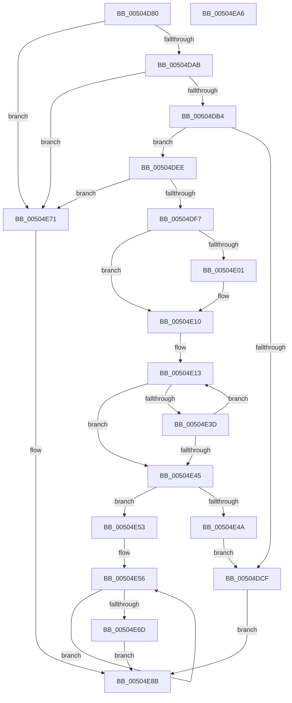

# xtoa_s

- RVA: `0x00504D80`–`0x00504EA7` (길이 `295` bytes)
- VA: `0x0000000140504D80`
- 실행 섹션: `.text`
- PDB 이름 있음: `예`; PDB Function 태그: `예`
- unwind 정보 RVA: `0x0005D7BC`
- 디코드: `91`개 명령, `295/295` bytes 표시
- 미해석 바이트: `0` (있으면 어셈블리에 `.byte`로 보존)

> 이 문서는 커널 이미지의 기계어와 PDB 기호를 분석해 생성했습니다. 4번과 5번은 함수 원형과 자료형을 바이너리 사용 방식에서 추정한 C 해석이며 원본 소스 복구 결과는 아닙니다.

## 1. Dependencies

- 직접 호출 지점: **2**; 고유 호출 대상: **1**
- 직접 호출자로 확인된 함수: **2**
- RIP 상대 이미지 참조: **0**

### Outgoing calls
- `0x00504DDF` → [EmpCheckErrataList](../49/EmpCheckErrataList_function_0049E550.md) (function, `0x0049E550`)
- `0x00504E81` → [EmpCheckErrataList](../49/EmpCheckErrataList_function_0049E550.md) (function, `0x0049E550`)

### Direct callers
- [itoa_s](itoa_s_function_00504BE0.md) at `0x00504BF8`
- [ultoa_s](ultoa_s_function_00504C30.md) at `0x00504C39`

### Static image references
- 디코드된 RIP-relative 메모리 참조가 없습니다.

## 2. Other-region calls and transfers

- 다른 실행 섹션으로 향하는 call: **0**
- 별도 외부 분기/꼬리 이동을 확인하지 못했습니다.

## 3. Assembly (complete function range)

```asm
00504D80  48 8B C4                        mov rax, rsp
00504D83  48 89 58 08                     mov qword ptr [rax + 8], rbx
00504D87  48 89 68 10                     mov qword ptr [rax + 0x10], rbp
00504D8B  48 89 70 18                     mov qword ptr [rax + 0x18], rsi
00504D8F  48 89 78 20                     mov qword ptr [rax + 0x20], rdi
00504D93  41 56                           push r14
00504D95  48 83 EC 30                     sub rsp, 0x30
00504D99  41 8B E9                        mov ebp, r9d
00504D9C  4D 8B D8                        mov r11, r8
00504D9F  4C 8B D2                        mov r10, rdx
00504DA2  48 85 D2                        test rdx, rdx
00504DA5  0F 84 C6 00 00 00               je 0x140504e71
00504DAB  4D 85 C0                        test r8, r8
00504DAE  0F 84 BD 00 00 00               je 0x140504e71
00504DB4  44 8B 44 24 60                  mov r8d, dword ptr [rsp + 0x60]
00504DB9  41 8B C0                        mov eax, r8d
00504DBC  C6 02 00                        mov byte ptr [rdx], 0
00504DBF  F7 D8                           neg eax
00504DC1  48 1B D2                        sbb rdx, rdx
00504DC4  48 F7 DA                        neg rdx
00504DC7  48 FF C2                        inc rdx
00504DCA  4C 3B DA                        cmp r11, rdx
00504DCD  77 1F                           ja 0x140504dee
00504DCF  48 83 64 24 20 00               and qword ptr [rsp + 0x20], 0
00504DD5  45 33 C9                        xor r9d, r9d
00504DD8  45 33 C0                        xor r8d, r8d
00504DDB  33 D2                           xor edx, edx
00504DDD  33 C9                           xor ecx, ecx
00504DDF  E8 6C 97 F9 FF                  call 0x14049e550
00504DE4  B8 22 00 00 00                  mov eax, 0x22
00504DE9  E9 9D 00 00 00                  jmp 0x140504e8b
00504DEE  41 8D 41 FE                     lea eax, [r9 - 2]
00504DF2  83 F8 22                        cmp eax, 0x22
00504DF5  77 7A                           ja 0x140504e71
00504DF7  33 FF                           xor edi, edi
00504DF9  49 8B DA                        mov rbx, r10
00504DFC  45 85 C0                        test r8d, r8d
00504DFF  74 0F                           je 0x140504e10
00504E01  41 C6 02 2D                     mov byte ptr [r10], 0x2d
00504E05  49 8D 5A 01                     lea rbx, [r10 + 1]
00504E09  BF 01 00 00 00                  mov edi, 1
00504E0E  F7 D9                           neg ecx
00504E10  4C 8B C3                        mov r8, rbx
00504E13  33 D2                           xor edx, edx
00504E15  48 8D 73 01                     lea rsi, [rbx + 1]
00504E19  8B C1                           mov eax, ecx
00504E1B  4C 8B CB                        mov r9, rbx
00504E1E  F7 F5                           div ebp
00504E20  8B C8                           mov ecx, eax
00504E22  83 FA 09                        cmp edx, 9
00504E25  B8 57 00 00 00                  mov eax, 0x57
00504E2A  44 8D 70 D9                     lea r14d, [rax - 0x27]
00504E2E  41 0F 46 C6                     cmovbe eax, r14d
00504E32  48 FF C7                        inc rdi
00504E35  02 C2                           add al, dl
00504E37  88 03                           mov byte ptr [rbx], al
00504E39  85 C9                           test ecx, ecx
00504E3B  74 08                           je 0x140504e45
00504E3D  48 8B DE                        mov rbx, rsi
00504E40  49 3B FB                        cmp rdi, r11
00504E43  72 CE                           jb 0x140504e13
00504E45  49 3B FB                        cmp rdi, r11
00504E48  72 09                           jb 0x140504e53
00504E4A  41 C6 02 00                     mov byte ptr [r10], 0
00504E4E  E9 7C FF FF FF                  jmp 0x140504dcf
00504E53  C6 06 00                        mov byte ptr [rsi], 0
00504E56  41 8A 00                        mov al, byte ptr [r8]
00504E59  41 8A 09                        mov cl, byte ptr [r9]
00504E5C  41 88 01                        mov byte ptr [r9], al
00504E5F  49 FF C9                        dec r9
00504E62  41 88 08                        mov byte ptr [r8], cl
00504E65  49 FF C0                        inc r8
00504E68  4D 3B C1                        cmp r8, r9
00504E6B  72 E9                           jb 0x140504e56
00504E6D  33 C0                           xor eax, eax
00504E6F  EB 1A                           jmp 0x140504e8b
00504E71  48 83 64 24 20 00               and qword ptr [rsp + 0x20], 0
00504E77  45 33 C9                        xor r9d, r9d
00504E7A  45 33 C0                        xor r8d, r8d
00504E7D  33 D2                           xor edx, edx
00504E7F  33 C9                           xor ecx, ecx
00504E81  E8 CA 96 F9 FF                  call 0x14049e550
00504E86  B8 16 00 00 00                  mov eax, 0x16
00504E8B  48 8B 5C 24 40                  mov rbx, qword ptr [rsp + 0x40]
00504E90  48 8B 6C 24 48                  mov rbp, qword ptr [rsp + 0x48]
00504E95  48 8B 74 24 50                  mov rsi, qword ptr [rsp + 0x50]
00504E9A  48 8B 7C 24 58                  mov rdi, qword ptr [rsp + 0x58]
00504E9F  48 83 C4 30                     add rsp, 0x30
00504EA3  41 5E                           pop r14
00504EA5  C3                              ret
00504EA6  CC                              int3
```

## 4. C-style interpretation (structured pseudocode)

```c
__int64 __fastcall xtoa_s(int a1, __int64 a2, __int64 a3, int a4, unsigned int a5)
{
    __int64 result;
    __int64 v_rbx;
    __int64 v_rdi;
    __int64 v_rsp;
    unsigned __int64 v_stack_m18;
    unsigned __int64 v_stack_p10;
    unsigned __int64 v_stack_p18;
    unsigned __int64 v_stack_p20;
    unsigned __int64 v_stack_p8;

    *(unsigned __int64 *)(v_rsp + 8) = v_rbx;
    *(unsigned __int64 *)(v_rsp + 16) = v_rbp;
    *(unsigned __int64 *)(v_rsp + 24) = v_rsi;
    *(unsigned __int64 *)(v_rsp + 32) = v_rdi;
    v_rsp = (v_rsp) - (48);
    if (a2 == 0) goto loc_00504E71;
    if (a3 == 0) goto loc_00504E71;
    *(unsigned __int8 *)(a2) = 0;
    result = (unsigned int)(-((unsigned int)((unsigned int)((unsigned int)(a5)))));
    a2 = -(a2);
    a2 = (a2) + 1;
    if (a3 > a2) goto loc_00504DEE;
loc_00504DCF:
    a4 = 0;
    a3 = 0;
    a2 = 0;
    a1 = 0;
    result = EmpCheckErrataList(a1, a2, a3, a4);
    goto loc_00504E8B;
loc_00504DEE:
    if (((unsigned int)(a4 - 2)) > 34) goto loc_00504E71;
    v_rdi = 0;
    v_rbx = 0;
    if (0 != 0) {
        *(unsigned __int8 *)(a2) = 45;
        v_rbx = a2 + 1;
        v_rdi = 1;
        a1 = (unsigned int)(-(a1));
    }
loc_00504E13:
    a2 = 0;
    result = 87;
    if (0 <= 9) { result = (unsigned int)(87 - 39); }
    v_rdi = (v_rdi) + 1;
    result = (unsigned __int8)((result) + (0));
    *(unsigned __int8 *)(v_rbx) = (unsigned __int8)(result);
    if ((unsigned int)((unsigned int)((unsigned int)((unsigned int)(a1)))) == 0) goto loc_00504E45;
    if (v_rdi < 0) goto loc_00504E13;
loc_00504E45:
    if (v_rdi < 0) goto loc_00504E53;
    *(unsigned __int8 *)(a2) = 0;
    goto loc_00504DCF;
loc_00504E53:
    *(unsigned __int8 *)(v_rbx + 1) = 0;
loc_00504E56:
    *(unsigned __int8 *)(v_rbx) = (unsigned __int8)(*(unsigned __int8 *)(v_rbx));
    a4 = (v_rbx) - 1;
    *(unsigned __int8 *)(v_rbx) = (unsigned __int8)(*(unsigned __int8 *)(v_rbx));
    a3 = (v_rbx) + 1;
    if (a3 < a4) goto loc_00504E56;
    result = 0;
    goto loc_00504E8B;
loc_00504E71:
    a4 = 0;
    a3 = 0;
    a2 = 0;
    a1 = 0;
    result = EmpCheckErrataList(a1, a2, a3, a4);
loc_00504E8B:
    v_rsp = (v_rsp) + (48);
    return 22;
}
```

## 5. (Beta) C Style

```c
int64_t xtoa_s(int32_t Arg1, void *Arg2, int64_t Arg3, void *Arg4, uint32_t Arg5)
{
    uint8_t *arg2 = (uint8_t *)Arg2;
    uint8_t *arg4 = (uint8_t *)Arg4;

    int64_t result;
    int64_t local_rbx;
    int64_t local_rdi;
    int64_t local_rsp;
    uint64_t v_stack_m18;
    uint64_t v_stack_p10;
    uint64_t v_stack_p18;
    uint64_t v_stack_p20;
    uint64_t v_stack_p8;

    *(uint64_t *)(local_rsp + 0x8) = local_rbx;
    *(uint64_t *)(local_rsp + 0x10) = local_rbp;
    *(uint64_t *)(local_rsp + 0x18) = local_rsi;
    *(uint64_t *)(local_rsp + 0x20) = local_rdi;
    local_rsp = (local_rsp) - (48);
    if (Arg2 == NULL) goto loc_00504E71;
    if (Arg3 == 0) goto loc_00504E71;
    *(uint8_t *)(arg2) = 0;
    result = (uint32_t)(-((uint32_t)((uint32_t)((uint32_t)(Arg5)))));
    Arg2 = -(Arg2);
    Arg2 = (Arg2) + 1;
    if (Arg3 > Arg2) goto loc_00504DEE;
loc_00504DCF:
    Arg4 = 0;
    Arg3 = 0;
    Arg2 = 0;
    Arg1 = 0;
    result = EmpCheckErrataList(Arg1, Arg2, Arg3, Arg4);
    goto loc_00504E8B;
loc_00504DEE:
    if (((uint32_t)(Arg4 - 2)) > 34) goto loc_00504E71;
    local_rdi = 0;
    local_rbx = 0;
    if (0 != 0) {
        *(uint8_t *)(arg2) = 45;
        local_rbx = Arg2 + 1;
        local_rdi = 1;
        Arg1 = (uint32_t)(-(Arg1));
    }
loc_00504E13:
    Arg2 = 0;
    result = 87;
    if (0 <= 9) { result = (uint32_t)(87 - 39); }
    local_rdi = (local_rdi) + 1;
    result = (uint8_t)((result) + (0));
    *(uint8_t *)(local_rbx) = (uint8_t)(result);
    if ((uint32_t)((uint32_t)((uint32_t)((uint32_t)(Arg1)))) == 0) goto loc_00504E45;
    if (local_rdi < 0) goto loc_00504E13;
loc_00504E45:
    if (local_rdi < 0) goto loc_00504E53;
    *(uint8_t *)(arg2) = 0;
    goto loc_00504DCF;
loc_00504E53:
    *(uint8_t *)(local_rbx + 0x1) = 0;
loc_00504E56:
    *(uint8_t *)(local_rbx) = (uint8_t)(*(uint8_t *)(local_rbx));
    Arg4 = (local_rbx) - 1;
    *(uint8_t *)(local_rbx) = (uint8_t)(*(uint8_t *)(local_rbx));
    Arg3 = (local_rbx) + 1;
    if (Arg3 < Arg4) goto loc_00504E56;
    result = 0;
    goto loc_00504E8B;
loc_00504E71:
    Arg4 = 0;
    Arg3 = 0;
    Arg2 = 0;
    Arg1 = 0;
    result = EmpCheckErrataList(Arg1, Arg2, Arg3, Arg4);
loc_00504E8B:
    local_rsp = (local_rsp) + (48);
    return 22;
}
```

### 관측된 메모리 오프셋

구조체 형식이 확인되지 않은 접근은 인자 기준의 오프셋으로만 기록했습니다.

| 기준 인자 | 오프셋 표현 | 폭 (bit) | 접근 |
|---|---:|---:|---|
| `Arg2` | `+ 0x0` | `8` | `W` |
| `Arg2` | `+ 0x1` | `64` | `R` |
| `Arg4` | `- 0x2` | `32` | `R` |

## 6. Execution-region graph

[열기: 2D/3D 그래프와 함수 탐색 컨트롤 패널](../../../control-panel.html?section=text&rva=0x00504D80&view=graph)

- 2D 그래프는 위에서 아래로 흐르고, 3D 그래프는 빈 공간을 드래그해 회전합니다. Shift+드래그는 이동, 휠은 확대·축소, 함수 노드 선택은 대상 보고서 이동입니다.

### Static fallback


