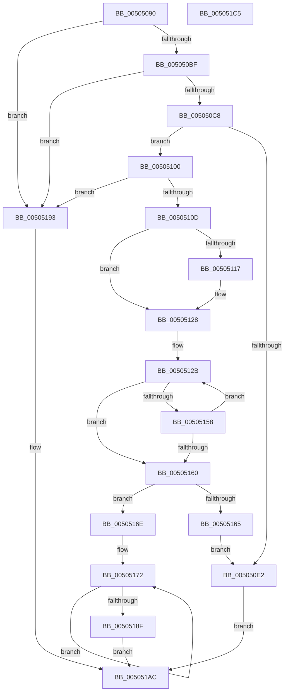

# xtow_s

- RVA: `0x00505090`–`0x005051C6` (길이 `310` bytes)
- VA: `0x0000000140505090`
- 실행 섹션: `.text`
- PDB 이름 있음: `예`; PDB Function 태그: `예`
- unwind 정보 RVA: `0x00084C9C`
- 디코드: `94`개 명령, `310/310` bytes 표시
- 미해석 바이트: `0` (있으면 어셈블리에 `.byte`로 보존)

> 이 문서는 커널 이미지의 기계어와 PDB 기호를 분석해 생성했습니다. 4번과 5번은 함수 원형과 자료형을 바이너리 사용 방식에서 추정한 C 해석이며 원본 소스 복구 결과는 아닙니다.

## 1. Dependencies

- 직접 호출 지점: **2**; 고유 호출 대상: **1**
- 직접 호출자로 확인된 함수: **2**
- RIP 상대 이미지 참조: **0**

### Outgoing calls
- `0x005050F1` → [EmpCheckErrataList](../49/EmpCheckErrataList_function_0049E550.md) (function, `0x0049E550`)
- `0x005051A2` → [EmpCheckErrataList](../49/EmpCheckErrataList_function_0049E550.md) (function, `0x0049E550`)

### Direct callers
- [itow_s](itow_s_function_00504EE0.md) at `0x00504EF8`
- [ultow_s](ultow_s_function_00504F30.md) at `0x00504F39`

### Static image references
- 디코드된 RIP-relative 메모리 참조가 없습니다.

## 2. Other-region calls and transfers

- 다른 실행 섹션으로 향하는 call: **0**
- 별도 외부 분기/꼬리 이동을 확인하지 못했습니다.

## 3. Assembly (complete function range)

```asm
00505090  48 89 5C 24 08                  mov qword ptr [rsp + 8], rbx
00505095  48 89 6C 24 10                  mov qword ptr [rsp + 0x10], rbp
0050509A  48 89 74 24 18                  mov qword ptr [rsp + 0x18], rsi
0050509F  57                              push rdi
005050A0  41 56                           push r14
005050A2  41 57                           push r15
005050A4  48 83 EC 30                     sub rsp, 0x30
005050A8  45 33 FF                        xor r15d, r15d
005050AB  41 8B E9                        mov ebp, r9d
005050AE  4D 8B D8                        mov r11, r8
005050B1  4C 8B D2                        mov r10, rdx
005050B4  8B D9                           mov ebx, ecx
005050B6  48 85 D2                        test rdx, rdx
005050B9  0F 84 D4 00 00 00               je 0x140505193
005050BF  4D 85 C0                        test r8, r8
005050C2  0F 84 CB 00 00 00               je 0x140505193
005050C8  66 44 89 3A                     mov word ptr [rdx], r15w
005050CC  8B 54 24 70                     mov edx, dword ptr [rsp + 0x70]
005050D0  8B C2                           mov eax, edx
005050D2  F7 D8                           neg eax
005050D4  48 1B C9                        sbb rcx, rcx
005050D7  48 F7 D9                        neg rcx
005050DA  48 FF C1                        inc rcx
005050DD  4C 3B C1                        cmp r8, rcx
005050E0  77 1E                           ja 0x140505100
005050E2  45 33 C9                        xor r9d, r9d
005050E5  4C 89 7C 24 20                  mov qword ptr [rsp + 0x20], r15
005050EA  45 33 C0                        xor r8d, r8d
005050ED  33 D2                           xor edx, edx
005050EF  33 C9                           xor ecx, ecx
005050F1  E8 5A 94 F9 FF                  call 0x14049e550
005050F6  B8 22 00 00 00                  mov eax, 0x22
005050FB  E9 AC 00 00 00                  jmp 0x1405051ac
00505100  41 8D 41 FE                     lea eax, [r9 - 2]
00505104  83 F8 22                        cmp eax, 0x22
00505107  0F 87 86 00 00 00               ja 0x140505193
0050510D  49 8B FF                        mov rdi, r15
00505110  49 8B CA                        mov rcx, r10
00505113  85 D2                           test edx, edx
00505115  74 11                           je 0x140505128
00505117  66 41 C7 02 2D 00               mov word ptr [r10], 0x2d
0050511D  49 8D 4A 02                     lea rcx, [r10 + 2]
00505121  BF 01 00 00 00                  mov edi, 1
00505126  F7 DB                           neg ebx
00505128  4C 8B C1                        mov r8, rcx
0050512B  33 D2                           xor edx, edx
0050512D  48 8D 71 02                     lea rsi, [rcx + 2]
00505131  8B C3                           mov eax, ebx
00505133  4C 8B C9                        mov r9, rcx
00505136  F7 F5                           div ebp
00505138  8B D8                           mov ebx, eax
0050513A  83 FA 09                        cmp edx, 9
0050513D  B8 57 00 00 00                  mov eax, 0x57
00505142  44 8D 70 D9                     lea r14d, [rax - 0x27]
00505146  66 41 0F 46 C6                  cmovbe ax, r14w
0050514B  48 FF C7                        inc rdi
0050514E  66 03 C2                        add ax, dx
00505151  66 89 01                        mov word ptr [rcx], ax
00505154  85 DB                           test ebx, ebx
00505156  74 08                           je 0x140505160
00505158  48 8B CE                        mov rcx, rsi
0050515B  49 3B FB                        cmp rdi, r11
0050515E  72 CB                           jb 0x14050512b
00505160  49 3B FB                        cmp rdi, r11
00505163  72 09                           jb 0x14050516e
00505165  66 45 89 3A                     mov word ptr [r10], r15w
00505169  E9 74 FF FF FF                  jmp 0x1405050e2
0050516E  66 44 89 3E                     mov word ptr [rsi], r15w
00505172  41 0F B7 00                     movzx eax, word ptr [r8]
00505176  41 0F B7 09                     movzx ecx, word ptr [r9]
0050517A  66 41 89 01                     mov word ptr [r9], ax
0050517E  49 83 E9 02                     sub r9, 2
00505182  66 41 89 08                     mov word ptr [r8], cx
00505186  49 83 C0 02                     add r8, 2
0050518A  4D 3B C1                        cmp r8, r9
0050518D  72 E3                           jb 0x140505172
0050518F  33 C0                           xor eax, eax
00505191  EB 19                           jmp 0x1405051ac
00505193  45 33 C9                        xor r9d, r9d
00505196  4C 89 7C 24 20                  mov qword ptr [rsp + 0x20], r15
0050519B  45 33 C0                        xor r8d, r8d
0050519E  33 D2                           xor edx, edx
005051A0  33 C9                           xor ecx, ecx
005051A2  E8 A9 93 F9 FF                  call 0x14049e550
005051A7  B8 16 00 00 00                  mov eax, 0x16
005051AC  48 8B 5C 24 50                  mov rbx, qword ptr [rsp + 0x50]
005051B1  48 8B 6C 24 58                  mov rbp, qword ptr [rsp + 0x58]
005051B6  48 8B 74 24 60                  mov rsi, qword ptr [rsp + 0x60]
005051BB  48 83 C4 30                     add rsp, 0x30
005051BF  41 5F                           pop r15
005051C1  41 5E                           pop r14
005051C3  5F                              pop rdi
005051C4  C3                              ret
005051C5  CC                              int3
```

## 4. C-style interpretation (structured pseudocode)

```c
__int64 __fastcall xtow_s(__int64 a1, __int64 a2, __int64 a3, int a4, unsigned int a5)
{
    __int64 result;
    __int64 v_r15;
    __int64 v_rbx;
    __int64 v_rdi;
    __int64 v_rsp;
    unsigned __int64 v_stack_m28;
    unsigned __int64 v_stack_p10;
    unsigned __int64 v_stack_p18;
    unsigned __int64 v_stack_p8;

    v_stack_p8 = v_rbx;
    v_stack_p10 = v_rbp;
    v_stack_p18 = v_rsi;
    v_rsp = (v_rsp) - (48);
    v_r15 = 0;
    if (a2 == 0) goto loc_00505193;
    if (a3 == 0) goto loc_00505193;
    *(unsigned __int16 *)(a2) = 0;
    result = (unsigned int)(-((unsigned int)((unsigned int)((unsigned int)(a5)))));
    a1 = -(a1);
    a1 = (a1) + 1;
    if (a3 > a1) goto loc_00505100;
loc_005050E2:
    a4 = 0;
    v_stack_m28 = 0;
    a3 = 0;
    a2 = 0;
    a1 = 0;
    result = EmpCheckErrataList(a1, a2, a3, a4);
    goto loc_005051AC;
loc_00505100:
    if (((unsigned int)(a4 - 2)) > 34) goto loc_00505193;
    v_rbx = (unsigned int)((unsigned int)(a1));
    v_rdi = 0;
    if (0 != 0) {
        *(unsigned __int16 *)(a2) = 45;
        a1 = a2 + 2;
        v_rdi = 1;
        v_rbx = (unsigned int)(-((unsigned int)((unsigned int)(a1))));
    }
loc_0050512B:
    a2 = 0;
    result = 87;
    if (0 <= 9) { result = (unsigned __int16)(87 - 39); }
    v_rdi = (v_rdi) + 1;
    result = (unsigned __int16)((result) + (0));
    *(unsigned __int16 *)(a1) = (unsigned __int16)(result);
    if ((unsigned int)((unsigned int)((unsigned int)((unsigned int)((unsigned int)(v_rbx))))) == 0) goto loc_00505160;
    if (v_rdi < 0) goto loc_0050512B;
loc_00505160:
    if (v_rdi < 0) goto loc_0050516E;
    *(unsigned __int16 *)(a2) = 0;
    goto loc_005050E2;
loc_0050516E:
    *(unsigned __int16 *)(a1 + 2) = 0;
loc_00505172:
    *(unsigned __int16 *)(a1) = (unsigned __int16)(*(unsigned __int16 *)(a1));
    a4 = (a1) - (2);
    *(unsigned __int16 *)(a1) = (unsigned __int16)(*(unsigned __int16 *)(a1));
    a3 = (a1) + (2);
    if (a3 < a4) goto loc_00505172;
    result = 0;
    goto loc_005051AC;
loc_00505193:
    a4 = 0;
    v_stack_m28 = 0;
    a3 = 0;
    a2 = 0;
    a1 = 0;
    result = EmpCheckErrataList(a1, a2, a3, a4);
loc_005051AC:
    v_rsp = (v_rsp) + (48);
    return 22;
}
```

## 5. (Beta) C Style

```c
int64_t xtow_s(int64_t Arg1, void *Arg2, int64_t Arg3, void *Arg4, uint32_t Arg5)
{
    uint8_t *arg2 = (uint8_t *)Arg2;
    uint8_t *arg4 = (uint8_t *)Arg4;

    int64_t result;
    int64_t local_r15;
    int64_t local_rbx;
    int64_t local_rdi;
    int64_t local_rsp;
    uint64_t v_stack_m28;
    uint64_t v_stack_p10;
    uint64_t v_stack_p18;
    uint64_t v_stack_p8;

    v_stack_p8 = local_rbx;
    v_stack_p10 = local_rbp;
    v_stack_p18 = local_rsi;
    local_rsp = (local_rsp) - (48);
    local_r15 = 0;
    if (Arg2 == NULL) goto loc_00505193;
    if (Arg3 == 0) goto loc_00505193;
    *(uint16_t *)(arg2) = 0;
    result = (uint32_t)(-((uint32_t)((uint32_t)((uint32_t)(Arg5)))));
    Arg1 = -(Arg1);
    Arg1 = (Arg1) + 1;
    if (Arg3 > Arg1) goto loc_00505100;
loc_005050E2:
    Arg4 = 0;
    v_stack_m28 = 0;
    Arg3 = 0;
    Arg2 = 0;
    Arg1 = 0;
    result = EmpCheckErrataList(Arg1, Arg2, Arg3, Arg4);
    goto loc_005051AC;
loc_00505100:
    if (((uint32_t)(Arg4 - 2)) > 34) goto loc_00505193;
    local_rbx = (uint32_t)((uint32_t)(Arg1));
    local_rdi = 0;
    if (0 != 0) {
        *(uint16_t *)(arg2) = 45;
        Arg1 = Arg2 + 2;
        local_rdi = 1;
        local_rbx = (uint32_t)(-((uint32_t)((uint32_t)(Arg1))));
    }
loc_0050512B:
    Arg2 = 0;
    result = 87;
    if (0 <= 9) { result = (uint16_t)(87 - 39); }
    local_rdi = (local_rdi) + 1;
    result = (uint16_t)((result) + (0));
    *(uint16_t *)(Arg1) = (uint16_t)(result);
    if ((uint32_t)((uint32_t)((uint32_t)((uint32_t)((uint32_t)(local_rbx))))) == 0) goto loc_00505160;
    if (local_rdi < 0) goto loc_0050512B;
loc_00505160:
    if (local_rdi < 0) goto loc_0050516E;
    *(uint16_t *)(arg2) = 0;
    goto loc_005050E2;
loc_0050516E:
    *(uint16_t *)(Arg1 + 0x2) = 0;
loc_00505172:
    *(uint16_t *)(Arg1) = (uint16_t)(*(uint16_t *)(Arg1));
    Arg4 = (Arg1) - (2);
    *(uint16_t *)(Arg1) = (uint16_t)(*(uint16_t *)(Arg1));
    Arg3 = (Arg1) + (2);
    if (Arg3 < Arg4) goto loc_00505172;
    result = 0;
    goto loc_005051AC;
loc_00505193:
    Arg4 = 0;
    v_stack_m28 = 0;
    Arg3 = 0;
    Arg2 = 0;
    Arg1 = 0;
    result = EmpCheckErrataList(Arg1, Arg2, Arg3, Arg4);
loc_005051AC:
    local_rsp = (local_rsp) + (48);
    return 22;
}
```

### 관측된 메모리 오프셋

구조체 형식이 확인되지 않은 접근은 인자 기준의 오프셋으로만 기록했습니다.

| 기준 인자 | 오프셋 표현 | 폭 (bit) | 접근 |
|---|---:|---:|---|
| `Arg2` | `+ 0x0` | `16` | `R` |
| `Arg2` | `+ 0x0` | `16` | `W` |
| `Arg2` | `+ 0x2` | `64` | `R` |
| `Arg4` | `- 0x2` | `32` | `R` |

## 6. Execution-region graph

[열기: 2D/3D 그래프와 함수 탐색 컨트롤 패널](../../../control-panel.html?section=text&rva=0x00505090&view=graph)

- 2D 그래프는 위에서 아래로 흐르고, 3D 그래프는 빈 공간을 드래그해 회전합니다. Shift+드래그는 이동, 휠은 확대·축소, 함수 노드 선택은 대상 보고서 이동입니다.

### Static fallback


