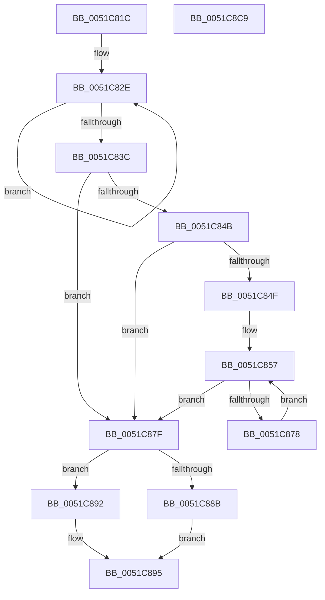

# RtlpComputeEpilogueOffset

- RVA: `0x0051C81C`–`0x0051C8CA` (길이 `174` bytes)
- VA: `0x000000014051C81C`
- 실행 섹션: `.text`
- PDB 이름 있음: `예`; PDB Function 태그: `아니요`
- unwind 정보 RVA: `0x0005CAAC`
- 디코드: `49`개 명령, `174/174` bytes 표시
- 미해석 바이트: `0` (있으면 어셈블리에 `.byte`로 보존)

> 이 문서는 커널 이미지의 기계어와 PDB 기호를 분석해 생성했습니다. 4번과 5번은 함수 원형과 자료형을 바이너리 사용 방식에서 추정한 C 해석이며 원본 소스 복구 결과는 아닙니다.

## 1. Dependencies

- 직접 호출 지점: **3**; 고유 호출 대상: **3**
- 직접 호출자로 확인된 함수: **7**
- RIP 상대 이미지 참조: **0**

### Outgoing calls
- `0x0051C88B` → [KeExitRetpoline](../46/KeExitRetpoline_function_00468E7C.md) (function, `0x00468E7C`)
- `0x0051C8A1` → [sub_00BE8DF0](../../initkdbg/BE/Unknown_function_00BE8DF0.md) (function, `0x00BE8DF0`)
- `0x0051C8B9` → [KeGuardDispatchICall](../../initkdbg/BE/KeGuardDispatchICall_function_00BEAA60.md) (function, `0x00BEAA60`)

### Direct callers
- [FsRtlTruncateSmallMcb](../69/FsRtlTruncateSmallMcb_function_0069BA30.md) at `0x0069BC6E`
- [IopTimerDispatch$filt$2](../6D/IopTimerDispatch_filt_2_function_006D2547.md) at `0x006D295D`
- [ExpTimerDpcRoutine$filt$1](../6D/ExpTimerDpcRoutine_filt_1_function_006D3F95.md) at `0x006D4367`
- [CmpLazyFlushDpcRoutine$filt$1](../6D/CmpLazyFlushDpcRoutine_filt_1_function_006D4566.md) at `0x006D498D`
- [ExpTimeRefreshDpcRoutine$filt$3](../6D/ExpTimeRefreshDpcRoutine_filt_3_function_006D4AD8.md) at `0x006D4F22`
- [PopThermalZoneDpc$filt$2](../6D/PopThermalZoneDpc_filt_2_function_006D560E.md) at `0x006D5A56`
- [FsRtlTruncateSmallMcb$fin$2](../6D/FsRtlTruncateSmallMcb_fin_2_function_006D6303.md) at `0x006D64F7`

### Static image references
- 디코드된 RIP-relative 메모리 참조가 없습니다.

## 2. Other-region calls and transfers

- 다른 실행 섹션으로 향하는 call: **2**
  - `0x0051C8A1` → [sub_00BE8DF0](../../initkdbg/BE/Unknown_function_00BE8DF0.md) (`.text` → `INITKDBG`)
  - `0x0051C8B9` → [KeGuardDispatchICall](../../initkdbg/BE/KeGuardDispatchICall_function_00BEAA60.md) (`.text` → `INITKDBG`)
- 별도 외부 분기/꼬리 이동을 확인하지 못했습니다.

## 3. Assembly (complete function range)

```asm
0051C81C  48 89 5C 24 08                  mov qword ptr [rsp + 8], rbx
0051C821  57                              push rdi
0051C822  48 83 EC 20                     sub rsp, 0x20
0051C826  48 8B DA                        mov rbx, rdx
0051C829  48 8B F9                        mov rdi, rcx
0051C82C  33 C0                           xor eax, eax
0051C82E  4C 31 02                        xor qword ptr [rdx], r8
0051C831  FF C0                           inc eax
0051C833  48 8D 52 08                     lea rdx, [rdx + 8]
0051C837  83 F8 19                        cmp eax, 0x19
0051C83A  72 F2                           jb 0x14051c82e
0051C83C  44 31 03                        xor dword ptr [rbx], r8d
0051C83F  48 63 8B C4 00 00 00            movsxd rcx, dword ptr [rbx + 0xc4]
0051C846  4D 85 C0                        test r8, r8
0051C849  74 34                           je 0x14051c87f
0051C84B  85 C9                           test ecx, ecx
0051C84D  74 30                           je 0x14051c87f
0051C84F  4C 8D 49 FF                     lea r9, [rcx - 1]
0051C853  4E 8D 0C CA                     lea r9, [rdx + r9*8]
0051C857  4D 31 01                        xor qword ptr [r9], r8
0051C85A  48 8D 44 24 38                  lea rax, [rsp + 0x38]
0051C85F  49 D3 C8                        ror r8, cl
0051C862  4D 8D 49 F8                     lea r9, [r9 - 8]
0051C866  4C 89 44 24 38                  mov qword ptr [rsp + 0x38], r8
0051C86B  41 83 E0 3F                     and r8d, 0x3f
0051C86F  4C 0F BB 00                     btc qword ptr [rax], r8
0051C873  83 E9 01                        sub ecx, 1
0051C876  74 07                           je 0x14051c87f
0051C878  4C 8B 44 24 38                  mov r8, qword ptr [rsp + 0x38]
0051C87D  EB D8                           jmp 0x14051c857
0051C87F  F7 83 DC 09 00 00 00 00 10 00   test dword ptr [rbx + 0x9dc], 0x100000
0051C889  74 07                           je 0x14051c892
0051C88B  E8 EC C5 F4 FF                  call 0x140468e7c
0051C890  EB 03                           jmp 0x14051c895
0051C892  0F AE E8                        lfence
0051C895  45 33 C9                        xor r9d, r9d
0051C898  45 33 C0                        xor r8d, r8d
0051C89B  48 8B D3                        mov rdx, rbx
0051C89E  48 8B CF                        mov rcx, rdi
0051C8A1  E8 4A C5 6C 00                  call 0x140be8df0
0051C8A6  48 8B 83 20 01 00 00            mov rax, qword ptr [rbx + 0x120]
0051C8AD  48 8D 8B B8 07 00 00            lea rcx, [rbx + 0x7b8]
0051C8B4  BA 01 00 00 00                  mov edx, 1
0051C8B9  E8 A2 E1 6C 00                  call 0x140beaa60
0051C8BE  48 8B 5C 24 30                  mov rbx, qword ptr [rsp + 0x30]
0051C8C3  48 83 C4 20                     add rsp, 0x20
0051C8C7  5F                              pop rdi
0051C8C8  C3                              ret
0051C8C9  CC                              int3
```

## 4. C-style interpretation (structured pseudocode)

```c
__int64 __fastcall RtlpComputeEpilogueOffset(__int64 a1, __int64 a2, __int64 a3)
{
    __int64 result;
    __int64 v_rsp;
    unsigned __int64 v_stack_p10;
    unsigned __int64 v_stack_p8;

    v_stack_p8 = v_rbx;
    v_rsp = (v_rsp) - (32);
    result = 0;
loc_0051C82E:
    result = (unsigned int)((result) + 1);
    if (((unsigned int)(result)) < 25) goto loc_0051C82E;
    if (a3 == 0) goto loc_0051C87F;
    if ((unsigned int)((int)(*(unsigned int *)(a2 + 196))) == 0) goto loc_0051C87F;
loc_0051C857:
    v_stack_p10 = a3;
    a3 = (unsigned int)((a3) & (63));
    a1 = (unsigned int)(((int)(*(unsigned int *)(a2 + 196))) - (1));
    if (condition_is_equal) goto loc_0051C87F;
    goto loc_0051C857;
loc_0051C87F:
    if (((*(unsigned int *)(a2 + 2524)) & (0x100000ULL)) == 0) goto loc_0051C892;
    result = KeExitRetpoline(a1, a2 + 8, v_stack_p10, a2 + 8 + (int)(*(unsigned int *)(a2 + 196)) - 1 * 8 - 8);
    goto loc_0051C895;
loc_0051C892:
loc_0051C895:
    a4 = 0;
    a3 = 0;
    result = sub_00BE8DF0(a1, a2, a3, a4);
    result = KeGuardDispatchICall(a2 + 1976, 1, a3, a4);
    v_rsp = (v_rsp) + (32);
    return result;
}
```

## 5. (Beta) C Style

```c
int64_t RtlpComputeEpilogueOffset(int64_t Arg1, void *Arg2, int64_t Arg3)
{
    uint8_t *arg2 = (uint8_t *)Arg2;

    int64_t result;
    int64_t local_rsp;
    uint64_t v_stack_p10;
    uint64_t v_stack_p8;

    v_stack_p8 = local_rbx;
    local_rsp = (local_rsp) - (32);
    result = 0;
loc_0051C82E:
    result = (uint32_t)((result) + 1);
    if (((uint32_t)(result)) < 25) goto loc_0051C82E;
    if (Arg3 == 0) goto loc_0051C87F;
    if ((uint32_t)((int32_t)(*(uint32_t *)(arg2 + 0xC4))) == 0) goto loc_0051C87F;
loc_0051C857:
    v_stack_p10 = Arg3;
    Arg3 = (uint32_t)((Arg3) & (63));
    Arg1 = (uint32_t)(((int32_t)(*(uint32_t *)(arg2 + 0xC4))) - (1));
    if (condition_is_equal) goto loc_0051C87F;
    goto loc_0051C857;
loc_0051C87F:
    if (((*(uint32_t *)(arg2 + 0x9DC)) & (0x100000ULL)) == 0) goto loc_0051C892;
    result = KeExitRetpoline(Arg1, Arg2 + 8, v_stack_p10, Arg2 + 8 + (int32_t)(*(uint32_t *)(arg2 + 0xC4)) - 1 * 8 - 8);
    goto loc_0051C895;
loc_0051C892:
loc_0051C895:
    a4 = 0;
    Arg3 = 0;
    result = sub_00BE8DF0(Arg1, Arg2, Arg3, a4);
    result = KeGuardDispatchICall(Arg2 + 1976, 1, Arg3, a4);
    local_rsp = (local_rsp) + (32);
    return result;
}
```

### 관측된 메모리 오프셋

구조체 형식이 확인되지 않은 접근은 인자 기준의 오프셋으로만 기록했습니다.

| 기준 인자 | 오프셋 표현 | 폭 (bit) | 접근 |
|---|---:|---:|---|
| `Arg2` | `- 0x8` | `64` | `R` |
| `Arg2` | `+ 0x0` | `32` | `R/W` |
| `Arg2` | `+ 0x0` | `64` | `R/W` |
| `Arg2` | `+ 0x0 + r9*8` | `64` | `R` |
| `Arg2` | `+ 0x8` | `64` | `R` |
| `Arg2` | `+ 0xC4` | `32` | `R` |
| `Arg2` | `+ 0x120` | `64` | `R` |
| `Arg2` | `+ 0x7B8` | `64` | `R` |
| `Arg2` | `+ 0x9DC` | `32` | `R` |

## 6. Execution-region graph

[열기: 2D/3D 그래프와 함수 탐색 컨트롤 패널](../../../control-panel.html?section=text&rva=0x0051C81C&view=graph)

- 2D 그래프는 위에서 아래로 흐르고, 3D 그래프는 빈 공간을 드래그해 회전합니다. Shift+드래그는 이동, 휠은 확대·축소, 함수 노드 선택은 대상 보고서 이동입니다.

### Static fallback


