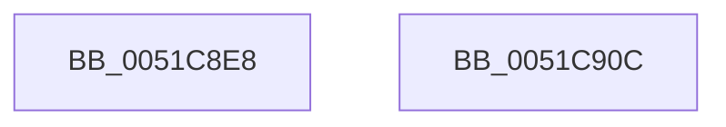

# SymCryptCpuidExFuncEnvWindowsKernelmodeWin8_1nLater

- RVA: `0x0051C8E8`–`0x0051C90D` (길이 `37` bytes)
- VA: `0x000000014051C8E8`
- 실행 섹션: `.text`
- PDB 이름 있음: `예`; PDB Function 태그: `아니요`
- unwind 정보 RVA: `0x00071750`
- 디코드: `12`개 명령, `37/37` bytes 표시
- 미해석 바이트: `0` (있으면 어셈블리에 `.byte`로 보존)

> 이 문서는 커널 이미지의 기계어와 PDB 기호를 분석해 생성했습니다. 4번과 5번은 함수 원형과 자료형을 바이너리 사용 방식에서 추정한 C 해석이며 원본 소스 복구 결과는 아닙니다.

## 1. Dependencies

- 직접 호출 지점: **0**; 고유 호출 대상: **0**
- 직접 호출자로 확인된 함수: **1**
- RIP 상대 이미지 참조: **0**

### Outgoing calls
- 직접 디코드된 call 명령이 없습니다.

### Direct callers
- [SymCryptCpuidExFunc](../5B/SymCryptCpuidExFunc_function_005B24C8.md) at `0x005B24CC`

### Static image references
- 디코드된 RIP-relative 메모리 참조가 없습니다.

## 2. Other-region calls and transfers

- 다른 실행 섹션으로 향하는 call: **0**
- 별도 외부 분기/꼬리 이동을 확인하지 못했습니다.

## 3. Assembly (complete function range)

```asm
0051C8E8  48 89 5C 24 08                  mov qword ptr [rsp + 8], rbx
0051C8ED  4C 8B C9                        mov r9, rcx
0051C8F0  8B C2                           mov eax, edx
0051C8F2  41 8B C8                        mov ecx, r8d
0051C8F5  0F A2                           cpuid
0051C8F7  41 89 01                        mov dword ptr [r9], eax
0051C8FA  41 89 59 04                     mov dword ptr [r9 + 4], ebx
0051C8FE  48 8B 5C 24 08                  mov rbx, qword ptr [rsp + 8]
0051C903  41 89 49 08                     mov dword ptr [r9 + 8], ecx
0051C907  41 89 51 0C                     mov dword ptr [r9 + 0xc], edx
0051C90B  C3                              ret
0051C90C  CC                              int3
```

## 4. C-style interpretation (structured pseudocode)

```c
__int64 __fastcall SymCryptCpuidExFuncEnvWindowsKernelmodeWin8_1nLater(__int64 a1, int a2, int a3)
{
    unsigned __int64 v_stack_p8;

    v_stack_p8 = v_rbx;
    *(unsigned int *)(a1) = (unsigned int)((unsigned int)(a2));
    *(unsigned int *)(a1 + 4) = (unsigned int)(v_rbx);
    *(unsigned int *)(a1 + 8) = (unsigned int)((unsigned int)(a3));
    *(unsigned int *)(a1 + 12) = a2;
    return (unsigned int)(a2);
}
```

## 5. (Beta) C Style

```c
int64_t SymCryptCpuidExFuncEnvWindowsKernelmodeWin8_1nLater(void *Arg1, int32_t Arg2, int32_t Arg3)
{
    uint8_t *arg1 = (uint8_t *)Arg1;

    uint64_t v_stack_p8;

    v_stack_p8 = local_rbx;
    *(uint32_t *)(arg1) = (uint32_t)((uint32_t)(Arg2));
    *(uint32_t *)(arg1 + 0x4) = (uint32_t)(local_rbx);
    *(uint32_t *)(arg1 + 0x8) = (uint32_t)((uint32_t)(Arg3));
    *(uint32_t *)(arg1 + 0xC) = Arg2;
    return (uint32_t)(Arg2);
}
```

### 관측된 메모리 오프셋

구조체 형식이 확인되지 않은 접근은 인자 기준의 오프셋으로만 기록했습니다.

| 기준 인자 | 오프셋 표현 | 폭 (bit) | 접근 |
|---|---:|---:|---|
| `Arg1` | `+ 0x0` | `32` | `W` |
| `Arg1` | `+ 0x4` | `32` | `W` |
| `Arg1` | `+ 0x8` | `32` | `W` |
| `Arg1` | `+ 0xC` | `32` | `W` |

## 6. Execution-region graph

[열기: 2D/3D 그래프와 함수 탐색 컨트롤 패널](../../../control-panel.html?section=text&rva=0x0051C8E8&view=graph)

- 2D 그래프는 위에서 아래로 흐르고, 3D 그래프는 빈 공간을 드래그해 회전합니다. Shift+드래그는 이동, 휠은 확대·축소, 함수 노드 선택은 대상 보고서 이동입니다.

### Static fallback


