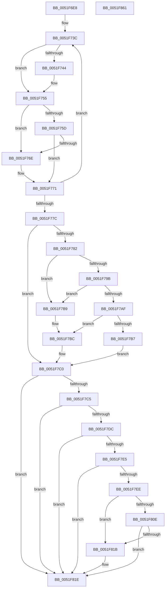

# SymCryptDetectCpuFeaturesByCpuid

- RVA: `0x0051F6E8`–`0x0051F862` (길이 `378` bytes)
- VA: `0x000000014051F6E8`
- 실행 섹션: `.text`
- PDB 이름 있음: `예`; PDB Function 태그: `아니요`
- unwind 정보 RVA: `0x000C3110`
- 디코드: `112`개 명령, `378/378` bytes 표시
- 미해석 바이트: `0` (있으면 어셈블리에 `.byte`로 보존)

> 이 문서는 커널 이미지의 기계어와 PDB 기호를 분석해 생성했습니다. 4번과 5번은 함수 원형과 자료형을 바이너리 사용 방식에서 추정한 C 해석이며 원본 소스 복구 결과는 아닙니다.

## 1. Dependencies

- 직접 호출 지점: **7**; 고유 호출 대상: **2**
- 직접 호출자로 확인된 함수: **1**
- RIP 상대 이미지 참조: **4**

### Outgoing calls
- `0x0051F729` → [SymCryptCpuidExFunc](../5B/SymCryptCpuidExFunc_function_005B24C8.md) (function, `0x005B24C8`)
- `0x0051F750` → [SymCryptCpuidExFunc](../5B/SymCryptCpuidExFunc_function_005B24C8.md) (function, `0x005B24C8`)
- `0x0051F78D` → [SymCryptCpuidExFunc](../5B/SymCryptCpuidExFunc_function_005B24C8.md) (function, `0x005B24C8`)
- `0x0051F7CE` → [SymCryptCpuidExFunc](../5B/SymCryptCpuidExFunc_function_005B24C8.md) (function, `0x005B24C8`)
- `0x0051F7F9` → [SymCryptCpuidExFunc](../5B/SymCryptCpuidExFunc_function_005B24C8.md) (function, `0x005B24C8`)
- `0x0051F82C` → [SymCryptCpuidExFunc](../5B/SymCryptCpuidExFunc_function_005B24C8.md) (function, `0x005B24C8`)
- `0x0051F83E` → [_security_check_cookie](../6A/_security_check_cookie_function_006AC640.md) (function, `0x006AC640`)

### Direct callers
- [SymCryptInitEnvWindowsKernelmodeWin8_1nLater](SymCryptInitEnvWindowsKernelmodeWin8_1nLater_function_0051C948.md) at `0x0051C9AE`

### Static image references
- `0x0051F707` → RVA `0x00E0A740` (`.data`; read)
- `0x0051F732` → RVA `0x0001FA10` (`.rdata`; read)
- `0x0051F821` → RVA `0x00EF0170` (`.data`; read)
- `0x0051F831` → RVA `0x00E0A730` (`.data`; write)

## 2. Other-region calls and transfers

- 다른 실행 섹션으로 향하는 call: **0**
- 별도 외부 분기/꼬리 이동을 확인하지 못했습니다.

## 3. Assembly (complete function range)

```asm
0051F6E8  48 8B C4                        mov rax, rsp
0051F6EB  48 89 58 08                     mov qword ptr [rax + 8], rbx
0051F6EF  48 89 70 10                     mov qword ptr [rax + 0x10], rsi
0051F6F3  48 89 78 18                     mov qword ptr [rax + 0x18], rdi
0051F6F7  4C 89 60 20                     mov qword ptr [rax + 0x20], r12
0051F6FB  55                              push rbp
0051F6FC  41 56                           push r14
0051F6FE  41 57                           push r15
0051F700  48 8B EC                        mov rbp, rsp
0051F703  48 83 EC 40                     sub rsp, 0x40
0051F707  48 8B 05 32 B0 8E 00            mov rax, qword ptr [rip + 0x8eb032]
0051F70E  48 33 C4                        xor rax, rsp
0051F711  48 89 45 F0                     mov qword ptr [rbp - 0x10], rax
0051F715  44 8B F9                        mov r15d, ecx
0051F718  45 33 F6                        xor r14d, r14d
0051F71B  48 8D 4D E0                     lea rcx, [rbp - 0x20]
0051F71F  45 33 C0                        xor r8d, r8d
0051F722  33 D2                           xor edx, edx
0051F724  BB 20 C0 FF FF                  mov ebx, 0xffffc020
0051F729  E8 9A 2D 09 00                  call 0x1405b24c8
0051F72E  44 8B 65 E0                     mov r12d, dword ptr [rbp - 0x20]
0051F732  48 8D 3D D7 02 B0 FF            lea rdi, [rip - 0x4ffd29]
0051F739  41 8B F6                        mov esi, r14d
0051F73C  0F B6 07                        movzx eax, byte ptr [rdi]
0051F73F  41 3B C6                        cmp eax, r14d
0051F742  74 11                           je 0x14051f755
0051F744  45 33 C0                        xor r8d, r8d
0051F747  48 8D 4D E0                     lea rcx, [rbp - 0x20]
0051F74B  8B D0                           mov edx, eax
0051F74D  44 8B F0                        mov r14d, eax
0051F750  E8 73 2D 09 00                  call 0x1405b24c8
0051F755  0F B6 07                        movzx eax, byte ptr [rdi]
0051F758  41 3B C4                        cmp eax, r12d
0051F75B  7F 11                           jg 0x14051f76e
0051F75D  0F B6 47 01                     movzx eax, byte ptr [rdi + 1]
0051F761  0F B6 57 02                     movzx edx, byte ptr [rdi + 2]
0051F765  8B 4C 85 E0                     mov ecx, dword ptr [rbp + rax*4 - 0x20]
0051F769  0F A3 D1                        bt ecx, edx
0051F76C  72 03                           jb 0x14051f771
0051F76E  0B 5F 04                        or ebx, dword ptr [rdi + 4]
0051F771  FF C6                           inc esi
0051F773  48 83 C7 08                     add rdi, 8
0051F777  83 FE 14                        cmp esi, 0x14
0051F77A  72 C0                           jb 0x14051f73c
0051F77C  41 F6 C7 01                     test r15b, 1
0051F780  74 3E                           je 0x14051f7c0
0051F782  45 33 C0                        xor r8d, r8d
0051F785  48 8D 4D E0                     lea rcx, [rbp - 0x20]
0051F789  41 8D 50 01                     lea edx, [r8 + 1]
0051F78D  E8 36 2D 09 00                  call 0x1405b24c8
0051F792  F7 45 E8 00 00 00 08            test dword ptr [rbp - 0x18], 0x8000000
0051F799  74 1E                           je 0x14051f7b9
0051F79B  33 C9                           xor ecx, ecx
0051F79D  0F 01 D0                        xgetbv
0051F7A0  48 C1 E2 20                     shl rdx, 0x20
0051F7A4  48 0B D0                        or rdx, rax
0051F7A7  8A C2                           mov al, dl
0051F7A9  24 06                           and al, 6
0051F7AB  3C 06                           cmp al, 6
0051F7AD  75 0A                           jne 0x14051f7b9
0051F7AF  80 E2 E0                        and dl, 0xe0
0051F7B2  80 FA E0                        cmp dl, 0xe0
0051F7B5  75 05                           jne 0x14051f7bc
0051F7B7  EB 07                           jmp 0x14051f7c0
0051F7B9  83 CB 10                        or ebx, 0x10
0051F7BC  0F BA EB 0C                     bts ebx, 0xc
0051F7C0  F6 C3 04                        test bl, 4
0051F7C3  75 59                           jne 0x14051f81e
0051F7C5  45 33 C0                        xor r8d, r8d
0051F7C8  48 8D 4D E0                     lea rcx, [rbp - 0x20]
0051F7CC  33 D2                           xor edx, edx
0051F7CE  E8 F5 2C 09 00                  call 0x1405b24c8
0051F7D3  81 7D E4 41 75 74 68            cmp dword ptr [rbp - 0x1c], 0x68747541
0051F7DA  75 42                           jne 0x14051f81e
0051F7DC  81 7D E8 63 41 4D 44            cmp dword ptr [rbp - 0x18], 0x444d4163
0051F7E3  75 39                           jne 0x14051f81e
0051F7E5  81 7D EC 65 6E 74 69            cmp dword ptr [rbp - 0x14], 0x69746e65
0051F7EC  75 30                           jne 0x14051f81e
0051F7EE  45 33 C0                        xor r8d, r8d
0051F7F1  48 8D 4D E0                     lea rcx, [rbp - 0x20]
0051F7F5  41 8D 50 01                     lea edx, [r8 + 1]
0051F7F9  E8 CA 2C 09 00                  call 0x1405b24c8
0051F7FE  8B 45 E0                        mov eax, dword ptr [rbp - 0x20]
0051F801  8B C8                           mov ecx, eax
0051F803  C1 F9 08                        sar ecx, 8
0051F806  83 E1 0F                        and ecx, 0xf
0051F809  83 F9 0F                        cmp ecx, 0xf
0051F80C  72 0D                           jb 0x14051f81b
0051F80E  C1 F8 14                        sar eax, 0x14
0051F811  0F B6 C0                        movzx eax, al
0051F814  03 C1                           add eax, ecx
0051F816  83 F8 15                        cmp eax, 0x15
0051F819  73 03                           jae 0x14051f81e
0051F81B  83 CB 04                        or ebx, 4
0051F81E  45 33 C0                        xor r8d, r8d
0051F821  48 8D 0D 48 09 9D 00            lea rcx, [rip + 0x9d0948]
0051F828  41 8D 50 01                     lea edx, [r8 + 1]
0051F82C  E8 97 2C 09 00                  call 0x1405b24c8
0051F831  89 1D F9 AE 8E 00               mov dword ptr [rip + 0x8eaef9], ebx
0051F837  48 8B 4D F0                     mov rcx, qword ptr [rbp - 0x10]
0051F83B  48 33 CC                        xor rcx, rsp
0051F83E  E8 FD CD 18 00                  call 0x1406ac640
0051F843  48 8B 5C 24 60                  mov rbx, qword ptr [rsp + 0x60]
0051F848  48 8B 74 24 68                  mov rsi, qword ptr [rsp + 0x68]
0051F84D  48 8B 7C 24 70                  mov rdi, qword ptr [rsp + 0x70]
0051F852  4C 8B 64 24 78                  mov r12, qword ptr [rsp + 0x78]
0051F857  48 83 C4 40                     add rsp, 0x40
0051F85B  41 5F                           pop r15
0051F85D  41 5E                           pop r14
0051F85F  5D                              pop rbp
0051F860  C3                              ret
0051F861  CC                              int3
```

## 4. C-style interpretation (structured pseudocode)

```c
__int64 __fastcall SymCryptDetectCpuFeaturesByCpuid(int a1, int a2, int a3)
{
    __int64 result;
    __int64 v_r14;
    __int64 v_rbx;
    __int64 v_rdi;
    __int64 v_rsi;
    __int64 v_rsp;
    unsigned __int64 v_stack_m28;
    unsigned int v_stack_m2C;
    unsigned int v_stack_m30;
    unsigned int v_stack_m34;
    unsigned __int64 v_stack_m38;
    unsigned __int64 v_stack_p10;
    unsigned __int64 v_stack_p18;
    unsigned __int64 v_stack_p20;
    unsigned __int64 v_stack_p8;

    *(unsigned __int64 *)(v_rsp + 8) = v_rbx;
    *(unsigned __int64 *)(v_rsp + 16) = v_rsi;
    *(unsigned __int64 *)(v_rsp + 24) = v_rdi;
    *(unsigned __int64 *)(v_rsp + 32) = v_r12;
    v_rsp = (v_rsp) - (64);
    result = (*(unsigned __int64 *)(v_rip + 9351218)) ^ (v_rsp);
    v_stack_m28 = result;
    v_r14 = 0;
    a3 = 0;
    a2 = 0;
    result = SymCryptCpuidExFunc(v_stack_m38, a2, a3, a4);
loc_0051F73C:
    result = *(unsigned __int8 *)(v_rip - 5242153);
    if (((unsigned int)(*(unsigned __int8 *)(v_rip - 5242153))) != 0) {
        a3 = 0;
        a1 = v_stack_m38;
        a2 = (unsigned int)(*(unsigned __int8 *)(v_rip - 5242153));
        v_r14 = (unsigned int)(*(unsigned __int8 *)(v_rip - 5242153));
        result = SymCryptCpuidExFunc(a1, a2, a3, a4);
    }
    if (((unsigned int)(*(unsigned __int8 *)(v_rip - 5242153))) > ((unsigned int)((unsigned int)(v_stack_m38)))) goto loc_0051F76E;
    v_rbx = (unsigned int)(0xFFFFC020ULL);
    if (((unsigned int)(*(unsigned __int8 *)(v_rip - 5242153))) >= ((unsigned int)((unsigned int)(v_stack_m38)))) {
        v_rbx = (unsigned int)(((unsigned int)(0xFFFFC020ULL)) | (*(unsigned int *)(v_rip - 5242153 + 4)));
    }
    v_rsi = (unsigned int)((0) + 1);
    v_rdi = (v_rip - 5242153) + (8);
    if (((unsigned int)(v_rsi)) < 20) goto loc_0051F73C;
    if ((((unsigned __int8)((unsigned int)(a1))) & (1)) == 0) goto loc_0051F7C0;
    a3 = 0;
    result = SymCryptCpuidExFunc(v_stack_m38, a3 + 1, a3, a4);
    if (((v_stack_m30) & (0x8000000ULL)) == 0) goto loc_0051F7B9;
    a1 = 0;
    a2 = (a3 + 1) << (32);
    a2 = (a2) | (result);
    result = (unsigned __int8)(((unsigned __int8)(a2)) & (6));
    if (((unsigned __int8)(result)) != 6) goto loc_0051F7B9;
    a2 = (unsigned __int8)((a2) & (224));
    if (((unsigned __int8)(a2)) != 224) goto loc_0051F7BC;
    goto loc_0051F7C0;
loc_0051F7B9:
    v_rbx = (unsigned int)((v_rbx) | (16));
loc_0051F7BC:
loc_0051F7C0:
    if ((((unsigned __int8)(v_rbx)) & (4)) != 0) goto loc_0051F81E;
    a3 = 0;
    a2 = 0;
    result = SymCryptCpuidExFunc(v_stack_m38, a2, a3, a4);
    if (v_stack_m34 != 0x68747541ULL) goto loc_0051F81E;
    if (v_stack_m30 != 0x444D4163ULL) goto loc_0051F81E;
    if (v_stack_m2C != 0x69746E65ULL) goto loc_0051F81E;
    a3 = 0;
    result = SymCryptCpuidExFunc(v_stack_m38, a3 + 1, a3, a4);
    a1 = (unsigned int)(((unsigned int)((unsigned int)((unsigned int)(v_stack_m38)))) >> (8));
    a1 = (unsigned int)((a1) & (15));
    if (a1 < 15) goto loc_0051F81B;
    result = (unsigned int)(((unsigned int)(v_stack_m38)) >> (20));
    result = (unsigned int)(((unsigned __int8)(result)) + (a1));
    if (((unsigned int)(result)) < 21) {
        v_rbx = (unsigned int)((v_rbx) | (4));
    }
    a3 = 0;
    result = SymCryptCpuidExFunc(v_rip + 10291528, a3 + 1, a3, a4);
    *(unsigned int *)(v_rip + 9350905) = (unsigned int)(v_rbx);
    a1 = (v_stack_m28) ^ (v_rsp);
    result = _security_check_cookie(a1, a3 + 1, a3, a4);
    v_rsp = (v_rsp) + (64);
    return result;
}
```

## 5. (Beta) C Style

```c
int64_t SymCryptDetectCpuFeaturesByCpuid(int32_t Arg1, int32_t Arg2, int32_t Arg3)
{
    int64_t result;
    int64_t local_r14;
    int64_t local_rbx;
    int64_t local_rdi;
    int64_t local_rsi;
    int64_t local_rsp;
    uint64_t v_stack_m28;
    uint32_t v_stack_m2C;
    uint32_t v_stack_m30;
    uint32_t v_stack_m34;
    uint64_t v_stack_m38;
    uint64_t v_stack_p10;
    uint64_t v_stack_p18;
    uint64_t v_stack_p20;
    uint64_t v_stack_p8;

    *(uint64_t *)(local_rsp + 0x8) = local_rbx;
    *(uint64_t *)(local_rsp + 0x10) = local_rsi;
    *(uint64_t *)(local_rsp + 0x18) = local_rdi;
    *(uint64_t *)(local_rsp + 0x20) = local_r12;
    local_rsp = (local_rsp) - (64);
    result = (*(uint64_t *)(v_rip + 0x8EB032)) ^ (local_rsp);
    v_stack_m28 = result;
    local_r14 = 0;
    Arg3 = 0;
    Arg2 = 0;
    result = SymCryptCpuidExFunc(v_stack_m38, Arg2, Arg3, a4);
loc_0051F73C:
    result = *(uint8_t *)(v_rip - 0x4FFD29);
    if (((uint32_t)(*(uint8_t *)(v_rip - 0x4FFD29))) != 0) {
        Arg3 = 0;
        Arg1 = v_stack_m38;
        Arg2 = (uint32_t)(*(uint8_t *)(v_rip - 0x4FFD29));
        local_r14 = (uint32_t)(*(uint8_t *)(v_rip - 0x4FFD29));
        result = SymCryptCpuidExFunc(Arg1, Arg2, Arg3, a4);
    }
    if (((uint32_t)(*(uint8_t *)(v_rip - 0x4FFD29))) > ((uint32_t)((uint32_t)(v_stack_m38)))) goto loc_0051F76E;
    local_rbx = (uint32_t)(0xFFFFC020ULL);
    if (((uint32_t)(*(uint8_t *)(v_rip - 0x4FFD29))) >= ((uint32_t)((uint32_t)(v_stack_m38)))) {
        local_rbx = (uint32_t)(((uint32_t)(0xFFFFC020ULL)) | (*(uint32_t *)(v_rip - 0x4FFD29 + 0x4)));
    }
    local_rsi = (uint32_t)((0) + 1);
    local_rdi = (v_rip - 5242153) + (8);
    if (((uint32_t)(local_rsi)) < 20) goto loc_0051F73C;
    if ((((uint8_t)((uint32_t)(Arg1))) & (1)) == 0) goto loc_0051F7C0;
    Arg3 = 0;
    result = SymCryptCpuidExFunc(v_stack_m38, Arg3 + 1, Arg3, a4);
    if (((v_stack_m30) & (0x8000000ULL)) == 0) goto loc_0051F7B9;
    Arg1 = 0;
    Arg2 = (Arg3 + 1) << (32);
    Arg2 = (Arg2) | (result);
    result = (uint8_t)(((uint8_t)(Arg2)) & (6));
    if (((uint8_t)(result)) != 6) goto loc_0051F7B9;
    Arg2 = (uint8_t)((Arg2) & (224));
    if (((uint8_t)(Arg2)) != 224) goto loc_0051F7BC;
    goto loc_0051F7C0;
loc_0051F7B9:
    local_rbx = (uint32_t)((local_rbx) | (16));
loc_0051F7BC:
loc_0051F7C0:
    if ((((uint8_t)(local_rbx)) & (4)) != 0) goto loc_0051F81E;
    Arg3 = 0;
    Arg2 = 0;
    result = SymCryptCpuidExFunc(v_stack_m38, Arg2, Arg3, a4);
    if (v_stack_m34 != 0x68747541ULL) goto loc_0051F81E;
    if (v_stack_m30 != 0x444D4163ULL) goto loc_0051F81E;
    if (v_stack_m2C != 0x69746E65ULL) goto loc_0051F81E;
    Arg3 = 0;
    result = SymCryptCpuidExFunc(v_stack_m38, Arg3 + 1, Arg3, a4);
    Arg1 = (uint32_t)(((uint32_t)((uint32_t)((uint32_t)(v_stack_m38)))) >> (8));
    Arg1 = (uint32_t)((Arg1) & (15));
    if (Arg1 < 15) goto loc_0051F81B;
    result = (uint32_t)(((uint32_t)(v_stack_m38)) >> (20));
    result = (uint32_t)(((uint8_t)(result)) + (Arg1));
    if (((uint32_t)(result)) < 21) {
        local_rbx = (uint32_t)((local_rbx) | (4));
    }
    Arg3 = 0;
    result = SymCryptCpuidExFunc(v_rip + 10291528, Arg3 + 1, Arg3, a4);
    *(uint32_t *)(v_rip + 0x8EAEF9) = (uint32_t)(local_rbx);
    Arg1 = (v_stack_m28) ^ (local_rsp);
    result = _security_check_cookie(Arg1, Arg3 + 1, Arg3, a4);
    local_rsp = (local_rsp) + (64);
    return result;
}
```

## 6. Execution-region graph

[열기: 2D/3D 그래프와 함수 탐색 컨트롤 패널](../../../control-panel.html?section=text&rva=0x0051F6E8&view=graph)

- 2D 그래프는 위에서 아래로 흐르고, 3D 그래프는 빈 공간을 드래그해 회전합니다. Shift+드래그는 이동, 휠은 확대·축소, 함수 노드 선택은 대상 보고서 이동입니다.

### Static fallback


