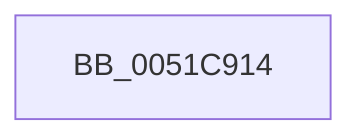

# SymCryptFatalEnvWindowsKernelmodeWin8_1nLater

- RVA: `0x0051C914`–`0x0051C941` (길이 `45` bytes)
- VA: `0x000000014051C914`
- 실행 섹션: `.text`
- PDB 이름 있음: `예`; PDB Function 태그: `아니요`
- unwind 정보 RVA: `0x000C8648`
- 디코드: `12`개 명령, `45/45` bytes 표시
- 미해석 바이트: `0` (있으면 어셈블리에 `.byte`로 보존)

> 이 문서는 커널 이미지의 기계어와 PDB 기호를 분석해 생성했습니다. 4번과 5번은 함수 원형과 자료형을 바이너리 사용 방식에서 추정한 C 해석이며 원본 소스 복구 결과는 아닙니다.

## 1. Dependencies

- 직접 호출 지점: **2**; 고유 호출 대상: **2**
- 직접 호출자로 확인된 함수: **2**
- RIP 상대 이미지 참조: **1**

### Outgoing calls
- `0x0051C91C` → [EmpCheckErrataList](../49/EmpCheckErrataList_function_0049E550.md) (function, `0x0049E550`)
- `0x0051C934` → `indirect target` (indirect, 간접 대상)

### Direct callers
- [SymCryptFatal](../5B/SymCryptFatal_function_005B24E0.md) at `0x005B24E4`
- [SymCryptCallbackRandom](../6A/SymCryptCallbackRandom_function_006AC584.md) at `0x006AC58D`

### Static image references
- `0x0051C934` → RVA `0x00042FE8` (`.rdata`; read)

## 2. Other-region calls and transfers

- 다른 실행 섹션으로 향하는 call: **0**
- 별도 외부 분기/꼬리 이동을 확인하지 못했습니다.

## 3. Assembly (complete function range)

```asm
0051C914  40 53                           push rbx
0051C916  48 83 EC 30                     sub rsp, 0x30
0051C91A  8B D9                           mov ebx, ecx
0051C91C  E8 2F 1C F8 FF                  call 0x14049e550
0051C921  48 83 64 24 20 00               and qword ptr [rsp + 0x20], 0
0051C927  8B D3                           mov edx, ebx
0051C929  45 33 C9                        xor r9d, r9d
0051C92C  45 33 C0                        xor r8d, r8d
0051C92F  B9 71 01 00 00                  mov ecx, 0x171
0051C934  48 FF 15 AD 66 B2 FF            call qword ptr [rip - 0x4d9953]
0051C93B  0F 1F 44 00 00                  nop dword ptr [rax + rax]
0051C940  CC                              int3
```

## 4. C-style interpretation (structured pseudocode)

```c
__int64 __fastcall SymCryptFatalEnvWindowsKernelmodeWin8_1nLater(int a1, __int64 a2, int a3, int a4)
{
    __int64 result;
    __int64 v_rsp;
    unsigned __int64 v_stack_m18;

    v_rsp = (v_rsp) - (48);
    result = EmpCheckErrataList(a1, a2, a3, a4);
    a4 = 0;
    a3 = 0;
    result = kernel_indirect_call(369, (unsigned int)((unsigned int)((unsigned int)(a1))), a3, a4);
    return result;
}
```

## 5. (Beta) C Style

```c
int64_t SymCryptFatalEnvWindowsKernelmodeWin8_1nLater(int32_t Arg1, int64_t Arg2, int32_t Arg3, int32_t Arg4)
{
    int64_t result;
    int64_t local_rsp;
    uint64_t v_stack_m18;

    local_rsp = (local_rsp) - (48);
    result = EmpCheckErrataList(Arg1, Arg2, Arg3, Arg4);
    Arg4 = 0;
    Arg3 = 0;
    result = kernel_indirect_call(369, (uint32_t)((uint32_t)((uint32_t)(Arg1))), Arg3, Arg4);
    return result;
}
```

## 6. Execution-region graph

[열기: 2D/3D 그래프와 함수 탐색 컨트롤 패널](../../../control-panel.html?section=text&rva=0x0051C914&view=graph)

- 2D 그래프는 위에서 아래로 흐르고, 3D 그래프는 빈 공간을 드래그해 회전합니다. Shift+드래그는 이동, 휠은 확대·축소, 함수 노드 선택은 대상 보고서 이동입니다.

### Static fallback


