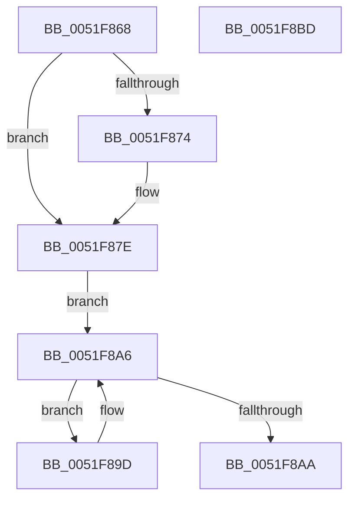

# SymCryptInitEnvCommon

- RVA: `0x0051F868`–`0x0051F8BE` (길이 `86` bytes)
- VA: `0x000000014051F868`
- 실행 섹션: `.text`
- PDB 이름 있음: `예`; PDB Function 태그: `아니요`
- unwind 정보 RVA: `0x0005C788`
- 디코드: `21`개 명령, `86/86` bytes 표시
- 미해석 바이트: `0` (있으면 어셈블리에 `.byte`로 보존)

> 이 문서는 커널 이미지의 기계어와 PDB 기호를 분석해 생성했습니다. 4번과 5번은 함수 원형과 자료형을 바이너리 사용 방식에서 추정한 C 해석이며 원본 소스 복구 결과는 아닙니다.

## 1. Dependencies

- 직접 호출 지점: **1**; 고유 호출 대상: **1**
- 직접 호출자로 확인된 함수: **1**
- RIP 상대 이미지 참조: **4**

### Outgoing calls
- `0x0051F879` → [SymCryptFatal](../5B/SymCryptFatal_function_005B24E0.md) (function, `0x005B24E0`)

### Direct callers
- [SymCryptInitEnvWindowsKernelmodeWin8_1nLater](SymCryptInitEnvWindowsKernelmodeWin8_1nLater_function_0051C948.md) at `0x0051C9DC`

### Static image references
- `0x0051F87E` → RVA `0x00E0F384` (`.data`; read/write)
- `0x0051F886` → RVA `0x0001FAB0` (`.rdata`; read)
- `0x0051F8AA` → RVA `0x00E0A730` (`.data`; read)
- `0x0051F8B2` → RVA `0x00E0F380` (`.data`; write)

## 2. Other-region calls and transfers

- 다른 실행 섹션으로 향하는 call: **0**
- 별도 외부 분기/꼬리 이동을 확인하지 못했습니다.

## 3. Assembly (complete function range)

```asm
0051F868  48 83 EC 28                     sub rsp, 0x28
0051F86C  81 F9 0C 00 67 00               cmp ecx, 0x67000c
0051F872  74 0A                           je 0x14051f87e
0051F874  B9 76 69 70 61                  mov ecx, 0x61706976
0051F879  E8 62 2C 09 00                  call 0x1405b24e0
0051F87E  F0 83 0D FE FA 8E 00 01         lock or dword ptr [rip + 0x8efafe], 1
0051F886  8A 05 24 02 B0 FF               mov al, byte ptr [rip - 0x4ffddc]
0051F88C  48 8D 0D 1D 02 B0 FF            lea rcx, [rip - 0x4ffde3]
0051F893  C7 44 24 30 0C 00 67 00         mov dword ptr [rsp + 0x30], 0x67000c
0051F89B  EB 09                           jmp 0x14051f8a6
0051F89D  48 FF C1                        inc rcx
0051F8A0  88 44 24 30                     mov byte ptr [rsp + 0x30], al
0051F8A4  8A 01                           mov al, byte ptr [rcx]
0051F8A6  84 C0                           test al, al
0051F8A8  75 F3                           jne 0x14051f89d
0051F8AA  8B 05 80 AE 8E 00               mov eax, dword ptr [rip + 0x8eae80]
0051F8B0  F7 D0                           not eax
0051F8B2  89 05 C8 FA 8E 00               mov dword ptr [rip + 0x8efac8], eax
0051F8B8  48 83 C4 28                     add rsp, 0x28
0051F8BC  C3                              ret
0051F8BD  CC                              int3
```

## 4. C-style interpretation (structured pseudocode)

```c
__int64 __fastcall SymCryptInitEnvCommon(int a1)
{
    __int64 result;
    __int64 v_rsp;
    unsigned int v_stack_p8;

    v_rsp = (v_rsp) - (40);
    if (a1 != 0x67000CULL) {
        a1 = 0x61706976ULL;
        result = SymCryptFatal(a1, a2, a3, a4);
    }
    v_stack_p8 = 0x67000CULL;
    goto loc_0051F8A6;
loc_0051F89D:
    a1 = (v_rip - 5242339) + 1;
    v_stack_p8 = (unsigned __int8)(*(unsigned __int8 *)(v_rip - 5242332));
loc_0051F8A6:
    if ((unsigned __int8)(*(unsigned __int8 *)(a1)) != 0) goto loc_0051F89D;
    result = (unsigned int)(~((unsigned int)(*(unsigned int *)(v_rip + 9350784))));
    *(unsigned int *)(v_rip + 9370312) = (unsigned int)(result);
    v_rsp = (v_rsp) + (40);
    return result;
}
```

## 5. (Beta) C Style

```c
int64_t SymCryptInitEnvCommon(int32_t Arg1)
{
    int64_t result;
    int64_t local_rsp;
    uint32_t v_stack_p8;

    local_rsp = (local_rsp) - (40);
    if (Arg1 != 0x67000CULL) {
        Arg1 = 0x61706976ULL;
        result = SymCryptFatal(Arg1, a2, a3, a4);
    }
    v_stack_p8 = 0x67000CULL;
    goto loc_0051F8A6;
loc_0051F89D:
    Arg1 = (v_rip - 5242339) + 1;
    v_stack_p8 = (uint8_t)(*(uint8_t *)(v_rip - 0x4FFDDC));
loc_0051F8A6:
    if ((uint8_t)(*(uint8_t *)(Arg1)) != 0) goto loc_0051F89D;
    result = (uint32_t)(~((uint32_t)(*(uint32_t *)(v_rip + 0x8EAE80))));
    *(uint32_t *)(v_rip + 0x8EFAC8) = (uint32_t)(result);
    local_rsp = (local_rsp) + (40);
    return result;
}
```

## 6. Execution-region graph

[열기: 2D/3D 그래프와 함수 탐색 컨트롤 패널](../../../control-panel.html?section=text&rva=0x0051F868&view=graph)

- 2D 그래프는 위에서 아래로 흐르고, 3D 그래프는 빈 공간을 드래그해 회전합니다. Shift+드래그는 이동, 휠은 확대·축소, 함수 노드 선택은 대상 보고서 이동입니다.

### Static fallback


