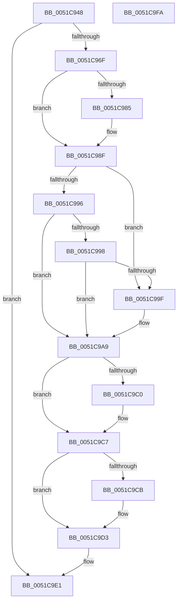

# SymCryptInitEnvWindowsKernelmodeWin8_1nLater

- RVA: `0x0051C948`–`0x0051C9FB` (길이 `179` bytes)
- VA: `0x000000014051C948`
- 실행 섹션: `.text`
- PDB 이름 있음: `예`; PDB Function 태그: `아니요`
- unwind 정보 RVA: `0x000CAA08`
- 디코드: `43`개 명령, `179/179` bytes 표시
- 미해석 바이트: `0` (있으면 어셈블리에 `.byte`로 보존)

> 이 문서는 커널 이미지의 기계어와 PDB 기호를 분석해 생성했습니다. 4번과 5번은 함수 원형과 자료형을 바이너리 사용 방식에서 추정한 C 해석이며 원본 소스 복구 결과는 아닙니다.

## 1. Dependencies

- 직접 호출 지점: **7**; 고유 호출 대상: **6**
- 직접 호출자로 확인된 함수: **2**
- RIP 상대 이미지 참조: **3**

### Outgoing calls
- `0x0051C97C` → [RtlGetVersion](../../page/A1/RtlGetVersion_function_00A19110.md) (function, `0x00A19110`)
- `0x0051C98A` → [SymCryptFatal](../5B/SymCryptFatal_function_005B24E0.md) (function, `0x005B24E0`)
- `0x0051C9A4` → [SymCryptFatal](../5B/SymCryptFatal_function_005B24E0.md) (function, `0x005B24E0`)
- `0x0051C9AE` → [SymCryptDetectCpuFeaturesByCpuid](SymCryptDetectCpuFeaturesByCpuid_function_0051F6E8.md) (function, `0x0051F6E8`)
- `0x0051C9B7` → [RtlGetEnabledExtendedFeatures](../5E/RtlGetEnabledExtendedFeatures_function_005E6C90.md) (function, `0x005E6C90`)
- `0x0051C9DC` → [SymCryptInitEnvCommon](SymCryptInitEnvCommon_function_0051F868.md) (function, `0x0051F868`)
- `0x0051C9EC` → [_security_check_cookie](../6A/_security_check_cookie_function_006AC640.md) (function, `0x006AC640`)

### Direct callers
- [SymCryptInit](../5B/SymCryptInit_function_005B24F8.md) at `0x005B2501`
- [KeInitSystem](../../init/C7/KeInitSystem_function_00C71660.md) at `0x00C718DB`

### Static image references
- `0x0051C951` → RVA `0x00E0A740` (`.data`; read)
- `0x0051C963` → RVA `0x00E0F384` (`.data`; read)
- `0x0051C9C0` → RVA `0x00E0A730` (`.data`; read/write)

## 2. Other-region calls and transfers

- 다른 실행 섹션으로 향하는 call: **1**
  - `0x0051C97C` → [RtlGetVersion](../../page/A1/RtlGetVersion_function_00A19110.md) (`.text` → `PAGE`)
- 별도 외부 분기/꼬리 이동을 확인하지 못했습니다.

## 3. Assembly (complete function range)

```asm
0051C948  40 53                           push rbx
0051C94A  48 81 EC 50 01 00 00            sub rsp, 0x150
0051C951  48 8B 05 E8 DD 8E 00            mov rax, qword ptr [rip + 0x8edde8]
0051C958  48 33 C4                        xor rax, rsp
0051C95B  48 89 84 24 40 01 00 00         mov qword ptr [rsp + 0x140], rax
0051C963  8B 05 1B 2A 8F 00               mov eax, dword ptr [rip + 0x8f2a1b]
0051C969  8B D9                           mov ebx, ecx
0051C96B  A8 01                           test al, 1
0051C96D  75 72                           jne 0x14051c9e1
0051C96F  48 8D 4C 24 20                  lea rcx, [rsp + 0x20]
0051C974  C7 44 24 20 14 01 00 00         mov dword ptr [rsp + 0x20], 0x114
0051C97C  E8 8F C7 4F 00                  call 0x140a19110
0051C981  85 C0                           test eax, eax
0051C983  79 0A                           jns 0x14051c98f
0051C985  B9 76 72 73 6E                  mov ecx, 0x6e737276
0051C98A  E8 51 5B 09 00                  call 0x1405b24e0
0051C98F  83 7C 24 24 06                  cmp dword ptr [rsp + 0x24], 6
0051C994  72 09                           jb 0x14051c99f
0051C996  75 11                           jne 0x14051c9a9
0051C998  83 7C 24 28 03                  cmp dword ptr [rsp + 0x28], 3
0051C99D  73 0A                           jae 0x14051c9a9
0051C99F  B9 76 72 73 6E                  mov ecx, 0x6e737276
0051C9A4  E8 37 5B 09 00                  call 0x1405b24e0
0051C9A9  B9 01 00 00 00                  mov ecx, 1
0051C9AE  E8 35 2D 00 00                  call 0x14051f6e8
0051C9B3  48 83 C9 FF                     or rcx, 0xffffffffffffffff
0051C9B7  E8 D4 A2 0C 00                  call 0x1405e6c90
0051C9BC  A8 04                           test al, 4
0051C9BE  75 07                           jne 0x14051c9c7
0051C9C0  83 0D 69 DD 8E 00 10            or dword ptr [rip + 0x8edd69], 0x10
0051C9C7  A8 E0                           test al, 0xe0
0051C9C9  75 08                           jne 0x14051c9d3
0051C9CB  0F BA 2D 5D DD 8E 00 0C         bts dword ptr [rip + 0x8edd5d], 0xc
0051C9D3  83 25 56 DD 8E 00 DF            and dword ptr [rip + 0x8edd56], 0xffffffdf
0051C9DA  8B CB                           mov ecx, ebx
0051C9DC  E8 87 2E 00 00                  call 0x14051f868
0051C9E1  48 8B 8C 24 40 01 00 00         mov rcx, qword ptr [rsp + 0x140]
0051C9E9  48 33 CC                        xor rcx, rsp
0051C9EC  E8 4F FC 18 00                  call 0x1406ac640
0051C9F1  48 81 C4 50 01 00 00            add rsp, 0x150
0051C9F8  5B                              pop rbx
0051C9F9  C3                              ret
0051C9FA  CC                              int3
```

## 4. C-style interpretation (structured pseudocode)

```c
__int64 __fastcall SymCryptInitEnvWindowsKernelmodeWin8_1nLater(int a1)
{
    __int64 result;
    __int64 v_rsp;
    unsigned int v_stack_m130;
    unsigned int v_stack_m134;
    unsigned __int64 v_stack_m138;
    unsigned __int64 v_stack_m18;

    v_rsp = (v_rsp) - (336);
    result = (*(unsigned __int64 *)(v_rip + 9362920)) ^ (v_rsp);
    v_stack_m18 = result;
    if ((((unsigned __int8)((unsigned int)(*(unsigned int *)(v_rip + 9382427)))) & (1)) != 0) goto loc_0051C9E1;
    v_stack_m138 = 276;
    result = RtlGetVersion(v_stack_m138, a2, a3, a4);
    if (sign_flag) {
        a1 = 0x6E737276ULL;
        result = SymCryptFatal(a1, a2, a3, a4);
    }
    if (v_stack_m134 < 6) goto loc_0051C99F;
    if (v_stack_m134 != 6) goto loc_0051C9A9;
    if (v_stack_m130 < 3) {
        a1 = 0x6E737276ULL;
        result = SymCryptFatal(a1, a2, a3, a4);
    }
    result = SymCryptDetectCpuFeaturesByCpuid(1, a2, a3, a4);
    a1 = (1) | (-1);
    result = RtlGetEnabledExtendedFeatures(a1, a2, a3, a4);
    if ((((unsigned __int8)(result)) & (4)) == 0) {
    }
    if ((((unsigned __int8)(result)) & (224)) == 0) {
    }
    result = SymCryptInitEnvCommon((unsigned int)((unsigned int)((unsigned int)(a1))), a2, a3, a4);
loc_0051C9E1:
    a1 = (v_stack_m18) ^ (v_rsp);
    result = _security_check_cookie(a1, a2, a3, a4);
    v_rsp = (v_rsp) + (336);
    return result;
}
```

## 5. (Beta) C Style

```c
int64_t SymCryptInitEnvWindowsKernelmodeWin8_1nLater(int32_t Arg1)
{
    int64_t result;
    int64_t local_rsp;
    uint32_t v_stack_m130;
    uint32_t v_stack_m134;
    uint64_t v_stack_m138;
    uint64_t v_stack_m18;

    local_rsp = (local_rsp) - (336);
    result = (*(uint64_t *)(v_rip + 0x8EDDE8)) ^ (local_rsp);
    v_stack_m18 = result;
    if ((((uint8_t)((uint32_t)(*(uint32_t *)(v_rip + 0x8F2A1B)))) & (1)) != 0) goto loc_0051C9E1;
    v_stack_m138 = 276;
    result = RtlGetVersion(v_stack_m138, a2, a3, a4);
    if (sign_flag) {
        Arg1 = 0x6E737276ULL;
        result = SymCryptFatal(Arg1, a2, a3, a4);
    }
    if (v_stack_m134 < 6) goto loc_0051C99F;
    if (v_stack_m134 != 6) goto loc_0051C9A9;
    if (v_stack_m130 < 3) {
        Arg1 = 0x6E737276ULL;
        result = SymCryptFatal(Arg1, a2, a3, a4);
    }
    result = SymCryptDetectCpuFeaturesByCpuid(1, a2, a3, a4);
    Arg1 = (1) | (-1);
    result = RtlGetEnabledExtendedFeatures(Arg1, a2, a3, a4);
    if ((((uint8_t)(result)) & (4)) == 0) {
    }
    if ((((uint8_t)(result)) & (224)) == 0) {
    }
    result = SymCryptInitEnvCommon((uint32_t)((uint32_t)((uint32_t)(Arg1))), a2, a3, a4);
loc_0051C9E1:
    Arg1 = (v_stack_m18) ^ (local_rsp);
    result = _security_check_cookie(Arg1, a2, a3, a4);
    local_rsp = (local_rsp) + (336);
    return result;
}
```

## 6. Execution-region graph

[열기: 2D/3D 그래프와 함수 탐색 컨트롤 패널](../../../control-panel.html?section=text&rva=0x0051C948&view=graph)

- 2D 그래프는 위에서 아래로 흐르고, 3D 그래프는 빈 공간을 드래그해 회전합니다. Shift+드래그는 이동, 휠은 확대·축소, 함수 노드 선택은 대상 보고서 이동입니다.

### Static fallback


