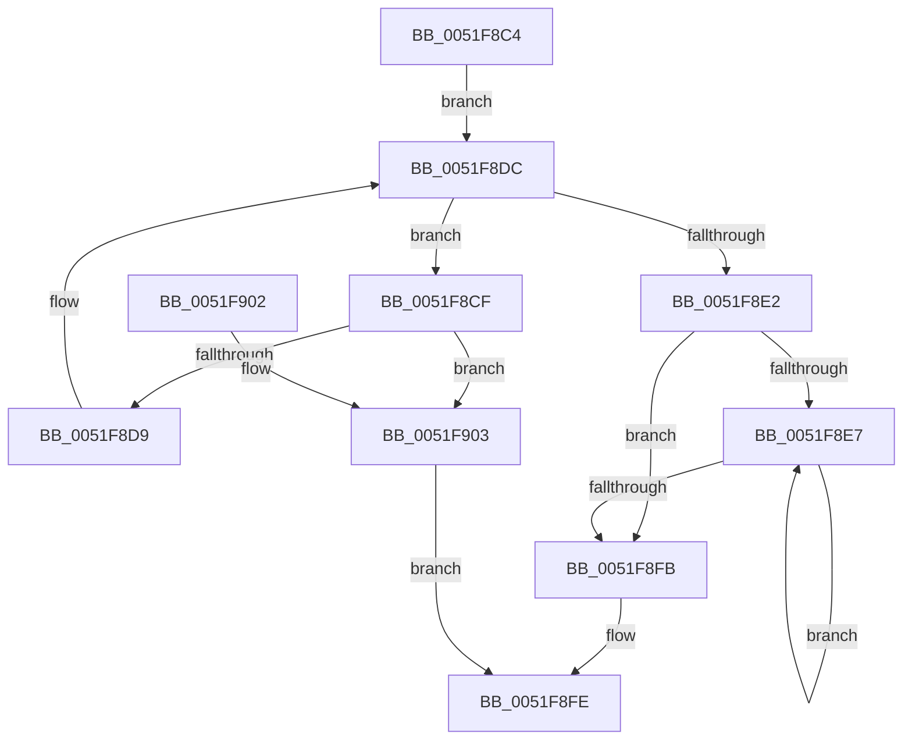

# SymCryptLoadMsbFirstUint64

- RVA: `0x0051F8C4`–`0x0051F90B` (길이 `71` bytes)
- VA: `0x000000014051F8C4`
- 실행 섹션: `.text`
- PDB 이름 있음: `예`; PDB Function 태그: `아니요`
- unwind 정보 RVA: `0x000DB714`
- 디코드: `25`개 명령, `71/71` bytes 표시
- 미해석 바이트: `0` (있으면 어셈블리에 `.byte`로 보존)

> 이 문서는 커널 이미지의 기계어와 PDB 기호를 분석해 생성했습니다. 4번과 5번은 함수 원형과 자료형을 바이너리 사용 방식에서 추정한 C 해석이며 원본 소스 복구 결과는 아닙니다.

## 1. Dependencies

- 직접 호출 지점: **0**; 고유 호출 대상: **0**
- 직접 호출자로 확인된 함수: **1**
- RIP 상대 이미지 참조: **0**

### Outgoing calls
- 직접 디코드된 call 명령이 없습니다.

### Direct callers
- [HashpVerifyPkcs1Signature](../../page/84/HashpVerifyPkcs1Signature_function_00841C68.md) at `0x00841DD1`

### Static image references
- 디코드된 RIP-relative 메모리 참조가 없습니다.

## 2. Other-region calls and transfers

- 다른 실행 섹션으로 향하는 call: **0**
- 별도 외부 분기/꼬리 이동을 확인하지 못했습니다.

## 3. Assembly (complete function range)

```asm
0051F8C4  45 33 C9                        xor r9d, r9d
0051F8C7  4C 8B D9                        mov r11, rcx
0051F8CA  45 8B D1                        mov r10d, r9d
0051F8CD  EB 0D                           jmp 0x14051f8dc
0051F8CF  41 8A 03                        mov al, byte ptr [r11]
0051F8D2  49 FF C3                        inc r11
0051F8D5  84 C0                           test al, al
0051F8D7  75 2A                           jne 0x14051f903
0051F8D9  48 FF CA                        dec rdx
0051F8DC  48 83 FA 08                     cmp rdx, 8
0051F8E0  77 ED                           ja 0x14051f8cf
0051F8E2  48 85 D2                        test rdx, rdx
0051F8E5  74 14                           je 0x14051f8fb
0051F8E7  41 0F B6 0B                     movzx ecx, byte ptr [r11]
0051F8EB  49 FF C3                        inc r11
0051F8EE  49 C1 E2 08                     shl r10, 8
0051F8F2  4C 0B D1                        or r10, rcx
0051F8F5  48 83 EA 01                     sub rdx, 1
0051F8F9  75 EC                           jne 0x14051f8e7
0051F8FB  4D 89 10                        mov qword ptr [r8], r10
0051F8FE  41 8B C1                        mov eax, r9d
0051F901  C3                              ret
0051F902  CC                              int3
0051F903  41 B9 12 80 00 00               mov r9d, 0x8012
0051F909  EB F3                           jmp 0x14051f8fe
```

## 4. C-style interpretation (structured pseudocode)

```c
__int64 __fastcall SymCryptLoadMsbFirstUint64(__int64 a1, __int64 a2, __int64 a3, int a4)
{
    __int64 v_r10;
    __int64 v_r11;

    a4 = 0;
    goto loc_0051F8DC;
loc_0051F8CF:
    v_r11 = (a1) + 1;
    if ((unsigned __int8)(*(unsigned __int8 *)(a1)) != 0) goto loc_0051F903;
    a2 = (a2) - 1;
loc_0051F8DC:
    if (a2 > 8) goto loc_0051F8CF;
    if (a2 == 0) goto loc_0051F8FB;
loc_0051F8E7:
    v_r11 = (v_r11) + 1;
    v_r10 = (0) << (8);
    v_r10 = (v_r10) | (*(unsigned __int8 *)(v_r11));
    a2 = (a2) - (1);
    if (condition_is_not_equal) goto loc_0051F8E7;
loc_0051F8FB:
    *(unsigned __int64 *)(a3) = v_r10;
loc_0051F8FE:
    return 0;
loc_0051F903:
    goto loc_0051F8FE;
}
```

## 5. (Beta) C Style

```c
int64_t SymCryptLoadMsbFirstUint64(int64_t Arg1, int64_t Arg2, void *Arg3, int32_t Arg4)
{
    uint8_t *arg3 = (uint8_t *)Arg3;

    int64_t local_r10;
    int64_t local_r11;

    Arg4 = 0;
    goto loc_0051F8DC;
loc_0051F8CF:
    local_r11 = (Arg1) + 1;
    if ((uint8_t)(*(uint8_t *)(Arg1)) != 0) goto loc_0051F903;
    Arg2 = (Arg2) - 1;
loc_0051F8DC:
    if (Arg2 > 8) goto loc_0051F8CF;
    if (Arg2 == 0) goto loc_0051F8FB;
loc_0051F8E7:
    local_r11 = (local_r11) + 1;
    local_r10 = (0) << (8);
    local_r10 = (local_r10) | (*(uint8_t *)(local_r11));
    Arg2 = (Arg2) - (1);
    if (condition_is_not_equal) goto loc_0051F8E7;
loc_0051F8FB:
    *(uint64_t *)(arg3) = local_r10;
loc_0051F8FE:
    return 0;
loc_0051F903:
    goto loc_0051F8FE;
}
```

### 관측된 메모리 오프셋

구조체 형식이 확인되지 않은 접근은 인자 기준의 오프셋으로만 기록했습니다.

| 기준 인자 | 오프셋 표현 | 폭 (bit) | 접근 |
|---|---:|---:|---|
| `Arg3` | `+ 0x0` | `64` | `W` |

## 6. Execution-region graph

[열기: 2D/3D 그래프와 함수 탐색 컨트롤 패널](../../../control-panel.html?section=text&rva=0x0051F8C4&view=graph)

- 2D 그래프는 위에서 아래로 흐르고, 3D 그래프는 빈 공간을 드래그해 회전합니다. Shift+드래그는 이동, 휠은 확대·축소, 함수 노드 선택은 대상 보고서 이동입니다.

### Static fallback


