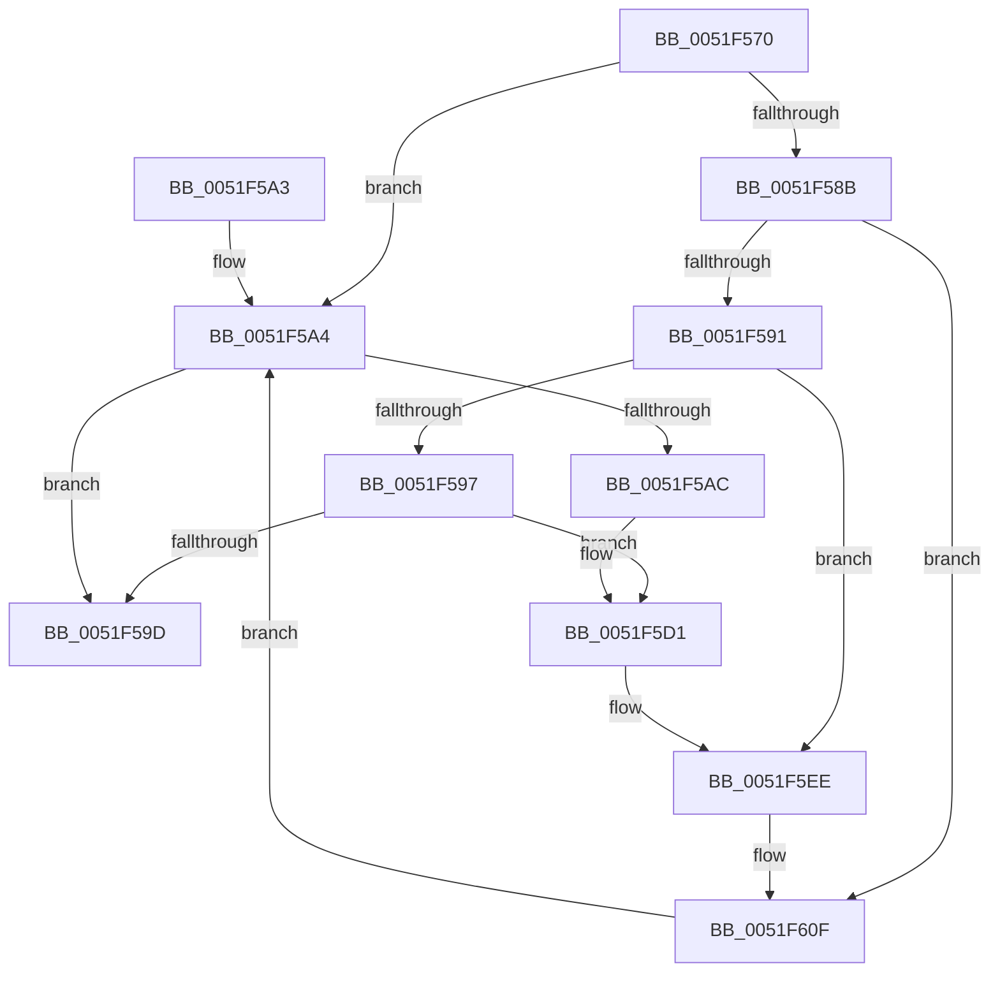

# SymCryptMarvin32AppendBlocks

- RVA: `0x0051F570`–`0x0051F631` (길이 `193` bytes)
- VA: `0x000000014051F570`
- 실행 섹션: `.text`
- PDB 이름 있음: `예`; PDB Function 태그: `아니요`
- unwind 정보 RVA: `0x000DB714`
- 디코드: `62`개 명령, `193/193` bytes 표시
- 미해석 바이트: `0` (있으면 어셈블리에 `.byte`로 보존)

> 이 문서는 커널 이미지의 기계어와 PDB 기호를 분석해 생성했습니다. 4번과 5번은 함수 원형과 자료형을 바이너리 사용 방식에서 추정한 C 해석이며 원본 소스 복구 결과는 아닙니다.

## 1. Dependencies

- 직접 호출 지점: **0**; 고유 호출 대상: **0**
- 직접 호출자로 확인된 함수: **2**
- RIP 상대 이미지 참조: **0**

### Outgoing calls
- 직접 디코드된 call 명령이 없습니다.

### Direct callers
- [SymCryptMarvin32Append](SymCryptMarvin32Append_function_0051F4AC.md) at `0x0051F50D`
- [SymCryptMarvin32Append](SymCryptMarvin32Append_function_0051F4AC.md) at `0x0051F52C`
- [SymCryptMarvin32Result](SymCryptMarvin32Result_function_0051F67C.md) at `0x0051F6AF`

### Static image references
- 디코드된 RIP-relative 메모리 참조가 없습니다.

## 2. Other-region calls and transfers

- 다른 실행 섹션으로 향하는 call: **0**
- 별도 외부 분기/꼬리 이동을 확인하지 못했습니다.

## 3. Assembly (complete function range)

```asm
0051F570  8B 01                           mov eax, dword ptr [rcx]
0051F572  4C 8D 59 04                     lea r11, [rcx + 4]
0051F576  45 8B 0B                        mov r9d, dword ptr [r11]
0051F579  4D 8B D0                        mov r10, r8
0051F57C  41 83 E2 0C                     and r10d, 0xc
0051F580  49 03 D2                        add rdx, r10
0051F583  4D 2B C2                        sub r8, r10
0051F586  4D 85 D2                        test r10, r10
0051F589  74 19                           je 0x14051f5a4
0051F58B  49 83 FA 04                     cmp r10, 4
0051F58F  74 7E                           je 0x14051f60f
0051F591  49 83 FA 08                     cmp r10, 8
0051F595  74 57                           je 0x14051f5ee
0051F597  49 83 FA 0C                     cmp r10, 0xc
0051F59B  74 34                           je 0x14051f5d1
0051F59D  89 01                           mov dword ptr [rcx], eax
0051F59F  45 89 0B                        mov dword ptr [r11], r9d
0051F5A2  C3                              ret
0051F5A3  CC                              int3
0051F5A4  4C 8B D2                        mov r10, rdx
0051F5A7  4D 85 C0                        test r8, r8
0051F5AA  74 F1                           je 0x14051f59d
0051F5AC  41 03 02                        add eax, dword ptr [r10]
0051F5AF  48 83 C2 10                     add rdx, 0x10
0051F5B3  44 33 C8                        xor r9d, eax
0051F5B6  49 83 E8 10                     sub r8, 0x10
0051F5BA  C1 C0 14                        rol eax, 0x14
0051F5BD  41 03 C1                        add eax, r9d
0051F5C0  41 C1 C1 09                     rol r9d, 9
0051F5C4  44 33 C8                        xor r9d, eax
0051F5C7  C1 C0 1B                        rol eax, 0x1b
0051F5CA  41 03 C1                        add eax, r9d
0051F5CD  41 C1 C1 13                     rol r9d, 0x13
0051F5D1  03 42 F4                        add eax, dword ptr [rdx - 0xc]
0051F5D4  44 33 C8                        xor r9d, eax
0051F5D7  C1 C0 14                        rol eax, 0x14
0051F5DA  41 03 C1                        add eax, r9d
0051F5DD  41 C1 C1 09                     rol r9d, 9
0051F5E1  44 33 C8                        xor r9d, eax
0051F5E4  C1 C0 1B                        rol eax, 0x1b
0051F5E7  41 03 C1                        add eax, r9d
0051F5EA  41 C1 C1 13                     rol r9d, 0x13
0051F5EE  03 42 F8                        add eax, dword ptr [rdx - 8]
0051F5F1  4C 8D 59 04                     lea r11, [rcx + 4]
0051F5F5  44 33 C8                        xor r9d, eax
0051F5F8  C1 C0 14                        rol eax, 0x14
0051F5FB  41 03 C1                        add eax, r9d
0051F5FE  41 C1 C1 09                     rol r9d, 9
0051F602  44 33 C8                        xor r9d, eax
0051F605  C1 C0 1B                        rol eax, 0x1b
0051F608  41 03 C1                        add eax, r9d
0051F60B  41 C1 C1 13                     rol r9d, 0x13
0051F60F  03 42 FC                        add eax, dword ptr [rdx - 4]
0051F612  44 33 C8                        xor r9d, eax
0051F615  C1 C0 14                        rol eax, 0x14
0051F618  41 03 C1                        add eax, r9d
0051F61B  41 C1 C1 09                     rol r9d, 9
0051F61F  44 33 C8                        xor r9d, eax
0051F622  C1 C0 1B                        rol eax, 0x1b
0051F625  41 03 C1                        add eax, r9d
0051F628  41 C1 C1 13                     rol r9d, 0x13
0051F62C  E9 73 FF FF FF                  jmp 0x14051f5a4
```

## 4. C-style interpretation (structured pseudocode)

```c
__int64 __fastcall SymCryptMarvin32AppendBlocks(__int64 a1, __int64 a2, __int64 a3)
{
    __int64 result;
    __int64 v_r10;

    v_r10 = (unsigned int)((a3) & (12));
    a2 = (a2) + (v_r10);
    a3 = (a3) - (v_r10);
    if (v_r10 == 0) goto loc_0051F5A4;
    if (v_r10 == 4) goto loc_0051F60F;
    if (v_r10 == 8) goto loc_0051F5EE;
    if (v_r10 == 12) goto loc_0051F5D1;
loc_0051F59D:
    *(unsigned int *)(a1) = (unsigned int)((unsigned int)(*(unsigned int *)(a1)));
    *(unsigned int *)(a1 + 4) = (unsigned int)((unsigned int)(*(unsigned int *)(a1 + 4)));
    return (unsigned int)(*(unsigned int *)(a1));
loc_0051F5A4:
    if (a3 == 0) goto loc_0051F59D;
    result = (unsigned int)(((unsigned int)(*(unsigned int *)(a1))) + (*(unsigned int *)(a2)));
    a2 = (a2) + (16);
    a4 = (unsigned int)(((unsigned int)(*(unsigned int *)(a1 + 4))) ^ ((unsigned int)(result)));
    a3 = (a3) - (16);
    result = (unsigned int)((result) + ((unsigned int)(a4)));
    a4 = (unsigned int)((a4) ^ ((unsigned int)(result)));
    result = (unsigned int)((result) + ((unsigned int)(a4)));
loc_0051F5D1:
    result = (unsigned int)((result) + (*(unsigned int *)(a2 - 12)));
    a4 = (unsigned int)((a4) ^ ((unsigned int)(result)));
    result = (unsigned int)((result) + ((unsigned int)(a4)));
    a4 = (unsigned int)((a4) ^ ((unsigned int)(result)));
    result = (unsigned int)((result) + ((unsigned int)(a4)));
loc_0051F5EE:
    result = (unsigned int)((result) + (*(unsigned int *)(a2 - 8)));
    a4 = (unsigned int)((a4) ^ ((unsigned int)(result)));
    result = (unsigned int)((result) + ((unsigned int)(a4)));
    a4 = (unsigned int)((a4) ^ ((unsigned int)(result)));
    result = (unsigned int)((result) + ((unsigned int)(a4)));
loc_0051F60F:
    result = (unsigned int)((result) + (*(unsigned int *)(a2 - 4)));
    a4 = (unsigned int)((a4) ^ ((unsigned int)(result)));
    result = (unsigned int)((result) + ((unsigned int)(a4)));
    a4 = (unsigned int)((a4) ^ ((unsigned int)(result)));
    result = (unsigned int)((result) + ((unsigned int)(a4)));
    goto loc_0051F5A4;
}
```

## 5. (Beta) C Style

```c
int64_t SymCryptMarvin32AppendBlocks(void *Arg1, void *Arg2, int64_t Arg3)
{
    uint8_t *arg1 = (uint8_t *)Arg1;
    uint8_t *arg2 = (uint8_t *)Arg2;

    int64_t result;
    int64_t local_r10;

    local_r10 = (uint32_t)((Arg3) & (12));
    Arg2 = (Arg2) + (local_r10);
    Arg3 = (Arg3) - (local_r10);
    if (local_r10 == 0) goto loc_0051F5A4;
    if (local_r10 == 4) goto loc_0051F60F;
    if (local_r10 == 8) goto loc_0051F5EE;
    if (local_r10 == 12) goto loc_0051F5D1;
loc_0051F59D:
    *(uint32_t *)(arg1) = (uint32_t)((uint32_t)(*(uint32_t *)(arg1)));
    *(uint32_t *)(arg1 + 0x4) = (uint32_t)((uint32_t)(*(uint32_t *)(arg1 + 0x4)));
    return (uint32_t)(*(uint32_t *)(arg1));
loc_0051F5A4:
    if (Arg3 == 0) goto loc_0051F59D;
    result = (uint32_t)(((uint32_t)(*(uint32_t *)(arg1))) + (*(uint32_t *)(arg2)));
    Arg2 = (Arg2) + (16);
    a4 = (uint32_t)(((uint32_t)(*(uint32_t *)(arg1 + 0x4))) ^ ((uint32_t)(result)));
    Arg3 = (Arg3) - (16);
    result = (uint32_t)((result) + ((uint32_t)(a4)));
    a4 = (uint32_t)((a4) ^ ((uint32_t)(result)));
    result = (uint32_t)((result) + ((uint32_t)(a4)));
loc_0051F5D1:
    result = (uint32_t)((result) + (*(uint32_t *)(arg2 - 0xC)));
    a4 = (uint32_t)((a4) ^ ((uint32_t)(result)));
    result = (uint32_t)((result) + ((uint32_t)(a4)));
    a4 = (uint32_t)((a4) ^ ((uint32_t)(result)));
    result = (uint32_t)((result) + ((uint32_t)(a4)));
loc_0051F5EE:
    result = (uint32_t)((result) + (*(uint32_t *)(arg2 - 0x8)));
    a4 = (uint32_t)((a4) ^ ((uint32_t)(result)));
    result = (uint32_t)((result) + ((uint32_t)(a4)));
    a4 = (uint32_t)((a4) ^ ((uint32_t)(result)));
    result = (uint32_t)((result) + ((uint32_t)(a4)));
loc_0051F60F:
    result = (uint32_t)((result) + (*(uint32_t *)(arg2 - 0x4)));
    a4 = (uint32_t)((a4) ^ ((uint32_t)(result)));
    result = (uint32_t)((result) + ((uint32_t)(a4)));
    a4 = (uint32_t)((a4) ^ ((uint32_t)(result)));
    result = (uint32_t)((result) + ((uint32_t)(a4)));
    goto loc_0051F5A4;
}
```

### 관측된 메모리 오프셋

구조체 형식이 확인되지 않은 접근은 인자 기준의 오프셋으로만 기록했습니다.

| 기준 인자 | 오프셋 표현 | 폭 (bit) | 접근 |
|---|---:|---:|---|
| `Arg1` | `+ 0x0` | `32` | `R` |
| `Arg1` | `+ 0x0` | `32` | `W` |
| `Arg1` | `+ 0x4` | `64` | `R` |
| `Arg2` | `- 0xC` | `32` | `R` |
| `Arg2` | `- 0x8` | `32` | `R` |
| `Arg2` | `- 0x4` | `32` | `R` |
| `Arg2` | `+ 0x0` | `32` | `R` |

## 6. Execution-region graph

[열기: 2D/3D 그래프와 함수 탐색 컨트롤 패널](../../../control-panel.html?section=text&rva=0x0051F570&view=graph)

- 2D 그래프는 위에서 아래로 흐르고, 3D 그래프는 빈 공간을 드래그해 회전합니다. Shift+드래그는 이동, 휠은 확대·축소, 함수 노드 선택은 대상 보고서 이동입니다.

### Static fallback


