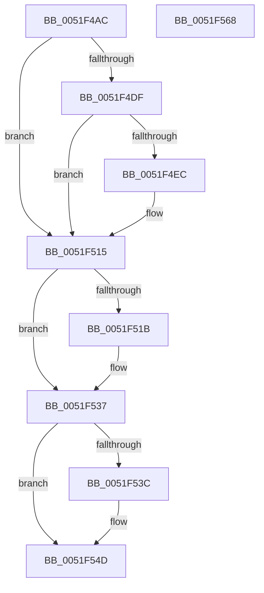

# SymCryptMarvin32Append

- RVA: `0x0051F4AC`–`0x0051F569` (길이 `189` bytes)
- VA: `0x000000014051F4AC`
- 실행 섹션: `.text`
- PDB 이름 있음: `예`; PDB Function 태그: `아니요`
- unwind 정보 RVA: `0x0005E6B4`
- 디코드: `55`개 명령, `189/189` bytes 표시
- 미해석 바이트: `0` (있으면 어셈블리에 `.byte`로 보존)

> 이 문서는 커널 이미지의 기계어와 PDB 기호를 분석해 생성했습니다. 4번과 5번은 함수 원형과 자료형을 바이너리 사용 방식에서 추정한 C 해석이며 원본 소스 복구 결과는 아닙니다.

## 1. Dependencies

- 직접 호출 지점: **4**; 고유 호출 대상: **2**
- 직접 호출자로 확인된 함수: **2**
- RIP 상대 이미지 참조: **0**

### Outgoing calls
- `0x0051F4F5` → [memcpy](../6C/memcpy_function_006C6840.md) (function, `0x006C6840`)
- `0x0051F50D` → [SymCryptMarvin32AppendBlocks](SymCryptMarvin32AppendBlocks_function_0051F570.md) (function, `0x0051F570`)
- `0x0051F52C` → [SymCryptMarvin32AppendBlocks](SymCryptMarvin32AppendBlocks_function_0051F570.md) (function, `0x0051F570`)
- `0x0051F548` → [memcpy](../6C/memcpy_function_006C6840.md) (function, `0x006C6840`)

### Direct callers
- [HvpGenerateLogEntryChecksums](../../page/9B/HvpGenerateLogEntryChecksums_function_009B6A5C.md) at `0x009B6ADD`
- [sub_00B2DE10](../../page/B2/Unknown_function_00B2DE10.md) at `0x00B2DE1C`

### Static image references
- 디코드된 RIP-relative 메모리 참조가 없습니다.

## 2. Other-region calls and transfers

- 다른 실행 섹션으로 향하는 call: **0**
- 별도 외부 분기/꼬리 이동을 확인하지 못했습니다.

## 3. Assembly (complete function range)

```asm
0051F4AC  48 8B C4                        mov rax, rsp
0051F4AF  48 89 58 08                     mov qword ptr [rax + 8], rbx
0051F4B3  48 89 68 10                     mov qword ptr [rax + 0x10], rbp
0051F4B7  48 89 70 18                     mov qword ptr [rax + 0x18], rsi
0051F4BB  48 89 78 20                     mov qword ptr [rax + 0x20], rdi
0051F4BF  41 56                           push r14
0051F4C1  48 83 EC 20                     sub rsp, 0x20
0051F4C5  44 8B 71 28                     mov r14d, dword ptr [rcx + 0x28]
0051F4C9  49 8B F8                        mov rdi, r8
0051F4CC  48 8B F2                        mov rsi, rdx
0051F4CF  48 8B E9                        mov rbp, rcx
0051F4D2  43 8D 04 06                     lea eax, [r14 + r8]
0051F4D6  89 41 28                        mov dword ptr [rcx + 0x28], eax
0051F4D9  41 83 E6 03                     and r14d, 3
0051F4DD  76 36                           jbe 0x14051f515
0051F4DF  BB 04 00 00 00                  mov ebx, 4
0051F4E4  41 2B DE                        sub ebx, r14d
0051F4E7  4C 3B C3                        cmp r8, rbx
0051F4EA  72 29                           jb 0x14051f515
0051F4EC  41 8B CE                        mov ecx, r14d
0051F4EF  44 8B C3                        mov r8d, ebx
0051F4F2  48 03 CD                        add rcx, rbp
0051F4F5  E8 46 73 1A 00                  call 0x1406c6840
0051F4FA  48 8D 4D 10                     lea rcx, [rbp + 0x10]
0051F4FE  41 B8 04 00 00 00               mov r8d, 4
0051F504  48 8B D5                        mov rdx, rbp
0051F507  48 03 F3                        add rsi, rbx
0051F50A  48 2B FB                        sub rdi, rbx
0051F50D  E8 5E 00 00 00                  call 0x14051f570
0051F512  45 33 F6                        xor r14d, r14d
0051F515  48 83 FF 04                     cmp rdi, 4
0051F519  72 1C                           jb 0x14051f537
0051F51B  48 8B DF                        mov rbx, rdi
0051F51E  48 8D 4D 10                     lea rcx, [rbp + 0x10]
0051F522  48 83 E3 FC                     and rbx, 0xfffffffffffffffc
0051F526  48 8B D6                        mov rdx, rsi
0051F529  4C 8B C3                        mov r8, rbx
0051F52C  E8 3F 00 00 00                  call 0x14051f570
0051F531  48 03 F3                        add rsi, rbx
0051F534  48 2B FB                        sub rdi, rbx
0051F537  48 85 FF                        test rdi, rdi
0051F53A  74 11                           je 0x14051f54d
0051F53C  41 8B CE                        mov ecx, r14d
0051F53F  4C 8B C7                        mov r8, rdi
0051F542  48 03 CD                        add rcx, rbp
0051F545  48 8B D6                        mov rdx, rsi
0051F548  E8 F3 72 1A 00                  call 0x1406c6840
0051F54D  48 8B 5C 24 30                  mov rbx, qword ptr [rsp + 0x30]
0051F552  48 8B 6C 24 38                  mov rbp, qword ptr [rsp + 0x38]
0051F557  48 8B 74 24 40                  mov rsi, qword ptr [rsp + 0x40]
0051F55C  48 8B 7C 24 48                  mov rdi, qword ptr [rsp + 0x48]
0051F561  48 83 C4 20                     add rsp, 0x20
0051F565  41 5E                           pop r14
0051F567  C3                              ret
0051F568  CC                              int3
```

## 4. C-style interpretation (structured pseudocode)

```c
__int64 __fastcall SymCryptMarvin32Append(__int64 a1, __int64 a2, __int64 a3)
{
    __int64 result;
    __int64 v_r14;
    __int64 v_rbx;
    __int64 v_rdi;
    __int64 v_rsi;
    __int64 v_rsp;
    unsigned __int64 v_stack_p10;
    unsigned __int64 v_stack_p18;
    unsigned __int64 v_stack_p20;
    unsigned __int64 v_stack_p8;

    *(unsigned __int64 *)(v_rsp + 8) = v_rbx;
    *(unsigned __int64 *)(v_rsp + 16) = v_rbp;
    *(unsigned __int64 *)(v_rsp + 24) = v_rsi;
    *(unsigned __int64 *)(v_rsp + 32) = v_rdi;
    v_rsp = (v_rsp) - (32);
    *(unsigned int *)(a1 + 40) = (unsigned int)((unsigned int)(*(unsigned int *)(a1 + 40)) + a3 * 1);
    v_r14 = (unsigned int)(((unsigned int)(*(unsigned int *)(a1 + 40))) & (3));
    if (condition_is_below_or_equal) goto loc_0051F515;
    v_rbx = (unsigned int)((4) - ((unsigned int)(v_r14)));
    result = (unsigned int)(*(unsigned int *)(a1 + 40)) + a3 * 1;
    v_rsi = a2;
    v_rdi = a3;
    if (a3 >= v_rbx) {
        a1 = (unsigned int)(v_r14);
        a3 = (unsigned int)(v_rbx);
        a1 = (a1) + (a1);
        result = memcpy(a1, a2, a3, a4);
        a1 = a1 + 16;
        a3 = 4;
        a2 = a1;
        v_rsi = (a2) + (v_rbx);
        v_rdi = (a3) - (v_rbx);
        result = SymCryptMarvin32AppendBlocks(a1, a2, a3, a4);
        v_r14 = 0;
    }
    if (v_rdi >= 4) {
        v_rbx = v_rdi;
        a1 = a1 + 16;
        v_rbx = (v_rbx) & (-4);
        a2 = v_rsi;
        a3 = v_rbx;
        result = SymCryptMarvin32AppendBlocks(a1, a2, a3, a4);
        v_rsi = (v_rsi) + (v_rbx);
        v_rdi = (v_rdi) - (v_rbx);
    }
    if (v_rdi != 0) {
        a1 = 0;
        a3 = v_rdi;
        a1 = (a1) + (a1);
        a2 = v_rsi;
        result = memcpy(a1, a2, a3, a4);
    }
    v_rsp = (v_rsp) + (32);
    return result;
}
```

## 5. (Beta) C Style

```c
int64_t SymCryptMarvin32Append(void *Arg1, int64_t Arg2, int64_t Arg3)
{
    uint8_t *arg1 = (uint8_t *)Arg1;

    int64_t result;
    int64_t local_r14;
    int64_t local_rbx;
    int64_t local_rdi;
    int64_t local_rsi;
    int64_t local_rsp;
    uint64_t v_stack_p10;
    uint64_t v_stack_p18;
    uint64_t v_stack_p20;
    uint64_t v_stack_p8;

    *(uint64_t *)(local_rsp + 0x8) = local_rbx;
    *(uint64_t *)(local_rsp + 0x10) = local_rbp;
    *(uint64_t *)(local_rsp + 0x18) = local_rsi;
    *(uint64_t *)(local_rsp + 0x20) = local_rdi;
    local_rsp = (local_rsp) - (32);
    *(uint32_t *)(arg1 + 0x28) = (uint32_t)((uint32_t)(*(uint32_t *)(arg1 + 0x28)) + Arg3 * 1);
    local_r14 = (uint32_t)(((uint32_t)(*(uint32_t *)(arg1 + 0x28))) & (3));
    if (condition_is_below_or_equal) goto loc_0051F515;
    local_rbx = (uint32_t)((4) - ((uint32_t)(local_r14)));
    result = (uint32_t)(*(uint32_t *)(arg1 + 0x28)) + Arg3 * 1;
    local_rsi = Arg2;
    local_rdi = Arg3;
    if (Arg3 >= local_rbx) {
        Arg1 = (uint32_t)(local_r14);
        Arg3 = (uint32_t)(local_rbx);
        Arg1 = (Arg1) + (Arg1);
        result = memcpy(Arg1, Arg2, Arg3, a4);
        Arg1 = Arg1 + 16;
        Arg3 = 4;
        Arg2 = Arg1;
        local_rsi = (Arg2) + (local_rbx);
        local_rdi = (Arg3) - (local_rbx);
        result = SymCryptMarvin32AppendBlocks(Arg1, Arg2, Arg3, a4);
        local_r14 = 0;
    }
    if (local_rdi >= 4) {
        local_rbx = local_rdi;
        Arg1 = Arg1 + 16;
        local_rbx = (local_rbx) & (-4);
        Arg2 = local_rsi;
        Arg3 = local_rbx;
        result = SymCryptMarvin32AppendBlocks(Arg1, Arg2, Arg3, a4);
        local_rsi = (local_rsi) + (local_rbx);
        local_rdi = (local_rdi) - (local_rbx);
    }
    if (local_rdi != 0) {
        Arg1 = 0;
        Arg3 = local_rdi;
        Arg1 = (Arg1) + (Arg1);
        Arg2 = local_rsi;
        result = memcpy(Arg1, Arg2, Arg3, a4);
    }
    local_rsp = (local_rsp) + (32);
    return result;
}
```

### 관측된 메모리 오프셋

구조체 형식이 확인되지 않은 접근은 인자 기준의 오프셋으로만 기록했습니다.

| 기준 인자 | 오프셋 표현 | 폭 (bit) | 접근 |
|---|---:|---:|---|
| `Arg1` | `+ 0x10` | `64` | `R` |
| `Arg1` | `+ 0x28` | `32` | `R` |
| `Arg1` | `+ 0x28` | `32` | `W` |

## 6. Execution-region graph

[열기: 2D/3D 그래프와 함수 탐색 컨트롤 패널](../../../control-panel.html?section=text&rva=0x0051F4AC&view=graph)

- 2D 그래프는 위에서 아래로 흐르고, 3D 그래프는 빈 공간을 드래그해 회전합니다. Shift+드래그는 이동, 휠은 확대·축소, 함수 노드 선택은 대상 보고서 이동입니다.

### Static fallback


