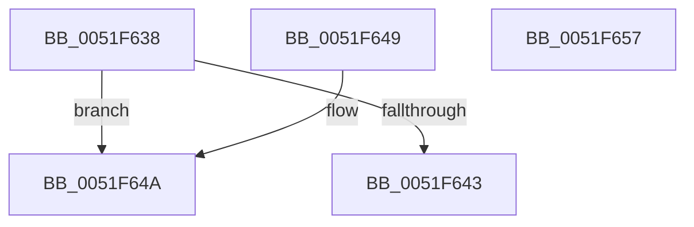

# SymCryptMarvin32ExpandSeed

- RVA: `0x0051F638`–`0x0051F658` (길이 `32` bytes)
- VA: `0x000000014051F638`
- 실행 섹션: `.text`
- PDB 이름 있음: `예`; PDB Function 태그: `아니요`
- unwind 정보 RVA: `0x000DB714`
- 디코드: `13`개 명령, `32/32` bytes 표시
- 미해석 바이트: `0` (있으면 어셈블리에 `.byte`로 보존)

> 이 문서는 커널 이미지의 기계어와 PDB 기호를 분석해 생성했습니다. 4번과 5번은 함수 원형과 자료형을 바이너리 사용 방식에서 추정한 C 해석이며 원본 소스 복구 결과는 아닙니다.

## 1. Dependencies

- 직접 호출 지점: **0**; 고유 호출 대상: **0**
- 직접 호출자로 확인된 함수: **1**
- RIP 상대 이미지 참조: **0**

### Outgoing calls
- 직접 디코드된 call 명령이 없습니다.

### Direct callers
- [HvInitializeHashLibrary](../../page/7E/HvInitializeHashLibrary_function_007EDC44.md) at `0x007EDC6E`

### Static image references
- 디코드된 RIP-relative 메모리 참조가 없습니다.

## 2. Other-region calls and transfers

- 다른 실행 섹션으로 향하는 call: **0**
- 별도 외부 분기/꼬리 이동을 확인하지 못했습니다.

## 3. Assembly (complete function range)

```asm
0051F638  33 C0                           xor eax, eax
0051F63A  4C 8B C9                        mov r9, rcx
0051F63D  49 83 F8 08                     cmp r8, 8
0051F641  74 07                           je 0x14051f64a
0051F643  B8 01 80 00 00                  mov eax, 0x8001
0051F648  C3                              ret
0051F649  CC                              int3
0051F64A  8B 0A                           mov ecx, dword ptr [rdx]
0051F64C  41 89 09                        mov dword ptr [r9], ecx
0051F64F  8B 4A 04                        mov ecx, dword ptr [rdx + 4]
0051F652  41 89 49 04                     mov dword ptr [r9 + 4], ecx
0051F656  C3                              ret
0051F657  CC                              int3
```

## 4. C-style interpretation (structured pseudocode)

```c
__int64 __fastcall SymCryptMarvin32ExpandSeed(__int64 a1, __int64 a2, __int64 a3)
{
    __int64 result;

    result = 0;
    if (a3 == 8) goto loc_0051F64A;
    return (unsigned int)(0x8001ULL);
loc_0051F64A:
    *(unsigned int *)(a1) = (unsigned int)((unsigned int)(*(unsigned int *)(a2)));
    *(unsigned int *)(a1 + 4) = (unsigned int)((unsigned int)(*(unsigned int *)(a2 + 4)));
    return (unsigned int)(0x8001ULL);
}
```

## 5. (Beta) C Style

```c
int64_t SymCryptMarvin32ExpandSeed(void *Arg1, void *Arg2, int64_t Arg3)
{
    uint8_t *arg1 = (uint8_t *)Arg1;
    uint8_t *arg2 = (uint8_t *)Arg2;

    int64_t result;

    result = 0;
    if (Arg3 == 8) goto loc_0051F64A;
    return (uint32_t)(0x8001ULL);
loc_0051F64A:
    *(uint32_t *)(arg1) = (uint32_t)((uint32_t)(*(uint32_t *)(arg2)));
    *(uint32_t *)(arg1 + 0x4) = (uint32_t)((uint32_t)(*(uint32_t *)(arg2 + 0x4)));
    return (uint32_t)(0x8001ULL);
}
```

### 관측된 메모리 오프셋

구조체 형식이 확인되지 않은 접근은 인자 기준의 오프셋으로만 기록했습니다.

| 기준 인자 | 오프셋 표현 | 폭 (bit) | 접근 |
|---|---:|---:|---|
| `Arg1` | `+ 0x0` | `32` | `W` |
| `Arg1` | `+ 0x4` | `32` | `W` |
| `Arg2` | `+ 0x0` | `32` | `R` |
| `Arg2` | `+ 0x4` | `32` | `R` |

## 6. Execution-region graph

[열기: 2D/3D 그래프와 함수 탐색 컨트롤 패널](../../../control-panel.html?section=text&rva=0x0051F638&view=graph)

- 2D 그래프는 위에서 아래로 흐르고, 3D 그래프는 빈 공간을 드래그해 회전합니다. Shift+드래그는 이동, 휠은 확대·축소, 함수 노드 선택은 대상 보고서 이동입니다.

### Static fallback


