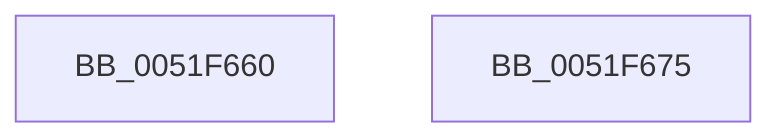

# SymCryptMarvin32Init

- RVA: `0x0051F660`–`0x0051F676` (길이 `22` bytes)
- VA: `0x000000014051F660`
- 실행 섹션: `.text`
- PDB 이름 있음: `예`; PDB Function 태그: `아니요`
- unwind 정보 RVA: `0x000DB714`
- 디코드: `7`개 명령, `22/22` bytes 표시
- 미해석 바이트: `0` (있으면 어셈블리에 `.byte`로 보존)

> 이 문서는 커널 이미지의 기계어와 PDB 기호를 분석해 생성했습니다. 4번과 5번은 함수 원형과 자료형을 바이너리 사용 방식에서 추정한 C 해석이며 원본 소스 복구 결과는 아닙니다.

## 1. Dependencies

- 직접 호출 지점: **0**; 고유 호출 대상: **0**
- 직접 호출자로 확인된 함수: **1**
- RIP 상대 이미지 참조: **0**

### Outgoing calls
- 직접 디코드된 call 명령이 없습니다.

### Direct callers
- [HvpGenerateLogEntryChecksums](../../page/9B/HvpGenerateLogEntryChecksums_function_009B6A5C.md) at `0x009B6ABC`

### Static image references
- 디코드된 RIP-relative 메모리 참조가 없습니다.

## 2. Other-region calls and transfers

- 다른 실행 섹션으로 향하는 call: **0**
- 별도 외부 분기/꼬리 이동을 확인하지 못했습니다.

## 3. Assembly (complete function range)

```asm
0051F660  0F 28 02                        movaps xmm0, xmmword ptr [rdx]
0051F663  83 61 28 00                     and dword ptr [rcx + 0x28], 0
0051F667  F3 0F 7F 41 10                  movdqu xmmword ptr [rcx + 0x10], xmm0
0051F66C  83 61 04 00                     and dword ptr [rcx + 4], 0
0051F670  48 89 51 20                     mov qword ptr [rcx + 0x20], rdx
0051F674  C3                              ret
0051F675  CC                              int3
```

## 4. C-style interpretation (structured pseudocode)

```c
void __fastcall SymCryptMarvin32Init(__int64 a1, __int64 a2)
{
    *(unsigned __int64 *)(a1 + 16) = v_xmm0;
    *(unsigned __int64 *)(a1 + 32) = a2;
    return;
}
```

## 5. (Beta) C Style

```c
void SymCryptMarvin32Init(void *Arg1, void *Arg2)
{
    uint8_t *arg1 = (uint8_t *)Arg1;
    uint8_t *arg2 = (uint8_t *)Arg2;

    *(uint64_t *)(arg1 + 0x10) = v_xmm0;
    *(void **)(arg1 + 0x20) = Arg2;
    return;
}
```

### 관측된 메모리 오프셋

구조체 형식이 확인되지 않은 접근은 인자 기준의 오프셋으로만 기록했습니다.

| 기준 인자 | 오프셋 표현 | 폭 (bit) | 접근 |
|---|---:|---:|---|
| `Arg1` | `+ 0x4` | `32` | `R/W` |
| `Arg1` | `+ 0x10` | `128` | `W` |
| `Arg1` | `+ 0x20` | `64` | `W` |
| `Arg1` | `+ 0x28` | `32` | `R/W` |
| `Arg2` | `+ 0x0` | `128` | `R` |

## 6. Execution-region graph

[열기: 2D/3D 그래프와 함수 탐색 컨트롤 패널](../../../control-panel.html?section=text&rva=0x0051F660&view=graph)

- 2D 그래프는 위에서 아래로 흐르고, 3D 그래프는 빈 공간을 드래그해 회전합니다. Shift+드래그는 이동, 휠은 확대·축소, 함수 노드 선택은 대상 보고서 이동입니다.

### Static fallback


