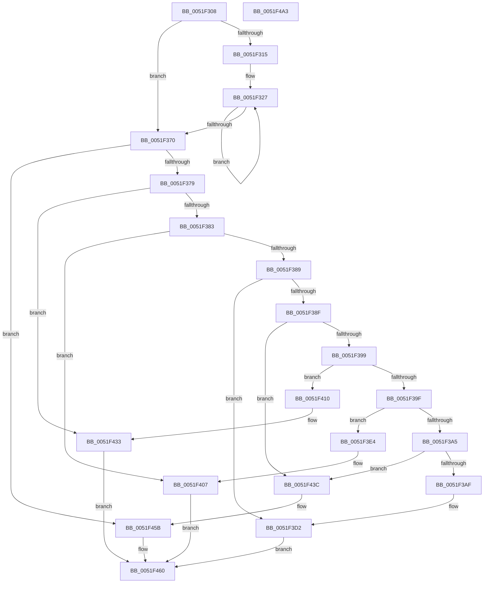

# SymCryptMarvin32

- RVA: `0x0051F308`–`0x0051F4A4` (길이 `412` bytes)
- VA: `0x000000014051F308`
- 실행 섹션: `.text`
- PDB 이름 있음: `예`; PDB Function 태그: `아니요`
- unwind 정보 RVA: `0x000DB714`
- 디코드: `119`개 명령, `412/412` bytes 표시
- 미해석 바이트: `0` (있으면 어셈블리에 `.byte`로 보존)

> 이 문서는 커널 이미지의 기계어와 PDB 기호를 분석해 생성했습니다. 4번과 5번은 함수 원형과 자료형을 바이너리 사용 방식에서 추정한 C 해석이며 원본 소스 복구 결과는 아닙니다.

## 1. Dependencies

- 직접 호출 지점: **0**; 고유 호출 대상: **0**
- 직접 호출자로 확인된 함수: **3**
- RIP 상대 이미지 참조: **0**

### Outgoing calls
- 직접 디코드된 call 명령이 없습니다.

### Direct callers
- [HvpGenerateLogEntryChecksums](../../page/9B/HvpGenerateLogEntryChecksums_function_009B6A5C.md) at `0x009B6B09`
- [HvpLogEntryCheckHeaderChecksum](../../page/AB/HvpLogEntryCheckHeaderChecksum_function_00ABEA18.md) at `0x00ABEA51`
- [HvpLogEntryCheckDataChecksum](../../page/AC/HvpLogEntryCheckDataChecksum_function_00AC5BD8.md) at `0x00AC5C04`

### Static image references
- 디코드된 RIP-relative 메모리 참조가 없습니다.

## 2. Other-region calls and transfers

- 다른 실행 섹션으로 향하는 call: **0**
- 별도 외부 분기/꼬리 이동을 확인하지 못했습니다.

## 3. Assembly (complete function range)

```asm
0051F308  44 8B 11                        mov r10d, dword ptr [rcx]
0051F30B  44 8B 59 04                     mov r11d, dword ptr [rcx + 4]
0051F30F  49 83 F8 07                     cmp r8, 7
0051F313  76 5B                           jbe 0x14051f370
0051F315  49 8D 48 F8                     lea rcx, [r8 - 8]
0051F319  48 C1 E9 03                     shr rcx, 3
0051F31D  48 FF C1                        inc rcx
0051F320  48 6B C1 F8                     imul rax, rcx, -8
0051F324  4C 03 C0                        add r8, rax
0051F327  44 03 12                        add r10d, dword ptr [rdx]
0051F32A  45 33 DA                        xor r11d, r10d
0051F32D  41 C1 C2 14                     rol r10d, 0x14
0051F331  45 03 D3                        add r10d, r11d
0051F334  41 C1 C3 09                     rol r11d, 9
0051F338  45 33 DA                        xor r11d, r10d
0051F33B  41 C1 C2 1B                     rol r10d, 0x1b
0051F33F  44 03 52 04                     add r10d, dword ptr [rdx + 4]
0051F343  48 83 C2 08                     add rdx, 8
0051F347  45 03 D3                        add r10d, r11d
0051F34A  41 C1 C3 13                     rol r11d, 0x13
0051F34E  45 33 DA                        xor r11d, r10d
0051F351  41 C1 C2 14                     rol r10d, 0x14
0051F355  45 03 D3                        add r10d, r11d
0051F358  41 C1 C3 09                     rol r11d, 9
0051F35C  45 33 DA                        xor r11d, r10d
0051F35F  41 C1 C2 1B                     rol r10d, 0x1b
0051F363  45 03 D3                        add r10d, r11d
0051F366  41 C1 C3 13                     rol r11d, 0x13
0051F36A  48 83 E9 01                     sub rcx, 1
0051F36E  75 B7                           jne 0x14051f327
0051F370  4D 85 C0                        test r8, r8
0051F373  0F 84 E2 00 00 00               je 0x14051f45b
0051F379  49 83 E8 01                     sub r8, 1
0051F37D  0F 84 B0 00 00 00               je 0x14051f433
0051F383  49 83 E8 01                     sub r8, 1
0051F387  74 7E                           je 0x14051f407
0051F389  49 83 E8 01                     sub r8, 1
0051F38D  74 43                           je 0x14051f3d2
0051F38F  49 83 E8 01                     sub r8, 1
0051F393  0F 84 A3 00 00 00               je 0x14051f43c
0051F399  49 83 E8 01                     sub r8, 1
0051F39D  74 71                           je 0x14051f410
0051F39F  49 83 E8 01                     sub r8, 1
0051F3A3  74 3F                           je 0x14051f3e4
0051F3A5  49 83 F8 01                     cmp r8, 1
0051F3A9  0F 85 8D 00 00 00               jne 0x14051f43c
0051F3AF  44 03 12                        add r10d, dword ptr [rdx]
0051F3B2  45 33 DA                        xor r11d, r10d
0051F3B5  41 C1 C2 14                     rol r10d, 0x14
0051F3B9  45 03 D3                        add r10d, r11d
0051F3BC  41 C1 C3 09                     rol r11d, 9
0051F3C0  45 33 DA                        xor r11d, r10d
0051F3C3  41 C1 C2 1B                     rol r10d, 0x1b
0051F3C7  45 03 D3                        add r10d, r11d
0051F3CA  41 C1 C3 13                     rol r11d, 0x13
0051F3CE  48 83 C2 04                     add rdx, 4
0051F3D2  0F B6 4A 02                     movzx ecx, byte ptr [rdx + 2]
0051F3D6  0F B7 02                        movzx eax, word ptr [rdx]
0051F3D9  C1 E1 10                        shl ecx, 0x10
0051F3DC  0B C8                           or ecx, eax
0051F3DE  0F BA E9 1F                     bts ecx, 0x1f
0051F3E2  EB 7C                           jmp 0x14051f460
0051F3E4  44 03 12                        add r10d, dword ptr [rdx]
0051F3E7  45 33 DA                        xor r11d, r10d
0051F3EA  41 C1 C2 14                     rol r10d, 0x14
0051F3EE  45 03 D3                        add r10d, r11d
0051F3F1  41 C1 C3 09                     rol r11d, 9
0051F3F5  45 33 DA                        xor r11d, r10d
0051F3F8  41 C1 C2 1B                     rol r10d, 0x1b
0051F3FC  45 03 D3                        add r10d, r11d
0051F3FF  41 C1 C3 13                     rol r11d, 0x13
0051F403  48 83 C2 04                     add rdx, 4
0051F407  0F B7 0A                        movzx ecx, word ptr [rdx]
0051F40A  0F BA E9 17                     bts ecx, 0x17
0051F40E  EB 50                           jmp 0x14051f460
0051F410  44 03 12                        add r10d, dword ptr [rdx]
0051F413  45 33 DA                        xor r11d, r10d
0051F416  41 C1 C2 14                     rol r10d, 0x14
0051F41A  45 03 D3                        add r10d, r11d
0051F41D  41 C1 C3 09                     rol r11d, 9
0051F421  45 33 DA                        xor r11d, r10d
0051F424  41 C1 C2 1B                     rol r10d, 0x1b
0051F428  45 03 D3                        add r10d, r11d
0051F42B  41 C1 C3 13                     rol r11d, 0x13
0051F42F  48 83 C2 04                     add rdx, 4
0051F433  0F B6 0A                        movzx ecx, byte ptr [rdx]
0051F436  0F BA E9 0F                     bts ecx, 0xf
0051F43A  EB 24                           jmp 0x14051f460
0051F43C  44 03 12                        add r10d, dword ptr [rdx]
0051F43F  45 33 DA                        xor r11d, r10d
0051F442  41 C1 C2 14                     rol r10d, 0x14
0051F446  45 03 D3                        add r10d, r11d
0051F449  41 C1 C3 09                     rol r11d, 9
0051F44D  45 33 DA                        xor r11d, r10d
0051F450  41 C1 C2 1B                     rol r10d, 0x1b
0051F454  45 03 D3                        add r10d, r11d
0051F457  41 C1 C3 13                     rol r11d, 0x13
0051F45B  B9 80 00 00 00                  mov ecx, 0x80
0051F460  44 03 D1                        add r10d, ecx
0051F463  45 33 DA                        xor r11d, r10d
0051F466  41 C1 C2 14                     rol r10d, 0x14
0051F46A  45 03 D3                        add r10d, r11d
0051F46D  41 C1 C3 09                     rol r11d, 9
0051F471  45 33 DA                        xor r11d, r10d
0051F474  41 C1 C2 1B                     rol r10d, 0x1b
0051F478  45 03 D3                        add r10d, r11d
0051F47B  41 C1 C3 13                     rol r11d, 0x13
0051F47F  45 33 DA                        xor r11d, r10d
0051F482  41 C1 C2 14                     rol r10d, 0x14
0051F486  45 03 D3                        add r10d, r11d
0051F489  41 C1 C3 09                     rol r11d, 9
0051F48D  45 33 DA                        xor r11d, r10d
0051F490  41 C1 C2 1B                     rol r10d, 0x1b
0051F494  45 03 D3                        add r10d, r11d
0051F497  41 C1 C3 13                     rol r11d, 0x13
0051F49B  45 89 59 04                     mov dword ptr [r9 + 4], r11d
0051F49F  45 89 11                        mov dword ptr [r9], r10d
0051F4A2  C3                              ret
0051F4A3  CC                              int3
```

## 4. C-style interpretation (structured pseudocode)

```c
__int64 __fastcall SymCryptMarvin32(__int64 a1, __int64 a2, __int64 a3, __int64 a4)
{
    __int64 result;
    __int64 v_r10;
    __int64 v_r11;

    if (a3 <= 7) goto loc_0051F370;
    a1 = (a3 - 8) >> (3);
    a1 = (a1) + 1;
    result = (result) * (a1);
    a3 = (a3) + (result);
loc_0051F327:
    v_r10 = (unsigned int)(((unsigned int)(*(unsigned int *)(a1))) + (*(unsigned int *)(a2)));
    v_r11 = (unsigned int)(((unsigned int)(*(unsigned int *)(a1 + 4))) ^ ((unsigned int)(v_r10)));
    v_r10 = (unsigned int)((v_r10) + ((unsigned int)(v_r11)));
    v_r11 = (unsigned int)((v_r11) ^ ((unsigned int)(v_r10)));
    v_r10 = (unsigned int)((v_r10) + (*(unsigned int *)(a2 + 4)));
    a2 = (a2) + (8);
    v_r10 = (unsigned int)((v_r10) + ((unsigned int)(v_r11)));
    v_r11 = (unsigned int)((v_r11) ^ ((unsigned int)(v_r10)));
    v_r10 = (unsigned int)((v_r10) + ((unsigned int)(v_r11)));
    v_r11 = (unsigned int)((v_r11) ^ ((unsigned int)(v_r10)));
    v_r10 = (unsigned int)((v_r10) + ((unsigned int)(v_r11)));
    a1 = (a1) - (1);
    if (condition_is_not_equal) goto loc_0051F327;
loc_0051F370:
    if (a3 == 0) goto loc_0051F45B;
    a3 = (a3) - (1);
    if (condition_is_equal) goto loc_0051F433;
    a3 = (a3) - (1);
    if (condition_is_equal) goto loc_0051F407;
    a3 = (a3) - (1);
    if (condition_is_equal) goto loc_0051F3D2;
    a3 = (a3) - (1);
    if (condition_is_equal) goto loc_0051F43C;
    a3 = (a3) - (1);
    if (condition_is_equal) goto loc_0051F410;
    a3 = (a3) - (1);
    if (condition_is_equal) goto loc_0051F3E4;
    if (a3 != 1) goto loc_0051F43C;
    v_r10 = (unsigned int)((v_r10) + (*(unsigned int *)(a2)));
    v_r11 = (unsigned int)((v_r11) ^ ((unsigned int)(v_r10)));
    v_r10 = (unsigned int)((v_r10) + ((unsigned int)(v_r11)));
    v_r11 = (unsigned int)((v_r11) ^ ((unsigned int)(v_r10)));
    v_r10 = (unsigned int)((v_r10) + ((unsigned int)(v_r11)));
    a2 = (a2) + (4);
loc_0051F3D2:
    a1 = (unsigned int)((*(unsigned __int8 *)(a2 + 2)) << (16));
    a1 = (unsigned int)((a1) | ((unsigned int)(*(unsigned __int16 *)(a2))));
    goto loc_0051F460;
loc_0051F3E4:
    v_r10 = (unsigned int)((v_r10) + (*(unsigned int *)(a2)));
    v_r11 = (unsigned int)((v_r11) ^ ((unsigned int)(v_r10)));
    v_r10 = (unsigned int)((v_r10) + ((unsigned int)(v_r11)));
    v_r11 = (unsigned int)((v_r11) ^ ((unsigned int)(v_r10)));
    v_r10 = (unsigned int)((v_r10) + ((unsigned int)(v_r11)));
    a2 = (a2) + (4);
loc_0051F407:
    goto loc_0051F460;
loc_0051F410:
    v_r10 = (unsigned int)((v_r10) + (*(unsigned int *)(a2)));
    v_r11 = (unsigned int)((v_r11) ^ ((unsigned int)(v_r10)));
    v_r10 = (unsigned int)((v_r10) + ((unsigned int)(v_r11)));
    v_r11 = (unsigned int)((v_r11) ^ ((unsigned int)(v_r10)));
    v_r10 = (unsigned int)((v_r10) + ((unsigned int)(v_r11)));
    a2 = (a2) + (4);
loc_0051F433:
    goto loc_0051F460;
loc_0051F43C:
    v_r10 = (unsigned int)((v_r10) + (*(unsigned int *)(a2)));
    v_r11 = (unsigned int)((v_r11) ^ ((unsigned int)(v_r10)));
    v_r10 = (unsigned int)((v_r10) + ((unsigned int)(v_r11)));
    v_r11 = (unsigned int)((v_r11) ^ ((unsigned int)(v_r10)));
    v_r10 = (unsigned int)((v_r10) + ((unsigned int)(v_r11)));
loc_0051F45B:
loc_0051F460:
    v_r10 = (unsigned int)((v_r10) + (128));
    v_r11 = (unsigned int)((v_r11) ^ ((unsigned int)(v_r10)));
    v_r10 = (unsigned int)((v_r10) + ((unsigned int)(v_r11)));
    v_r11 = (unsigned int)((v_r11) ^ ((unsigned int)(v_r10)));
    v_r10 = (unsigned int)((v_r10) + ((unsigned int)(v_r11)));
    v_r11 = (unsigned int)((v_r11) ^ ((unsigned int)(v_r10)));
    v_r10 = (unsigned int)((v_r10) + ((unsigned int)(v_r11)));
    v_r11 = (unsigned int)((v_r11) ^ ((unsigned int)(v_r10)));
    v_r10 = (unsigned int)((v_r10) + ((unsigned int)(v_r11)));
    *(unsigned int *)(a4 + 4) = (unsigned int)(v_r11);
    *(unsigned int *)(a4) = (unsigned int)(v_r10);
    return *(unsigned __int16 *)(a2);
}
```

## 5. (Beta) C Style

```c
int64_t SymCryptMarvin32(void *Arg1, void *Arg2, int64_t Arg3, void *Arg4)
{
    uint8_t *arg1 = (uint8_t *)Arg1;
    uint8_t *arg2 = (uint8_t *)Arg2;
    uint8_t *arg4 = (uint8_t *)Arg4;

    int64_t result;
    int64_t local_r10;
    int64_t local_r11;

    if (Arg3 <= 7) goto loc_0051F370;
    Arg1 = (Arg3 - 8) >> (3);
    Arg1 = (Arg1) + 1;
    result = (result) * (Arg1);
    Arg3 = (Arg3) + (result);
loc_0051F327:
    local_r10 = (uint32_t)(((uint32_t)(*(uint32_t *)(arg1))) + (*(uint32_t *)(arg2)));
    local_r11 = (uint32_t)(((uint32_t)(*(uint32_t *)(arg1 + 0x4))) ^ ((uint32_t)(local_r10)));
    local_r10 = (uint32_t)((local_r10) + ((uint32_t)(local_r11)));
    local_r11 = (uint32_t)((local_r11) ^ ((uint32_t)(local_r10)));
    local_r10 = (uint32_t)((local_r10) + (*(uint32_t *)(arg2 + 0x4)));
    Arg2 = (Arg2) + (8);
    local_r10 = (uint32_t)((local_r10) + ((uint32_t)(local_r11)));
    local_r11 = (uint32_t)((local_r11) ^ ((uint32_t)(local_r10)));
    local_r10 = (uint32_t)((local_r10) + ((uint32_t)(local_r11)));
    local_r11 = (uint32_t)((local_r11) ^ ((uint32_t)(local_r10)));
    local_r10 = (uint32_t)((local_r10) + ((uint32_t)(local_r11)));
    Arg1 = (Arg1) - (1);
    if (condition_is_not_equal) goto loc_0051F327;
loc_0051F370:
    if (Arg3 == 0) goto loc_0051F45B;
    Arg3 = (Arg3) - (1);
    if (condition_is_equal) goto loc_0051F433;
    Arg3 = (Arg3) - (1);
    if (condition_is_equal) goto loc_0051F407;
    Arg3 = (Arg3) - (1);
    if (condition_is_equal) goto loc_0051F3D2;
    Arg3 = (Arg3) - (1);
    if (condition_is_equal) goto loc_0051F43C;
    Arg3 = (Arg3) - (1);
    if (condition_is_equal) goto loc_0051F410;
    Arg3 = (Arg3) - (1);
    if (condition_is_equal) goto loc_0051F3E4;
    if (Arg3 != 1) goto loc_0051F43C;
    local_r10 = (uint32_t)((local_r10) + (*(uint32_t *)(arg2)));
    local_r11 = (uint32_t)((local_r11) ^ ((uint32_t)(local_r10)));
    local_r10 = (uint32_t)((local_r10) + ((uint32_t)(local_r11)));
    local_r11 = (uint32_t)((local_r11) ^ ((uint32_t)(local_r10)));
    local_r10 = (uint32_t)((local_r10) + ((uint32_t)(local_r11)));
    Arg2 = (Arg2) + (4);
loc_0051F3D2:
    Arg1 = (uint32_t)((*(uint8_t *)(arg2 + 0x2)) << (16));
    Arg1 = (uint32_t)((Arg1) | ((uint32_t)(*(uint16_t *)(arg2))));
    goto loc_0051F460;
loc_0051F3E4:
    local_r10 = (uint32_t)((local_r10) + (*(uint32_t *)(arg2)));
    local_r11 = (uint32_t)((local_r11) ^ ((uint32_t)(local_r10)));
    local_r10 = (uint32_t)((local_r10) + ((uint32_t)(local_r11)));
    local_r11 = (uint32_t)((local_r11) ^ ((uint32_t)(local_r10)));
    local_r10 = (uint32_t)((local_r10) + ((uint32_t)(local_r11)));
    Arg2 = (Arg2) + (4);
loc_0051F407:
    goto loc_0051F460;
loc_0051F410:
    local_r10 = (uint32_t)((local_r10) + (*(uint32_t *)(arg2)));
    local_r11 = (uint32_t)((local_r11) ^ ((uint32_t)(local_r10)));
    local_r10 = (uint32_t)((local_r10) + ((uint32_t)(local_r11)));
    local_r11 = (uint32_t)((local_r11) ^ ((uint32_t)(local_r10)));
    local_r10 = (uint32_t)((local_r10) + ((uint32_t)(local_r11)));
    Arg2 = (Arg2) + (4);
loc_0051F433:
    goto loc_0051F460;
loc_0051F43C:
    local_r10 = (uint32_t)((local_r10) + (*(uint32_t *)(arg2)));
    local_r11 = (uint32_t)((local_r11) ^ ((uint32_t)(local_r10)));
    local_r10 = (uint32_t)((local_r10) + ((uint32_t)(local_r11)));
    local_r11 = (uint32_t)((local_r11) ^ ((uint32_t)(local_r10)));
    local_r10 = (uint32_t)((local_r10) + ((uint32_t)(local_r11)));
loc_0051F45B:
loc_0051F460:
    local_r10 = (uint32_t)((local_r10) + (128));
    local_r11 = (uint32_t)((local_r11) ^ ((uint32_t)(local_r10)));
    local_r10 = (uint32_t)((local_r10) + ((uint32_t)(local_r11)));
    local_r11 = (uint32_t)((local_r11) ^ ((uint32_t)(local_r10)));
    local_r10 = (uint32_t)((local_r10) + ((uint32_t)(local_r11)));
    local_r11 = (uint32_t)((local_r11) ^ ((uint32_t)(local_r10)));
    local_r10 = (uint32_t)((local_r10) + ((uint32_t)(local_r11)));
    local_r11 = (uint32_t)((local_r11) ^ ((uint32_t)(local_r10)));
    local_r10 = (uint32_t)((local_r10) + ((uint32_t)(local_r11)));
    *(uint32_t *)(arg4 + 0x4) = (uint32_t)(local_r11);
    *(uint32_t *)(arg4) = (uint32_t)(local_r10);
    return *(uint16_t *)(arg2);
}
```

### 관측된 메모리 오프셋

구조체 형식이 확인되지 않은 접근은 인자 기준의 오프셋으로만 기록했습니다.

| 기준 인자 | 오프셋 표현 | 폭 (bit) | 접근 |
|---|---:|---:|---|
| `Arg1` | `+ 0x0` | `32` | `R` |
| `Arg1` | `+ 0x4` | `32` | `R` |
| `Arg2` | `+ 0x0` | `8` | `R` |
| `Arg2` | `+ 0x0` | `16` | `R` |
| `Arg2` | `+ 0x0` | `32` | `R` |
| `Arg2` | `+ 0x2` | `8` | `R` |
| `Arg2` | `+ 0x4` | `32` | `R` |
| `Arg4` | `+ 0x0` | `32` | `W` |
| `Arg4` | `+ 0x4` | `32` | `W` |

## 6. Execution-region graph

[열기: 2D/3D 그래프와 함수 탐색 컨트롤 패널](../../../control-panel.html?section=text&rva=0x0051F308&view=graph)

- 2D 그래프는 위에서 아래로 흐르고, 3D 그래프는 빈 공간을 드래그해 회전합니다. Shift+드래그는 이동, 휠은 확대·축소, 함수 노드 선택은 대상 보고서 이동입니다.

### Static fallback


