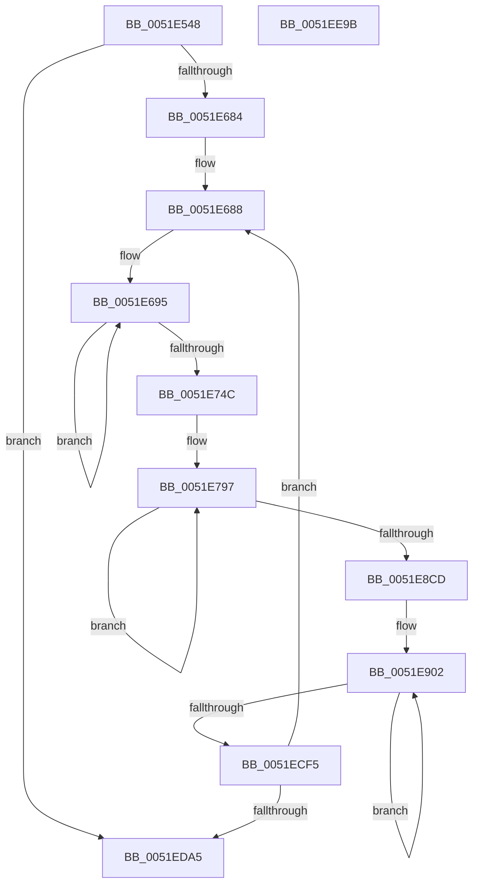

# SymCryptParallelSha256AppendBlocks_xmm

- RVA: `0x0051E548`–`0x0051EE9C` (길이 `2,388` bytes)
- VA: `0x000000014051E548`
- 실행 섹션: `.text`
- PDB 이름 있음: `예`; PDB Function 태그: `아니요`
- unwind 정보 RVA: `0x000C30B4`
- 디코드: `512`개 명령, `2,388/2,388` bytes 표시
- 미해석 바이트: `0` (있으면 어셈블리에 `.byte`로 보존)

> 이 문서는 커널 이미지의 기계어와 PDB 기호를 분석해 생성했습니다. 4번과 5번은 함수 원형과 자료형을 바이너리 사용 방식에서 추정한 C 해석이며 원본 소스 복구 결과는 아닙니다.

## 1. Dependencies

- 직접 호출 지점: **0**; 고유 호출 대상: **0**
- 직접 호출자로 확인된 함수: **1**
- RIP 상대 이미지 참조: **3**

### Outgoing calls
- 직접 디코드된 call 명령이 없습니다.

### Direct callers
- [SymCryptParallelSha256Append](SymCryptParallelSha256Append_function_0051E450.md) at `0x0051E522`

### Static image references
- `0x0051E6A7` → RVA `0x0001FA00` (`.rdata`; read)
- `0x0051E8D6` → RVA `0x0001F908` (`.rdata`; read)
- `0x0051EBDE` → RVA `0x0001FA08` (`.rdata`; read)

## 2. Other-region calls and transfers

- 다른 실행 섹션으로 향하는 call: **0**
- 별도 외부 분기/꼬리 이동을 확인하지 못했습니다.

## 3. Assembly (complete function range)

```asm
0051E548  48 8B C4                        mov rax, rsp
0051E54B  48 89 58 08                     mov qword ptr [rax + 8], rbx
0051E54F  48 89 70 10                     mov qword ptr [rax + 0x10], rsi
0051E553  57                              push rdi
0051E554  48 83 EC 70                     sub rsp, 0x70
0051E558  0F 29 70 E8                     movaps xmmword ptr [rax - 0x18], xmm6
0051E55C  4D 8B D0                        mov r10, r8
0051E55F  0F 29 78 D8                     movaps xmmword ptr [rax - 0x28], xmm7
0051E563  44 0F 29 40 C8                  movaps xmmword ptr [rax - 0x38], xmm8
0051E568  44 0F 29 48 B8                  movaps xmmword ptr [rax - 0x48], xmm9
0051E56D  44 0F 29 50 A8                  movaps xmmword ptr [rax - 0x58], xmm10
0051E572  44 0F 29 60 98                  movaps xmmword ptr [rax - 0x68], xmm12
0051E577  48 8B 01                        mov rax, qword ptr [rcx]
0051E57A  44 0F 29 2C 24                  movaps xmmword ptr [rsp], xmm13
0051E57F  F3 44 0F 6F 00                  movdqu xmm8, xmmword ptr [rax]
0051E584  48 8B 41 08                     mov rax, qword ptr [rcx + 8]
0051E588  66 45 0F 6F D0                  movdqa xmm10, xmm8
0051E58D  F3 0F 6F 00                     movdqu xmm0, xmmword ptr [rax]
0051E591  48 8B 41 10                     mov rax, qword ptr [rcx + 0x10]
0051E595  66 44 0F 62 D0                  punpckldq xmm10, xmm0
0051E59A  66 44 0F 6A C0                  punpckhdq xmm8, xmm0
0051E59F  66 41 0F 6F FA                  movdqa xmm7, xmm10
0051E5A4  66 45 0F 6F C8                  movdqa xmm9, xmm8
0051E5A9  F3 0F 6F 10                     movdqu xmm2, xmmword ptr [rax]
0051E5AD  48 8B 41 18                     mov rax, qword ptr [rcx + 0x18]
0051E5B1  66 0F 6F C2                     movdqa xmm0, xmm2
0051E5B5  F3 0F 6F 08                     movdqu xmm1, xmmword ptr [rax]
0051E5B9  66 0F 62 C1                     punpckldq xmm0, xmm1
0051E5BD  66 0F 6C F8                     punpcklqdq xmm7, xmm0
0051E5C1  F3 41 0F 7F B9 B0 00 00 00      movdqu xmmword ptr [r9 + 0xb0], xmm7
0051E5CA  66 44 0F 6D D0                  punpckhqdq xmm10, xmm0
0051E5CF  F3 45 0F 7F 91 A0 00 00 00      movdqu xmmword ptr [r9 + 0xa0], xmm10
0051E5D8  66 0F 6A D1                     punpckhdq xmm2, xmm1
0051E5DC  66 44 0F 6C CA                  punpcklqdq xmm9, xmm2
0051E5E1  F3 45 0F 7F 89 90 00 00 00      movdqu xmmword ptr [r9 + 0x90], xmm9
0051E5EA  66 44 0F 6D C2                  punpckhqdq xmm8, xmm2
0051E5EF  F3 45 0F 7F 81 80 00 00 00      movdqu xmmword ptr [r9 + 0x80], xmm8
0051E5F8  48 8B 01                        mov rax, qword ptr [rcx]
0051E5FB  F3 0F 6F 68 10                  movdqu xmm5, xmmword ptr [rax + 0x10]
0051E600  48 8B 41 08                     mov rax, qword ptr [rcx + 8]
0051E604  66 0F 6F DD                     movdqa xmm3, xmm5
0051E608  F3 0F 6F 40 10                  movdqu xmm0, xmmword ptr [rax + 0x10]
0051E60D  48 8B 41 10                     mov rax, qword ptr [rcx + 0x10]
0051E611  66 0F 62 D8                     punpckldq xmm3, xmm0
0051E615  66 0F 6A E8                     punpckhdq xmm5, xmm0
0051E619  66 0F 6F C3                     movdqa xmm0, xmm3
0051E61D  F3 0F 6F 60 10                  movdqu xmm4, xmmword ptr [rax + 0x10]
0051E622  48 8B 41 18                     mov rax, qword ptr [rcx + 0x18]
0051E626  66 0F 6F D4                     movdqa xmm2, xmm4
0051E62A  F3 0F 6F 48 10                  movdqu xmm1, xmmword ptr [rax + 0x10]
0051E62F  66 0F 62 D1                     punpckldq xmm2, xmm1
0051E633  66 0F 6C C2                     punpcklqdq xmm0, xmm2
0051E637  F3 41 0F 7F 41 70               movdqu xmmword ptr [r9 + 0x70], xmm0
0051E63D  66 0F 6F C5                     movdqa xmm0, xmm5
0051E641  66 0F 6A E1                     punpckhdq xmm4, xmm1
0051E645  66 0F 6C C4                     punpcklqdq xmm0, xmm4
0051E649  F3 41 0F 7F 41 50               movdqu xmmword ptr [r9 + 0x50], xmm0
0051E64F  66 0F 6D DA                     punpckhqdq xmm3, xmm2
0051E653  F3 41 0F 7F 59 60               movdqu xmmword ptr [r9 + 0x60], xmm3
0051E659  66 0F 6D EC                     punpckhqdq xmm5, xmm4
0051E65D  F3 41 0F 7F 69 40               movdqu xmmword ptr [r9 + 0x40], xmm5
0051E663  F3 45 0F 7F 01                  movdqu xmmword ptr [r9], xmm8
0051E668  F3 45 0F 7F 49 10               movdqu xmmword ptr [r9 + 0x10], xmm9
0051E66E  F3 45 0F 7F 51 20               movdqu xmmword ptr [r9 + 0x20], xmm10
0051E674  F3 41 0F 7F 79 30               movdqu xmmword ptr [r9 + 0x30], xmm7
0051E67A  49 83 F8 40                     cmp r8, 0x40
0051E67E  0F 82 21 07 00 00               jb 0x14051eda5
0051E684  49 C1 EA 06                     shr r10, 6
0051E688  4D 8D 81 E0 00 00 00            lea r8, [r9 + 0xe0]
0051E68F  41 BB 04 00 00 00               mov r11d, 4
0051E695  48 8B 02                        mov rax, qword ptr [rdx]
0051E698  F3 0F 6F 20                     movdqu xmm4, xmmword ptr [rax]
0051E69C  48 83 C0 10                     add rax, 0x10
0051E6A0  48 89 02                        mov qword ptr [rdx], rax
0051E6A3  48 8B 42 08                     mov rax, qword ptr [rdx + 8]
0051E6A7  66 0F 38 00 25 50 13 B0 FF      pshufb xmm4, xmmword ptr [rip - 0x4fecb0]
0051E6B0  F3 0F 6F 08                     movdqu xmm1, xmmword ptr [rax]
0051E6B4  48 83 C0 10                     add rax, 0x10
0051E6B8  48 89 42 08                     mov qword ptr [rdx + 8], rax
0051E6BC  66 0F 6F D4                     movdqa xmm2, xmm4
0051E6C0  48 8B 42 10                     mov rax, qword ptr [rdx + 0x10]
0051E6C4  66 0F 38 00 0D 33 13 B0 FF      pshufb xmm1, xmmword ptr [rip - 0x4feccd]
0051E6CD  F3 0F 6F 18                     movdqu xmm3, xmmword ptr [rax]
0051E6D1  48 83 C0 10                     add rax, 0x10
0051E6D5  66 0F 62 D1                     punpckldq xmm2, xmm1
0051E6D9  66 0F 38 00 1D 1E 13 B0 FF      pshufb xmm3, xmmword ptr [rip - 0x4fece2]
0051E6E2  48 89 42 10                     mov qword ptr [rdx + 0x10], rax
0051E6E6  48 8B 42 18                     mov rax, qword ptr [rdx + 0x18]
0051E6EA  66 0F 6A E1                     punpckhdq xmm4, xmm1
0051E6EE  66 0F 6F CB                     movdqa xmm1, xmm3
0051E6F2  F3 0F 6F 00                     movdqu xmm0, xmmword ptr [rax]
0051E6F6  48 83 C0 10                     add rax, 0x10
0051E6FA  48 89 42 18                     mov qword ptr [rdx + 0x18], rax
0051E6FE  66 0F 38 00 05 F9 12 B0 FF      pshufb xmm0, xmmword ptr [rip - 0x4fed07]
0051E707  66 0F 62 C8                     punpckldq xmm1, xmm0
0051E70B  66 0F 6A D8                     punpckhdq xmm3, xmm0
0051E70F  66 0F 6F C2                     movdqa xmm0, xmm2
0051E713  66 0F 6C C1                     punpcklqdq xmm0, xmm1
0051E717  F3 41 0F 7F 40 E0               movdqu xmmword ptr [r8 - 0x20], xmm0
0051E71D  66 0F 6F C4                     movdqa xmm0, xmm4
0051E721  66 0F 6C C3                     punpcklqdq xmm0, xmm3
0051E725  66 0F 6D D1                     punpckhqdq xmm2, xmm1
0051E729  66 0F 6D E3                     punpckhqdq xmm4, xmm3
0051E72D  F3 41 0F 7F 00                  movdqu xmmword ptr [r8], xmm0
0051E732  F3 41 0F 7F 50 F0               movdqu xmmword ptr [r8 - 0x10], xmm2
0051E738  F3 41 0F 7F 60 10               movdqu xmmword ptr [r8 + 0x10], xmm4
0051E73E  4D 8D 40 40                     lea r8, [r8 + 0x40]
0051E742  49 83 EB 01                     sub r11, 1
0051E746  0F 85 49 FF FF FF               jne 0x14051e695
0051E74C  F3 41 0F 6F A9 B0 01 00 00      movdqu xmm5, xmmword ptr [r9 + 0x1b0]
0051E755  49 8D 81 50 01 00 00            lea rax, [r9 + 0x150]
0051E75C  F3 41 0F 6F A1 A0 01 00 00      movdqu xmm4, xmmword ptr [r9 + 0x1a0]
0051E765  45 8D 43 18                     lea r8d, [r11 + 0x18]
0051E769  F3 41 0F 6F B1 C0 00 00 00      movdqu xmm6, xmmword ptr [r9 + 0xc0]
0051E772  66 0F 6F CC                     movdqa xmm1, xmm4
0051E776  66 0F 6F D4                     movdqa xmm2, xmm4
0051E77A  66 0F 6F FC                     movdqa xmm7, xmm4
0051E77E  66 44 0F 6F C4                  movdqa xmm8, xmm4
0051E783  66 44 0F 6F CD                  movdqa xmm9, xmm5
0051E788  66 44 0F 6F D5                  movdqa xmm10, xmm5
0051E78D  66 44 0F 6F E5                  movdqa xmm12, xmm5
0051E792  66 44 0F 6F ED                  movdqa xmm13, xmm5
0051E797  F3 0F 6F 58 80                  movdqu xmm3, xmmword ptr [rax - 0x80]
0051E79C  66 0F 72 F2 0D                  pslld xmm2, 0xd
0051E7A1  66 0F 72 F1 0F                  pslld xmm1, 0xf
0051E7A6  66 0F 72 D4 11                  psrld xmm4, 0x11
0051E7AB  66 0F 72 D5 11                  psrld xmm5, 0x11
0051E7B0  66 0F 6F C4                     movdqa xmm0, xmm4
0051E7B4  66 0F 72 D7 13                  psrld xmm7, 0x13
0051E7B9  66 0F 6F E1                     movdqa xmm4, xmm1
0051E7BD  66 41 0F 72 D0 0A               psrld xmm8, 0xa
0051E7C3  0F 57 E0                        xorps xmm4, xmm0
0051E7C6  66 41 0F 72 F1 0F               pslld xmm9, 0xf
0051E7CC  0F 57 E2                        xorps xmm4, xmm2
0051E7CF  66 41 0F 72 F2 0D               pslld xmm10, 0xd
0051E7D5  0F 57 E7                        xorps xmm4, xmm7
0051E7D8  66 41 0F 72 D4 13               psrld xmm12, 0x13
0051E7DE  41 0F 57 E0                     xorps xmm4, xmm8
0051E7E2  66 41 0F 72 D5 0A               psrld xmm13, 0xa
0051E7E8  66 0F FE E6                     paddd xmm4, xmm6
0051E7EC  F3 0F 6F 70 90                  movdqu xmm6, xmmword ptr [rax - 0x70]
0051E7F1  66 0F 6F D3                     movdqa xmm2, xmm3
0051E7F5  66 0F FE 20                     paddd xmm4, xmmword ptr [rax]
0051E7F9  66 0F 6F C3                     movdqa xmm0, xmm3
0051E7FD  66 0F 72 F2 19                  pslld xmm2, 0x19
0051E802  66 0F 6F CB                     movdqa xmm1, xmm3
0051E806  66 0F 72 D0 07                  psrld xmm0, 7
0051E80B  48 8D 40 20                     lea rax, [rax + 0x20]
0051E80F  66 0F 72 F1 0E                  pslld xmm1, 0xe
0051E814  0F 57 D0                        xorps xmm2, xmm0
0051E817  0F 57 D1                        xorps xmm2, xmm1
0051E81A  66 0F 6F C3                     movdqa xmm0, xmm3
0051E81E  66 0F 72 D0 12                  psrld xmm0, 0x12
0051E823  66 0F 6F CB                     movdqa xmm1, xmm3
0051E827  66 0F 72 D1 03                  psrld xmm1, 3
0051E82C  0F 57 D0                        xorps xmm2, xmm0
0051E82F  0F 57 D1                        xorps xmm2, xmm1
0051E832  66 0F 6F C5                     movdqa xmm0, xmm5
0051E836  66 0F FE E2                     paddd xmm4, xmm2
0051E83A  66 41 0F 6F E9                  movdqa xmm5, xmm9
0051E83F  F3 0F 7F 60 50                  movdqu xmmword ptr [rax + 0x50], xmm4
0051E844  0F 57 E8                        xorps xmm5, xmm0
0051E847  41 0F 57 EA                     xorps xmm5, xmm10
0051E84B  66 0F 6F D6                     movdqa xmm2, xmm6
0051E84F  66 0F 72 F2 19                  pslld xmm2, 0x19
0051E854  41 0F 57 EC                     xorps xmm5, xmm12
0051E858  41 0F 57 ED                     xorps xmm5, xmm13
0051E85C  66 0F 6F C6                     movdqa xmm0, xmm6
0051E860  66 0F 72 D0 07                  psrld xmm0, 7
0051E865  66 0F FE EB                     paddd xmm5, xmm3
0051E869  66 0F FE 68 F0                  paddd xmm5, xmmword ptr [rax - 0x10]
0051E86E  0F 57 D0                        xorps xmm2, xmm0
0051E871  66 0F 6F CE                     movdqa xmm1, xmm6
0051E875  66 0F 6F C6                     movdqa xmm0, xmm6
0051E879  66 0F 72 F1 0E                  pslld xmm1, 0xe
0051E87E  66 0F 6F FC                     movdqa xmm7, xmm4
0051E882  66 0F 72 D0 12                  psrld xmm0, 0x12
0051E887  0F 57 D1                        xorps xmm2, xmm1
0051E88A  0F 57 D0                        xorps xmm2, xmm0
0051E88D  66 0F 6F CE                     movdqa xmm1, xmm6
0051E891  66 0F 72 D1 03                  psrld xmm1, 3
0051E896  66 44 0F 6F C4                  movdqa xmm8, xmm4
0051E89B  0F 57 D1                        xorps xmm2, xmm1
0051E89E  66 0F 6F CC                     movdqa xmm1, xmm4
0051E8A2  66 0F FE EA                     paddd xmm5, xmm2
0051E8A6  66 0F 6F D4                     movdqa xmm2, xmm4
0051E8AA  F3 0F 7F 68 60                  movdqu xmmword ptr [rax + 0x60], xmm5
0051E8AF  66 44 0F 6F CD                  movdqa xmm9, xmm5
0051E8B4  66 44 0F 6F D5                  movdqa xmm10, xmm5
0051E8B9  66 44 0F 6F E5                  movdqa xmm12, xmm5
0051E8BE  66 44 0F 6F ED                  movdqa xmm13, xmm5
0051E8C3  49 83 E8 01                     sub r8, 1
0051E8C7  0F 85 CA FE FF FF               jne 0x14051e797
0051E8CD  F3 41 0F 6F B9 B0 00 00 00      movdqu xmm7, xmmword ptr [r9 + 0xb0]
0051E8D6  4C 8D 05 2B 10 B0 FF            lea r8, [rip - 0x4fefd5]
0051E8DD  F3 45 0F 6F 91 A0 00 00 00      movdqu xmm10, xmmword ptr [r9 + 0xa0]
0051E8E6  4D 8D 59 40                     lea r11, [r9 + 0x40]
0051E8EA  F3 45 0F 6F 89 90 00 00 00      movdqu xmm9, xmmword ptr [r9 + 0x90]
0051E8F3  F3 45 0F 6F 81 80 00 00 00      movdqu xmm8, xmmword ptr [r9 + 0x80]
0051E8FC  F3 45 0F 6F 61 40               movdqu xmm12, xmmword ptr [r9 + 0x40]
0051E902  F3 41 0F 6F 73 30               movdqu xmm6, xmmword ptr [r11 + 0x30]
0051E908  F3 41 0F 6F 6B 20               movdqu xmm5, xmmword ptr [r11 + 0x20]
0051E90E  66 0F 6F D6                     movdqa xmm2, xmm6
0051E912  F3 41 0F 6F 5B 10               movdqu xmm3, xmmword ptr [r11 + 0x10]
0051E918  66 0F 6F C6                     movdqa xmm0, xmm6
0051E91C  66 0F 72 D0 06                  psrld xmm0, 6
0051E921  66 0F 6F CE                     movdqa xmm1, xmm6
0051E925  66 0F 72 F2 1A                  pslld xmm2, 0x1a
0051E92A  0F 57 D0                        xorps xmm2, xmm0
0051E92D  66 0F 72 F1 15                  pslld xmm1, 0x15
0051E932  0F 57 D1                        xorps xmm2, xmm1
0051E935  66 0F 6F C6                     movdqa xmm0, xmm6
0051E939  66 0F 72 D0 0B                  psrld xmm0, 0xb
0051E93E  66 0F 6F CE                     movdqa xmm1, xmm6
0051E942  0F 57 D0                        xorps xmm2, xmm0
0051E945  66 0F 72 F1 07                  pslld xmm1, 7
0051E94A  0F 57 D1                        xorps xmm2, xmm1
0051E94D  66 0F 6F C6                     movdqa xmm0, xmm6
0051E951  66 0F 72 D0 19                  psrld xmm0, 0x19
0051E956  66 0F 6F CF                     movdqa xmm1, xmm7
0051E95A  0F 57 D0                        xorps xmm2, xmm0
0051E95D  66 0F 72 F1 13                  pslld xmm1, 0x13
0051E962  66 41 0F FE 93 80 00 00 00      paddd xmm2, xmmword ptr [r11 + 0x80]
0051E96B  66 0F 6F C5                     movdqa xmm0, xmm5
0051E96F  0F 57 C3                        xorps xmm0, xmm3
0051E972  66 41 0F FE D4                  paddd xmm2, xmm12
0051E977  0F 54 C6                        andps xmm0, xmm6
0051E97A  0F 57 C3                        xorps xmm0, xmm3
0051E97D  66 0F FE D0                     paddd xmm2, xmm0
0051E981  66 41 0F 6E 40 F8               movd xmm0, dword ptr [r8 - 8]
0051E987  66 0F 70 C0 00                  pshufd xmm0, xmm0, 0
0051E98C  66 0F FE D0                     paddd xmm2, xmm0
0051E990  66 0F 6F C7                     movdqa xmm0, xmm7
0051E994  66 0F 72 D0 02                  psrld xmm0, 2
0051E999  66 44 0F 6F E2                  movdqa xmm12, xmm2
0051E99E  66 45 0F FE E0                  paddd xmm12, xmm8
0051E9A3  66 44 0F 6F C7                  movdqa xmm8, xmm7
0051E9A8  66 41 0F 72 F0 1E               pslld xmm8, 0x1e
0051E9AE  44 0F 57 C0                     xorps xmm8, xmm0
0051E9B2  F3 45 0F 7F 63 40               movdqu xmmword ptr [r11 + 0x40], xmm12
0051E9B8  44 0F 57 C1                     xorps xmm8, xmm1
0051E9BC  66 0F 6F C7                     movdqa xmm0, xmm7
0051E9C0  66 0F 72 D0 0D                  psrld xmm0, 0xd
0051E9C5  66 0F 6F CF                     movdqa xmm1, xmm7
0051E9C9  44 0F 57 C0                     xorps xmm8, xmm0
0051E9CD  66 0F 72 F1 0A                  pslld xmm1, 0xa
0051E9D2  44 0F 57 C1                     xorps xmm8, xmm1
0051E9D6  66 0F 6F C7                     movdqa xmm0, xmm7
0051E9DA  66 0F 72 D0 16                  psrld xmm0, 0x16
0051E9DF  66 41 0F 6F CA                  movdqa xmm1, xmm10
0051E9E4  44 0F 57 C0                     xorps xmm8, xmm0
0051E9E8  0F 56 CF                        orps xmm1, xmm7
0051E9EB  66 44 0F FE C2                  paddd xmm8, xmm2
0051E9F0  41 0F 54 C9                     andps xmm1, xmm9
0051E9F4  66 41 0F 6F C2                  movdqa xmm0, xmm10
0051E9F9  66 41 0F 6F D4                  movdqa xmm2, xmm12
0051E9FE  0F 54 C7                        andps xmm0, xmm7
0051EA01  66 0F 72 F2 1A                  pslld xmm2, 0x1a
0051EA06  0F 56 C8                        orps xmm1, xmm0
0051EA09  66 41 0F 6F C4                  movdqa xmm0, xmm12
0051EA0E  66 0F 72 D0 06                  psrld xmm0, 6
0051EA13  66 44 0F FE C1                  paddd xmm8, xmm1
0051EA18  0F 57 D0                        xorps xmm2, xmm0
0051EA1B  66 41 0F 6F CC                  movdqa xmm1, xmm12
0051EA20  66 0F 72 F1 15                  pslld xmm1, 0x15
0051EA25  66 41 0F 6F C4                  movdqa xmm0, xmm12
0051EA2A  66 0F 72 D0 0B                  psrld xmm0, 0xb
0051EA2F  0F 57 D1                        xorps xmm2, xmm1
0051EA32  0F 57 D0                        xorps xmm2, xmm0
0051EA35  66 41 0F 6F CC                  movdqa xmm1, xmm12
0051EA3A  66 41 0F 6F C4                  movdqa xmm0, xmm12
0051EA3F  66 0F 72 F1 07                  pslld xmm1, 7
0051EA44  66 0F 72 D0 19                  psrld xmm0, 0x19
0051EA49  0F 57 D1                        xorps xmm2, xmm1
0051EA4C  0F 57 D0                        xorps xmm2, xmm0
0051EA4F  66 0F 6F C5                     movdqa xmm0, xmm5
0051EA53  66 41 0F FE 93 90 00 00 00      paddd xmm2, xmmword ptr [r11 + 0x90]
0051EA5C  0F 57 C6                        xorps xmm0, xmm6
0051EA5F  41 0F 54 C4                     andps xmm0, xmm12
0051EA63  66 0F FE D3                     paddd xmm2, xmm3
0051EA67  0F 57 C5                        xorps xmm0, xmm5
0051EA6A  66 0F FE D0                     paddd xmm2, xmm0
0051EA6E  66 41 0F 6F C8                  movdqa xmm1, xmm8
0051EA73  66 41 0F 6E 40 FC               movd xmm0, dword ptr [r8 - 4]
0051EA79  66 0F 70 C0 00                  pshufd xmm0, xmm0, 0
0051EA7E  66 0F FE D0                     paddd xmm2, xmm0
0051EA82  66 0F 72 F1 13                  pslld xmm1, 0x13
0051EA87  66 0F 6F E2                     movdqa xmm4, xmm2
0051EA8B  66 41 0F 6F C0                  movdqa xmm0, xmm8
0051EA90  66 0F 72 D0 02                  psrld xmm0, 2
0051EA95  66 41 0F FE E1                  paddd xmm4, xmm9
0051EA9A  66 45 0F 6F C8                  movdqa xmm9, xmm8
0051EA9F  F3 41 0F 7F 63 50               movdqu xmmword ptr [r11 + 0x50], xmm4
0051EAA5  66 41 0F 72 F1 1E               pslld xmm9, 0x1e
0051EAAB  44 0F 57 C8                     xorps xmm9, xmm0
0051EAAF  66 41 0F 6F C0                  movdqa xmm0, xmm8
0051EAB4  66 0F 72 D0 0D                  psrld xmm0, 0xd
0051EAB9  44 0F 57 C9                     xorps xmm9, xmm1
0051EABD  44 0F 57 C8                     xorps xmm9, xmm0
0051EAC1  66 41 0F 6F C8                  movdqa xmm1, xmm8
0051EAC6  66 0F 72 F1 0A                  pslld xmm1, 0xa
0051EACB  66 41 0F 6F C0                  movdqa xmm0, xmm8
0051EAD0  66 0F 72 D0 16                  psrld xmm0, 0x16
0051EAD5  44 0F 57 C9                     xorps xmm9, xmm1
0051EAD9  44 0F 57 C8                     xorps xmm9, xmm0
0051EADD  66 41 0F 6F C8                  movdqa xmm1, xmm8
0051EAE2  66 44 0F FE CA                  paddd xmm9, xmm2
0051EAE7  0F 56 CF                        orps xmm1, xmm7
0051EAEA  41 0F 54 CA                     andps xmm1, xmm10
0051EAEE  66 41 0F 6F C0                  movdqa xmm0, xmm8
0051EAF3  0F 54 C7                        andps xmm0, xmm7
0051EAF6  66 0F 6F D4                     movdqa xmm2, xmm4
0051EAFA  0F 56 C8                        orps xmm1, xmm0
0051EAFD  66 0F 72 F2 1A                  pslld xmm2, 0x1a
0051EB02  66 44 0F FE C9                  paddd xmm9, xmm1
0051EB07  66 0F 6F C4                     movdqa xmm0, xmm4
0051EB0B  66 0F 72 D0 06                  psrld xmm0, 6
0051EB10  66 0F 6F CC                     movdqa xmm1, xmm4
0051EB14  0F 57 D0                        xorps xmm2, xmm0
0051EB17  66 0F 72 F1 15                  pslld xmm1, 0x15
0051EB1C  0F 57 D1                        xorps xmm2, xmm1
0051EB1F  66 0F 6F C4                     movdqa xmm0, xmm4
0051EB23  66 0F 72 D0 0B                  psrld xmm0, 0xb
0051EB28  66 0F 6F CC                     movdqa xmm1, xmm4
0051EB2C  0F 57 D0                        xorps xmm2, xmm0
0051EB2F  66 0F 72 F1 07                  pslld xmm1, 7
0051EB34  0F 57 D1                        xorps xmm2, xmm1
0051EB37  66 0F 6F C4                     movdqa xmm0, xmm4
0051EB3B  66 0F 72 D0 19                  psrld xmm0, 0x19
0051EB40  66 41 0F 6F C9                  movdqa xmm1, xmm9
0051EB45  0F 57 D0                        xorps xmm2, xmm0
0051EB48  66 0F 72 F1 13                  pslld xmm1, 0x13
0051EB4D  66 41 0F FE 93 A0 00 00 00      paddd xmm2, xmmword ptr [r11 + 0xa0]
0051EB56  66 41 0F 6F C4                  movdqa xmm0, xmm12
0051EB5B  0F 57 C6                        xorps xmm0, xmm6
0051EB5E  66 0F FE D5                     paddd xmm2, xmm5
0051EB62  0F 54 C4                        andps xmm0, xmm4
0051EB65  0F 57 C6                        xorps xmm0, xmm6
0051EB68  66 0F FE D0                     paddd xmm2, xmm0
0051EB6C  66 41 0F 6E 00                  movd xmm0, dword ptr [r8]
0051EB71  66 0F 70 C0 00                  pshufd xmm0, xmm0, 0
0051EB76  66 0F FE D0                     paddd xmm2, xmm0
0051EB7A  66 41 0F 6F C1                  movdqa xmm0, xmm9
0051EB7F  66 0F 72 F0 1E                  pslld xmm0, 0x1e
0051EB84  66 0F 6F DA                     movdqa xmm3, xmm2
0051EB88  66 41 0F FE DA                  paddd xmm3, xmm10
0051EB8D  66 45 0F 6F D1                  movdqa xmm10, xmm9
0051EB92  66 41 0F 72 D2 02               psrld xmm10, 2
0051EB98  44 0F 57 D0                     xorps xmm10, xmm0
0051EB9C  F3 41 0F 7F 5B 60               movdqu xmmword ptr [r11 + 0x60], xmm3
0051EBA2  44 0F 57 D1                     xorps xmm10, xmm1
0051EBA6  66 41 0F 6F C1                  movdqa xmm0, xmm9
0051EBAB  66 0F 72 D0 0D                  psrld xmm0, 0xd
0051EBB0  66 41 0F 6F C9                  movdqa xmm1, xmm9
0051EBB5  44 0F 57 D0                     xorps xmm10, xmm0
0051EBB9  66 0F 72 F1 0A                  pslld xmm1, 0xa
0051EBBE  44 0F 57 D1                     xorps xmm10, xmm1
0051EBC2  66 41 0F 6F C1                  movdqa xmm0, xmm9
0051EBC7  66 0F 72 D0 16                  psrld xmm0, 0x16
0051EBCC  66 41 0F 6F C9                  movdqa xmm1, xmm9
0051EBD1  44 0F 57 D0                     xorps xmm10, xmm0
0051EBD5  66 44 0F FE D2                  paddd xmm10, xmm2
0051EBDA  41 0F 56 C8                     orps xmm1, xmm8
0051EBDE  48 8D 05 23 0E B0 FF            lea rax, [rip - 0x4ff1dd]
0051EBE5  0F 54 CF                        andps xmm1, xmm7
0051EBE8  4D 8D 5B 40                     lea r11, [r11 + 0x40]
0051EBEC  66 41 0F 6F C1                  movdqa xmm0, xmm9
0051EBF1  66 0F 6F D3                     movdqa xmm2, xmm3
0051EBF5  41 0F 54 C0                     andps xmm0, xmm8
0051EBF9  66 0F 72 F2 1A                  pslld xmm2, 0x1a
0051EBFE  0F 56 C8                        orps xmm1, xmm0
0051EC01  66 0F 6F C3                     movdqa xmm0, xmm3
0051EC05  66 0F 72 D0 06                  psrld xmm0, 6
0051EC0A  66 44 0F FE D1                  paddd xmm10, xmm1
0051EC0F  0F 57 D0                        xorps xmm2, xmm0
0051EC12  66 0F 6F CB                     movdqa xmm1, xmm3
0051EC16  66 0F 72 F1 15                  pslld xmm1, 0x15
0051EC1B  66 0F 6F C3                     movdqa xmm0, xmm3
0051EC1F  66 0F 72 D0 0B                  psrld xmm0, 0xb
0051EC24  0F 57 D1                        xorps xmm2, xmm1
0051EC27  0F 57 D0                        xorps xmm2, xmm0
0051EC2A  66 0F 6F CB                     movdqa xmm1, xmm3
0051EC2E  66 0F 72 F1 07                  pslld xmm1, 7
0051EC33  66 0F 6F C3                     movdqa xmm0, xmm3
0051EC37  66 0F 72 D0 19                  psrld xmm0, 0x19
0051EC3C  0F 57 D1                        xorps xmm2, xmm1
0051EC3F  0F 57 D0                        xorps xmm2, xmm0
0051EC42  66 41 0F 6F CA                  movdqa xmm1, xmm10
0051EC47  66 41 0F FE 53 70               paddd xmm2, xmmword ptr [r11 + 0x70]
0051EC4D  66 41 0F 6F C4                  movdqa xmm0, xmm12
0051EC52  0F 57 C4                        xorps xmm0, xmm4
0051EC55  66 0F 72 F1 13                  pslld xmm1, 0x13
0051EC5A  0F 54 C3                        andps xmm0, xmm3
0051EC5D  66 0F FE D6                     paddd xmm2, xmm6
0051EC61  41 0F 57 C4                     xorps xmm0, xmm12
0051EC65  66 0F FE D0                     paddd xmm2, xmm0
0051EC69  66 41 0F 6E 40 04               movd xmm0, dword ptr [r8 + 4]
0051EC6F  66 0F 70 C0 00                  pshufd xmm0, xmm0, 0
0051EC74  49 83 C0 10                     add r8, 0x10
0051EC78  66 0F FE D0                     paddd xmm2, xmm0
0051EC7C  66 0F 6F C2                     movdqa xmm0, xmm2
0051EC80  66 0F FE C7                     paddd xmm0, xmm7
0051EC84  66 41 0F 6F FA                  movdqa xmm7, xmm10
0051EC89  F3 41 0F 7F 43 30               movdqu xmmword ptr [r11 + 0x30], xmm0
0051EC8F  66 41 0F 6F C2                  movdqa xmm0, xmm10
0051EC94  66 0F 72 D0 02                  psrld xmm0, 2
0051EC99  66 0F 72 F7 1E                  pslld xmm7, 0x1e
0051EC9E  0F 57 F8                        xorps xmm7, xmm0
0051ECA1  66 41 0F 6F C2                  movdqa xmm0, xmm10
0051ECA6  66 0F 72 D0 0D                  psrld xmm0, 0xd
0051ECAB  0F 57 F9                        xorps xmm7, xmm1
0051ECAE  0F 57 F8                        xorps xmm7, xmm0
0051ECB1  66 41 0F 6F CA                  movdqa xmm1, xmm10
0051ECB6  66 0F 72 F1 0A                  pslld xmm1, 0xa
0051ECBB  66 41 0F 6F C2                  movdqa xmm0, xmm10
0051ECC0  66 0F 72 D0 16                  psrld xmm0, 0x16
0051ECC5  0F 57 F9                        xorps xmm7, xmm1
0051ECC8  0F 57 F8                        xorps xmm7, xmm0
0051ECCB  66 41 0F 6F C9                  movdqa xmm1, xmm9
0051ECD0  41 0F 56 CA                     orps xmm1, xmm10
0051ECD4  66 41 0F 6F C1                  movdqa xmm0, xmm9
0051ECD9  41 0F 54 C2                     andps xmm0, xmm10
0051ECDD  41 0F 54 C8                     andps xmm1, xmm8
0051ECE1  0F 56 C8                        orps xmm1, xmm0
0051ECE4  66 0F FE FA                     paddd xmm7, xmm2
0051ECE8  66 0F FE F9                     paddd xmm7, xmm1
0051ECEC  4C 3B C0                        cmp r8, rax
0051ECEF  0F 8C 0D FC FF FF               jl 0x14051e902
0051ECF5  66 41 0F FE 79 30               paddd xmm7, xmmword ptr [r9 + 0x30]
0051ECFB  F3 41 0F 7F B9 B0 00 00 00      movdqu xmmword ptr [r9 + 0xb0], xmm7
0051ED04  66 45 0F FE 51 20               paddd xmm10, xmmword ptr [r9 + 0x20]
0051ED0A  F3 41 0F 7F 79 30               movdqu xmmword ptr [r9 + 0x30], xmm7
0051ED10  F3 45 0F 7F 91 A0 00 00 00      movdqu xmmword ptr [r9 + 0xa0], xmm10
0051ED19  66 45 0F FE 49 10               paddd xmm9, xmmword ptr [r9 + 0x10]
0051ED1F  F3 45 0F 7F 51 20               movdqu xmmword ptr [r9 + 0x20], xmm10
0051ED25  F3 45 0F 7F 89 90 00 00 00      movdqu xmmword ptr [r9 + 0x90], xmm9
0051ED2E  66 45 0F FE 01                  paddd xmm8, xmmword ptr [r9]
0051ED33  F3 45 0F 7F 49 10               movdqu xmmword ptr [r9 + 0x10], xmm9
0051ED39  F3 45 0F 7F 81 80 00 00 00      movdqu xmmword ptr [r9 + 0x80], xmm8
0051ED42  F3 45 0F 7F 01                  movdqu xmmword ptr [r9], xmm8
0051ED47  F3 41 0F 6F 81 70 04 00 00      movdqu xmm0, xmmword ptr [r9 + 0x470]
0051ED50  66 41 0F FE 41 70               paddd xmm0, xmmword ptr [r9 + 0x70]
0051ED56  F3 41 0F 6F 49 60               movdqu xmm1, xmmword ptr [r9 + 0x60]
0051ED5C  F3 41 0F 7F 41 70               movdqu xmmword ptr [r9 + 0x70], xmm0
0051ED62  66 41 0F FE 89 60 04 00 00      paddd xmm1, xmmword ptr [r9 + 0x460]
0051ED6B  F3 41 0F 7F 49 60               movdqu xmmword ptr [r9 + 0x60], xmm1
0051ED71  F3 41 0F 6F 81 50 04 00 00      movdqu xmm0, xmmword ptr [r9 + 0x450]
0051ED7A  66 41 0F FE 41 50               paddd xmm0, xmmword ptr [r9 + 0x50]
0051ED80  F3 41 0F 7F 41 50               movdqu xmmword ptr [r9 + 0x50], xmm0
0051ED86  F3 41 0F 6F 89 40 04 00 00      movdqu xmm1, xmmword ptr [r9 + 0x440]
0051ED8F  66 41 0F FE 49 40               paddd xmm1, xmmword ptr [r9 + 0x40]
0051ED95  F3 41 0F 7F 49 40               movdqu xmmword ptr [r9 + 0x40], xmm1
0051ED9B  49 83 EA 01                     sub r10, 1
0051ED9F  0F 85 E3 F8 FF FF               jne 0x14051e688
0051EDA5  48 8B 01                        mov rax, qword ptr [rcx]
0051EDA8  4C 8D 5C 24 70                  lea r11, [rsp + 0x70]
0051EDAD  49 8B 5B 10                     mov rbx, qword ptr [r11 + 0x10]
0051EDB1  66 0F 6F D7                     movdqa xmm2, xmm7
0051EDB5  49 8B 73 18                     mov rsi, qword ptr [r11 + 0x18]
0051EDB9  66 41 0F 6F C9                  movdqa xmm1, xmm9
0051EDBE  0F 28 74 24 60                  movaps xmm6, xmmword ptr [rsp + 0x60]
0051EDC3  45 0F 28 63 A0                  movaps xmm12, xmmword ptr [r11 - 0x60]
0051EDC8  45 0F 28 6B 90                  movaps xmm13, xmmword ptr [r11 - 0x70]
0051EDCD  66 41 0F 62 D2                  punpckldq xmm2, xmm10
0051EDD2  66 41 0F 62 C8                  punpckldq xmm1, xmm8
0051EDD7  66 0F 6F C2                     movdqa xmm0, xmm2
0051EDDB  66 0F 6C C1                     punpcklqdq xmm0, xmm1
0051EDDF  F3 0F 7F 00                     movdqu xmmword ptr [rax], xmm0
0051EDE3  48 8B 41 08                     mov rax, qword ptr [rcx + 8]
0051EDE7  66 0F 6D D1                     punpckhqdq xmm2, xmm1
0051EDEB  66 41 0F 6A FA                  punpckhdq xmm7, xmm10
0051EDF0  45 0F 28 53 B0                  movaps xmm10, xmmword ptr [r11 - 0x50]
0051EDF5  66 0F 6F C7                     movdqa xmm0, xmm7
0051EDF9  F3 0F 7F 10                     movdqu xmmword ptr [rax], xmm2
0051EDFD  48 8B 41 10                     mov rax, qword ptr [rcx + 0x10]
0051EE01  66 45 0F 6A C8                  punpckhdq xmm9, xmm8
0051EE06  45 0F 28 43 D0                  movaps xmm8, xmmword ptr [r11 - 0x30]
0051EE0B  66 41 0F 6C C1                  punpcklqdq xmm0, xmm9
0051EE10  F3 0F 7F 00                     movdqu xmmword ptr [rax], xmm0
0051EE14  48 8B 41 18                     mov rax, qword ptr [rcx + 0x18]
0051EE18  66 41 0F 6D F9                  punpckhqdq xmm7, xmm9
0051EE1D  45 0F 28 4B C0                  movaps xmm9, xmmword ptr [r11 - 0x40]
0051EE22  F3 0F 7F 38                     movdqu xmmword ptr [rax], xmm7
0051EE26  48 8B 01                        mov rax, qword ptr [rcx]
0051EE29  F3 41 0F 6F 41 60               movdqu xmm0, xmmword ptr [r9 + 0x60]
0051EE2F  F3 41 0F 6F 69 70               movdqu xmm5, xmmword ptr [r9 + 0x70]
0051EE35  F3 41 0F 6F 59 50               movdqu xmm3, xmmword ptr [r9 + 0x50]
0051EE3B  66 0F 6F E5                     movdqa xmm4, xmm5
0051EE3F  0F 28 7C 24 50                  movaps xmm7, xmmword ptr [rsp + 0x50]
0051EE44  66 0F 6F CB                     movdqa xmm1, xmm3
0051EE48  66 0F 62 E0                     punpckldq xmm4, xmm0
0051EE4C  66 0F 6A E8                     punpckhdq xmm5, xmm0
0051EE50  66 0F 6F D4                     movdqa xmm2, xmm4
0051EE54  F3 41 0F 6F 41 40               movdqu xmm0, xmmword ptr [r9 + 0x40]
0051EE5A  66 0F 62 C8                     punpckldq xmm1, xmm0
0051EE5E  66 0F 6A D8                     punpckhdq xmm3, xmm0
0051EE62  66 0F 6F C5                     movdqa xmm0, xmm5
0051EE66  66 0F 6C D1                     punpcklqdq xmm2, xmm1
0051EE6A  F3 0F 7F 50 10                  movdqu xmmword ptr [rax + 0x10], xmm2
0051EE6F  48 8B 41 08                     mov rax, qword ptr [rcx + 8]
0051EE73  66 0F 6D E1                     punpckhqdq xmm4, xmm1
0051EE77  66 0F 6C C3                     punpcklqdq xmm0, xmm3
0051EE7B  66 0F 6D EB                     punpckhqdq xmm5, xmm3
0051EE7F  F3 0F 7F 60 10                  movdqu xmmword ptr [rax + 0x10], xmm4
0051EE84  48 8B 41 10                     mov rax, qword ptr [rcx + 0x10]
0051EE88  F3 0F 7F 40 10                  movdqu xmmword ptr [rax + 0x10], xmm0
0051EE8D  48 8B 41 18                     mov rax, qword ptr [rcx + 0x18]
0051EE91  F3 0F 7F 68 10                  movdqu xmmword ptr [rax + 0x10], xmm5
0051EE96  49 8B E3                        mov rsp, r11
0051EE99  5F                              pop rdi
0051EE9A  C3                              ret
0051EE9B  CC                              int3
```

## 4. C-style interpretation (structured pseudocode)

```c
__int64 __fastcall SymCryptParallelSha256AppendBlocks_xmm(__int64 a1, __int64 a2, __int64 a3, __int64 a4)
{
    __int64 result;
    __int64 v_r10;
    __int64 v_r11;
    __int64 v_rsp;
    unsigned __int64 v_stack_m18;
    unsigned __int64 v_stack_m28;
    unsigned __int64 v_stack_m78;
    unsigned __int64 v_stack_m8;

    *(unsigned __int64 *)(v_rsp + 8) = v_rbx;
    *(unsigned __int64 *)(v_rsp + 16) = v_rsi;
    v_rsp = (v_rsp) - (112);
    *(unsigned __int64 *)(v_rsp - 24) = v_xmm6;
    *(unsigned __int64 *)(v_rsp - 40) = v_xmm7;
    *(unsigned __int64 *)(v_rsp - 56) = v_xmm8;
    *(unsigned __int64 *)(v_rsp - 72) = v_xmm9;
    *(unsigned __int64 *)(v_rsp - 88) = v_xmm10;
    *(unsigned __int64 *)(v_rsp - 104) = v_xmm12;
    v_stack_m78 = v_xmm13;
    *(unsigned __int64 *)(a4 + 176) = v_xmm7;
    *(unsigned __int64 *)(a4 + 160) = v_xmm10;
    *(unsigned __int64 *)(a4 + 144) = v_xmm9;
    *(unsigned __int64 *)(a4 + 128) = v_xmm8;
    *(unsigned __int64 *)(a4 + 112) = v_xmm0;
    *(unsigned __int64 *)(a4 + 80) = v_xmm0;
    *(unsigned __int64 *)(a4 + 96) = v_xmm3;
    *(unsigned __int64 *)(a4 + 64) = v_xmm5;
    *(unsigned __int64 *)(a4) = v_xmm8;
    *(unsigned __int64 *)(a4 + 16) = v_xmm9;
    *(unsigned __int64 *)(a4 + 32) = v_xmm10;
    *(unsigned __int64 *)(a4 + 48) = v_xmm7;
    if (a3 < 64) goto loc_0051EDA5;
    v_r10 = (a3) >> (6);
loc_0051E688:
loc_0051E695:
    result = (*(unsigned __int64 *)(a2)) + (16);
    *(unsigned __int64 *)(a2) = result;
    result = (*(unsigned __int64 *)(a2 + 8)) + (16);
    *(unsigned __int64 *)(a2 + 8) = result;
    result = (*(unsigned __int64 *)(a2 + 16)) + (16);
    *(unsigned __int64 *)(a2 + 16) = result;
    result = (*(unsigned __int64 *)(a2 + 24)) + (16);
    *(unsigned __int64 *)(a2 + 24) = result;
    *(unsigned __int64 *)(a4 + 224 - 32) = v_xmm0;
    *(unsigned __int64 *)(a4 + 224) = v_xmm0;
    *(unsigned __int64 *)(a4 + 224 - 16) = v_xmm2;
    *(unsigned __int64 *)(a4 + 224 + 16) = v_xmm4;
    v_r11 = (4) - (1);
    if (condition_is_not_equal) goto loc_0051E695;
loc_0051E797:
    *(unsigned __int64 *)(a4 + 336 + 32 + 80) = v_xmm4;
    *(unsigned __int64 *)(a4 + 336 + 32 + 96) = v_xmm5;
    a3 = (v_r11 + 24) - (1);
    if (condition_is_not_equal) goto loc_0051E797;
loc_0051E902:
    *(unsigned __int64 *)(a4 + 64 + 64) = v_xmm12;
    *(unsigned __int64 *)(a4 + 64 + 80) = v_xmm4;
    *(unsigned __int64 *)(a4 + 64 + 96) = v_xmm3;
    a3 = (v_rip - 5238741) + (16);
    *(unsigned __int64 *)(a4 + 64 + 64 + 48) = v_xmm0;
    if (a3 < (v_rip - 5239261)) goto loc_0051E902;
    *(unsigned __int64 *)(a4 + 176) = v_xmm7;
    *(unsigned __int64 *)(a4 + 48) = v_xmm7;
    *(unsigned __int64 *)(a4 + 160) = v_xmm10;
    *(unsigned __int64 *)(a4 + 32) = v_xmm10;
    *(unsigned __int64 *)(a4 + 144) = v_xmm9;
    *(unsigned __int64 *)(a4 + 16) = v_xmm9;
    *(unsigned __int64 *)(a4 + 128) = v_xmm8;
    *(unsigned __int64 *)(a4) = v_xmm8;
    *(unsigned __int64 *)(a4 + 112) = v_xmm0;
    *(unsigned __int64 *)(a4 + 96) = v_xmm1;
    *(unsigned __int64 *)(a4 + 80) = v_xmm0;
    *(unsigned __int64 *)(a4 + 64) = v_xmm1;
    v_r10 = (v_r10) - (1);
    if (condition_is_not_equal) goto loc_0051E688;
loc_0051EDA5:
    *(unsigned __int64 *)(*(unsigned __int64 *)(a1)) = v_xmm0;
    *(unsigned __int64 *)(*(unsigned __int64 *)(a1 + 8)) = v_xmm2;
    *(unsigned __int64 *)(*(unsigned __int64 *)(a1 + 16)) = v_xmm0;
    *(unsigned __int64 *)(*(unsigned __int64 *)(a1 + 24)) = v_xmm7;
    *(unsigned __int64 *)(*(unsigned __int64 *)(a1) + 16) = v_xmm2;
    *(unsigned __int64 *)(*(unsigned __int64 *)(a1 + 8) + 16) = v_xmm4;
    *(unsigned __int64 *)(*(unsigned __int64 *)(a1 + 16) + 16) = v_xmm0;
    *(unsigned __int64 *)(*(unsigned __int64 *)(a1 + 24) + 16) = v_xmm5;
    return *(unsigned __int64 *)(a1 + 24);
}
```

## 5. (Beta) C Style

```c
int64_t SymCryptParallelSha256AppendBlocks_xmm(void *Arg1, void *Arg2, int64_t Arg3, void *Arg4)
{
    uint8_t *arg1 = (uint8_t *)Arg1;
    uint8_t *arg2 = (uint8_t *)Arg2;
    uint8_t *arg4 = (uint8_t *)Arg4;

    int64_t result;
    int64_t local_r10;
    int64_t local_r11;
    int64_t local_rsp;
    uint64_t v_stack_m18;
    uint64_t v_stack_m28;
    uint64_t v_stack_m78;
    uint64_t v_stack_m8;

    *(uint64_t *)(local_rsp + 0x8) = local_rbx;
    *(uint64_t *)(local_rsp + 0x10) = local_rsi;
    local_rsp = (local_rsp) - (112);
    *(uint64_t *)(local_rsp - 0x18) = v_xmm6;
    *(uint64_t *)(local_rsp - 0x28) = v_xmm7;
    *(uint64_t *)(local_rsp - 0x38) = v_xmm8;
    *(uint64_t *)(local_rsp - 0x48) = v_xmm9;
    *(uint64_t *)(local_rsp - 0x58) = v_xmm10;
    *(uint64_t *)(local_rsp - 0x68) = v_xmm12;
    v_stack_m78 = v_xmm13;
    *(uint64_t *)(arg4 + 0xB0) = v_xmm7;
    *(uint64_t *)(arg4 + 0xA0) = v_xmm10;
    *(uint64_t *)(arg4 + 0x90) = v_xmm9;
    *(uint64_t *)(arg4 + 0x80) = v_xmm8;
    *(uint64_t *)(arg4 + 0x70) = v_xmm0;
    *(uint64_t *)(arg4 + 0x50) = v_xmm0;
    *(uint64_t *)(arg4 + 0x60) = v_xmm3;
    *(uint64_t *)(arg4 + 0x40) = v_xmm5;
    *(uint64_t *)(arg4) = v_xmm8;
    *(uint64_t *)(arg4 + 0x10) = v_xmm9;
    *(uint64_t *)(arg4 + 0x20) = v_xmm10;
    *(uint64_t *)(arg4 + 0x30) = v_xmm7;
    if (Arg3 < 64) goto loc_0051EDA5;
    local_r10 = (Arg3) >> (6);
loc_0051E688:
loc_0051E695:
    result = (*(uint64_t *)(arg2)) + (16);
    *(uint64_t *)(arg2) = result;
    result = (*(uint64_t *)(arg2 + 0x8)) + (16);
    *(uint64_t *)(arg2 + 0x8) = result;
    result = (*(uint64_t *)(arg2 + 0x10)) + (16);
    *(uint64_t *)(arg2 + 0x10) = result;
    result = (*(uint64_t *)(arg2 + 0x18)) + (16);
    *(uint64_t *)(arg2 + 0x18) = result;
    *(uint64_t *)(arg4 + 0xE0 - 0x20) = v_xmm0;
    *(uint64_t *)(arg4 + 0xE0) = v_xmm0;
    *(uint64_t *)(arg4 + 0xE0 - 0x10) = v_xmm2;
    *(uint64_t *)(arg4 + 0xE0 + 0x10) = v_xmm4;
    local_r11 = (4) - (1);
    if (condition_is_not_equal) goto loc_0051E695;
loc_0051E797:
    *(uint64_t *)(arg4 + 0x150 + 0x20 + 0x50) = v_xmm4;
    *(uint64_t *)(arg4 + 0x150 + 0x20 + 0x60) = v_xmm5;
    Arg3 = (local_r11 + 24) - (1);
    if (condition_is_not_equal) goto loc_0051E797;
loc_0051E902:
    *(uint64_t *)(arg4 + 0x40 + 0x40) = v_xmm12;
    *(uint64_t *)(arg4 + 0x40 + 0x50) = v_xmm4;
    *(uint64_t *)(arg4 + 0x40 + 0x60) = v_xmm3;
    Arg3 = (v_rip - 5238741) + (16);
    *(uint64_t *)(arg4 + 0x40 + 0x40 + 0x30) = v_xmm0;
    if (Arg3 < (v_rip - 5239261)) goto loc_0051E902;
    *(uint64_t *)(arg4 + 0xB0) = v_xmm7;
    *(uint64_t *)(arg4 + 0x30) = v_xmm7;
    *(uint64_t *)(arg4 + 0xA0) = v_xmm10;
    *(uint64_t *)(arg4 + 0x20) = v_xmm10;
    *(uint64_t *)(arg4 + 0x90) = v_xmm9;
    *(uint64_t *)(arg4 + 0x10) = v_xmm9;
    *(uint64_t *)(arg4 + 0x80) = v_xmm8;
    *(uint64_t *)(arg4) = v_xmm8;
    *(uint64_t *)(arg4 + 0x70) = v_xmm0;
    *(uint64_t *)(arg4 + 0x60) = v_xmm1;
    *(uint64_t *)(arg4 + 0x50) = v_xmm0;
    *(uint64_t *)(arg4 + 0x40) = v_xmm1;
    local_r10 = (local_r10) - (1);
    if (condition_is_not_equal) goto loc_0051E688;
loc_0051EDA5:
    *(uint64_t *)(*(uint64_t *)(arg1)) = v_xmm0;
    *(uint64_t *)(*(uint64_t *)(arg1 + 0x8)) = v_xmm2;
    *(uint64_t *)(*(uint64_t *)(arg1 + 0x10)) = v_xmm0;
    *(uint64_t *)(*(uint64_t *)(arg1 + 0x18)) = v_xmm7;
    *(uint64_t *)(*(uint64_t *)(arg1) + 0x10) = v_xmm2;
    *(uint64_t *)(*(uint64_t *)(arg1 + 0x8) + 0x10) = v_xmm4;
    *(uint64_t *)(*(uint64_t *)(arg1 + 0x10) + 0x10) = v_xmm0;
    *(uint64_t *)(*(uint64_t *)(arg1 + 0x18) + 0x10) = v_xmm5;
    return *(uint64_t *)(arg1 + 0x18);
}
```

### 관측된 메모리 오프셋

구조체 형식이 확인되지 않은 접근은 인자 기준의 오프셋으로만 기록했습니다.

| 기준 인자 | 오프셋 표현 | 폭 (bit) | 접근 |
|---|---:|---:|---|
| `Arg1` | `+ 0x0` | `64` | `R` |
| `Arg1` | `+ 0x8` | `64` | `R` |
| `Arg1` | `+ 0x10` | `64` | `R` |
| `Arg1` | `+ 0x18` | `64` | `R` |
| `Arg2` | `+ 0x0` | `64` | `R` |
| `Arg2` | `+ 0x0` | `64` | `W` |
| `Arg2` | `+ 0x8` | `64` | `R` |
| `Arg2` | `+ 0x8` | `64` | `W` |
| `Arg2` | `+ 0x10` | `64` | `R` |
| `Arg2` | `+ 0x10` | `64` | `W` |
| `Arg2` | `+ 0x18` | `64` | `R` |
| `Arg2` | `+ 0x18` | `64` | `W` |
| `Arg4` | `- 0x80` | `128` | `R` |
| `Arg4` | `- 0x70` | `128` | `R` |
| `Arg4` | `- 0x20` | `128` | `W` |
| `Arg4` | `- 0x10` | `128` | `R` |
| `Arg4` | `- 0x10` | `128` | `W` |
| `Arg4` | `+ 0x0` | `128` | `R` |
| `Arg4` | `+ 0x0` | `128` | `W` |
| `Arg4` | `+ 0x10` | `128` | `R` |
| `Arg4` | `+ 0x10` | `128` | `W` |
| `Arg4` | `+ 0x20` | `64` | `R` |
| `Arg4` | `+ 0x20` | `128` | `R` |
| `Arg4` | `+ 0x20` | `128` | `W` |
| `Arg4` | `+ 0x30` | `128` | `R` |
| `Arg4` | `+ 0x30` | `128` | `W` |
| `Arg4` | `+ 0x40` | `64` | `R` |
| `Arg4` | `+ 0x40` | `128` | `R` |
| `Arg4` | `+ 0x40` | `128` | `W` |
| `Arg4` | `+ 0x50` | `128` | `R` |
| `Arg4` | `+ 0x50` | `128` | `W` |
| `Arg4` | `+ 0x60` | `128` | `R` |

추가 오프셋 20개는 표에서 생략했습니다.

## 6. Execution-region graph

[열기: 2D/3D 그래프와 함수 탐색 컨트롤 패널](../../../control-panel.html?section=text&rva=0x0051E548&view=graph)

- 2D 그래프는 위에서 아래로 흐르고, 3D 그래프는 빈 공간을 드래그해 회전합니다. Shift+드래그는 이동, 휠은 확대·축소, 함수 노드 선택은 대상 보고서 이동입니다.

### Static fallback


