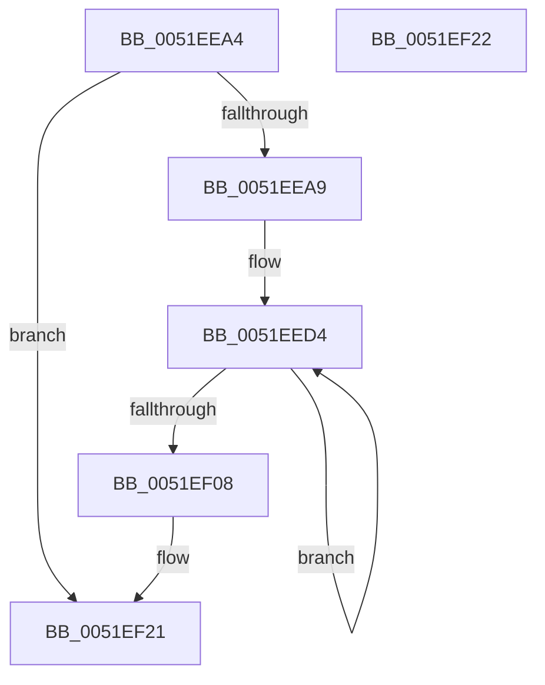

# SymCryptParallelSha256AppendBytes_serial

- RVA: `0x0051EEA4`–`0x0051EF23` (길이 `127` bytes)
- VA: `0x000000014051EEA4`
- 실행 섹션: `.text`
- PDB 이름 있음: `예`; PDB Function 태그: `아니요`
- unwind 정보 RVA: `0x000C3098`
- 디코드: `39`개 명령, `127/127` bytes 표시
- 미해석 바이트: `0` (있으면 어셈블리에 `.byte`로 보존)

> 이 문서는 커널 이미지의 기계어와 PDB 기호를 분석해 생성했습니다. 4번과 5번은 함수 원형과 자료형을 바이너리 사용 방식에서 추정한 C 해석이며 원본 소스 복구 결과는 아닙니다.

## 1. Dependencies

- 직접 호출 지점: **2**; 고유 호출 대상: **2**
- 직접 호출자로 확인된 함수: **1**
- RIP 상대 이미지 참조: **1**

### Outgoing calls
- `0x0051EEEB` → [SymCryptSha256AppendBlocks](SymCryptSha256AppendBlocks_function_0051CC00.md) (function, `0x0051CC00`)
- `0x0051EF10` → [_security_check_cookie](../6A/_security_check_cookie_function_006AC640.md) (function, `0x006AC640`)

### Direct callers
- [SymCryptParallelSha256Append](SymCryptParallelSha256Append_function_0051E450.md) at `0x0051E4B2`

### Static image references
- `0x0051EEB5` → RVA `0x00E0A740` (`.data`; read)

## 2. Other-region calls and transfers

- 다른 실행 섹션으로 향하는 call: **0**
- 별도 외부 분기/꼬리 이동을 확인하지 못했습니다.

## 3. Assembly (complete function range)

```asm
0051EEA4  48 85 D2                        test rdx, rdx
0051EEA7  74 78                           je 0x14051ef21
0051EEA9  48 89 5C 24 10                  mov qword ptr [rsp + 0x10], rbx
0051EEAE  55                              push rbp
0051EEAF  56                              push rsi
0051EEB0  57                              push rdi
0051EEB1  48 83 EC 30                     sub rsp, 0x30
0051EEB5  48 8B 05 84 B8 8E 00            mov rax, qword ptr [rip + 0x8eb884]
0051EEBC  48 33 C4                        xor rax, rsp
0051EEBF  48 89 44 24 28                  mov qword ptr [rsp + 0x28], rax
0051EEC4  33 DB                           xor ebx, ebx
0051EEC6  49 8B E8                        mov rbp, r8
0051EEC9  48 89 5C 24 20                  mov qword ptr [rsp + 0x20], rbx
0051EECE  48 8B FA                        mov rdi, rdx
0051EED1  48 8B F1                        mov rsi, rcx
0051EED4  48 8B 14 DE                     mov rdx, qword ptr [rsi + rbx*8]
0051EED8  4C 8D 4C 24 20                  lea r9, [rsp + 0x20]
0051EEDD  4C 8B C5                        mov r8, rbp
0051EEE0  48 8B 0A                        mov rcx, qword ptr [rdx]
0051EEE3  48 8B 52 20                     mov rdx, qword ptr [rdx + 0x20]
0051EEE7  48 83 C1 60                     add rcx, 0x60
0051EEEB  E8 10 DD FF FF                  call 0x14051cc00
0051EEF0  48 8B 04 DE                     mov rax, qword ptr [rsi + rbx*8]
0051EEF4  48 01 68 20                     add qword ptr [rax + 0x20], rbp
0051EEF8  48 8B 04 DE                     mov rax, qword ptr [rsi + rbx*8]
0051EEFC  48 FF C3                        inc rbx
0051EEFF  48 29 68 28                     sub qword ptr [rax + 0x28], rbp
0051EF03  48 3B DF                        cmp rbx, rdi
0051EF06  72 CC                           jb 0x14051eed4
0051EF08  48 8B 4C 24 28                  mov rcx, qword ptr [rsp + 0x28]
0051EF0D  48 33 CC                        xor rcx, rsp
0051EF10  E8 2B D7 18 00                  call 0x1406ac640
0051EF15  48 8B 5C 24 58                  mov rbx, qword ptr [rsp + 0x58]
0051EF1A  48 83 C4 30                     add rsp, 0x30
0051EF1E  5F                              pop rdi
0051EF1F  5E                              pop rsi
0051EF20  5D                              pop rbp
0051EF21  C3                              ret
0051EF22  CC                              int3
```

## 4. C-style interpretation (structured pseudocode)

```c
__int64 __fastcall SymCryptParallelSha256AppendBytes_serial(__int64 a1, __int64 a2, __int64 a3)
{
    __int64 result;
    __int64 v_rbx;
    __int64 v_rsp;
    unsigned __int64 v_stack_m20;
    unsigned __int64 v_stack_m28;
    unsigned __int64 v_stack_p10;

    if (a2 == 0) goto loc_0051EF21;
    v_stack_p10 = v_rbx;
    v_rsp = (v_rsp) - (48);
    result = (*(unsigned __int64 *)(v_rip + 9353348)) ^ (v_rsp);
    v_stack_m20 = result;
    v_rbx = 0;
    v_stack_m28 = 0;
loc_0051EED4:
    a1 = (*(unsigned __int64 *)(*(unsigned __int64 *)(a1 + v_rbx * 8))) + (96);
    result = SymCryptSha256AppendBlocks(a1, *(unsigned __int64 *)(*(unsigned __int64 *)(a1 + v_rbx * 8) + 32), a3, v_stack_m28);
    v_rbx = (v_rbx) + 1;
    if (v_rbx < a2) goto loc_0051EED4;
    a1 = (v_stack_m20) ^ (v_rsp);
    result = _security_check_cookie(a1, *(unsigned __int64 *)(*(unsigned __int64 *)(a1 + v_rbx * 8) + 32), a3, v_stack_m28);
    v_rsp = (v_rsp) + (48);
loc_0051EF21:
    return result;
}
```

## 5. (Beta) C Style

```c
int64_t SymCryptParallelSha256AppendBytes_serial(void *Arg1, int64_t Arg2, int64_t Arg3)
{
    uint8_t *arg1 = (uint8_t *)Arg1;

    int64_t result;
    int64_t local_rbx;
    int64_t local_rsp;
    uint64_t v_stack_m20;
    uint64_t v_stack_m28;
    uint64_t v_stack_p10;

    if (Arg2 == 0) goto loc_0051EF21;
    v_stack_p10 = local_rbx;
    local_rsp = (local_rsp) - (48);
    result = (*(uint64_t *)(v_rip + 0x8EB884)) ^ (local_rsp);
    v_stack_m20 = result;
    local_rbx = 0;
    v_stack_m28 = 0;
loc_0051EED4:
    Arg1 = (*(uint64_t *)(*(uint64_t *)(arg1 + local_rbx * 8))) + (96);
    result = SymCryptSha256AppendBlocks(Arg1, *(uint64_t *)(*(uint64_t *)(arg1 + local_rbx * 8) + 0x20), Arg3, v_stack_m28);
    local_rbx = (local_rbx) + 1;
    if (local_rbx < Arg2) goto loc_0051EED4;
    Arg1 = (v_stack_m20) ^ (local_rsp);
    result = _security_check_cookie(Arg1, *(uint64_t *)(*(uint64_t *)(arg1 + local_rbx * 8) + 0x20), Arg3, v_stack_m28);
    local_rsp = (local_rsp) + (48);
loc_0051EF21:
    return result;
}
```

### 관측된 메모리 오프셋

구조체 형식이 확인되지 않은 접근은 인자 기준의 오프셋으로만 기록했습니다.

| 기준 인자 | 오프셋 표현 | 폭 (bit) | 접근 |
|---|---:|---:|---|
| `Arg1` | `+ 0x0 + rbx*8` | `64` | `R` |

## 6. Execution-region graph

[열기: 2D/3D 그래프와 함수 탐색 컨트롤 패널](../../../control-panel.html?section=text&rva=0x0051EEA4&view=graph)

- 2D 그래프는 위에서 아래로 흐르고, 3D 그래프는 빈 공간을 드래그해 회전합니다. Shift+드래그는 이동, 휠은 확대·축소, 함수 노드 선택은 대상 보고서 이동입니다.

### Static fallback


