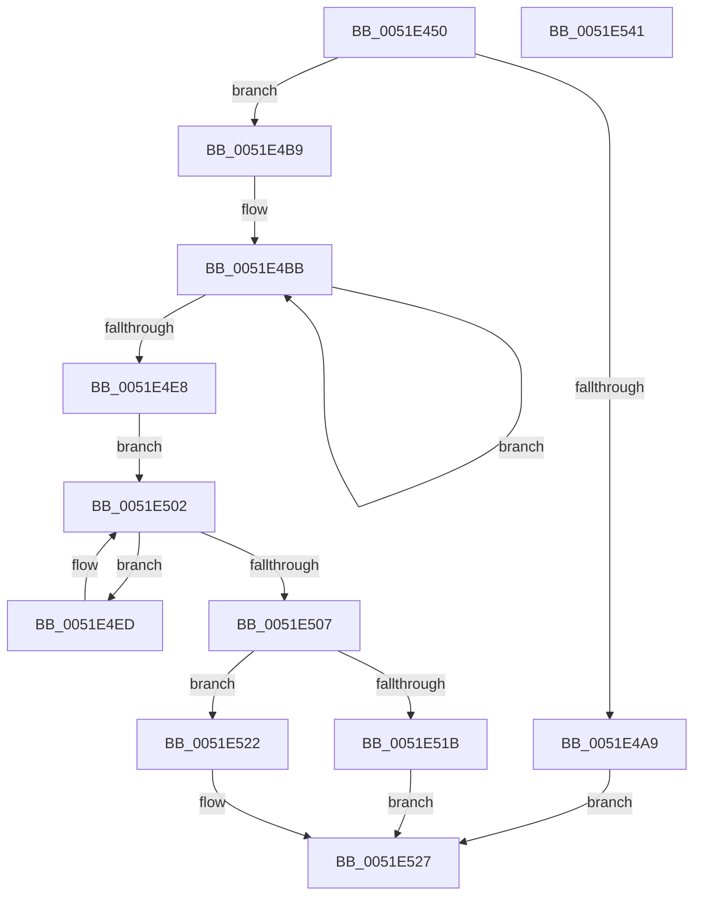

# SymCryptParallelSha256Append

- RVA: `0x0051E450`–`0x0051E542` (길이 `242` bytes)
- VA: `0x000000014051E450`
- 실행 섹션: `.text`
- PDB 이름 있음: `예`; PDB Function 태그: `아니요`
- unwind 정보 RVA: `0x000CD4FC`
- 디코드: `73`개 명령, `242/242` bytes 표시
- 미해석 바이트: `0` (있으면 어셈블리에 `.byte`로 보존)

> 이 문서는 커널 이미지의 기계어와 PDB 기호를 분석해 생성했습니다. 4번과 5번은 함수 원형과 자료형을 바이너리 사용 방식에서 추정한 C 해석이며 원본 소스 복구 결과는 아닙니다.

## 1. Dependencies

- 직접 호출 지점: **6**; 고유 호출 대상: **5**
- 직접 호출자로 확인된 함수: **0**
- RIP 상대 이미지 참조: **1**

### Outgoing calls
- `0x0051E487` → [memset](../6C/memset_function_006C6C40.md) (function, `0x006C6C40`)
- `0x0051E496` → [memset](../6C/memset_function_006C6C40.md) (function, `0x006C6C40`)
- `0x0051E4B2` → [SymCryptParallelSha256AppendBytes_serial](SymCryptParallelSha256AppendBytes_serial_function_0051EEA4.md) (function, `0x0051EEA4`)
- `0x0051E51B` → [SymCryptParallelSha256AppendBlocks_ymm](../52/SymCryptParallelSha256AppendBlocks_ymm_function_00522234.md) (function, `0x00522234`)
- `0x0051E522` → [SymCryptParallelSha256AppendBlocks_xmm](SymCryptParallelSha256AppendBlocks_xmm_function_0051E548.md) (function, `0x0051E548`)
- `0x0051E52E` → [_security_check_cookie](../6A/_security_check_cookie_function_006AC640.md) (function, `0x006AC640`)

### Direct callers
- 이 함수 시작 RVA로 연결되는 직접 call은 확인되지 않았습니다. 간접 호출은 완전히 역산할 수 없습니다.

### Static image references
- `0x0051E463` → RVA `0x00E0A740` (`.data`; read)

## 2. Other-region calls and transfers

- 다른 실행 섹션으로 향하는 call: **0**
- 별도 외부 분기/꼬리 이동을 확인하지 못했습니다.

## 3. Assembly (complete function range)

```asm
0051E450  40 55                           push rbp
0051E452  53                              push rbx
0051E453  56                              push rsi
0051E454  57                              push rdi
0051E455  41 56                           push r14
0051E457  48 8D 6C 24 D1                  lea rbp, [rsp - 0x2f]
0051E45C  48 81 EC B0 00 00 00            sub rsp, 0xb0
0051E463  48 8B 05 D6 C2 8E 00            mov rax, qword ptr [rip + 0x8ec2d6]
0051E46A  48 33 C4                        xor rax, rsp
0051E46D  48 89 45 1F                     mov qword ptr [rbp + 0x1f], rax
0051E471  48 8B FA                        mov rdi, rdx
0051E474  49 8B D8                        mov rbx, r8
0051E477  33 D2                           xor edx, edx
0051E479  48 8B F1                        mov rsi, rcx
0051E47C  48 8D 4D DF                     lea rcx, [rbp - 0x21]
0051E480  4D 8B F1                        mov r14, r9
0051E483  44 8D 42 40                     lea r8d, [rdx + 0x40]
0051E487  E8 B4 87 1A 00                  call 0x1406c6c40
0051E48C  33 D2                           xor edx, edx
0051E48E  48 8D 4D 9F                     lea rcx, [rbp - 0x61]
0051E492  44 8D 42 40                     lea r8d, [rdx + 0x40]
0051E496  E8 A5 87 1A 00                  call 0x1406c6c40
0051E49B  44 8D 4F 03                     lea r9d, [rdi + 3]
0051E49F  41 83 E1 FC                     and r9d, 0xfffffffc
0051E4A3  48 83 FF 02                     cmp rdi, 2
0051E4A7  73 10                           jae 0x14051e4b9
0051E4A9  4C 8B C3                        mov r8, rbx
0051E4AC  48 8B D7                        mov rdx, rdi
0051E4AF  48 8B CE                        mov rcx, rsi
0051E4B2  E8 ED 09 00 00                  call 0x14051eea4
0051E4B7  EB 6E                           jmp 0x14051e527
0051E4B9  33 D2                           xor edx, edx
0051E4BB  48 8B 0C D6                     mov rcx, qword ptr [rsi + rdx*8]
0051E4BF  48 8B 01                        mov rax, qword ptr [rcx]
0051E4C2  48 83 C0 60                     add rax, 0x60
0051E4C6  48 89 44 D5 DF                  mov qword ptr [rbp + rdx*8 - 0x21], rax
0051E4CB  48 8B 41 20                     mov rax, qword ptr [rcx + 0x20]
0051E4CF  48 89 44 D5 9F                  mov qword ptr [rbp + rdx*8 - 0x61], rax
0051E4D4  48 01 59 20                     add qword ptr [rcx + 0x20], rbx
0051E4D8  48 8B 04 D6                     mov rax, qword ptr [rsi + rdx*8]
0051E4DC  48 FF C2                        inc rdx
0051E4DF  48 29 58 28                     sub qword ptr [rax + 0x28], rbx
0051E4E3  48 3B D7                        cmp rdx, rdi
0051E4E6  72 D3                           jb 0x14051e4bb
0051E4E8  41 8B C9                        mov ecx, r9d
0051E4EB  EB 15                           jmp 0x14051e502
0051E4ED  48 8B 45 DF                     mov rax, qword ptr [rbp - 0x21]
0051E4F1  48 89 44 D5 DF                  mov qword ptr [rbp + rdx*8 - 0x21], rax
0051E4F6  48 8B 45 9F                     mov rax, qword ptr [rbp - 0x61]
0051E4FA  48 89 44 D5 9F                  mov qword ptr [rbp + rdx*8 - 0x61], rax
0051E4FF  48 FF C2                        inc rdx
0051E502  48 3B D1                        cmp rdx, rcx
0051E505  72 E6                           jb 0x14051e4ed
0051E507  41 83 F9 08                     cmp r9d, 8
0051E50B  48 8D 55 9F                     lea rdx, [rbp - 0x61]
0051E50F  4D 8B CE                        mov r9, r14
0051E512  48 8D 4D DF                     lea rcx, [rbp - 0x21]
0051E516  4C 8B C3                        mov r8, rbx
0051E519  75 07                           jne 0x14051e522
0051E51B  E8 14 3D 00 00                  call 0x140522234
0051E520  EB 05                           jmp 0x14051e527
0051E522  E8 21 00 00 00                  call 0x14051e548
0051E527  48 8B 4D 1F                     mov rcx, qword ptr [rbp + 0x1f]
0051E52B  48 33 CC                        xor rcx, rsp
0051E52E  E8 0D E1 18 00                  call 0x1406ac640
0051E533  48 81 C4 B0 00 00 00            add rsp, 0xb0
0051E53A  41 5E                           pop r14
0051E53C  5F                              pop rdi
0051E53D  5E                              pop rsi
0051E53E  5B                              pop rbx
0051E53F  5D                              pop rbp
0051E540  C3                              ret
0051E541  CC                              int3
```

## 4. C-style interpretation (structured pseudocode)

```c
__int64 __fastcall SymCryptParallelSha256Append(__int64 a1, __int64 a2, __int64 a3, __int64 a4)
{
    __int64 result;
    __int64 v_rsp;
    unsigned __int64 v_stack_m38;
    unsigned __int64 v_stack_m57;
    unsigned __int64 v_stack_m78;
    unsigned __int64 v_stack_mB8;

    v_rsp = (v_rsp) - (176);
    result = (*(unsigned __int64 *)(v_rip + 9355990)) ^ (v_rsp);
    v_stack_m38 = result;
    a2 = 0;
    result = memset(v_stack_m78, a2, a2 + 64, a4);
    a2 = 0;
    result = memset(v_stack_mB8, a2, a2 + 64, a4);
    a4 = (unsigned int)((a2 + 3) & (0xFFFFFFFCULL));
    if (0 >= 2) goto loc_0051E4B9;
    result = SymCryptParallelSha256AppendBytes_serial(a1, 0, a3, a4);
    goto loc_0051E527;
loc_0051E4B9:
    a2 = 0;
loc_0051E4BB:
    result = (*(unsigned __int64 *)(*(unsigned __int64 *)(a1 + a2 * 8))) + (96);
    *(unsigned __int64 *)(v_stack_m57 + a2 * 8 - 33) = result;
    *(unsigned __int64 *)(v_stack_m57 + a2 * 8 - 97) = *(unsigned __int64 *)(*(unsigned __int64 *)(a1 + a2 * 8) + 32);
    a2 = (a2) + 1;
    if (a2 < a2) goto loc_0051E4BB;
    goto loc_0051E502;
loc_0051E4ED:
    *(unsigned __int64 *)(v_stack_m57 + a2 * 8 - 33) = v_stack_m78;
    *(unsigned __int64 *)(v_stack_m57 + a2 * 8 - 97) = v_stack_mB8;
    a2 = (a2) + 1;
loc_0051E502:
    if (a2 < ((unsigned int)((unsigned int)(a4)))) goto loc_0051E4ED;
    if (((unsigned int)(a4)) != 8) goto loc_0051E522;
    result = SymCryptParallelSha256AppendBlocks_ymm(v_stack_m78, v_stack_mB8, a3, a4);
    goto loc_0051E527;
loc_0051E522:
    result = SymCryptParallelSha256AppendBlocks_xmm(v_stack_m78, v_stack_mB8, a3, a4);
loc_0051E527:
    a1 = (v_stack_m38) ^ (v_rsp);
    result = _security_check_cookie(a1, v_stack_mB8, a3, a4);
    v_rsp = (v_rsp) + (176);
    return result;
}
```

## 5. (Beta) C Style

```c
int64_t SymCryptParallelSha256Append(void *Arg1, void *Arg2, int64_t Arg3, int64_t Arg4)
{
    uint8_t *arg1 = (uint8_t *)Arg1;
    uint8_t *arg2 = (uint8_t *)Arg2;

    int64_t result;
    int64_t local_rsp;
    uint64_t v_stack_m38;
    uint64_t v_stack_m57;
    uint64_t v_stack_m78;
    uint64_t v_stack_mB8;

    local_rsp = (local_rsp) - (176);
    result = (*(uint64_t *)(v_rip + 0x8EC2D6)) ^ (local_rsp);
    v_stack_m38 = result;
    Arg2 = 0;
    result = memset(v_stack_m78, Arg2, Arg2 + 64, Arg4);
    Arg2 = 0;
    result = memset(v_stack_mB8, Arg2, Arg2 + 64, Arg4);
    Arg4 = (uint32_t)((Arg2 + 3) & (0xFFFFFFFCULL));
    if (0 >= 2) goto loc_0051E4B9;
    result = SymCryptParallelSha256AppendBytes_serial(Arg1, 0, Arg3, Arg4);
    goto loc_0051E527;
loc_0051E4B9:
    Arg2 = 0;
loc_0051E4BB:
    result = (*(uint64_t *)(*(uint64_t *)(arg1 + arg2 * 8))) + (96);
    *(uint64_t *)(v_stack_m57 + arg2 * 8 - 0x21) = result;
    *(uint64_t *)(v_stack_m57 + arg2 * 8 - 0x61) = *(uint64_t *)(*(uint64_t *)(arg1 + arg2 * 8) + 0x20);
    Arg2 = (Arg2) + 1;
    if (Arg2 < Arg2) goto loc_0051E4BB;
    goto loc_0051E502;
loc_0051E4ED:
    *(uint64_t *)(v_stack_m57 + arg2 * 8 - 0x21) = v_stack_m78;
    *(uint64_t *)(v_stack_m57 + arg2 * 8 - 0x61) = v_stack_mB8;
    Arg2 = (Arg2) + 1;
loc_0051E502:
    if (Arg2 < ((uint32_t)((uint32_t)(Arg4)))) goto loc_0051E4ED;
    if (((uint32_t)(Arg4)) != 8) goto loc_0051E522;
    result = SymCryptParallelSha256AppendBlocks_ymm(v_stack_m78, v_stack_mB8, Arg3, Arg4);
    goto loc_0051E527;
loc_0051E522:
    result = SymCryptParallelSha256AppendBlocks_xmm(v_stack_m78, v_stack_mB8, Arg3, Arg4);
loc_0051E527:
    Arg1 = (v_stack_m38) ^ (local_rsp);
    result = _security_check_cookie(Arg1, v_stack_mB8, Arg3, Arg4);
    local_rsp = (local_rsp) + (176);
    return result;
}
```

### 관측된 메모리 오프셋

구조체 형식이 확인되지 않은 접근은 인자 기준의 오프셋으로만 기록했습니다.

| 기준 인자 | 오프셋 표현 | 폭 (bit) | 접근 |
|---|---:|---:|---|
| `Arg1` | `+ 0x0 + rdx*8` | `64` | `R` |
| `Arg2` | `+ 0x3` | `32` | `R` |

## 6. Execution-region graph

[열기: 2D/3D 그래프와 함수 탐색 컨트롤 패널](../../../control-panel.html?section=text&rva=0x0051E450&view=graph)

- 2D 그래프는 위에서 아래로 흐르고, 3D 그래프는 빈 공간을 드래그해 회전합니다. Shift+드래그는 이동, 휠은 확대·축소, 함수 노드 선택은 대상 보고서 이동입니다.

### Static fallback


