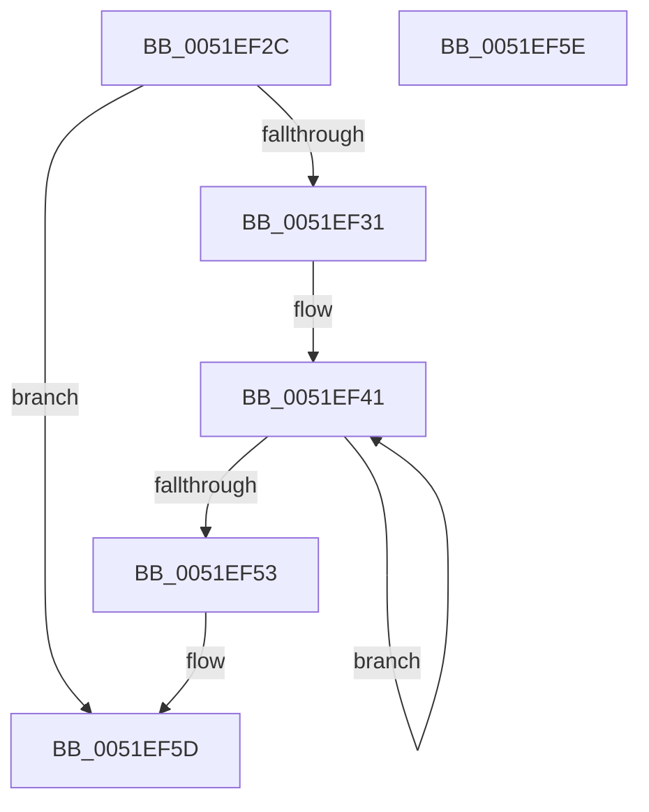

# SymCryptParallelSha256Init

- RVA: `0x0051EF2C`–`0x0051EF5F` (길이 `51` bytes)
- VA: `0x000000014051EF2C`
- 실행 섹션: `.text`
- PDB 이름 있음: `예`; PDB Function 태그: `아니요`
- unwind 정보 RVA: `0x00084918`
- 디코드: `17`개 명령, `51/51` bytes 표시
- 미해석 바이트: `0` (있으면 어셈블리에 `.byte`로 보존)

> 이 문서는 커널 이미지의 기계어와 PDB 기호를 분석해 생성했습니다. 4번과 5번은 함수 원형과 자료형을 바이너리 사용 방식에서 추정한 C 해석이며 원본 소스 복구 결과는 아닙니다.

## 1. Dependencies

- 직접 호출 지점: **1**; 고유 호출 대상: **1**
- 직접 호출자로 확인된 함수: **1**
- RIP 상대 이미지 참조: **0**

### Outgoing calls
- `0x0051EF44` → [SymCryptSha256Init](SymCryptSha256Init_function_0051E2C0.md) (function, `0x0051E2C0`)

### Direct callers
- [KeComputeParallelSha256](../5B/KeComputeParallelSha256_function_005B16A0.md) at `0x005B16C3`

### Static image references
- 디코드된 RIP-relative 메모리 참조가 없습니다.

## 2. Other-region calls and transfers

- 다른 실행 섹션으로 향하는 call: **0**
- 별도 외부 분기/꼬리 이동을 확인하지 못했습니다.

## 3. Assembly (complete function range)

```asm
0051EF2C  48 85 D2                        test rdx, rdx
0051EF2F  74 2C                           je 0x14051ef5d
0051EF31  48 89 5C 24 08                  mov qword ptr [rsp + 8], rbx
0051EF36  57                              push rdi
0051EF37  48 83 EC 20                     sub rsp, 0x20
0051EF3B  48 8B FA                        mov rdi, rdx
0051EF3E  48 8B D9                        mov rbx, rcx
0051EF41  48 8B CB                        mov rcx, rbx
0051EF44  E8 77 F3 FF FF                  call 0x14051e2c0
0051EF49  48 83 EB 80                     sub rbx, -0x80
0051EF4D  48 83 EF 01                     sub rdi, 1
0051EF51  75 EE                           jne 0x14051ef41
0051EF53  48 8B 5C 24 30                  mov rbx, qword ptr [rsp + 0x30]
0051EF58  48 83 C4 20                     add rsp, 0x20
0051EF5C  5F                              pop rdi
0051EF5D  C3                              ret
0051EF5E  CC                              int3
```

## 4. C-style interpretation (structured pseudocode)

```c
__int64 __fastcall SymCryptParallelSha256Init(__int64 a1, __int64 a2)
{
    __int64 result;
    __int64 v_rbx;
    __int64 v_rdi;
    __int64 v_rsp;
    unsigned __int64 v_stack_p8;

    if (a2 == 0) goto loc_0051EF5D;
    v_stack_p8 = v_rbx;
    v_rsp = (v_rsp) - (32);
loc_0051EF41:
    result = SymCryptSha256Init(a1, a2, a3, a4);
    v_rbx = (a1) - (-128);
    v_rdi = (a2) - (1);
    if (condition_is_not_equal) goto loc_0051EF41;
    v_rsp = (v_rsp) + (32);
loc_0051EF5D:
    return result;
}
```

## 5. (Beta) C Style

```c
int64_t SymCryptParallelSha256Init(int64_t Arg1, int64_t Arg2)
{
    int64_t result;
    int64_t local_rbx;
    int64_t local_rdi;
    int64_t local_rsp;
    uint64_t v_stack_p8;

    if (Arg2 == 0) goto loc_0051EF5D;
    v_stack_p8 = local_rbx;
    local_rsp = (local_rsp) - (32);
loc_0051EF41:
    result = SymCryptSha256Init(Arg1, Arg2, a3, a4);
    local_rbx = (Arg1) - (-128);
    local_rdi = (Arg2) - (1);
    if (condition_is_not_equal) goto loc_0051EF41;
    local_rsp = (local_rsp) + (32);
loc_0051EF5D:
    return result;
}
```

## 6. Execution-region graph

[열기: 2D/3D 그래프와 함수 탐색 컨트롤 패널](../../../control-panel.html?section=text&rva=0x0051EF2C&view=graph)

- 2D 그래프는 위에서 아래로 흐르고, 3D 그래프는 빈 공간을 드래그해 회전합니다. Shift+드래그는 이동, 휠은 확대·축소, 함수 노드 선택은 대상 보고서 이동입니다.

### Static fallback


