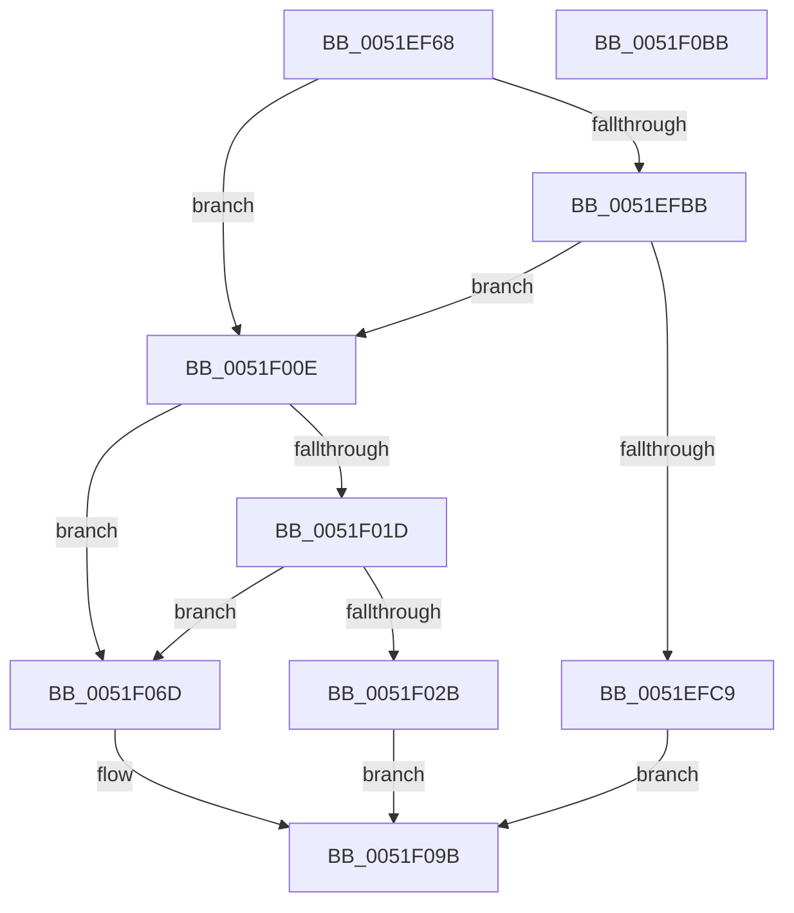

# SymCryptParallelSha256Process

- RVA: `0x0051EF68`–`0x0051F0BC` (길이 `340` bytes)
- VA: `0x000000014051EF68`
- 실행 섹션: `.text`
- PDB 이름 있음: `예`; PDB Function 태그: `아니요`
- unwind 정보 RVA: `0x000C30E4`
- 디코드: `84`개 명령, `340/340` bytes 표시
- 미해석 바이트: `0` (있으면 어셈블리에 `.byte`로 보존)

> 이 문서는 커널 이미지의 기계어와 PDB 기호를 분석해 생성했습니다. 4번과 5번은 함수 원형과 자료형을 바이너리 사용 방식에서 추정한 C 해석이며 원본 소스 복구 결과는 아닙니다.

## 1. Dependencies

- 직접 호출 지점: **11**; 고유 호출 대상: **9**
- 직접 호출자로 확인된 함수: **1**
- RIP 상대 이미지 참조: **3**

### Outgoing calls
- `0x0051EFA7` → [memset](../6C/memset_function_006C6C40.md) (function, `0x006C6C40`)
- `0x0051EFAC` → [SymCryptCpuFeaturesNeverPresent](../49/SymCryptCpuFeaturesNeverPresent_function_00498CB0.md) (function, `0x00498CB0`)
- `0x0051EFC0` → [SymCryptSaveYmm](../5B/SymCryptSaveYmm_function_005B252C.md) (function, `0x005B252C`)
- `0x0051EFF8` → [SymCryptParallelHashProcess](../52/SymCryptParallelHashProcess_function_00521BF4.md) (function, `0x00521BF4`)
- `0x0051F004` → [SymCryptRestoreYmm](../5B/SymCryptRestoreYmm_function_005B2514.md) (function, `0x005B2514`)
- `0x0051F00E` → [SymCryptCpuFeaturesNeverPresent](../49/SymCryptCpuFeaturesNeverPresent_function_00498CB0.md) (function, `0x00498CB0`)
- `0x0051F022` → [SymCryptSaveXmm](../49/SymCryptSaveXmm_function_004990EC.md) (function, `0x004990EC`)
- `0x0051F05A` → [SymCryptParallelHashProcess](../52/SymCryptParallelHashProcess_function_00521BF4.md) (function, `0x00521BF4`)
- `0x0051F066` → [SymCryptInjectError](../4A/SymCryptInjectError_function_004A4FCC.md) (function, `0x004A4FCC`)
- `0x0051F094` → [SymCryptParallelHashProcess_serial](../52/SymCryptParallelHashProcess_serial_function_00521EB8.md) (function, `0x00521EB8`)
- `0x0051F0A8` → [_security_check_cookie](../6A/_security_check_cookie_function_006AC640.md) (function, `0x006AC640`)

### Direct callers
- [KeComputeParallelSha256](../5B/KeComputeParallelSha256_function_005B16A0.md) at `0x005B1742`

### Static image references
- `0x0051EF76` → RVA `0x00E0A740` (`.data`; read)
- `0x0051EFB1` → RVA `0x00E0A730` (`.data`; read)
- `0x0051EFD1` → RVA `0x00006700` (`.rdata`; read)

## 2. Other-region calls and transfers

- 다른 실행 섹션으로 향하는 call: **0**
- 별도 외부 분기/꼬리 이동을 확인하지 못했습니다.

## 3. Assembly (complete function range)

```asm
0051EF68  40 53                           push rbx
0051EF6A  55                              push rbp
0051EF6B  56                              push rsi
0051EF6C  57                              push rdi
0051EF6D  41 56                           push r14
0051EF6F  48 81 EC 90 00 00 00            sub rsp, 0x90
0051EF76  48 8B 05 C3 B7 8E 00            mov rax, qword ptr [rip + 0x8eb7c3]
0051EF7D  48 33 C4                        xor rax, rsp
0051EF80  48 89 84 24 80 00 00 00         mov qword ptr [rsp + 0x80], rax
0051EF88  4C 8B B4 24 E0 00 00 00         mov r14, qword ptr [rsp + 0xe0]
0051EF90  48 8B FA                        mov rdi, rdx
0051EF93  33 D2                           xor edx, edx
0051EF95  49 8B F0                        mov rsi, r8
0051EF98  48 8B D9                        mov rbx, rcx
0051EF9B  49 8B E9                        mov rbp, r9
0051EF9E  48 8D 4C 24 40                  lea rcx, [rsp + 0x40]
0051EFA3  44 8D 42 40                     lea r8d, [rdx + 0x40]
0051EFA7  E8 94 7C 1A 00                  call 0x1406c6c40
0051EFAC  E8 FF 9C F7 FF                  call 0x140498cb0
0051EFB1  0B 05 79 B7 8E 00               or eax, dword ptr [rip + 0x8eb779]
0051EFB7  A8 10                           test al, 0x10
0051EFB9  75 53                           jne 0x14051f00e
0051EFBB  48 8D 4C 24 40                  lea rcx, [rsp + 0x40]
0051EFC0  E8 67 35 09 00                  call 0x1405b252c
0051EFC5  85 C0                           test eax, eax
0051EFC7  75 45                           jne 0x14051f00e
0051EFC9  48 8B 84 24 E8 00 00 00         mov rax, qword ptr [rsp + 0xe8]
0051EFD1  48 8D 0D 28 77 AE FF            lea rcx, [rip - 0x5188d8]
0051EFD8  C7 44 24 38 08 00 00 00         mov dword ptr [rsp + 0x38], 8
0051EFE0  4C 8B CE                        mov r9, rsi
0051EFE3  48 89 44 24 30                  mov qword ptr [rsp + 0x30], rax
0051EFE8  4C 8B C7                        mov r8, rdi
0051EFEB  4C 89 74 24 28                  mov qword ptr [rsp + 0x28], r14
0051EFF0  48 8B D3                        mov rdx, rbx
0051EFF3  48 89 6C 24 20                  mov qword ptr [rsp + 0x20], rbp
0051EFF8  E8 F7 2B 00 00                  call 0x140521bf4
0051EFFD  48 8D 4C 24 40                  lea rcx, [rsp + 0x40]
0051F002  8B D8                           mov ebx, eax
0051F004  E8 0B 35 09 00                  call 0x1405b2514
0051F009  E9 8D 00 00 00                  jmp 0x14051f09b
0051F00E  E8 9D 9C F7 FF                  call 0x140498cb0
0051F013  0B 05 17 B7 8E 00               or eax, dword ptr [rip + 0x8eb717]
0051F019  A8 02                           test al, 2
0051F01B  75 50                           jne 0x14051f06d
0051F01D  48 8D 4C 24 40                  lea rcx, [rsp + 0x40]
0051F022  E8 C5 A0 F7 FF                  call 0x1404990ec
0051F027  85 C0                           test eax, eax
0051F029  75 42                           jne 0x14051f06d
0051F02B  48 8B 84 24 E8 00 00 00         mov rax, qword ptr [rsp + 0xe8]
0051F033  48 8D 0D C6 76 AE FF            lea rcx, [rip - 0x51893a]
0051F03A  C7 44 24 38 04 00 00 00         mov dword ptr [rsp + 0x38], 4
0051F042  4C 8B CE                        mov r9, rsi
0051F045  48 89 44 24 30                  mov qword ptr [rsp + 0x30], rax
0051F04A  4C 8B C7                        mov r8, rdi
0051F04D  4C 89 74 24 28                  mov qword ptr [rsp + 0x28], r14
0051F052  48 8B D3                        mov rdx, rbx
0051F055  48 89 6C 24 20                  mov qword ptr [rsp + 0x20], rbp
0051F05A  E8 95 2B 00 00                  call 0x140521bf4
0051F05F  48 8D 4C 24 40                  lea rcx, [rsp + 0x40]
0051F064  8B D8                           mov ebx, eax
0051F066  E8 61 5F F8 FF                  call 0x1404a4fcc
0051F06B  EB 2E                           jmp 0x14051f09b
0051F06D  48 8B 84 24 E8 00 00 00         mov rax, qword ptr [rsp + 0xe8]
0051F075  48 8D 0D 84 76 AE FF            lea rcx, [rip - 0x51897c]
0051F07C  48 89 44 24 30                  mov qword ptr [rsp + 0x30], rax
0051F081  4C 8B CE                        mov r9, rsi
0051F084  4C 89 74 24 28                  mov qword ptr [rsp + 0x28], r14
0051F089  4C 8B C7                        mov r8, rdi
0051F08C  48 8B D3                        mov rdx, rbx
0051F08F  48 89 6C 24 20                  mov qword ptr [rsp + 0x20], rbp
0051F094  E8 1F 2E 00 00                  call 0x140521eb8
0051F099  8B D8                           mov ebx, eax
0051F09B  8B C3                           mov eax, ebx
0051F09D  48 8B 8C 24 80 00 00 00         mov rcx, qword ptr [rsp + 0x80]
0051F0A5  48 33 CC                        xor rcx, rsp
0051F0A8  E8 93 D5 18 00                  call 0x1406ac640
0051F0AD  48 81 C4 90 00 00 00            add rsp, 0x90
0051F0B4  41 5E                           pop r14
0051F0B6  5F                              pop rdi
0051F0B7  5E                              pop rsi
0051F0B8  5D                              pop rbp
0051F0B9  5B                              pop rbx
0051F0BA  C3                              ret
0051F0BB  CC                              int3
```

## 4. C-style interpretation (structured pseudocode)

```c
__int64 __fastcall SymCryptParallelSha256Process(__int64 a1, __int64 a2, __int64 a3, __int64 a4, __int64 a5, __int64 a6)
{
    __int64 result;
    __int64 v_rsp;
    unsigned __int64 v_stack_m38;
    unsigned __int64 v_stack_m78;
    unsigned int v_stack_m80;
    unsigned __int64 v_stack_m88;
    unsigned __int64 v_stack_m90;
    unsigned __int64 v_stack_m98;

    v_rsp = (v_rsp) - (144);
    result = (*(unsigned __int64 *)(v_rip + 9353155)) ^ (v_rsp);
    v_stack_m38 = result;
    a2 = 0;
    result = memset(v_stack_m78, a2, a2 + 64, a4);
    result = SymCryptCpuFeaturesNeverPresent(v_stack_m78, a2, a2 + 64, a4);
    result = (unsigned int)((result) | (*(unsigned int *)(v_rip + 9353081)));
    if ((((unsigned __int8)(result)) & (16)) != 0) goto loc_0051F00E;
    result = SymCryptSaveYmm(v_stack_m78, a2, a2 + 64, a4);
    if ((unsigned int)(result) != 0) goto loc_0051F00E;
    v_stack_m80 = 8;
    v_stack_m88 = a6;
    v_stack_m90 = a5;
    v_stack_m98 = a4;
    result = SymCryptParallelHashProcess(v_rip - 5343448, a1, 0, a3);
    result = SymCryptRestoreYmm(v_stack_m78, a1, 0, a3);
    goto loc_0051F09B;
loc_0051F00E:
    result = SymCryptCpuFeaturesNeverPresent(v_stack_m78, a1, 0, a3);
    result = (unsigned int)((result) | (*(unsigned int *)(v_rip + 9352983)));
    if ((((unsigned __int8)(result)) & (2)) != 0) goto loc_0051F06D;
    result = SymCryptSaveXmm(v_stack_m78, a1, 0, a3);
    if ((unsigned int)(result) != 0) goto loc_0051F06D;
    v_stack_m80 = 4;
    v_stack_m88 = a6;
    v_stack_m90 = a5;
    v_stack_m98 = a4;
    result = SymCryptParallelHashProcess(v_rip - 5343546, (unsigned int)((unsigned int)(result)), 0, a3);
    result = SymCryptInjectError(v_stack_m78, (unsigned int)((unsigned int)(result)), 0, a3);
    goto loc_0051F09B;
loc_0051F06D:
    v_stack_m88 = a6;
    v_stack_m90 = a5;
    v_stack_m98 = a4;
    result = SymCryptParallelHashProcess_serial(v_rip - 5343612, (unsigned int)((unsigned int)(result)), 0, a3);
loc_0051F09B:
    a1 = (v_stack_m38) ^ (v_rsp);
    result = _security_check_cookie(a1, (unsigned int)((unsigned int)(result)), 0, a3);
    v_rsp = (v_rsp) + (144);
    return result;
}
```

## 5. (Beta) C Style

```c
int64_t SymCryptParallelSha256Process(int64_t Arg1, int64_t Arg2, int64_t Arg3, int64_t Arg4, int64_t Arg5, int64_t Arg6)
{
    int64_t result;
    int64_t local_rsp;
    uint64_t v_stack_m38;
    uint64_t v_stack_m78;
    uint32_t v_stack_m80;
    uint64_t v_stack_m88;
    uint64_t v_stack_m90;
    uint64_t v_stack_m98;

    local_rsp = (local_rsp) - (144);
    result = (*(uint64_t *)(v_rip + 0x8EB7C3)) ^ (local_rsp);
    v_stack_m38 = result;
    Arg2 = 0;
    result = memset(v_stack_m78, Arg2, Arg2 + 64, Arg4);
    result = SymCryptCpuFeaturesNeverPresent(v_stack_m78, Arg2, Arg2 + 64, Arg4);
    result = (uint32_t)((result) | (*(uint32_t *)(v_rip + 0x8EB779)));
    if ((((uint8_t)(result)) & (16)) != 0) goto loc_0051F00E;
    result = SymCryptSaveYmm(v_stack_m78, Arg2, Arg2 + 64, Arg4);
    if ((uint32_t)(result) != 0) goto loc_0051F00E;
    v_stack_m80 = 8;
    v_stack_m88 = Arg6;
    v_stack_m90 = Arg5;
    v_stack_m98 = Arg4;
    result = SymCryptParallelHashProcess(v_rip - 5343448, Arg1, 0, Arg3);
    result = SymCryptRestoreYmm(v_stack_m78, Arg1, 0, Arg3);
    goto loc_0051F09B;
loc_0051F00E:
    result = SymCryptCpuFeaturesNeverPresent(v_stack_m78, Arg1, 0, Arg3);
    result = (uint32_t)((result) | (*(uint32_t *)(v_rip + 0x8EB717)));
    if ((((uint8_t)(result)) & (2)) != 0) goto loc_0051F06D;
    result = SymCryptSaveXmm(v_stack_m78, Arg1, 0, Arg3);
    if ((uint32_t)(result) != 0) goto loc_0051F06D;
    v_stack_m80 = 4;
    v_stack_m88 = Arg6;
    v_stack_m90 = Arg5;
    v_stack_m98 = Arg4;
    result = SymCryptParallelHashProcess(v_rip - 5343546, (uint32_t)((uint32_t)(result)), 0, Arg3);
    result = SymCryptInjectError(v_stack_m78, (uint32_t)((uint32_t)(result)), 0, Arg3);
    goto loc_0051F09B;
loc_0051F06D:
    v_stack_m88 = Arg6;
    v_stack_m90 = Arg5;
    v_stack_m98 = Arg4;
    result = SymCryptParallelHashProcess_serial(v_rip - 5343612, (uint32_t)((uint32_t)(result)), 0, Arg3);
loc_0051F09B:
    Arg1 = (v_stack_m38) ^ (local_rsp);
    result = _security_check_cookie(Arg1, (uint32_t)((uint32_t)(result)), 0, Arg3);
    local_rsp = (local_rsp) + (144);
    return result;
}
```

## 6. Execution-region graph

[열기: 2D/3D 그래프와 함수 탐색 컨트롤 패널](../../../control-panel.html?section=text&rva=0x0051EF68&view=graph)

- 2D 그래프는 위에서 아래로 흐르고, 3D 그래프는 빈 공간을 드래그해 회전합니다. Shift+드래그는 이동, 휠은 확대·축소, 함수 노드 선택은 대상 보고서 이동입니다.

### Static fallback


